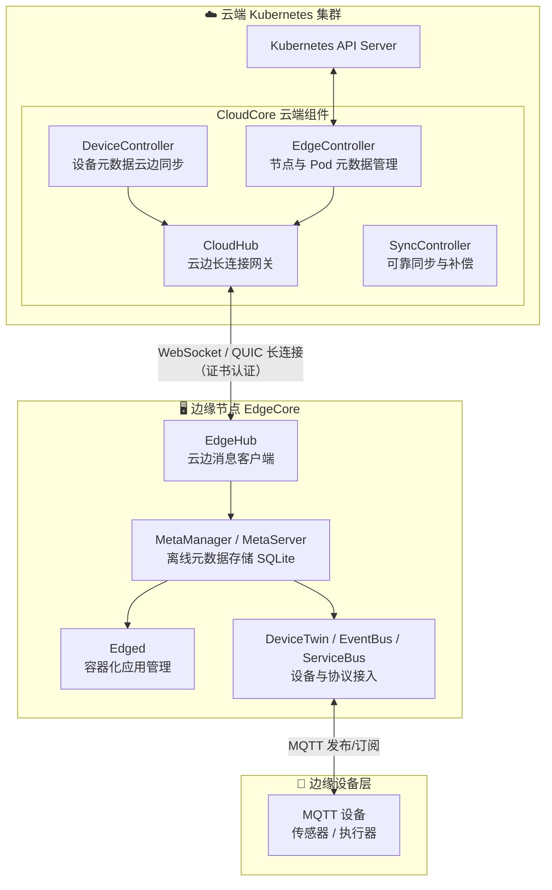

本页是整个知识库的入口，面向初次接触 KubeEdge 的开发者。我们将回答三个根本问题：KubeEdge 是什么、它解决什么问题、以及这个代码仓库是如何组织的。读完本页后，你将建立起对 KubeEdge 云边协同架构的整体认知，并知道下一步应该深入哪些内容。本页所有结论均来自仓库源码与官方 README 的直接验证，不含任何推测。

## 一句话定位：Kubernetes 的边缘延伸

KubeEdge 是一个基于 Kubernetes 构建的开源系统，它把云原生的容器化应用编排能力和设备管理能力，从数据中心延伸到边缘侧的主机之上。它由**云端（cloud part）和边缘端（edge part）**两部分组成，为云边之间的网络通信、应用部署和元数据同步提供核心基础设施支持，同时支持 **MQTT** 协议，使边缘设备可以通过边缘节点接入系统。

Sources: [README.md](README.md#L11-L13), [README_zh.md](README_zh.md#L11-L11)

从业务价值角度看，KubeEdge 让开发者可以轻松地把已有的复杂机器学习、图像识别、事件处理等高级应用部署到边缘运行。当业务逻辑下沉到边缘后，海量数据可以在**数据产生的地方就地处理**——这带来了两个直接收益：响应速度显著提升，以及数据隐私得到更好保护。这一"数据不出场"的设计哲学，正是边缘计算区别于传统集中式云计算的核心差异点。

Sources: [README.md](README.md#L15-L17)

在社区成熟度方面，KubeEdge 已于 2024 年 10 月正式从 CNCF（云原生计算基金会）**毕业**，成为毕业级托管项目。毕业是 CNCF 项目成熟度的最高等级，意味着项目在生产环境经过充分验证、拥有健康的治理结构和多样化的维护者社区。项目采用 Apache 2.0 许可证，可放心用于商业场景。

Sources: [README.md](README.md#L19-L19), [README.md](README.md#L130-L132)

## 五大核心价值：为什么选择 KubeEdge

官方 README 明确列出了 KubeEdge 的五项优势。对于初学者，理解这些优势背后"解决了什么痛点"比记住名词更重要——下表将每项优势与它对应的边缘计算现实难题做了映射：

| 核心优势 | 解决的现实难题 | 关键机制 |
|---------|--------------|---------|
| **Kubernetes 原生支持** | 学习成本高：边缘场景被迫引入全新工具链 | 完全兼容 Kubernetes API，用 `kubectl` 像管理云端一样管理边缘应用与设备 |
| **云边可靠协作** | 边缘网络不稳定，消息丢失导致云边状态不一致 | 可靠消息传递机制，保证弱网环境下消息不丢失 |
| **边缘自治** | 断网后边缘业务停摆 | 云边网络中断或边缘离线重启时，边缘节点与应用仍可自主运行 |
| **边缘设备管理** | IoT 设备接入缺少统一管理界面 | 通过 Kubernetes 原生 API 与 CRD（自定义资源）管理边缘设备 |
| **极致轻量边缘代理** | 边缘硬件资源受限，跑不动重量级组件 | 轻量级边缘代理 EdgeCore，专为资源受限环境设计 |

Sources: [README_zh.md](README_zh.md#L20-L30), [README.md](README.md#L21-L28)

其中"**边缘自治**"与"**云边可靠协作**"这两项，是 KubeEdge 相对于"直接把 Kubelet 装到边缘节点"方案的差异化所在。边缘节点往往通过不稳定网络（如 4G/5G、专线）连接云端，任何基于"实时在线"假设的架构在这种环境下都会失效——KubeEdge 的整套设计正是围绕这一约束展开的。

Sources: [README_zh.md](README_zh.md#L26-L26)

## 架构总览：云端与边缘端的双层设计

在阅读架构图之前，先建立一个前置认知：KubeEdge 的架构可以概括为**三层**——最上层是原有的 Kubernetes 云端集群，中间是运行在边缘节点上的 EdgeCore 代理，最下层是通过 MQTT 等协议接入的边缘设备。云端与边缘之间只维持**一条长连接**作为消息通道，所有云边交互都经由它完成。

Sources: [README.md](README.md#L30-L38)



图中的消息流向遵循一个清晰的原则：云端控制器（EdgeController、DeviceController）监听 Kubernetes API Server 的变更，将变更内容经 CloudHub 下发；边缘侧 EdgeHub 接收后交给 MetaManager，由 MetaManager 写入本地轻量级数据库 SQLite——正是这份本地元数据副本，支撑了断网情况下的边缘自治能力。

Sources: [README.md](README.md#L40-L43), [README_zh.md](README_zh.md#L48-L53)

### 云端组件速查

| 组件 | 职责 | 源码位置 |
|------|------|---------|
| CloudHub | WebSocket 服务端，监听云端变化，缓存并向 EdgeHub 发送消息 | `cloud/pkg/cloudhub` |
| EdgeController | 扩展的 Kubernetes 控制器，管理边缘节点与 Pod 元数据，将数据定向投递到指定边缘节点 | `cloud/pkg/edgecontroller` |
| DeviceController | 扩展的 Kubernetes 控制器，实现设备元数据/状态的云边同步 | `cloud/pkg/devicecontroller` |
| SyncController | 可靠同步的补偿机制 | `cloud/pkg/synccontroller` |

Sources: [README.md](README.md#L40-L43), [cloud/README.md](cloud/README.md#L5-L9)

CloudHub 的工作方式值得一提：EdgeController 并不是让每个边缘节点反复轮询 API Server，而是预先把"某个节点上应该运行哪些 Pod"这类绑定信息整理成按节点组织的数据。这种设计**提升了下发效率，并显著降低了云边之间对网络带宽的要求**——这正是为弱网环境所做的适配。

Sources: [cloud/README.md](cloud/README.md#L5-L9)

### 边缘组件速查

| 组件 | 职责 | 源码位置 |
|------|------|---------|
| EdgeHub | WebSocket 客户端，负责与云端服务交互：同步云端资源更新、上报边缘主机与设备状态 | `edge/pkg/edgehub` |
| Edged | 运行在边缘节点上的代理，管理容器化应用（类似轻量版 kubelet） | `edge/pkg/edged` |
| MetaManager | 位于 Edged 与 EdgeHub 之间的消息处理器，负责向 SQLite 存储/检索元数据 | `edge/pkg/metamanager` |
| DeviceTwin | 存储设备状态并同步到云端，为应用提供设备状态查询接口 | `edge/pkg/devicetwin` |
| EventBus | MQTT 客户端，与 MQTT 服务器交互，为其他组件提供发布/订阅能力 | `edge/pkg/eventbus` |
| ServiceBus | 边缘 HTTP 客户端，让云端服务能通过 HTTP 访问边缘侧 HTTP 服务 | `edge/pkg/servicebus` |

Sources: [edge/README.md](edge/README.md#L5-L12), [README.md](README.md#L46-L52)

上述六大组件共同构成一个名为 **EdgeCore** 的单体进程，它们以模块化的方式组织在 `edge/pkg` 目录下的 8 个包中（common、devicetwin、edged、edgehub、edgestream、eventbus、metamanager、servicebus、taskmanager）。云端同样如此，`cloud/pkg` 下包含 cloudhub、edgecontroller、devicecontroller、synccontroller 等 14 个模块包。

Sources: [edge/README.md](edge/README.md#L5-L12)

## 代码仓库地图：本仓库如何组织

初学者打开仓库时最需要的，是一份"目录 → 用途"的对照表。以下结构已逐一验证，覆盖了仓库的全部核心内容：

```text
kubeedge/
├── cloud/          # ☁️ 云端组件源码（cloudcore 及其子模块）
├── edge/           # 🖥️ 边缘组件源码（edgecore 及其子模块）
├── keadm/          # 🔧 一键部署工具 keadm 的源码
├── edgesite/       # 🏝️ 边缘独立集群（edgesite-server / edgesite-agent）
├── edgemesh/       # 🕸️ 边缘服务发现与通信（已移至独立仓库）
├── mappers/        # 📟 设备映射器（已移至 mappers-go 独立仓库）
├── pkg/            # 📦 云边共享的通用库（stream 隧道、metaserver、安全等）
├── common/         # 📐 云边共享的常量与类型定义
├── manifests/      # 📋 Helm Charts（cloudcore、edgemesh）等部署清单
├── staging/        # 🧩 以独立模块发布的组件：api、beehive、mapper-framework
├── tests/          # 🧪 端到端与集成测试
├── build/          # 🐳 各组件的 Dockerfile 与 K8s 部署 YAML
├── hack/           # ⚙️ 构建与代码生成脚本
└── docs/           # 📚 架构图与设计提案（proposals）
```

Sources: [mappers/README.md](mappers/README.md#L1-L3), [edgesite/README.md](edgesite/README.md#L2-L4)

`staging` 目录值得特别解释——它包含了三个以独立 Go 模块形式发布的仓库，通过 Go workspace（`go.work`）与主仓库联合开发：**api**（API 类型与 CRD 定义）、**beehive**（模块间消息通信框架）和 **mapper-framework**（设备映射器开发框架）。初学者在后续阅读组件源码时会频繁遇到 `beehive` 的消息收发 API，它是理解 KubeEdge 模块化架构的钥匙。

Sources: [go.work](go.work#L1-L9), [go.mod](go.mod#L21-L22)

## 技术底座：从依赖看清设计选择

阅读 `go.mod` 的关键依赖，可以快速验证前文提到的多项架构特性：

| 依赖库 | 版本 | 印证的设计决策 |
|--------|------|--------------|
| `gorilla/websocket` | v1.5.0 | 云边长连接采用 WebSocket 协议（CloudHub ↔ EdgeHub） |
| `eclipse/paho.mqtt.golang` | v1.2.0 | 边缘设备通过 MQTT 协议接入（EventBus） |
| `mattn/go-sqlite3` | v1.14.22 | 边缘侧使用轻量级 SQLite 存储元数据，支撑离线自治 |
| `k8s.io/*` 系列依赖 | — | 深度复用 Kubernetes 官方库，保证 API 原生兼容 |

Sources: [go.mod](go.mod#L12-L24)

本仓库主模块为 `github.com/kubeedge/kubeedge`，使用 Go 1.23 开发。此外，源码中还固化了一些对初学者有用的默认值：MetaServer 本地 API Server 默认监听 `127.0.0.1:10550`，EdgeCore 节点服务默认端口为 `10350`，边缘节点会自动打上 `node-role.kubernetes.io/edge` 角色标签——记住这个标签，后续你将用它来区分边缘节点与普通云端节点。

Sources: [go.mod](go.mod#L1-L3), [common/constants/default.go](common/constants/default.go#L39-L39), [common/constants/default.go](common/constants/default.go#L69-L77)

## 版本兼容性速查

KubeEdge 与 Kubernetes 版本存在明确的兼容矩阵。下表为当前版本的兼容情况（`✓` 表示完全兼容，`+` 表示 KubeEdge 具有对应 Kubernetes 版本中不存在的特性，`-` 表示不可用）：

| | K8s 1.27 | K8s 1.28 | K8s 1.29 | K8s 1.30 | K8s 1.31 | K8s 1.32 |
|---|---|---|---|---|---|---|
| **KubeEdge 1.19** | ✓ | ✓ | ✓ | - | - | - |
| **KubeEdge 1.20** | + | ✓ | ✓ | ✓ | - | - |
| **KubeEdge 1.21** | + | ✓ | ✓ | ✓ | - | - |
| **KubeEdge 1.22** | + | + | ✓ | ✓ | ✓ | - |
| **KubeEdge 1.23** | + | + | + | ✓ | ✓ | ✓ |
| **master** | + | + | + | ✓ | ✓ | ✓ |

部署前务必按此矩阵选择版本组合，源码中当前支持的 Kubernetes 版本为 `v1.32.10`。

Sources: [README.md](README.md#L54-L68), [common/constants/default.go](common/constants/default.go#L36-L36)

## 建议的学习路径

基于知识库的目录结构，为初学者规划一条循序渐进的阅读路线：

1. **动手优先**：先阅读 [快速开始：搭建首个云边协同环境](2-kuai-su-kai-shi-da-jian-shou-ge-yun-bian-xie-tong-huan-jing)，用最小成本跑通一个云边集群，建立直观体感；
2. **理解部署**：实践中会用到部署工具，可参考 [keadm 一键部署与 Helm Charts 安装配置](4-keadm-jian-bu-shu-yu-helm-charts-an-zhuang-pei-zhi) 深入了解 keadm 的用法；
3. **架构全景**：回到 [云边协同总体架构：云端与边缘组件全景](7-yun-bian-xie-tong-zong-ti-jia-gou-yun-duan-yu-bian-yuan-zu-jian-quan-jing)，系统性地理解每个组件在消息流转中的位置；
4. **按需深入**：云端组件从 [CloudHub：云边长连接网关与消息分发](8-cloudhub-yun-bian-chang-lian-jie-wang-guan-yu-xiao-xi-fen-fa) 开始，边缘组件从 [EdgeCore：模块化边缘核心与启动生命周期](15-edgecore-mo-kuai-hua-bian-yuan-he-xin-yu-qi-dong-sheng-ming-zhou-qi) 开始；
5. **专项主题**：对边缘自治与可靠消息感兴趣，可进入 [可靠消息传递与边缘自治机制](27-ke-kao-xiao-xi-chuan-di-yu-bian-yuan-zi-zhi-ji-mechanism)；对独立边缘集群场景，可阅读 [EdgeSite：轻量级边缘独立集群](28-edgesite-qing-liang-ji-bian-yuan-du-li-ji-qun)。

Sources: [README.md](README.md#L70-L76)

## 小结

KubeEdge 的本质，是用一套"云端管理、边缘自治"的双层架构，把 Kubernetes 的编程模型完整地复制到资源受限、网络不稳定的边缘环境中。其五大核心价值（Kubernetes 原生、可靠协作、边缘自治、设备管理、极致轻量）分别对应弱网、断电、硬件受限等边缘现实约束。带着这张"定位地图"，你可以进入下一页开始搭建自己的第一个云边协同环境了。