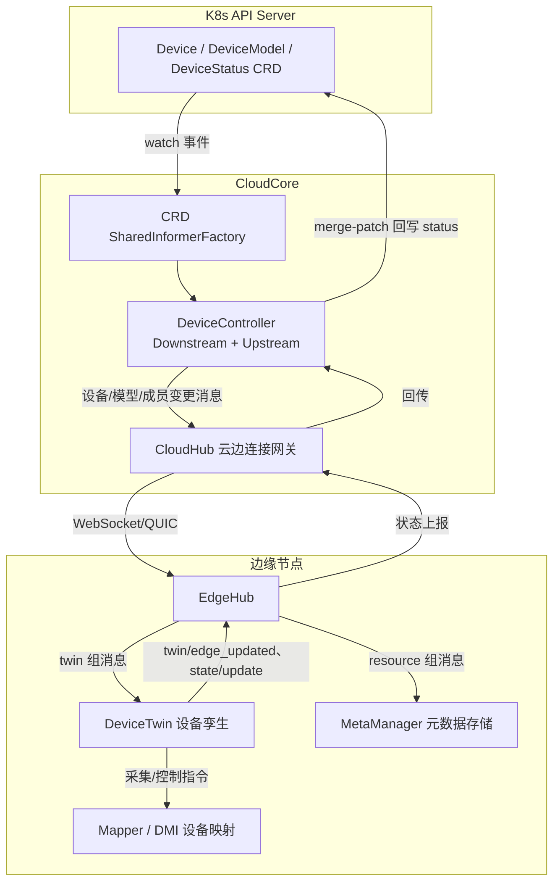
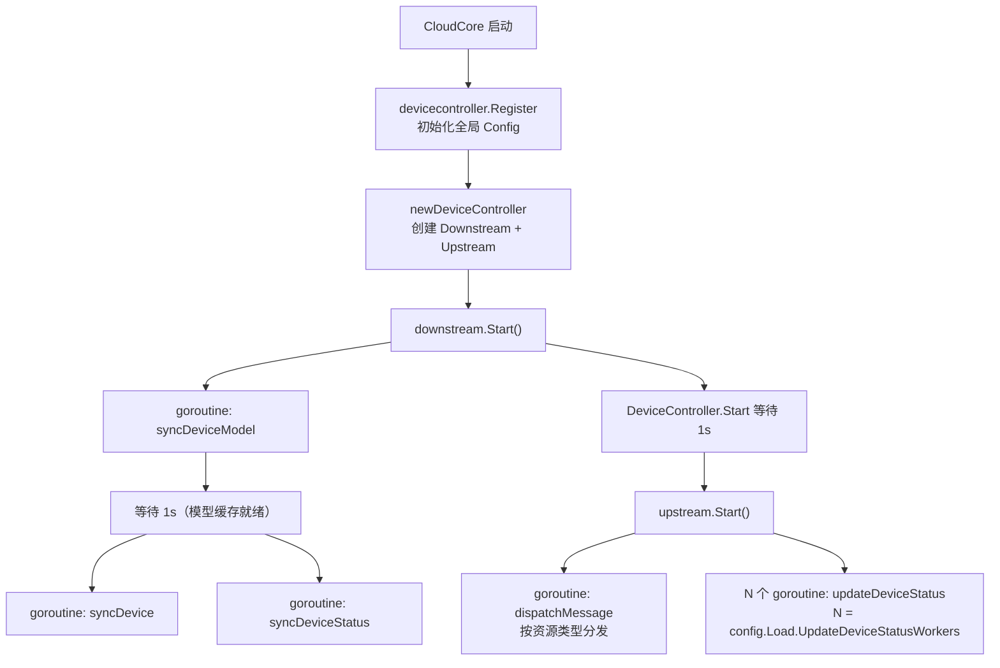
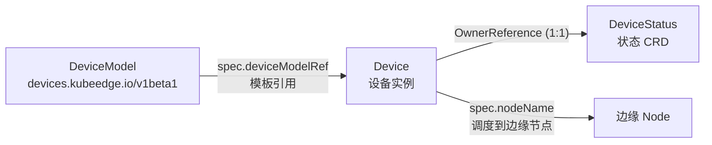
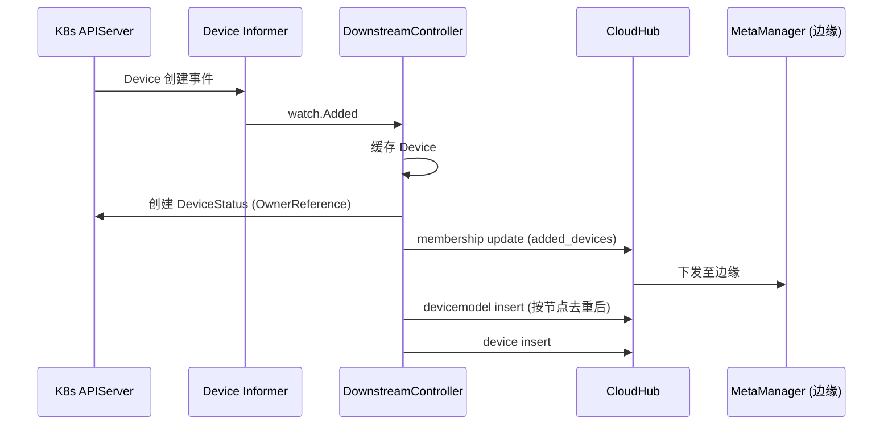
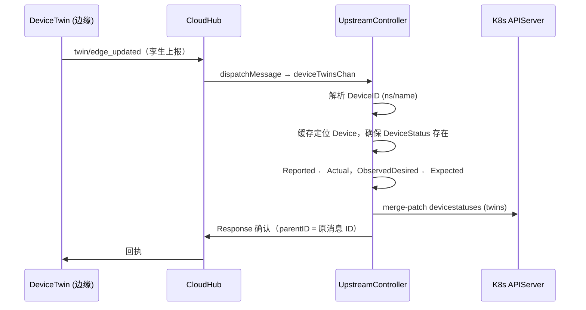

DeviceController 是 KubeEdge 云端组件 CloudCore 中专门负责**设备元数据同步**的模块。它管理的对象不是 Kubernetes 原生资源，而是 KubeEdge 自定义的三类设备 CRD：`Device`（设备实例）、`DeviceModel`（设备模型）和 `DeviceStatus`（设备状态）。本页从模块结构、数据模型、下行/上行两条同步链路、消息格式与配置模型等维度，逐层拆解 DeviceController 的实现原理，帮助中级开发者建立对设备云边同步机制的系统性认知。

## 在云边协同架构中的定位

DeviceController 是一个标准的 Beehive 模块：`DeviceController` 结构体实现了 `core.Module` 接口，内部聚合了一个 DownstreamController（下行控制器）和一个 UpstreamController（上行控制器）[devicecontroller.go](cloud/pkg/devicecontroller/devicecontroller.go#L17-L21)。模块通过 `Register` 函数在 CloudCore 启动时注册，`newDeviceController` 分别构造下行、上行控制器，构造失败会直接导致进程退出，体现了"设备同步是 CloudCore 关键职能"的设计立场 [devicecontroller.go](cloud/pkg/devicecontroller/devicecontroller.go#L25-L47)。

与 EdgeController（负责 ConfigMap/Secret/Pod 等原生资源下发）分工不同，DeviceController 只面向设备域的 CRD 资源，其消息经由 Beehive 消息层发往 CloudHub，再由 CloudHub 通过云边长连接下发到边缘节点。它在 `registerModules` 中与 cloudhub、edgecontroller、synccontroller 等模块并列注册 [server.go](cloud/cmd/cloudcore/app/server.go#L165-L179)。

 informer 资源来源于全局共享的 KubeEdge CRD Informer 工厂：`GetInformersManager().GetKubeEdgeInformerFactory()` 基于 `github.com/kubeedge/api` 提供的 `edgeinformers.SharedInformerFactory` 构建，与内置 Kubernetes 资源的 informer 工厂相互独立 [informer_manager.go](cloud/pkg/common/informers/informer_manager.go#L130-L158)。

Sources: [devicecontroller.go](cloud/pkg/devicecontroller/devicecontroller.go#L17-L47), [server.go](cloud/cmd/cloudcore/app/server.go#L165-L179), [informer_manager.go](cloud/pkg/common/informers/informer_manager.go#L130-L158)

## 模块组成与启动时序

DeviceController 的代码组织为五个子包，职责边界清晰：

| 子包/文件 | 核心内容 | 职责 |
|---|---|---|
| `devicecontroller.go` | `DeviceController` 模块主体 | 模块注册、生命周期编排 |
| `controller/downstream.go` | `DownstreamController`（约 550 行） | 监听 APIServer，下发设备元数据 |
| `controller/upstream.go` | `UpstreamController`（约 370 行） | 消费边缘上报，回写 DeviceStatus |
| `manager/` | Device/DeviceModel/DeviceStatus 三个 Manager | 包裹 informer 事件通道 + `sync.Map` 本地缓存 |
| `config/`、`constants/`、`types/` | 配置、常量、消息载荷结构 | 支撑层 |

Sources: [devicecontroller.go](cloud/pkg/devicecontroller/devicecontroller.go#L17-L21), [downstream.go](cloud/pkg/devicecontroller/controller/downstream.go#L52-L61), [upstream.go](cloud/pkg/devicecontroller/controller/upstream.go#L66-L76)

启动时序上有两处显式的 1 秒等待，构成一条"自上而下逐层就绪"的链路：模块 `Start` 先启动下行控制器，睡 1 秒后再启动上行控制器；而下行控制器内部又先启动 DeviceModel 同步循环，睡 1 秒后再启动 Device 与 DeviceStatus 的同步循环。这样设计的目的是让模型缓存先于设备事件被填充，降低下行发送时"设备引用的模型尚未入缓存"的概率（代码中保留了 TODO，说明作者也认为时序同步有待改进）[devicecontroller.go](cloud/pkg/devicecontroller/devicecontroller.go#L69-L79)。

每个 Manager 的构造遵循同一模式：为传入的 `SharedIndexInformer` 注册一个 `CommonResourceEventHandler`，该 Handler 把 Add/Update/Delete 回调统一转成 `watch.Event` 写入带缓冲的 channel，同时各自维护一个以 `namespace/name` 为键的 `sync.Map` 作为对象缓存 [common.go](cloud/pkg/devicecontroller/manager/common.go#L15-L50)。三个 Manager 唯一的差异是事件缓冲大小配置项不同（`DeviceEvent`、`DeviceModelEvent`、`DeviceStatusEvent`）[device.go](cloud/pkg/devicecontroller/manager/device.go#L27-L36)。

Sources: [devicecontroller.go](cloud/pkg/devicecontroller/devicecontroller.go#L69-L79), [downstream.go](cloud/pkg/devicecontroller/controller/downstream.go#L490-L503), [common.go](cloud/pkg/devicecontroller/manager/common.go#L15-L50), [device.go](cloud/pkg/devicecontroller/manager/device.go#L27-L36)

## 数据模型：Device、DeviceModel 与 DeviceStatus

三者的关系是"模型定义能力，实例绑定节点与属性，状态记录孪生"：

`DeviceSpec` 的关键字段决定了下行同步的行为：`deviceModelRef` 指向模板模型，`nodeName` 声明设备归属的边缘节点（为空则不下发），`properties` 描述属性及其期望值，`protocol` 定义接入协议，`stateReport` 控制状态上报周期 [device_instance_types.go](staging/src/github.com/kubeedge/api/apis/devices/v1beta1/device_instance_types.go#L27-L49)。`DeviceModelSpec` 则以 `properties`（名称/类型/访问模式/访客配置）+ `protocol` 描述一类设备的通用能力 [device_model_types.go](staging/src/github.com/kubeedge/api/apis/devices/v1beta1/device_model_types.go#L23-L57)。

值得注意的是 **DeviceStatus 是从 Device.status 中拆分出来的独立 CRD**（v1beta1 新增设计，Device 上仅保留过渡期的 `DeviceStatusOld`）。其注释明确说明：由于设备与状态是 1:1 关系，归属关系通过 OwnerReference 表达，Status 中无需冗余反指字段 [device_status_types.go](staging/src/github.com/kubeedge/api/apis/devices/v1beta1/device_status_types.go#L42-L46)。`DeviceStatusStatus` 包含三部分核心信息：`twins`（孪生属性列表）、`state`（设备在线状态）、`lastOnlineTime`（最后在线时间），以及可扩展的 `extensions` [device_status_types.go](staging/src/github.com/kubeedge/api/apis/devices/v1beta1/device_status_types.go#L48-L64)。

孪生属性 `Twin` 的结构体现了"期望/上报"双向语义：`propertyName` 关联设备属性，`reported` 是边缘实际采集值，`observedDesired` 则表示 mapper 当前周期已收到的期望值——注释特别强调该字段**只能由 devicecontroller upstream 更新**，用于运维者核查 mapper 是否正常工作 [device_status_types.go](staging/src/github.com/kubeedge/api/apis/devices/v1beta1/device_status_types.go#L73-L85)。

Sources: [device_instance_types.go](staging/src/github.com/kubeedge/api/apis/devices/v1beta1/device_instance_types.go#L27-L49), [device_model_types.go](staging/src/github.com/kubeedge/api/apis/devices/v1beta1/device_model_types.go#L23-L57), [device_status_types.go](staging/src/github.com/kubeedge/api/apis/devices/v1beta1/device_status_types.go#L42-L85)

## 下行同步：从 Informer 事件到边缘消息

DownstreamController 持有三类 Manager 缓存、kube/crd 两个客户端以及一个 `DeviceControllerMessageLayer`，后者的实际角色是把消息投递给同进程的 CloudHub 模块 [downstream.go](cloud/pkg/devicecontroller/controller/downstream.go#L52-L61)、[context.go](cloud/pkg/common/messagelayer/context.go#L83-L89)。三个同步循环各自消费 informer 事件，并按事件类型分发到具体处理函数：模型事件只做缓存增删（模型本身不下发，只有被设备引用时才捎带下发）[downstream.go](cloud/pkg/devicecontroller/controller/downstream.go#L64-L109)；设备事件才是下行同步的主战场 [downstream.go](cloud/pkg/devicecontroller/controller/downstream.go#L112-L136)。

`deviceAdded` 的处理逻辑最具代表性，它串联了下行同步的全部关键动作：

1. 以 `namespace/name` 为 ID 缓存设备对象；
2. 调用 `getOrCreateDeviceStatusForDevice` **按需创建** DeviceStatus CRD——先查缓存，未命中则 Get，仍不存在则 Create，并通过 `controllerutil.SetControllerReference` 建立 Device → DeviceStatus 的属主关系 [downstream.go](cloud/pkg/devicecontroller/controller/downstream.go#L179-L214)；
3. 仅当 `spec.nodeName` 非空时，向边缘发送三类消息：membership 更新（把设备加入节点的设备成员列表）、设备模型 insert（若该节点尚无引用此模型的其他设备）、设备 insert [downstream.go](cloud/pkg/devicecontroller/controller/downstream.go#L139-L177)。

其中"模型是否已在节点"由 `isExistModel` 判断：遍历设备缓存，排除当前设备后检查是否存在**同节点、同命名空间、引用同一模型**的其他设备，存在则跳过模型下发，实现按节点去重 [downstream.go](cloud/pkg/devicecontroller/controller/downstream.go#L232-L258)。

`deviceUpdated` 体现了"事件 != 变更"的防御式设计：informer 的 Modified 事件可能由 status 或 metadata 变化触发，控制器先用 `reflect.DeepEqual` 比较新旧 `Spec`，只有 Spec 真正变化才继续 [downstream.go](cloud/pkg/devicecontroller/controller/downstream.go#L289-L293)。若 `nodeName` 发生迁移，则构造一个携带旧 Spec 的"伪删除"对象走删除流程（从旧节点摘除），再把新设备走添加流程（挂到新节点）；否则按顺序发送模型 update + 设备 update [downstream.go](cloud/pkg/devicecontroller/controller/downstream.go#L263-L287)。`deviceDeleted` 则对称地发送 membership remove、模型 delete（同样经 `isExistModel` 去重）和设备 delete [downstream.go](cloud/pkg/devicecontroller/controller/downstream.go#L295-L326)。

Sources: [downstream.go](cloud/pkg/devicecontroller/controller/downstream.go#L52-L177), [downstream.go](cloud/pkg/devicecontroller/controller/downstream.go#L232-L326), [context.go](cloud/pkg/common/messagelayer/context.go#L83-L89)

## 消息路由与资源格式

下行消息通过 Beehive 资源字符串寻址，DeviceController 使用两种资源构造函数：带命名空间的 `BuildResource` 生成 `node/{nodeID}/{namespace}/{resourceType}/{resourceID}` 五段式（用于 device/devicemodel）[util.go](cloud/pkg/common/messagelayer/util.go#L49-L60)；不带命名空间的 `BuildResourceForDevice` 生成 `node/{nodeID}/{resourceType}` 三段式（用于 membership/twin）[util.go](cloud/pkg/common/messagelayer/util.go#L119-L130)。上行方向则靠 `GetResourceTypeForDevice` 对资源串做子串匹配来识别消息类别，`GetDeviceID` 从 `$hw/events/device/{ns}/{name}/...` 格式中解析出 `namespace/name` 作为设备 ID [util.go](cloud/pkg/common/messagelayer/util.go#L132-L152)。

完整的消息矩阵如下：

| 方向 | 消息 | 路由资源 | Group / Operation | 内容类型 |
|---|---|---|---|---|
| 下行 | 设备成员变更 | `node/{node}/membership` | twin / update | `MembershipUpdate`（added_devices / removed_devices）|
| 下行 | 设备资源 | `node/{node}/{ns}/device/{name}` | resource / insert·update·delete | 完整 `Device` CRD |
| 下行 | 模型资源 | `node/{node}/{ns}/devicemodel/{name}` | resource / insert·update·delete | 完整 `DeviceModel` CRD |
| 上行 | 孪生上报 | 含 `twin/edge_updated` | — | `DeviceTwinUpdate`（twin map）|
| 上行 | 状态上报 | 含 `state/update` | — | `DeviceStateUpdate`（state + lastOnlineTime）|
| 上行 | 成员详情 | 含 `membership/detail` | — | 被 dispatch 显式忽略 |

消息载荷类型定义在 `types/device.go` 中，`MembershipUpdate` 携带增删设备列表，`DeviceTwinUpdate`/`DeviceStateUpdate` 是边缘上报的两种载荷 [types/device.go](cloud/pkg/devicecontroller/types/device.go#L35-L45)、[types/device.go](cloud/pkg/devicecontroller/types/device.go#L104-L114)。下行消息的 Group 常量（`twin`/`resource`）与资源类型常量（`devicemodel`/`device`）分别定义于 [constants/service.go](cloud/pkg/devicecontroller/constants/service.go#L4-L12) 和 [constants/device.go](cloud/pkg/devicecontroller/constants/device.go#L29-L31)。

消息到达边缘后，EdgeHub 的消息处理器按 Group 分流：`TwinGroup` 消息（membership、twin 事件）转发给 DeviceTwin 模块 [handler_twin.go](edge/pkg/edgehub/messagehandler/handler_twin.go#L28-L40)；`resource` 组消息（device/devicemodel 的 insert/update/delete）转发给 MetaManager 持久化到本地元数据库，支撑边缘离线自治 [handler_meta.go](edge/pkg/edgehub/messagehandler/handler_meta.go#L29-L48)。边缘侧的事件主题命名与云端资源串严格对应，如 `$hw/events/node/{node}/membership/updated`、`$hw/events/device/{ns}/{name}/twin/edge_updated`、`$hw/events/device/{ns}/{name}/state/update` [common.go](edge/pkg/devicetwin/dtcommon/common.go#L17-L56)。

Sources: [util.go](cloud/pkg/common/messagelayer/util.go#L49-L152), [types/device.go](cloud/pkg/devicecontroller/types/device.go#L35-L114), [constants/service.go](cloud/pkg/devicecontroller/constants/service.go#L4-L12), [handler_twin.go](edge/pkg/edgehub/messagehandler/handler_twin.go#L28-L40), [handler_meta.go](edge/pkg/edgehub/messagehandler/handler_meta.go#L29-L48), [common.go](edge/pkg/devicetwin/dtcommon/common.go#L17-L56)

## 上行同步：从边缘消息到 DeviceStatus 回写

UpstreamController 的并发模型是经典的"单分发器 + N 工作协程"：`Start` 时按配置创建两个带缓冲的 channel（`deviceTwinsChan`、`deviceStatesChan`），启动一个 `dispatchMessage` 协程和 `UpdateDeviceStatusWorkers` 个 `updateDeviceStatus` 协程 [upstream.go](cloud/pkg/devicecontroller/controller/upstream.go#L78-L90)。分发器从消息层持续接收（消息层从 Beehive 的 devicecontroller 模块队列取 CloudHub 转交的消息），按资源类型归入不同 channel [upstream.go](cloud/pkg/devicecontroller/controller/upstream.go#L92-L125)。

两条工作流共享同一骨架：从缓存定位设备 → 确保 DeviceStatus 存在 → 修改缓存中的状态 → 以 merge-patch 回写 APIServer → 向边缘回执确认。状态上报（`state/update`）只更新 `state` 与 `lastOnlineTime` 两个字段，patch 结构被刻意收窄，避免覆盖 twins [upstream.go](cloud/pkg/devicecontroller/controller/upstream.go#L146-L185)；孪生上报（`twin/edge_updated`）则遍历上报的 twin map，对每个属性名调用 `findOrCreateTwinByName`——只有存在于 `device.Spec.Properties` 中的属性才会建立孪生，`Actual`（实际值）映射到 `Reported`，`Expected`（期望值）映射到 `ObservedDesired`，其中时间戳和类型信息被编码进 `TwinProperty.Metadata` [upstream.go](cloud/pkg/devicecontroller/controller/upstream.go#L237-L267)、[upstream.go](cloud/pkg/devicecontroller/controller/upstream.go#L349-L364)。

回执通过 `model.NewMessage(msg.GetID())` 携带原消息 ID 构造，资源为 `node/{nodeID}/twin`，内容为成功标记，经 CloudHub 送回边缘孪生模块，闭环一次上报 [upstream.go](cloud/pkg/devicecontroller/controller/upstream.go#L188-L206)。孪生更新时 patch 使用的 `DeviceStatusCRDPatch` 结构特意排除了 `extensions` 字段（结构体注释写明 "with Extensions excluded"），防止边缘上报的回写意外清掉云端扩展数据 [upstream.go](cloud/pkg/devicecontroller/controller/upstream.go#L45-L64)。此外，每次回写前控制器都会**先把新状态写回本地缓存**（`deviceStatusManager.DeviceStatus.Store`），这样 informer 收到 patch 触发的 Modified 事件时，下行侧不会把这些"自己产生的回声"当作云端变更处理 [upstream.go](cloud/pkg/devicecontroller/controller/upstream.go#L269-L271)。

Sources: [upstream.go](cloud/pkg/devicecontroller/controller/upstream.go#L45-L125), [upstream.go](cloud/pkg/devicecontroller/controller/upstream.go#L146-L206), [upstream.go](cloud/pkg/devicecontroller/controller/upstream.go#L237-L288), [upstream.go](cloud/pkg/devicecontroller/controller/upstream.go#L349-L364)

## 配置项与并发模型

DeviceController 的配置挂在 CloudCore 配置树的 `modules.deviceController` 下，结构上分为使能开关、Buffer（通道缓冲）与 Load（工作协程数）三组 [types.go](staging/src/github.com/kubeedge/api/apis/componentconfig/cloudcore/v1alpha1/types.go#L391-L427)。配置在 `Register` 时经 `InitConfigure` 以 `sync.Once` 语义写入包级单例 `config.Config`，供各 Manager 和 Upstream 读取 [config.go](cloud/pkg/devicecontroller/config/config.go#L9-L23)。

| 配置项 | 默认值 | 作用点 |
|---|---|---|
| `enable` | `true` | 模块总开关，false 时注册空模块 [default.go](staging/src/github.com/kubeedge/api/apis/componentconfig/cloudcore/v1alpha1/default.go#L101-L112) |
| `buffer.updateDeviceTwins` | `1024` | 孪生上报 channel 缓冲 [default.go](staging/src/github.com/kubeedge/api/apis/common/constants/default.go#L85-L90) |
| `buffer.updateDeviceStates` | `1024` | 状态上报 channel 缓冲 |
| `buffer.deviceEvent` | `1` | Device informer 事件 channel 缓冲 |
| `buffer.deviceModelEvent` | `1` | DeviceModel informer 事件 channel 缓冲 |
| `buffer.deviceStatusEvent` | `1` | DeviceStatus informer 事件 channel 缓冲 [types.go](staging/src/github.com/kubeedge/api/apis/componentconfig/cloudcore/v1alpha1/types.go#L417-L419) |
| `load.updateDeviceStatusWorkers` | `1` | 上行状态回写协程数 |

两类缓冲的差异折射出流量的不对称性：**下行事件序列化要求严格**（缓冲仅为 1，事件按序处理，避免乱序的 membership/update 消息），而**上行上报允许并发积压**（1024 的缓冲 + 可横向扩大的 worker 数）。资源 ID 的构造规则 `namespace + "/" + name` 是贯穿三处缓存与消息解析的统一约定 [util.go](pkg/util/util.go#L161-L164)。

Sources: [types.go](staging/src/github.com/kubeedge/api/apis/componentconfig/cloudcore/v1alpha1/types.go#L391-L427), [default.go](staging/src/github.com/kubeedge/api/apis/componentconfig/cloudcore/v1alpha1/default.go#L101-L112), [default.go](staging/src/github.com/kubeedge/api/apis/common/constants/default.go#L85-L90), [config.go](cloud/pkg/devicecontroller/config/config.go#L9-L23), [util.go](pkg/util/util.go#L161-L164)

## 关键设计细节与边界情况

以下几个实现细节最能体现 DeviceController 的工程考量，也是阅读源码时容易忽略的部分。

**模型下发与事件竞态。** `sendDeviceModelMsg` 在从缓存加载模型时使用 retry-go 最多重试 10 次、每次间隔 1 秒 [downstream.go](cloud/pkg/devicecontroller/controller/downstream.go#L365-L391)。这是对"设备事件先于模型事件到达"这一竞态的兜底——尽管启动时序已经让模型同步先行，但运行期新建模型与设备的组合仍可能出现短暂的缓存空窗。

**孪生名称清理。** 当 Device Spec 中的属性被删除后，边缘上报的孪生可能残留已不存在的属性名。`deviceStatusUpdated` 通过 `removeTwinWithNameChanged` 过滤缓存中的孪生：只保留 `propertyName` 仍存在于 `device.Spec.Properties` 中的条目，防止状态 CRD 中积累孤儿孪生 [downstream.go](cloud/pkg/devicecontroller/controller/downstream.go#L536-L551)、[downstream.go](cloud/pkg/devicecontroller/controller/downstream.go#L467-L482)。

**对象稳定性。** 设备缓存的 `sync.Map` 存储的是 informer 投递的对象指针，而 `deviceUpdated` 在比较后立即 `Store` 新对象，比较逻辑只依赖 `Spec` 的深比较，不依赖指针相等性，这保证了即使 informer 因 resync 重复投递相同对象也不会触发多余的消息下发。

**已知限制。** 源码中保留了两处值得关注的 TODO：其一，删除 DeviceModel 时缺少 finalizer 机制来清理引用该模型的设备；其二，下行各同步循环之间的就绪同步依赖 `time.Sleep` 而非确定性信号 [downstream.go](cloud/pkg/devicecontroller/controller/downstream.go#L106-L109)。二者都是二次开发或故障排查时需要留意的边界。

**与可靠同步的关系。** DeviceController 自身不提供消息级 ACK/重传，下行消息的可靠到达依赖 CloudHub 与边缘 EdgeHub 之间的连接管理，以及 SyncController 基于 `reliablesyncs` ClusterObjectSync 的补偿机制（详见 [SyncController：可靠同步与补偿机制](11-synccontroller-ke-kao-tong-bu-yu-bu-chang-ji-zhi)）。

Sources: [downstream.go](cloud/pkg/devicecontroller/controller/downstream.go#L106-L109), [downstream.go](cloud/pkg/devicecontroller/controller/downstream.go#L365-L391), [downstream.go](cloud/pkg/devicecontroller/controller/downstream.go#L467-L482), [downstream.go](cloud/pkg/devicecontroller/controller/downstream.go#L536-L551)

## 小结与延伸阅读

DeviceController 以"双控制器 + 三缓存"的对称结构，把 Kubernetes 声明式资源模型延伸到了设备域：下行侧通过 informer 事件驱动 membership/设备/模型三类消息把期望状态推向边缘，上行侧通过消息分发与工作协程把孪生与状态实况 merge-patch 回 DeviceStatus CRD。理解它的关键在于抓住三条主线——CRD 三件套的数据模型、`node/{node}/...` 资源寻址规则、以及"缓存先行、patch 收窄、回写防回声"的防御式细节。

若要继续深入，建议按以下路径阅读：

- 消息如何跨越云边连接：[CloudHub：云边长连接网关与消息分发](8-cloudhub-yun-bian-chang-lian-jie-wang-guan-yu-xiao-xi-fen-fa)
- 下行消息在边缘的落地与离线自治：[MetaManager 与 MetaServer：离线元数据存储与本地 API Server](18-metamanager-yu-metaserver-chi-xian-yuan-shu-ju-cun-chu-yu-ben-di-api-server)
- 孪生模块如何消费 membership/twin 消息并驱动设备：[DeviceTwin：设备数字孪生与状态管理](20-devicetwin-she-bei-shu-zi-luan-sheng-yu-zhuang-tai-guan-li)
- mapper 如何基于设备模型采集与控制：[Mapper Framework 与 DMI 设备映射接入](25-mapper-framework-yu-dmi-she-bei-ying-mo-she-jie-ru)
- CRD 定义与代码生成体系全貌：[API 定义、CRD 规范与代码生成体系](24-api-ding-yi-crd-gui-fan-yu-dai-ma-sheng-cheng-ti-xi)