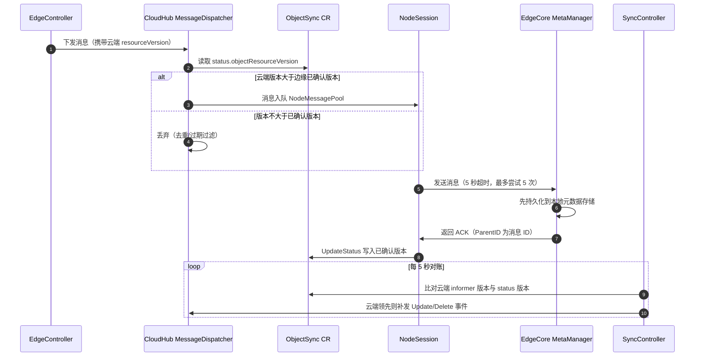
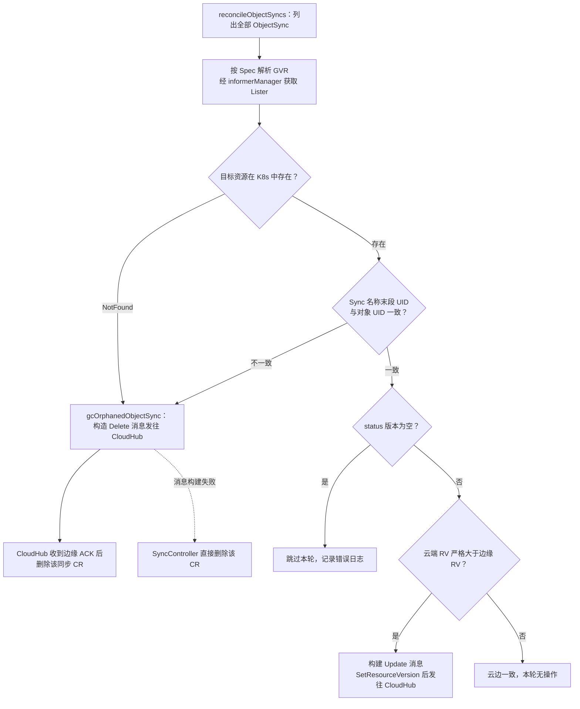

SyncController 是 CloudCore 内置的云边数据一致性仲裁组件：它自身不与边缘节点通信，而是周期性地将 Kubernetes 中资源的最新 `resourceVersion` 与记录在 `ObjectSync`/`ClusterObjectSync` CR 中的"边缘已确认版本"进行比对，据此补发更新事件、下发删除事件并回收失效的同步 CR。本文剖析其设计动机、数据模型、对账循环、补偿场景与垃圾回收机制，并说明它与 CloudHub 消息分发链路如何构成一个闭环的 At-Least-Once 可靠投递体系。

## 设计动机：从 At-Most-Once 到 At-Least-Once

云边之间通常是不稳定的广域网络，边緣节点频繁断连、CloudCore 或 EdgeCore 重启都会导致下行消息永久丢失，进而造成云边状态不一致。设计提案明确指出，在引入该机制之前，KubeEdge 的下行消息投递是"At-Most-Once"——发出去即不管，任何一次网络抖动都意味着丢失。

Sources: [reliable-message-delivery.md](docs/proposals/sig-node/reliable-message-delivery.md#L18-L25)

提案在三种投递语义中做了权衡：Exactly-Once 虽然无损但性能最差；而 KubeEdge 遵循 Kubernetes 的最终一致性原则，边缘重复收到同一条消息并无危害，只要它是最新版本即可。因此系统选择了 **At-Least-Once**：CloudHub 侧引入节点级发送队列与 ACK 确认，而 SyncController 则充当整个体系中的"兜底补偿器"——凡是重试耗尽、进程重启期间丢失的事件，最终都由它在对账循环中修复。

Sources: [reliable-message-delivery.md](docs/proposals/sig-node/reliable-message-delivery.md#L52-L68)

| 投递语义 | 消息丢失 | 消息重复 | 性能开销 | KubeEdge 取舍 |
| --- | --- | --- | --- | --- |
| At-Most-Once | 可能 | 无 | 最低 | 早期实现，已被淘汰 |
| Exactly-Once | 无 | 无 | 最高 | 不采纳 |
| At-Least-Once | 无（最终补偿） | 允许，可幂等处理 | 中等 | **当前方案** |

Sources: [reliable-message-delivery.md](docs/proposals/sig-node/reliable-message-delivery.md#L54-L68)

## 核心数据模型：ObjectSync 与 ClusterObjectSync

可靠同步的状态外置为两个 CRD（组为 `reliablesyncs.kubeedge.io`）：命名空间级的 `ObjectSync` 记录"已成功持久化到某个边缘节点"的命名空间对象状态，集群级的 `ClusterObjectSync` 记录集群级对象的状态。两者结构完全同构——`Spec` 描述被同步对象的 APIVersion/Kind/Name，`Status` 只有一个字段 `objectResourceVersion`，即该对象**当前已确认到达边缘的** resourceVersion。这一字段是全系统的对账基准：它由 CloudHub 在收到边缘 ACK 后写入，由 SyncController 读取比对。

Sources: [type.go](staging/src/github.com/kubeedge/api/apis/reliablesyncs/v1alpha1/type.go#L85-L103)

CR 命名规则是 `节点名.对象UID`（由 `BuildObjectSyncName` 拼接），反解析函数 `getNodeName`/`getObjectUID` 通过最后一个 `.` 切分。这一设计有三重含义：每条 CR 天然绑定"某节点 × 某对象实例"这一同步粒度；UID 段可以在资源被删除重建（UID 变化）时识别出孤儿 CR；CloudHub 收到删除 ACK 后按名删除即可完成状态清理。

Sources: [synccontroller.go](cloud/pkg/synccontroller/synccontroller.go#L247-L260)

| 维度 | ObjectSync | ClusterObjectSync |
| --- | --- | --- |
| 作用域 | Namespaced（随对象命名空间） | Cluster |
| 覆盖对象 | Pod、ConfigMap 等命名空间级资源 | ClusterRole、Namespace 等集群级资源 |
| 命名规则 | `nodeName.objectUID` | `nodeName.objectUID` |
| Spec 字段 | objectAPIVersion / objectKind / objectName | 同左 |
| Status 字段 | objectResourceVersion | objectResourceVersion |
| 状态子资源 | 启用（status 为独立子资源） | 启用 |

Sources: [objectsync_v1alpha1.yaml](build/crds/reliablesyncs/objectsync_v1alpha1.yaml#L20-L75) [cluster_objectsync_v1alpha1.yaml](build/crds/reliablesyncs/cluster_objectsync_v1alpha1.yaml#L21-L23)

## 可靠同步闭环：SyncController 在消息链路中的位置

理解 SyncController 的前提是理解"写入"与"对账"两侧的分工。下行消息从 EdgeController 经 Beehive 通道进入 CloudHub 的 MessageDispatcher；Dispatcher 在入队前先与 ObjectSync 中的已确认版本比对做去重过滤，消息经 NodeMessagePool 发往边缘，EdgeCore 的 MetaManager **先持久化到本地元数据库、再回 ACK**，CloudHub 收到 ACK 后才把该消息的 resourceVersion 写回 CR——这一步是"边缘版本"这一事实的唯一合法来源。SyncController 随后每 5 秒轮询比对，发现云端版本领先即补发事件。整个闭环的分工可概括为：**CloudHub 负责记录事实，SyncController 负责修复偏差**。

Sources: [reliable-message-delivery.md](docs/proposals/sig-node/reliable-message-delivery.md#L77-L96)

下图中前半段（1–7 步）是常规的可靠投递路径，循环部分则是 SyncController 的补偿路径。关键在于：SyncController 补发的消息同样以 `EdgeController` 模块、`GroupResource` 组路由，最终仍发送给 `cloudhub` 模块，即**补偿事件会重新进入同一条带 ACK 的可靠管道**，而不是旁路直发边缘——这使得补偿动作本身也具备 ACK、重试与版本过滤能力。

Sources: [objectsync.go](cloud/pkg/synccontroller/objectsync.go#L105-L120) [default.go](common/constants/default.go#L12)

Sources: [message_dispatcher.go](cloud/pkg/cloudhub/dispatcher/message_dispatcher.go#L258-L287) [node_session.go](cloud/pkg/cloudhub/session/node_session.go#L342-L375) [node_session.go](cloud/pkg/cloudhub/session/node_session.go#L460-L464)

## 对账循环：五秒一次的版本仲裁

SyncController 是标准的 Beehive 模块（模块名/组均为 `synccontroller`），通过 `Register` 注册进 CloudCore。`Start()` 的启动序列体现了防御式设计：先 `WaitForCacheSync` 等待三个 informer（ObjectSync、ClusterObjectSync、Node）缓存就绪，随后**在进入对账循环之前先执行一轮孤儿 CR 清理**（对应提案中"CloudCore 启动时先检查旧 CR"的要求），最后用 `wait.Until` 启动两个每 5 秒一轮的常驻 goroutine，分别对账两类 CR。

Sources: [synccontroller.go](cloud/pkg/synccontroller/synccontroller.go#L36-L95) [synccontroller.go](cloud/pkg/synccontroller/synccontroller.go#L117-L129) [reliable-message-delivery.md](docs/proposals/sig-node/reliable-message-delivery.md#L246-L249)

单个 `ObjectSync` 的对账决策是一个四层过滤漏斗：先按 `Spec.ObjectAPIVersion` 解析 GVR 并从 informerManager 拿到对应资源的 Lister——如果目标资源在 K8s 中已不存在，转入删除补偿；若存在但 CR 名称末段 UID 与资源 UID 不一致（同名重建），同样转入删除补偿；若 status 版本为空则跳过本轮（此时 CR 刚被 Dispatcher 创建、尚未写入版本）；最后比较 resourceVersion，**仅当云端版本严格大于边缘已确认版本时**才构造 Update 消息补发，相等或落后则说明云边一致，不做任何动作。

Sources: [objectsync.go](cloud/pkg/synccontroller/objectsync.go#L26-L65) [objectsync.go](cloud/pkg/synccontroller/objectsync.go#L90-L103)

Sources: [objectsync.go](cloud/pkg/synccontroller/objectsync.go#L45-L88)

版本比较由 `CompareResourceVersion` 完成：将两个字符串解析为无符号整数后直接比较大小，返回 1/0/-1。Kubernetes 的 resourceVersion 是单调递增的整数序列，因此整数比较即为因果序比较——这是整个可靠同步体系最核心的一行不变量。值得注意的是，解析失败会直接 `panic`（代码注释标注为 coder error），即该函数把"版本格式非法"视为不可恢复的编程错误而非运行时故障。

Sources: [objectsync.go](cloud/pkg/synccontroller/objectsync.go#L138-L160)

`ClusterObjectSync` 的对账逻辑（`reconcileClusterObjectSync`）与命名空间路径逐层对应，差异只有两点：集群级对象经 Lister 无需按 namespace 检索；构造 Delete 消息时 namespace 使用 `models.NullNamespace` 哨兵值。该文件还将 `sendToEdge`、`compareResourceVersionFunc` 等依赖提取为包级可注入变量，形成纯函数级别的测试缝隙——这是在既有紧耦合代码上做可测性改造的典型手法。

Sources: [clusterobjectsync.go](cloud/pkg/synccontroller/clusterobjectsync.go#L44-L85) [clusterobjectsync.go](cloud/pkg/synccontroller/clusterobjectsync.go#L24-L42)

## 补偿机制：三类失效场景的修复路径

| 失效场景 | 根因 | SyncController 的补偿动作 |
| --- | --- | --- |
| 消息重试耗尽 | 边缘离线或链路抖动，CloudHub 重试 5 次后丢弃 | 下轮对账发现云端 RV 领先，补发 Update 事件 |
| CloudCore 重启期间资源被删除 | Delete 事件在宕机窗口内永久丢失 | 对账发现资源 NotFound，向边缘补发 Delete 事件并 GC |
| 资源同名重建 | UID 漂移导致 CR 与对象失配 | 视为孤儿 CR，下发 Delete 并回收 |

第一种场景是最高频的补偿路径：CloudHub 的 `sendMessageWithRetry` 以 5 秒为间隔重发未确认消息，`retryCount` 达到 4（即首次发送加 4 次重试共 5 次）后返回超时并放弃。提案明确说明"5 次重试全部失败后 CloudHub 丢弃事件，由 SyncController 处理这些失败事件"——只要节点后续重新上线，最多一个对账周期（5 秒）内偏差即被发现并修复，收敛延迟上界是对账周期而非网络重试时长。

Sources: [node_session.go](cloud/pkg/cloudhub/session/node_session.go#L342-L375) [reliable-message-delivery.md](docs/proposals/sig-node/reliable-message-delivery.md#L91-L92)

第二种场景依赖 `gcOrphanedObjectSync` 的两阶段删除策略。该函数用一个仅含 namespace/name/UID 的合成 Unstructured 对象构造 Delete 消息发给 CloudHub；代码注释揭示了删除 CR 的责任转移规则——**消息构建成功时，CR 由 CloudHub 在收到边缘 ACK 后删除（保证边缘确实删掉了才清理账本）；构建失败时才由 SyncController 直接删除 CR**。直接删除并不会造成边缘残留：节点重连后 SyncController 会再次发现资源缺失并重发 Delete。

Sources: [objectsync.go](cloud/pkg/synccontroller/objectsync.go#L67-L88) [clusterobjectsync.go](cloud/pkg/cloudhub/dispatcher/message_dispatcher.go#L419-L430)

第三种场景源于命名规则的内在性质：`节点名.UID` 中编码了对象实例的身份，当资源被删除又以同名重建时，新对象的 UID 与 CR 中记录的不一致，`reconcileObjectSync` 中 `syncObjUID != object.GetUID()` 的判定将其归入孤儿处理。这一校验防止了一个危险的误同步：把新实例的最新版本经旧 CR 的账本"确认"后，掩盖旧实例从未被删除的事实。

Sources: [objectsync.go](cloud/pkg/synccontroller/objectsync.go#L58-L62)

## 垃圾回收：节点删除后的同步 CR 清理

ObjectSync 的生命周期依附于边缘节点，因此节点删除时其名下全部同步 CR 都必须回收。SyncController 在 Nodes informer 上注册了 `DeleteFunc` 事件处理器，节点删除事件触发 `deleteObjectSyncs` 与 `deleteClusterObjectSyncs`；`Start()` 启动序列中同样各调用一次，覆盖"CloudCore 宕机期间节点被删除、重启后补删"的窗口。两处调用共享同一套判定逻辑：`checkObjectSync` 通过 NodeLister 查询节点，`IsNotFound` 即判定为垃圾。

Sources: [synccontroller.go](cloud/pkg/synccontroller/synccontroller.go#L70-L78) [synccontroller.go](cloud/pkg/synccontroller/synccontroller.go#L123-L124) [synccontroller.go](cloud/pkg/synccontroller/synccontroller.go#L227-L245)

清理动作使用 `retry-go` 执行逐 CR 删除：每个 CR 最多重试 5 次（`maxRetries`），间隔 1 秒（`deleteSyncsDelay`），单次失败仅告警不中断整个批次——这种"逐项重试、批次推进"的策略保证了部分 API Server 瞬时错误不会阻塞其余 CR 的回收。删除使用 `NewDeleteOptions(0)` 即零宽限期立即删除，与对账路径中的孤儿清理保持一致的强删除语义。

Sources: [synccontroller.go](cloud/pkg/synccontroller/synccontroller.go#L30-L34) [synccontroller.go](cloud/pkg/synccontroller/synccontroller.go#L159-L191) [synccontroller.go](cloud/pkg/synccontroller/synccontroller.go#L193-L225)

## 与 CloudHub 的协同过滤：补偿事件的幂等性保障

SyncController 之所以能"放心补发"而不用担心风暴，是因为下游 Dispatcher 内置了三层与版本相关的过滤。其一，删除消息（含携带 deletionTimestamp 的消息）与响应类消息**强制入队**，绕过版本比较——这保证了对账路径下发的 Delete 一定可达边缘。其二，消息若在节点的 AckMessageStore 中已存在，则与存量消息比较版本，版本不更新或存量是删除消息时直接丢弃，实现同 key 消息合并（workqueue 只入队 key，反复 Add 自动去重）。其三，Store 未命中时再与 CR 中的已确认版本比较。

Sources: [message_dispatcher.go](cloud/pkg/cloudhub/dispatcher/message_dispatcher.go#L258-L277) [message_pool.go](cloud/pkg/cloudhub/common/message_pool.go#L28-L55)

第三层过滤中还有一个容易被忽略的**懒创建**行为：当某（节点，对象）的 CR 尚不存在时，Dispatcher 视其为首次下发的资源，立即创建 CR 并将 status 初始化为 `"0"`——而非留空。这个细节解释了为什么对账循环中"status 版本为空"只是瞬态（CR 创建与状态写入之间的窗口），也保证了全系统对版本比较的输入恒为可解析整数。

Sources: [message_dispatcher.go](cloud/pkg/cloudhub/dispatcher/message_dispatcher.go#L352-L417)

ACK 通路侧同样有防重设计：边缘可能对同一消息的多次重发返回多个重复 ACK，`ReceiveMessageAck` 使用 `sync.Map` 的 `LoadAndDelete` 原子操作取出并关闭 ack channel，注释明确指出若拆成两步会导致并发下重复 close 而 panic。收到有效 ACK 后 `saveSuccessPoint` 才把 `msg.GetResourceVersion()` 写入 CR 的 status——至此"边缘事实"完成落账，对账循环随之自然收敛。

Sources: [node_session.go](cloud/pkg/cloudhub/session/node_session.go#L126-L137) [node_session.go](cloud/pkg/cloudhub/session/node_session.go#L355-L359) [node_session.go](cloud/pkg/cloudhub/session/node_session.go#L377-L393)

## 配置与可观测性

SyncController 的配置面极小：`CloudCore.syncController.enable` 一个开关，默认 `true`，用于调试场景整体停用补偿机制。模块名与消息组均为常量 `synccontroller`，无 worker 数、无周期等可调参数——对账周期 5 秒、GC 重试策略等全部硬编码，这简化了运维但牺牲了针对大规模集群的调优空间。

Sources: [types.go](staging/src/github.com/kubeedge/api/apis/componentconfig/cloudcore/v1alpha1/types.go#L487-L493) [default.go](staging/src/github.com/kubeedge/api/apis/componentconfig/cloudcore/v1alpha1/default.go#L123-L125) [config.go](cloud/pkg/synccontroller/config/config.go#L9-L22) [modules.go](cloud/pkg/common/modules/modules.go#L22-L23)

| 常量/参数 | 取值 | 代码位置 | 作用 |
| --- | --- | --- | --- |
| 对账周期 | 5s | `wait.Until` 参数 | 补偿收敛延迟上界 |
| `maxRetries` | 5 | synccontroller.go | GC 删除单 CR 重试上限 |
| `deleteSyncsDelay` | 1s | synccontroller.go | GC 删除重试间隔 |
| `sendRetryInterval` | 5s | node_session.go | CloudHub 发送重试间隔 |
| 发送尝试次数 | 5（首次 + 4 重试） | node_session.go | 超时后放弃，移交 SyncController |
| `enable` | 默认 true | CloudCore 配置 | 模块开关 |

可观测性有两个实用窗口：其一，`kubectl get objectsyncs -A -o wide` 可直接检视每个"节点×对象"的已确认版本，配合云端对象 RV 可人工诊断某条同步是否滞后；其二，对账循环的判定日志位于 `V(4)` 级别（补发 Update、孤儿 Delete），生产排障时需将 CloudCore 日志verbosity 调至 4 以上才能观察到补偿动作的发生。

Sources: [objectsync.go](cloud/pkg/synccontroller/objectsync.go#L99) [objectsync.go](cloud/pkg/synccontroller/objectsync.go#L75)

## 设计权衡与已知局限

对比设计文档与当前实现，有几处值得注意的演进与遗留。提案中的 CR 命名是 `nodeobjectsync-{namespace}-{name}-{node}` 风格的设想，最终落地为 `nodeName.UID` 并以 Spec 承载对象三元组；而 DeviceTwin 的离线状态（设备孪生版本）在 `saveSuccessPoint` 中仍是一个显式 TODO，意味着设备孪生同步暂未纳入这一版本账本体系，其可靠性由其他机制承担。

Sources: [node_session.go](cloud/pkg/cloudhub/session/node_session.go#L377-L383) [reliable-message-delivery.md](docs/proposals/sig-node/reliable-message-delivery.md#L151-L217)

扩展性上存在一笔隐性成本：CR 数量等于"边缘节点数 × 已下发对象数"的笛卡尔积，万级节点 × 千级对象的集群将产生千万级 CR，全部依赖 Kube-API Server 存储与 informer 缓存。此外，`CompareResourceVersion` 的 panic-on-error 策略意味着任何一条脏版本数据都会击穿对账 goroutine；"先 CloudHub 记账、后 SyncController 对账"的双组件协作也使故障域横跨两个模块，排障时需要同时审视两侧日志。这些都是设计上以简单性换取可维护性的权衡，理解它们有助于在超大规模部署前评估改造点。

Sources: [objectsync.go](cloud/pkg/synccontroller/objectsync.go#L141-L151) [reliable-message-delivery.md](docs/proposals/sig-node/reliable-message-delivery.md#L251-L277)

## 延伸阅读

SyncController 是可靠消息传递体系中的补偿环节，若要建立完整认知，建议按以下路径延伸：先了解事件的生产端 [EdgeController：边缘资源下发与状态上报](9-edgecontroller-bian-yuan-zi-yuan-xia-fa-yu-zhuang-tai-shang-bao) 与消息的转发端 [CloudHub：云边长连接网关与消息分发](8-cloudhub-yun-bian-chang-lian-jie-wang-guan-yu-xiao-xi-fen-fa)；再从边缘视角审视消息的消费与本地持久化，见 [MetaManager 与 MetaServer：离线元数据存储与本地 API Server](18-metamanager-yu-metaserver-chi-xian-yuan-shu-ju-cun-chu-yu-ben-di-api-server)；最后把本文机制置于全局可靠性设计中理解，参见 [可靠消息传递与边缘自治机制](27-ke-kao-xiao-xi-chuan-di-yu-bian-yuan-zi-zhi-ji-zhi)，以及从设计文档视角回顾架构决策的 [设计提案导读：理解架构演进决策](30-she-ji-ti-an-dao-du-li-jie-gou-yan-jin-jue-ce)。