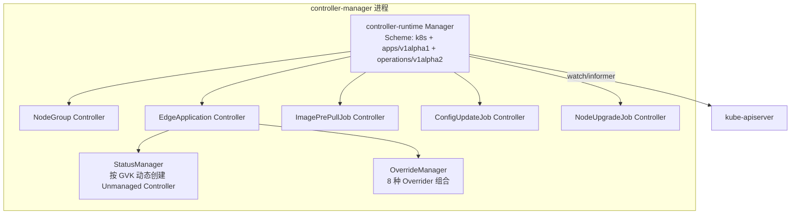
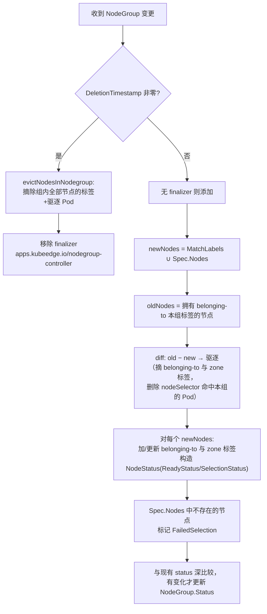
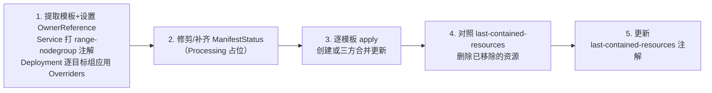
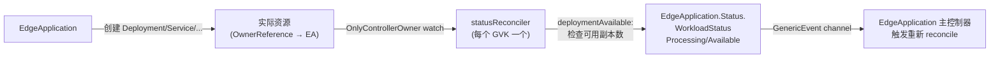
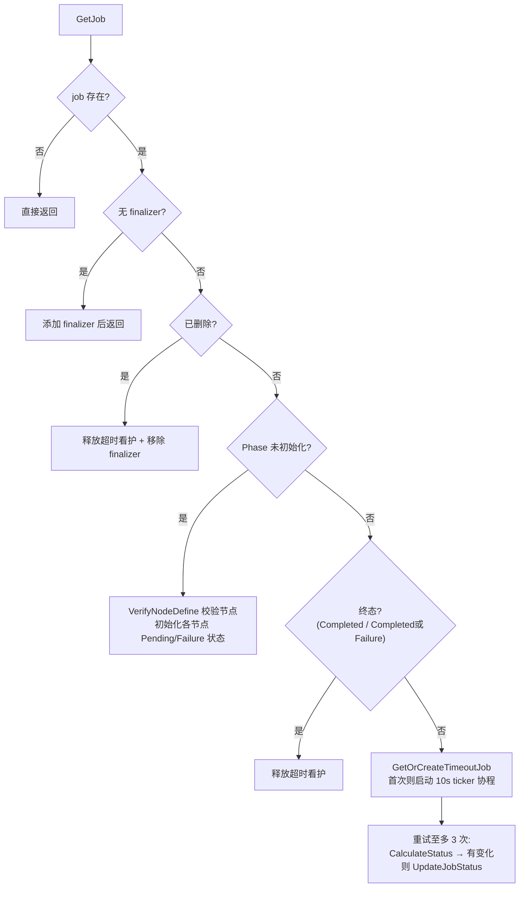
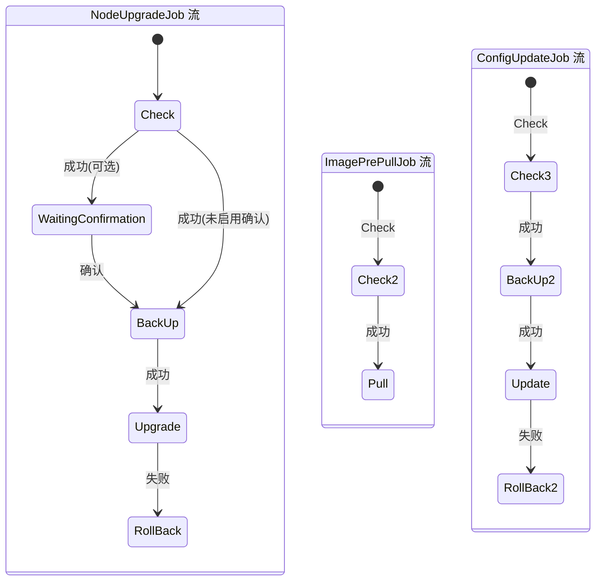
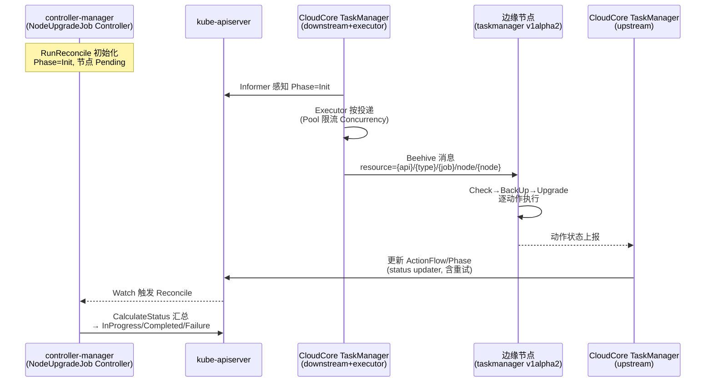

ControllerManager（`controller-manager` 二进制）是 KubeEdge 云端组件中的"应用与节点编排中枢"。它不直接与边缘节点通信，而是基于 controller-runtime 的一组 Kubernetes 控制器，负责三件事：**将节点组织为 NodeGroup**、**将 EdgeApplication 中的工作负载模板按节点组差异化解为真实的 Kubernetes 资源**，以及**驱动三类节点任务（升级/镜像预拉取/配置更新）的全生命周期状态机**。理解这个组件的关键在于把握它的三层结构：控制器宿主进程、可组合的覆盖与状态子系统，以及跨进程的云边投递链路。

Sources: [controllermanager.go](cloud/pkg/controllermanager/controllermanager.go#L34-L65)

## 架构总览：一个二进制与五个控制器

与 KubeEdge 中基于 Beehive 模块框架的 CloudCore 不同，ControllerManager 是一个纯粹基于 `sigs.k8s.io/controller-runtime` 的进程。`NewControllerManager` 函数创建一个注入了 `kubeedgeScheme`（Kubernetes 内置类型 + KubeEdge apps/operations 两个 API 组）的 Manager，注册恒真的 healthz/readyz 探针，然后调用 `setupControllers` 完成控制器装配。

`setupControllers` 中的装配逻辑揭示了一个重要的版本分界：NodeGroup 与 EdgeApplication 两个控制器无条件注册，而三个节点任务控制器（ImagePrePullJob、ConfigUpdateJob、NodeUpgradeJob）仅在 feature gate `DisableNodeTaskV1alpha2` 未开启时注册——默认关闭该 gate 即使用 v1alpha2 新架构，开启则回退到 legacy 路径（详见后文版本演进一节）。

五个控制器的职责与目标资源如下表所示。注意所有节点任务 CRD 均为集群级资源，与 NodeGroup 一致，这与 EdgeApplication 的命名空间级资源形成对比。

| 控制器 | 目标 CRD | 作用域 | 核心职责 |
|---|---|---|---|
| NodeGroup Controller | `NodeGroup`（apps.kubeedge.io） | Cluster | 维护组成员标签、驱逐非成员、汇总节点就绪状态 |
| EdgeApplication Controller | `EdgeApplication`（apps.kubeedge.io） | Namespaced | 模板复制 × 节点组覆盖 → 生成实际资源，回写部署状态 |
| ImagePrePullJob Controller | `ImagePrePullJob`（operations.kubeedge.io） | Cluster | 镜像预拉取任务的节点状态汇总与超时看护 |
| ConfigUpdateJob Controller | `ConfigUpdateJob`（operations.kubeedge.io） | Cluster | 边缘配置更新任务的状态汇总与超时看护 |
| NodeUpgradeJob Controller | `NodeUpgradeJob`（operations.kubeedge.io） | Cluster | 边缘节点 EdgeCore 升级任务的状态汇总与超时看护 |

Sources: [controllermanager.go](cloud/pkg/controllermanager/controllermanager.go#L67-L93), [options.go](cloud/cmd/controllermanager/app/options/options.go#L7-L23)

## NodeGroup 控制器：组成员关系与节点驱逐

NodeGroup 的 API 模型刻意保持简单：`Spec.Nodes`（按名字列举）与 `Spec.MatchLabels`（按标签选择）二者的**并集**构成组的期望成员，`Spec.TopologyEnabled` 决定是否为成员节点附加拓扑标签。控制器通过在 Node 对象上打 `apps.kubeedge.io/belonging-to=<组名>` 标签来物化"成员关系"这一事实——这是一个精心设计的选择：后续的 EdgeApplication 覆盖、Pod 驱逐、调度约束全部复用这一个标签，而不是引入新的关联对象。

Sources: [nodegroup_types.go](staging/src/github.com/kubeedge/api/apis/apps/v1alpha1/nodegroup_types.go#L24-L36), [nodegroupcontroller.go](cloud/pkg/controllermanager/nodegroup/nodegroupcontroller.go#L25-L34)

驱逐逻辑值得展开。当节点离开组（或组被删除）时，`evictNodes` 除了摘除 `belonging-to` 与 `topology.kubernetes.io/zone` 标签外，还会**主动删除** nodeSelector 中包含该组标签的 Pod。为了高效查询某节点上的 Pod，控制器在 `SetupWithManager` 中为 Pod 注册了 `spec.nodeName` 字段索引，随后 `evictPodsShouldNotRunOnNode` 利用 `MatchingFieldsSelector` 直接列出目标节点上的 Pod 逐个删除。代码注释中留有一个 TODO：Pod 删除是同步阻塞式的，未来可能改为异步驱逐——这意味着当前实现下，大规模节点组的成员变更会产生可观的 API 调用量。

Sources: [nodegroupcontroller.go](cloud/pkg/controllermanager/nodegroup/nodegroupcontroller.go#L199-L244), [nodegroupcontroller.go](cloud/pkg/controllermanager/nodegroup/nodegroupcontroller.go#L186-L197)

标签的归属是排他的。`addOrUpdateNodeLabel` 在发现节点已带有其他组的 `belonging-to` 标签时会直接报错（"has already belonged to NodeGroup"），即一个节点至多属于一个组。而事件侧的 `nodeMapFunc` 则负责把 Node 的变更路由回 NodeGroup 的 reconcile：若节点已有 belonging-to 标签则直接映射到对应组；否则遍历所有 NodeGroup，用标签选择器匹配"即将加入某组"的新节点。这意味着新节点的接入由 Node 事件驱动，而非周期性全量同步。

Sources: [nodegroupcontroller.go](cloud/pkg/controllermanager/nodegroup/nodegroupcontroller.go#L358-L399), [nodegroupcontroller.go](cloud/pkg/controllermanager/nodegroup/nodegroupcontroller.go#L280-L313)

状态汇总部分，控制器将每个成员节点的 Ready 条件（True/False/Unknown，缺失 Ready 条件同样映射为 Unknown）与选择结果（Succeeded/Failed 及原因）写入 `NodeGroup.Status.NodeStatuses`，并在写入前做了深比较以避免无意义的 status 更新风暴。这是 KubeEdge 控制器的普遍范式：**先 diff 再写**，对高变更频率的节点状态尤其重要。

Sources: [nodegroupcontroller.go](cloud/pkg/controllermanager/nodegroup/nodegroupcontroller.go#L137-L183), [nodegroup_types.go](staging/src/github.com/kubeedge/api/apis/apps/v1alpha1/nodegroup_types.go#L47-L85)

## EdgeApplication 控制器：一模板多覆盖的分发机制

EdgeApplication 解决的核心问题是：**同一份工作负载模板，如何在不同节点组中以差异化形态部署**。其 Spec 由两部分构成——`WorkloadTemplate.Manifests` 存放原始 Kubernetes 资源（JSON/Raw Extension 形式），`WorkloadScope` 声明分发目标。Scope 支持两个维度，且可以混用：

| Scope 维度 | 字段 | 匹配机制 | 覆盖约束注入方式 |
|---|---|---|---|
| 节点组 | `TargetNodeGroups[].Name + Overriders` | 复用 NodeGroup 的 belonging-to 标签 | 注入 `spec.template.spec.nodeSelector` |
| 独立标签 | `TargetNodeLabels[].LabelSelector + Overriders` | 直接匹配 Node 标签，不依赖 NodeGroup | 注入 required nodeAffinity MatchExpressions |

Sources: [edgeapplication_types.go](staging/src/github.com/kubeedge/api/apis/apps/v1alpha1/edgeapplication_types.go#L26-L64), [utils.go](cloud/pkg/controllermanager/edgeapplication/utils/utils.go#L60-L84)

`syncEdgeApplication` 是整个控制器的心脏，它把一次 reconcile 分解为五步，每步都容忍部分失败并聚合错误继续执行：

Sources: [edgeapplicationcontroller.go](cloud/pkg/controllermanager/edgeapplication/edgeapplicationcontroller.go#L120-L198)

**第一步**中有两个容易忽略的分支：Service 模板不做覆盖，只附加 `apps.kubeedge.io/service-topology: range-nodegroup` 注解，这是给 Edgemesh 服务拓扑用的范围声明；而 `needOverride` 以 GVK 白名单（当前仅 `apps/v1 Deployment`）判定哪些模板需要经过覆盖管线，其余资源原样透传。也就是说，当前的差异化部署能力**只对 Deployment 生效**。

Sources: [edgeapplicationcontroller.go](cloud/pkg/controllermanager/edgeapplication/edgeapplicationcontroller.go#L132-L164), [constants.go](cloud/pkg/controllermanager/edgeapplication/constants/constants.go#L10-L23), [edgeapplicationcontroller.go](cloud/pkg/controllermanager/edgeapplication/edgeapplicationcontroller.go#L609-L642)

### OverrideManager：JSON Patch 组成的覆盖管线

覆盖体系是一个策略模式加组合模式的结构：`Overrider` 接口只有一个方法 `ApplyOverrides(unstructured, OverriderInfo)`，`OverrideManager` 持有一个 Overrider 切片并逐一应用。每种 Overrider 的产出物是 JSON Patch 操作（op/path/value），最终通过 `applyJSONPatch` 统一施加在 unstructured 对象上——这个设计使覆盖规则与资源类型解耦，新增资源支持只需扩展 Overrider。

| Overrider | 作用字段 | 支持算子 |
|---|---|---|
| NameOverrider | 资源名（多组部署时防重名） | add/replace |
| ReplicasOverrider | `spec.replicas` | add/replace |
| ImageOverrider | 容器镜像的 Registry/Repository/Tag 分量 | add/remove/replace |
| NodeSelectorOverrider | `spec.template.spec.nodeSelector` / nodeAffinity | 结构化注入 |
| CommandOverrider / ArgsOverrider | 容器 command/args | add/remove |
| EnvOverrider | 容器 env | add/remove/replace |
| ResourcesOverrider | 容器 resources | 整体替换 |

其中 ImageOverrider 值得单独说明：它是从 Karmada 的 imageoverride 实现派生的（源文件头部 CHANGELOG 注明），支持 `ImagePredicate` 过滤目标字段路径，未指定 Predicate 时会按 Pod/ReplicaSet/Deployment/DaemonSet/StatefulSet 的惯例路径自动探测所有容器镜像。`Component` 字段把镜像名拆解为 `[registry/]repository[:tag]` 三段，允许只替换 Tag（如各节点组使用不同架构 tag）而保留其余部分。

Sources: [overridemanager.go](cloud/pkg/controllermanager/edgeapplication/overridemanager/overridemanager.go#L16-L71), [imageoverrider.go](cloud/pkg/controllermanager/edgeapplication/overridemanager/imageoverrider.go#L1-L51), [edgeapplicationcontroller.go](cloud/pkg/controllermanager/edgeapplication/edgeapplicationcontroller.go#L47-L65)

NodeSelectorOverrider 是连接 EdgeApplication 与 NodeGroup 的枢纽，它的行为精确对应 Scope 的两个维度：面向 `TargetNodeGroup` 时，直接把 `{apps.kubeedge.io/belonging-to: <组名>}` 写入 Deployment 的 `spec.template.spec.nodeSelector`——Pod 因此只能调度到打了该组标签的节点上，这与 NodeGroup 控制器维护的标签形成闭环；面向 `TargetNodeLabels` 时则构造 required nodeAffinity 的 MatchExpressions，将标签选择器翻译为亲和性约束。这解释了为什么驱逐逻辑要删除 nodeSelector 含 belonging-to 标签的 Pod：那个标签正是这里注入的。

Sources: [nodeselectoroverrider.go](cloud/pkg/controllermanager/edgeapplication/overridemanager/nodeselectoroverrider.go#L15-L65)

### 三方合并更新：last-applied-template 注解

EdgeApplication 生成的资源更新遵循 kubectl apply 的经典语义。每个被创建的资源都会记录 `apps.kubeedge.io/last-applied-template` 注解（完整模板 JSON）；更新时，控制器计算"上次模板 → 新模板"的 merge patch，再把该 patch 应用到**当前实际对象**上，实现三方合并。这保证了用户在模板之外对存活对象做的修改不会被无声抹除。`--use-server-side-apply` 启动参数可切换为直接 Update（代码中标注为 SSA 切换，但当前实现是整体替换更新）。`apps.kubeedge.io/last-contained-resources` 注解则记录上一轮包含的资源清单，用于检测 manifests 中被移除的条目并级联删除——这两条注解共同构成了 EdgeApplication 的声明式生命周期凭证。

Sources: [edgeapplicationcontroller.go](cloud/pkg/controllermanager/edgeapplication/edgeapplicationcontroller.go#L485-L546), [edgeapplicationcontroller.go](cloud/pkg/controllermanager/edgeapplication/edgeapplicationcontroller.go#L200-L222)

### StatusManager：动态 GVK 状态回写

EdgeApplication 状态回写的难点在于：它创建的资源类型在编译期不可知（manifests 里可以放任何 GVK）。StatusManager 的解法是为实际用到的每个 GVK **动态创建 Unmanaged Controller**：`startToWatch` 以 `controller.NewUnmanaged` 构建控制器，watch 范围限定为"以该 EdgeApplication 为 Controller Owner 的资源"（`TypedEnqueueRequestForOwner` + `OnlyControllerOwner`），每个 GVK 对应一个 `statusReconciler`，通过 watch/cancel 两个 channel 管理生命周期，另有每 5 分钟一次的 GC 例程清理。

`statusReconciler` 中有一个策略分叉：Deployment GVK 使用 `deploymentAvailable` 策略（判定条件是 Deployment 的可用副本数），其他 GVK 使用 `availableIfExists`（对象存在即可用）——代码注释明确说明这是当前仅支持 Deployment 覆盖下的临时策略。特别地，statusReconciler 在同步末尾会向主控制器注入一个 GenericEvent，处理"资源被外部删除但 EdgeApplication status 未变化"的场景，避免删除的对象要等下一次 resync 才被重建。

Sources: [statusmanager.go](cloud/pkg/controllermanager/edgeapplication/statusmanager/statusmanager.go#L59-L119), [statusmanager.go](cloud/pkg/controllermanager/edgeapplication/statusmanager/statusmanager.go#L168-L200), [reconciler.go](cloud/pkg/controllermanager/edgeapplication/statusmanager/reconciler.go#L50-L113)

## 节点任务框架：泛型 Reconcile 与三类作业

节点任务是 KubeEdge 云端驱动边缘"执行动作"的机制，v1alpha2 提供三个集群级 CRD：`NodeUpgradeJob`（升级边缘 EdgeCore）、`ImagePrePullJob`（预拉取镜像）与 `ConfigUpdateJob`（更新边缘配置）。三者共享同一套 CRD Schema 范式与控制器骨架，这是通过 Go 泛型实现的：`NodeJobType` 接口约束了三种作业类型，`ReconcileHandler[T]` 定义了十几个语义钩子（GetJob/NoFinalizer/AddFinalizer/NotInitialized/InitNodesStatus/IsFinalPhase/CalculateStatus/CheckTimeout 等），而 `RunReconcile` 是所有作业共用的模板方法。

以 NodeUpgradeJob 为例，其 Spec 的关键字段体现了任务编排的经典考量：

| 字段 | 语义 | 默认值 |
|---|---|---|
| `Version` | 目标 EdgeCore 版本（必填） | — |
| `NodeNames` / `LabelSelector` | 按名/按标签选节点，二者**互斥**，必须二选一 | — |
| `Concurrency` | 每个 CloudCore 实例同时升级的节点数上限 | 1 |
| `TimeoutSeconds` | 任务超时时间 | 300 |
| `FailureTolerate` | 失败容忍比例 | 0.1 |
| `CheckItems` | 升级前检查项（cpu/mem/disk） | nil |
| `RequireConfirmation` | 是否需要人工确认（插入 WaitingConfirmation 动作） | false |
| `Image` | 升级工具镜像（含 keadm + edgecore） | kubeedge/installation-package |

Sources: [reconcile_runner.go](cloud/pkg/controllermanager/nodetask/reconcile_runner.go#L34-L78), [types_nodeupgrade.go](staging/src/github.com/kubeedge/api/apis/operations/v1alpha2/types_nodeupgrade.go#L66-L125)

`RunReconcile` 的执行序列本身就是一张状态机驱动表：

Sources: [reconcile_runner.go](cloud/pkg/controllermanager/nodetask/reconcile_runner.go#L86-L147)

初始化阶段的 `VerifyNodeDefine` 强制执行 NodeNames 与 LabelSelector 的互斥约束，并逐节点验证：必须是真实存在、是边缘节点（`IsEdgeNode`）、且处于 Ready 状态，否则对应节点任务直接置为 Failure 并写入原因。这个前置校验避免了向不存在的节点投递任务消息的浪费。

Sources: [node_verify.go](cloud/pkg/controllermanager/nodetask/node_verify.go#L41-L80), [nodeupgradejob_handler.go](cloud/pkg/controllermanager/nodetask/nodeupgradejob_handler.go#L86-L109)

### 阶段计算与容错

整体作业阶段（JobPhase）与单节点任务阶段（NodeTaskPhase）是两层模型。`CalculatePhaseWithCounts` 用高精度十进制（shopspring/decimal，避免浮点误差）实现容错判断：

| 条件 | JobPhase 结果 |
|---|---|
| 节点总数为 0 | Failure |
| 仍有节点处于处理中 | InProgress |
| 失败比例（保留 2 位小数）> FailureTolerate | Failure（附带超限原因） |
| 其余（含失败但未超容忍） | Completed |

值得注意的细节：NodeUpgradeJob 的 `IsFinalPhase` 只认 `Completed`，而 ImagePrePullJob 认 `Completed` 和 `Failure` 两者——升级作业进入 Failure 后允许重试路径（requeue 循环），而镜像预拉取作业到达任一终态即停止看护。单节点阶段则包含 `Unknown`，它由超时看护产生，并在计算时与 Failure 同等计入失败数。

Sources: [calculation.go](cloud/pkg/controllermanager/nodetask/calculation.go#L30-L60), [nodeupgradejob_handler.go](cloud/pkg/controllermanager/nodetask/nodeupgradejob_handler.go#L111-L151), [imageprepulljob_handler.go](cloud/pkg/controllermanager/nodetask/imageprepulljob_handler.go#L112-L115)

### 超时看护：TimeoutJob

每个处于非终态的作业都会在首次 reconcile 时于全局 `sync.Map` 中注册一个 `TimeoutJob`——一个每 10 秒 tick 一次的后台协程。它调用各 handler 的 `CheckTimeout`：仅对 InProgress 作业，遍历未到终态的节点任务，以 `ActionFlow` 中最后一个动作的上报时间 + TimeoutSeconds 为界，超时者置为 Unknown。作业到达终态或被删除时，`ReleaseTimeoutJob` 从 map 中摘除并停止协程。这一设计与 reconcile 循环解耦，保证即使没有新事件触发，停滞的任务也能被推进到明确终态。

Sources: [timeout_job.go](cloud/pkg/controllermanager/nodetask/timeout_job.go#L27-L111), [nodeupgradejob_handler.go](cloud/pkg/controllermanager/nodetask/nodeupgradejob_handler.go#L161-L205)

### ActionFlow：边缘侧动作序列的契约

云端与边缘对"任务要经历哪些动作"达成共识的载体是 `pkg/nodetask/actionflow` 中定义的链表式动作流。每类作业一条流，动作以 `NextSuccessful`/`NextFailure` 两个指针连接：

Sources: [action_flow.go](pkg/nodetask/actionflow/action_flow.go#L65-L119)

这条动作链是云边之间的**契约**：边缘执行器沿链推进并逐动作上报，云端用 `action.Next(success)` 判定下一动作，并依据"成功且无后继，或失败且无后继"判定 `isFinalAction`。升级动作流中 RollBack 的存在意味着升级失败会自动回退到备份版本，这与 BackUp 动作的前置呼应。

Sources: [action_flow.go](pkg/nodetask/actionflow/action_flow.go#L22-L63)

## 云边投递链路：ControllerManager 与 TaskManager 的分工

这是本组件最容易被误解的部分：**controller-manager 二进制不发送任何消息到边缘**。节点任务的投递由运行在 CloudCore 内的 TaskManager 模块（Beehive module）完成，两者通过 Kubernetes API 解耦。完整链路如下：

Sources: [downstream/downstream.go](cloud/pkg/taskmanager/downstream/downstream.go#L104-L138), [task_manager.go](cloud/pkg/taskmanager/task_manager.go#L115-L156)

投递侧有几个精妙的工程约束。其一，下游仅当作业处于 `Init` 阶段时放行（`CanDownstreamPhase`），且注释说明当前不支持重试执行——任务不会二次投递。其二，`NodeTaskExecutor` 为每个作业维护一个以 `Concurrency` 为容量的信号量 Pool，且投递前会通过 CloudHub 的 SessionManager 获取**当前 CloudCore 实例已连接**的节点列表，未连接的节点直接标记失败（"not connected to the current cloudcore instance"）——这在多 CloudCore HA 部署下是正确性保证：每个实例只对自己的会话负责。其三，作业 CR 被删除时，`InterruptExecutor` 会找到运行中的执行器并中断，避免幽灵任务继续扩散。

Sources: [downstream/node_upgrade.go](cloud/pkg/taskmanager/downstream/node_upgrade.go#L68-L98), [executor/executor.go](cloud/pkg/taskmanager/executor/executor.go#L119-L178), [executor/pool.go](cloud/pkg/taskmanager/executor/pool.go#L19-L42)

上游回传侧，TaskManager 的 `dispatchMessage` 循环从消息层接收边缘上报，用 `IsNodeJobResource`（按 API 组前缀判断）区分 v1alpha2 与 v1alpha1 消息并路由到不同 channel。upstream 处理器解析消息体 `UpstreamMessage{action, succ, finishTime, reason, extend}` 与资源字符串（格式为 `{apiversion}/{resource_type}/{job_name}/node/{node_name}`），查 ActionFlow 确定是否终态动作，终态时释放执行器并发额度（`FinishTask`），随后由各作业专属的 status updater 将动作状态追加到 `ActionFlow` 数组、解析 extend 中的新旧版本号，并以带重试的乐观并发方式写回 CR status。

Sources: [upstream/upstream.go](cloud/pkg/taskmanager/upstream/upstream.go#L57-L144), [upstream/node_upgrade.go](cloud/pkg/taskmanager/upstream/node_upgrade.go#L62-L110), [status/node_upgrade.go](cloud/pkg/taskmanager/status/node_upgrade.go#L30-L78), [message/message.go](pkg/nodetask/message/message.go#L33-L107)

## 版本演进：v1alpha1 与 v1alpha2 双轨

节点任务体系正处在一个显式的迁移期。`DisableNodeTaskV1alpha2` gate 的语义是反直觉的：**开启**它才是禁用新架构、回退 v1alpha1 旧链路（`cloud/pkg/taskmanager/v1alpha1` 下的 NodeUpgradeController/ImagePrePullController 与 ExecutorMachine）。源码注释明确：v1.23 之后该开关将被移除，仅保留 v1alpha2+。

| 维度 | v1alpha1（legacy） | v1alpha2（当前默认） |
|---|---|---|
| 控制器位置 | 全部在 CloudCore TaskManager 内（informer + 手写循环） | 状态机在 controller-manager 二进制（controller-runtime）；投递在 CloudCore TaskManager |
| 消息投递 | ExecutorMachine 直连 | NodeTaskExecutor + 信号量 Pool + 连接感知 |
| 状态模型 | 扁平 State 字段（FSM） | JobPhase/NodeTaskPhase 两层 + ActionFlow 动作轨迹 |
| 支持作业 | NodeUpgradeJob、ImagePrePullJob | NodeUpgradeJob、ImagePrePullJob、**ConfigUpdateJob（新增）** |
| 生命周期 | — | Finalizer + 超时看护 + 中断机制 |

Sources: [features.go](pkg/features/features.go#L37-L49), [task_manager.go](cloud/pkg/taskmanager/task_manager.go#L73-L125), [types_nodeupgrade.go](staging/src/github.com/kubeedge/api/apis/operations/v1alpha2/types_nodeupgrade.go#L177-L200)

## 关键设计取舍

综合代码证据，ControllerManager 的架构呈现四个值得记住的设计决策。**单一事实标签**：节点组成员关系物化为 Node 上的一个 label，NodeGroup 控制器维护它、NodeSelectorOverrider 消费它、驱逐逻辑依据它，避免了独立的成员关联对象。**进程职责分离**：controller-manager 负责"决策"（状态机、容错计算、超时判定），CloudCore TaskManager 负责"运输"（限流投递、会话感知、状态回写），两者只通过 CR status 通信，任何一方重启都不破坏任务语义。**泛型模板方法**：`RunReconcile[T]` + `ReconcileHandler[T]` 把三类作业的共有生命周期收敛为一份代码，新作业类型只需实现约十个语义钩子。**乐观容错同步**：从 NodeGroup 的 status 深比较到 NodeTask 状态更新的 3 次重试，处处体现"先 diff 再写、冲突重试"的分布式习惯，这也是它能在大规模节点场景下保持低 API 压力的原因。

Sources: [nodegroupcontroller.go](cloud/pkg/controllermanager/nodegroup/nodegroupcontroller.go#L363-L383), [reconcile_runner.go](cloud/pkg/controllermanager/nodetask/reconcile_runner.go#L131-L146), [executor/executor.go](cloud/pkg/taskmanager/executor/executor.go#L157-L161)

## 延伸阅读

- 若需理解边缘侧如何接收与执行这些任务消息，请继续阅读 [EdgeCore：模块化边缘核心与启动生命周期](15-edgecore-mo-kuah-hua-bian-yuan-he-xin-yu-qi-dong-sheng-ming-zhou-qi) 中 taskmanager 模块的部分。
- 节点任务消息依赖的云边长连接与会话管理，详见 [CloudHub：云边长连接网关与消息分发](8-cloudhub-yun-bian-chang-lian-jie-wang-guan-yu-xiao-xi-fen-fa)。
- EdgeApplication 依赖的 CRD 定义与代码生成体系，详见 [API 定义、CRD 规范与代码生成体系](24-api-ding-yi-crd-gui-fan-yu-dai-ma-sheng-cheng-ti-xi)。
- 节点升级任务的边缘侧动作（Check/BackUp/Upgrade/RollBack）的执行细节与升级可靠性，参见设计提案 [设计提案导读：理解架构演进决策](30-she-ji-ti-an-dao-du-li-jie-jia-gou-yan-jin-jue-ce)。