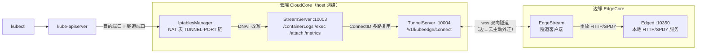
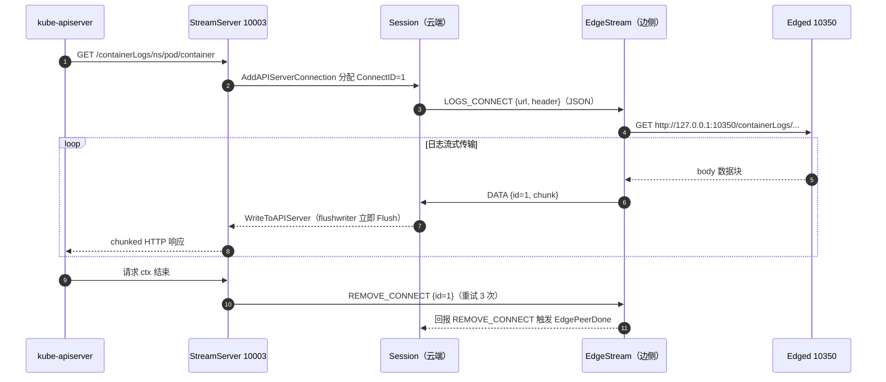
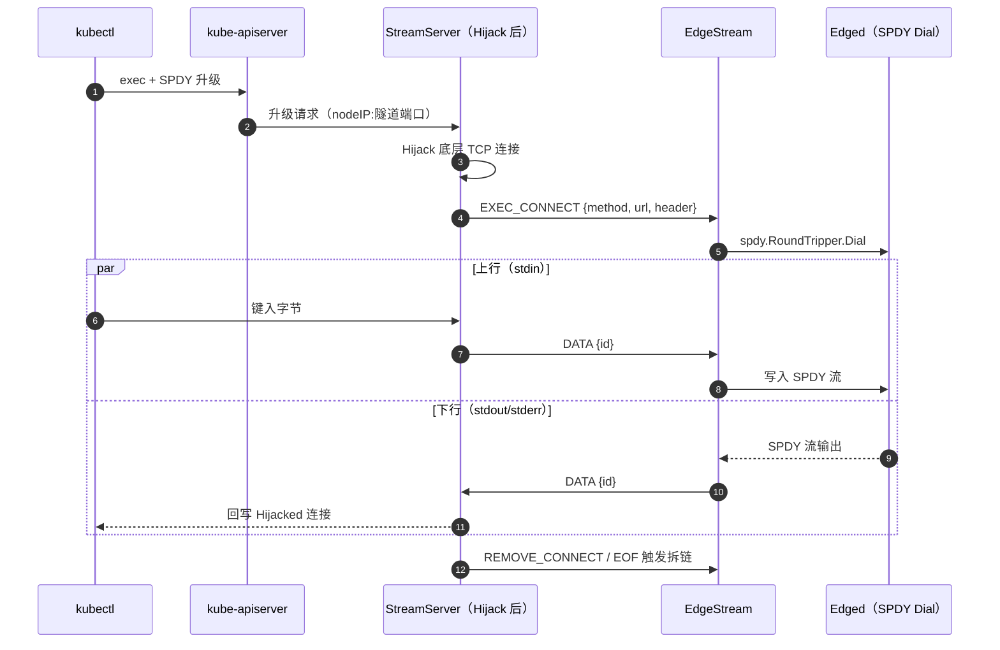

当工程师在边缘集群中敲下 `kubectl logs`、`kubectl exec` 或 `kubectl top` 时，请求并不会像标准 Kubernetes 那样由 kube-apiserver 直接反向连接节点上的 kubelet——边缘节点通常藏在 NAT 与防火墙之后，云端根本无法主动触达。KubeEdge 的解法不是"打通网络"，而是"拦截与扮演"：云端 CloudStream 模块伪装成 kubelet 接收请求，边侧 EdgeStream 模块主动外连建立隧道，再把请求在边缘本地重放给 Edged。本文以 `cloud/pkg/cloudstream`、`edge/pkg/edgestream` 与共享库 `pkg/stream` 三个代码域为主线，拆解这条云边隧道的架构、报文协议与转发模式。

## 设计动机：apiserver 无法直连 kubelet

在原生 Kubernetes 中，`kubectl exec/logs` 与 metrics 采集都遵循同一个模式：kube-apiserver 根据 Node 对象上的 kubelet 端口，向 `nodeIP:10250` 发起 HTTP(S) 请求（exec/attach 还要经 SPDY 协议升级）。这一模式隐含前提是**云端到节点的网络可达**，而边缘场景恰恰不满足。CloudStream 的代码注释对此有一句精确的概括：apiserver 发起的三类连接请求（containerLogs、containerExec、Metric）先被 CloudStream 模块拦截，再经隧道发送给边侧的 EdgeStream 模块处理。

由于隧道方向被反转为**边缘主动连云**（与 CloudHub 的 WebSocket 长连接同构），整个体系只需要"边→云"的单向连通性即可工作，这正是 KubeEdge 全部云边交互的统一网络假设。这也解释了为何 EdgeStream 复用 EdgeHub 签发的证书体系：隧道的建立完全依赖与 CloudHub 相同的 CA 与证书分发链路。

Sources: [apiserverconnection.go](cloud/pkg/cloudstream/apiserverconnection.go#L14-L17), [edgestream.go](edge/pkg/edgestream/edgestream.go#L84-L118)

## 端到端数据通路全景

理解 CloudStream 的关键是分清**两个 TCP 监听端口与一条 WebSocket 隧道**的职责边界：StreamServer（默认 10003）面向 kube-apiserver 接收 REST/SPDY 请求；TunnelServer（默认 10004）面向边缘节点接受 EdgeStream 的 WebSocket 拨入；两者之间通过内存中的 `Session` 对象衔接。而请求之所以能"找到" StreamServer，依赖两处精心设计的寻址魔法——Node 状态中 kubelet 端口被改写为隧道端口，以及 iptables 将该端口的流量 DNAT 到 StreamServer（后文详述）。

一次典型的 `kubectl logs` 请求要经历六跳：kubectl → kube-apiserver → （iptables 重定向）→ StreamServer → Session/TunnelServer → EdgeStream → Edged。数据回流则沿着同一隧道以自定义二进制协议逐块回传，由 Session 按连接 ID 分发回对应的 HTTP 响应写出器。

Sources: [streamserver.go](cloud/pkg/cloudstream/streamserver.go#L55-L113), [tunnelserver.go](cloud/pkg/cloudstream/tunnelserver.go#L95-L101), [edgestream.go](edge/pkg/edgestream/edgestream.go#L85-L89), [default.go](common/constants/default.go#L66-L69)

## 云端：CloudStream 模块与双服务器

### 生命周期与 TLS 启动依赖

CloudStream 是一个标准的 Beehive 模块，`Register` 时通过 `InitConfigure` 加载隧道 CA、证书与私钥文件（若本地隧道证书缺失，运行期会回落到 CloudHub 的配置）。它的 `Start` 有一个容易被忽视的启动依赖：必须等待 `cloudhub.DoneTLSTunnelCerts` 通道信号——该信号在 CloudHub 完成 `PrepareAllCerts`（证书不存在时自动生成）之后发出。这一等待保证了 TunnelServer 启动时证书链已就绪，边侧节点才有可能完成 mTLS 握手。

对应地，边侧 EdgeStream 的 `Start` 也有镜像依赖：它阻塞在 `edgehub.GetCertSyncChannel` 上，等待 EdgeHub 完成证书签发后才加载密钥对外拨号。云边两侧通过各自的证书准备事件对齐启动时序，是理解"为什么隧道迟迟建不起来"类问题时的重要排查线索。

Sources: [cloudstream.go](cloud/pkg/cloudstream/cloudstream.go#L41-L67), [cloudhub.go](cloud/pkg/cloudhub/cloudhub.go#L109-L116), [config.go](cloud/pkg/cloudstream/config/config.go#L39-L73), [edgestream.go](edge/pkg/edgestream/edgestream.go#L90-L98)

### TunnelServer：隧道会话注册表

TunnelServer 只暴露一条路由——`GET /v1/kubeedge/connect`，即 EdgeStream 的拨入端点。握手 HTTP 头中携带两个会话身份：`SessionHostNameOverride`（节点名）与 `SessionInternalIP`（节点内网 IP，缺省时从 RemoteAddr 解析）。握手成功升级为 WebSocket 后，云端先执行一个关键的元数据操作：`updateNodeKubeletEndpoint` 将该节点的 `status.daemonEndpoints.kubeletEndpoint.port` 改写为隧道端口，让 kube-apiserver 后续"连 kubelet"时实际拨向隧道端口。改写失败（如节点对象尚未注册）时，云端会向边侧发送 `MessageTypeCloseConnect` 并拒绝本次会话，EdgeStream 收到后断开重连。

会话注册采用**双键映射**：节点名与内网 IP 各自指向同一个 `Session` 对象。节点名键服务于 logs/exec 场景（通过 Pod 对象反查 `Spec.NodeName`），IP 键服务于 metrics 场景（apiserver 拨号时的 `Host` 头是节点 IP）。此外 `addNodeIP` 维护节点名到 IP 的映射，用于 metrics 转发时改写 Host 头。TunnelServer 自身的 TLS 策略是严格的 `RequireAndVerifyClientCert`（TLS 1.2、ECDHE-ECDSA-AES128-GCM-SHA256），即只有持有合法边缘证书的节点才能接入隧道——这与面向 apiserver 的 StreamServer 形成鲜明对比（后者仅需 `RequestClientCert`）。

Sources: [tunnelserver.go](cloud/pkg/cloudstream/tunnelserver.go#L95-L101), [tunnelserver.go](cloud/pkg/cloudstream/tunnelserver.go#L128-L162), [tunnelserver.go](cloud/pkg/cloudstream/tunnelserver.go#L200-L207), [tunnelserver.go](cloud/pkg/cloudstream/tunnelserver.go#L216-L241), [constants.go](pkg/stream/constants.go#L3-L6)

### StreamServer：面向 apiserver 的 REST 门面

StreamServer 借助 go-restful 注册了五组路由，完整复刻 kubelet 的 URL 空间：`/containerLogs/{ns}/{pod}/{container}`、`/exec`、`/attach`、`/stats` 系列与 `/metrics` 系列（后者明确标注服务于 Prometheus）。这些处理函数的公共骨架高度一致：定位会话 → 构造对应的 `APIServerConnection` → 注册到 Session 获取 ConnectID → 进入各自的 `Serve` 循环。

不同请求类型在"如何持有 apiserver 侧连接"上分道扬镳：logs 使用 chunked 传输编码加 `flushwriter` 实现流式回写；exec/attach 先校验 `httpstream.IsUpgradeRequest`，再通过 `http.Hijacker` **劫持底层 TCP 连接**（因为 SPDY 协议升级后已脱离 HTTP 语义，需要原始字节流双向读写）；metrics 则直接持有 `http.ResponseWriter`。会话定位也有两种路径：logs/exec/attach 从 URL 中截取命名空间与 Pod 名，再经 kube client 查询 Pod 所在节点；metrics 则优先从 `X-Forwarded-Uri`（apiserver 聚合代理场景 `/api/v1/nodes/{name}/proxy/...`）解析节点名，否则从 `Host` 头取 IP 并在命中 `addNodeIP` 映射时改写为 `nodeIP:10350`。

Sources: [streamserver.go](cloud/pkg/cloudstream/streamserver.go#L55-L113), [streamserver.go](cloud/pkg/cloudstream/streamserver.go#L115-L170), [streamserver.go](cloud/pkg/cloudstream/streamserver.go#L181-L194), [streamserver.go](cloud/pkg/cloudstream/streamserver.go#L242-L262), [streamserver.go](cloud/pkg/cloudstream/streamserver.go#L362-L381), [streamserver.go](cloud/pkg/cloudstream/streamserver.go#L394-L405)

### Session：单隧道上的多路复用器

`Session` 是整条隧道的心脏，其结构注释言简意赅：一条隧道连接（默认 WebSocket）对应来自多个 apiserver 的并发请求。每当 StreamServer 挂载新的 `APIServerConnection`，`AddAPIServerConnection` 便以原子递增的 `nextMessageID` 分配全局唯一的 ConnectID，作为该请求在此隧道上所有报文的复用标识。

数据回流由 `Serve` → `ProxyTunnelMessageToApiserver` 完成：循环读取隧道报文，`MessageTypeRemoveConnect` 触发对端连接的 `SetEdgePeerDone`（通知云侧处理协程退出），`MessageTypeData` 则调用连接对象的 `WriteToAPIServer` 写回 apiserver——注意代码中按返回的 n 值**循环写入直到全部字节落盘**，确保半写场景不丢数据。当隧道本身断开时，`Close` 遍历所有在途连接逐个 `SetEdgePeerDone`，保证 apiserver 侧的 `Serve` 协程不会泄漏。

Sources: [session.go](cloud/pkg/cloudstream/session.go#L30-L59), [session.go](cloud/pkg/cloudstream/session.go#L62-L111), [session.go](cloud/pkg/cloudstream/session.go#L117-L140)

## 隧道报文协议：`pkg/stream` 共享库

云边两侧共享同一份协议实现 `pkg/stream`，报文结构极其精简：`Message{ConnectID uint64, MessageType, Data []byte}`。序列化时 `Bytes()` 用 varint 编码前两个字段再拼接原始 Data，经 WebSocket **TextMessage** 帧发送；读侧 `ReadMessageFromTunnel` 对应地按 varint 解出头部，Data 部分被 `io.LimitReader` 限制在 1 MiB（`MaxRespBodyLength`）以内——这是一个隐式的单报文体积上限，也是 metrics 场景禁用 gzip 的间接原因之一（见后文）。所有写操作经由 `DefaultTunnel` 的互斥锁串行化，避免 gorilla/websocket 并发写崩溃。

| 值 | 常量 | 典型方向 | 语义 |
|---|---|---|---|
| 0 | `MessageTypeLogsConnect` | 云→边 | 建立 logs 请求（JSON 携带 URL/Header） |
| 1 | `MessageTypeExecConnect` | 云→边 | 建立 exec 请求（JSON 携带 Method/URL/Header） |
| 2 | `MessageTypeMetricConnect` | 云→边 | 建立 metrics 请求 |
| 3 | `MessageTypeData` | 双向 | 业务数据字节流 |
| 4 | `MessageTypeRemoveConnect` | 双向 | 通知对端拆除该 ConnectID 的连接 |
| 5 | `MessageTypeCloseConnect` | 云→边 | 要求 EdgeStream 关闭整条隧道并重连 |
| 6 | `MessageTypeAttachConnect` | 云→边 | 建立 attach 请求 |

值得注意的是 `MessageTypeAttachConnect` 排在末位（值为 6）而非与 exec 比邻，说明 attach 支持是后来追加的协议演进——varint 编码天然兼容这种尾部扩展。协议本身没有应用层 ACK 与序号，可靠性与有序性完全委托给 TCP 之上的 WebSocket 语义。

Sources: [message.go](pkg/stream/message.go#L52-L100), [constants.go](pkg/stream/constants.go#L8-L16), [tunnel.go](pkg/stream/tunnel.go#L27-L68), [default.go](common/constants/default.go#L73-L74)

## 边侧：EdgeStream 与 EdgedConnection

### 隧道客户端的拨入与保活

EdgeStream 的主循环堪称简朴：每 2 秒 tick 一次，尝试向 `wss://<TunnelServer>/v1/kubeedge/connect` 发起 WebSocket 拨号，失败则等待下个周期重试（这意味着隧道中断的恢复时间上界约为 2 秒加上握手耗时）。拨号头携带 hostname-override 与节点 IP，TLS 配置加载 EdgeHub 签发的服务器证书对。

`TunnelSession.Serve` 承担两条职责：其一是每 5 秒发送 WebSocket Ping 帧保活（穿透中间设备的连接超时）；其二是消息分发——收到 `MessageTypeCloseConnect` 直接返回错误触发重连；收到四种 Connect 类型时**为每条请求新建 goroutine** 调用 `ServeConnection`，反序列化出对应的 `EdgedXxxConnection`（内置 128 容量的 `ReadChan`）放入本地连接表；收到 `Data`/`RemoveConnect` 则按 ConnectID 查表后 `CacheTunnelMessage` 投递给对应连接的读通道。会话退出时 `DeleteLocalConnection` 逐个清理：先 `CleanChannel` 排空 Stop 信号，再 `CloseReadChannel` 关闭读通道。

Sources: [edgestream.go](edge/pkg/edgestream/edgestream.go#L84-L152), [tunnel.go](edge/pkg/edgestream/tunnel.go#L33-L48), [tunnel.go](edge/pkg/edgestream/tunnel.go#L150-L208), [tunnel.go](edge/pkg/edgestream/tunnel.go#L210-L233)

### 三种 EdgedConnection 在边侧的访问方式

`EdgedConnection` 接口是边侧连接的统一抽象：`CreateConnectMessage`（响应云侧建连）、`CacheTunnelMessage`（接收隧道下行数据）、`Serve`（执行真正的边侧动作）。三种实现在"如何访问 Edged"上呈现三种范式：

- **logs**：普通 `http.Client` GET 请求打向云侧重放 URL（`http://127.0.0.1:10350`），拿到响应体后以 256 字节缓冲循环读取，逐块封装为 `MessageTypeData` 回传隧道；
- **exec/attach**：使用 client-go 的 `spdy.NewRoundTripper` 执行 `Dial`，与 Edged 建立真正的 SPDY 双向流——`receiveFromCloudStream` 把隧道下行数据写入 SPDY 连接（kubectl 的 stdin 方向），`write2CloudStream` 把 SPDY 连接读出的数据回传隧道（stdout/stderr 方向），两个方向均为独立 goroutine；
- **metrics**：普通 GET 请求，但强制设置 `accept-encoding: identity`——代码注释明确解释：当前隧道仅支持 Text 消息，必须禁用压缩；回传时使用 `bufio.Scanner` **按行**切分，每行末尾补 `\n` 后发送，天然契合 Prometheus 文本格式。

所有连接结束时都会以重试 3 次的 `MessageTypeRemoveConnect` 向云端回报，驱动云侧 `EdgePeerDone` 信号触发连接清理，形成协议级的"双向拆链"闭环。

Sources: [edgedconnection.go](pkg/stream/edgedconnection.go#L5-L14), [edgedlogconnection.go](pkg/stream/edgedlogconnection.go#L108-L143), [edgedexecconnection.go](pkg/stream/edgedexecconnection.go#L106-L141), [edgedmetricsconnection.go](pkg/stream/edgedmetricsconnection.go#L107-L138), [edgedattachconnection.go](pkg/stream/edgedattachconnection.go#L116-L125)

## 云侧连接对象与转发模式对比

云侧四种连接对象实现统一的 `APIServerConnection` 接口（`SendConnection`/`WriteToTunnel`/`WriteToAPIServer`/`Serve`/`SetEdgePeerDone` 等）。`SendConnection` 是建连的关键动作：把原始请求的 Method/URL/Header 序列化进 `EdgedXxxConnection`，并将 URL 重写为 `http://127.0.0.1:10350`（`defaultServerHost` + `constants.ServerPort`，即 Edged 的本地服务端口）后经隧道发出——**边侧重放所需的全部上下文都在这一步凝固**。

云侧 `Serve` 的形态因请求方向性而异：logs/metrics 是纯下行流，`Serve` 阻塞在 `select` 上等待"apiserver 侧 ctx 结束→发 RemoveConnect"或"边侧回报结束"；exec/attach 则多一个泵循环——从被劫持的 net.Conn 持续读取 kubectl 上行字节（256 字节缓冲）封装为 Data 消息写入隧道，读到 EOF 同样发 RemoveConnect。一个精巧的并发细节：`SetEdgePeerDone` 通过向 `edgePeerStop` 通道发送信号来通知退出，而 `closeChan` 在 `Serve` 的 defer 中被关闭——双重通道设计避免了对端退出后重复发送信号导致的 goroutine 阻塞或 panic。

| 维度 | logs | exec | attach | metrics |
|---|---|---|---|---|
| 云侧路由 | `/containerLogs` | `/exec` | `/attach` | `/metrics`、`/stats` |
| apiserver 侧连接形态 | chunked HTTP + flushwriter | SPDY 升级 + Hijack | SPDY 升级 + Hijack | 普通 HTTP ResponseWriter |
| 数据方向 | 单向下行 | 双向 | 双向 | 单向下行 |
| 边侧访问 Edged | HTTP GET 流式读 | SPDY Dial 双向流 | SPDY Dial 双向流 | HTTP GET 按行读 |
| 上行数据 | 无 | kubectl stdin | kubectl stdin | 无 |
| 特殊处理 | Transfer-Encoding: chunked | EOF 触发 RemoveConnect | 与 exec 同构 | 强制 identity 编码 |

Sources: [apiserverconnection.go](cloud/pkg/cloudstream/apiserverconnection.go#L14-L35), [containerlog_connection.go](cloud/pkg/cloudstream/containerlog_connection.go#L77-L127), [containerexec_connection.go](cloud/pkg/cloudstream/containerexec_connection.go#L77-L154), [containermetrics_connection.go](cloud/pkg/cloudstream/containermetrics_connection.go#L78-L128), [containerattach_connection.go](cloud/pkg/cloudstream/containerattach_connection.go#L77-L80), [flushwriter/writer.go](pkg/stream/flushwriter/writer.go#L24-L48)

## 关键时序：logs 流式回传与 exec 双向泵

`kubectl logs -f` 的下行流式回传是理解隧道多路复用的最佳样本： apiserver 响应与隧道报文交替出现，`flushwriter` 保证每个数据块即刻 Flush 到客户端——这正是 `kubectl logs -f` 能实时滚动输出的底层保障。

`kubectl exec` 则展示上行路径：apiserver 发起 SPDY 协议升级后被 Hijack，此后 kubectl 的每个按键都以 `Message{Data}` 形式穿过隧道，在边侧被注入 SPDY 连接流向容器 stdin，容器输出沿原路返回——本质上是在一条 WebSocket 上仿真了 SPDY 的双向流语义。

Sources: [streamserver.go](cloud/pkg/cloudstream/streamserver.go#L136-L143), [session.go](cloud/pkg/cloudstream/session.go#L100-L107), [edgedexecconnection.go](pkg/stream/edgedexecconnection.go#L66-L104), [containerlog_connection.go](cloud/pkg/cloudstream/containerlog_connection.go#L108-L126)

## 寻址魔法：KubeletEndpoint 改写与 iptables DNAT

整条通路的起点依赖一个反直觉的事实：kube-apiserver 根本不知道边缘节点的存在差异，它只是按 Node 对象上登记的 kubelet 端口拨号。CloudStream 正是利用这一点完成"流量牵引"——节点接入隧道时把 `kubeletEndpoint.port` 改写为隧道端口（默认 10004），apiserver 便会把 logs/exec/metrics 请求发往 `nodeIP:10004`。改写过程带重试保护：每 20 秒重试、2 分钟超时（`DefaultRetrySleepTime`/`DefaultNodeStatusUpdateTimeout`）。

但请求到达的是"节点的隧道端口"，而真正监听的却是"云端主机的 StreamServer 端口"，中间的鸿沟由 **IptablesManager** 弥合：它在 NAT 表维护 `TUNNEL-PORT` 自定义链，并挂接到 OUTPUT 与 PREROUTING 两个内置链；reconcile 循环（每 10 秒）从 `kube-system/tunnel-port` ConfigMap 的注解中读取所有 CloudCore 实例的 `IP→隧道端口` 记录，生成 DNAT 规则——**只匹配目的端口**（`--dport`），将命中流量改写到对应 CloudCore 主机 IP 的 StreamPort。这套设计服务于多 CloudCore 实例：`NegotiateTunnelPort` 在 cloudcore 启动时为每个实例按 IP 协商互不冲突的隧道端口（协商自 `constants.ServerPort` + 1 即 10351 起步），协商结果写回 ConfigMap 并覆盖本地配置；IptablesManager 还监听 CloudCore Pod 删除事件，及时清理失效记录避免规则悬挂。部署形态分 internal（随 cloudcore 进程、共享主机网络，默认）与 external（独立部署）两种模式。

理解这一段的最佳心智模型是：**Node 元数据改写决定"apiserver 往哪个端口拨号"，iptables 决定"该端口流量落到哪台 CloudCore 的 StreamServer"**，二者缺一不可——这也是排查 `kubectl logs` 卡死时必须同时检查 Node status 与宿主机 iptables 规则的原因。

Sources: [tunnelserver.go](cloud/pkg/cloudstream/tunnelserver.go#L44-L48), [tunnelserver.go](cloud/pkg/cloudstream/tunnelserver.go#L228-L234), [iptables.go](cloud/pkg/cloudstream/iptables/iptables.go#L57-L76), [iptables.go](cloud/pkg/cloudstream/iptables/iptables.go#L161-L202), [iptables.go](cloud/pkg/cloudstream/iptables/iptables.go#L270-L299), [server.go](cloud/cmd/cloudcore/app/server.go#L104-L112), [server.go](cloud/cmd/cloudcore/app/server.go#L271-L278)

## 配置与端口速查

云端 CloudStream 配置位于 `cloudcore.yaml` 的 `modules.cloudStream` 与 `commonConfig` 中：

| 参数 | 默认值 | 说明 |
|---|---|---|
| `enable` | true | 模块开关 |
| `tunnelPort` | 10004 | TunnelServer 监听端口（多实例时被协商结果覆盖） |
| `streamPort` | 10003 | StreamServer 监听端口 |
| `tlsTunnelCAFile` | /etc/kubeedge/ca/rootCA.crt | 隧道 CA（缺省回落 CloudHub 配置） |
| `tlsTunnelCertFile` / `tlsTunnelPrivateKeyFile` | /etc/kubeedge/certs/server.crt / .key | 隧道服务端证书对 |
| `tlsStreamCAFile` | /etc/kubeedge/ca/streamCA.crt | 校验 apiserver 客户端证书的 CA |
| `tlsStreamCertFile` / `tlsStreamPrivateKeyFile` | /etc/kubeedge/certs/stream.crt / .key | StreamServer 服务端证书对 |

边侧 EdgeStream 配置位于 `edgecore.yaml` 的 `edgeStream` 中：

| 参数 | 默认值 | 说明 |
|---|---|---|
| `enable` | true | 模块开关 |
| `server` | 127.0.0.1:10004（必填） | 隧道服务端地址 |
| `handshakeTimeout` | 30s | WebSocket 握手超时 |
| `readDeadline` / `writeDeadline` | 15s / 15s | 读写截止时间 |
| `tlsTunnelCertFile` / `tlsTunnelPrivateKeyFile` | /etc/kubeedge/certs/server.crt / .key | 拨号用客户端证书对 |

另有两个硬编码常量贯穿全链路：Edged 本地服务端口 `ServerPort = 10350`（云侧重放 URL 的目标）与单报文上限 `MaxRespBodyLength = 1 MiB`。

Sources: [types.go](staging/src/github.com/kubeedge/api/apis/componentconfig/cloudcore/v1alpha1/types.go#L503-L534), [types.go](staging/src/github.com/kubeedge/api/apis/componentconfig/edgecore/v1alpha2/types.go#L1087-L1116), [default.go](staging/src/github.com/kubeedge/api/apis/componentconfig/edgecore/v1alpha2/default.go#L156), [default.go](common/constants/default.go#L66-L74)

## 设计权衡与工程观察

**复用粒度的取舍**：整条隧道在一条 WebSocket 上以 `uint64 ConnectID` 多路复用所有并发请求，而非每请求一条连接——代价是协议必须自带拆链语义（RemoveConnect）与保活（5 秒 Ping），收益则是边缘侧海量节点接入时的资源可控。**单向连通性红利**：所有流向 apiserver 的数据都要"绕道"边缘主动外连的隧道，这在跨广域网、NAT 环境中是唯一可行解，但意味着云侧 StreamServer 的 goroutine 生命周期与 apiserver 的请求 ctx 深度绑定，任何一侧的信号丢失都依赖 3 次重试与通道关闭来兜底。**协议演进痕迹**：attach 的消息类型追加在枚举末尾、metrics 强制 identity 编码（注释直言未来支持二进制消息后可移除）、`CloseConnect` 仅用于云端主动拒绝等细节，都忠实记录了这套协议的演进路径。**可观测性缺口**：协议无应用层 ACK/序号，`ReadChan` 缓冲 128、读缓冲 256 字节均为经验值，面对高吞吐 metrics 抓取时隧道内的排队行为需要结合 klog V(4)/V(6) 日志观察。

对高级开发者而言，掌握三条调试主线即可覆盖绝大多数问题：会话是否建立（TunnelServer 日志中的 `get a new tunnel agent`）、寻址是否正确（Node 的 kubeletEndpoint 端口与 iptables TUNNEL-PORT 规则）、连接是否注册（`Add a new apiserver connection` 与边侧 `Get Exec Connection info`）。

Sources: [session.go](cloud/pkg/cloudstream/session.go#L117-L130), [edgedmetricsconnection.go](pkg/stream/edgedmetricsconnection.go#L107-L112), [edgedlogconnection.go](pkg/stream/edgedlogconnection.go#L83-L106), [tunnel.go](edge/pkg/edgestream/tunnel.go#L150-L166)

## 总结与延伸阅读

CloudStream/EdgeStream 体系以"拦截—隧道—重放"三段式架构，在不改变 kubectl 与 kube-apiserver 任何行为的前提下，将 exec/logs/attach/metrics 四类节点级流量透明地延伸到边缘。其精髓在于三个解耦点：Node 元数据改写与 iptables DNAT 解决"流量入口"，双键 Session 注册表解决"请求归栈"，varint 报文协议与双端连接对象解决"隧道复用"。这套设计与消息面的 CloudHub/EdgeHub 并行不悖——前者承载流式字节流，后者承载结构化消息。

建议按以下路径继续深入：隧道的证书来源与 mTLS 细节可回溯 [CloudHub：云边长连接网关与消息分发](8-cloudhub-yun-bian-chang-lian-jie-wang-guan-yu-xiao-xi-fen-fa) 与 [EdgeHub：云边消息收发枢纽与证书认证](17-edgehub-yun-bian-xiao-xi-shou-fa-shu-niu-yu-zheng-shu-ren-zheng)；边侧模块的启动时序与 Edged 本地服务的实现分别见 [EdgeCore：模块化边缘核心与启动生命周期](15-edgecore-mo-kuai-hua-bian-yuan-he-xin-yu-qi-dong-sheng-ming-zhou-qi) 与 [Edged：轻量级边缘节点代理与容器管理](16-edged-qing-liang-ji-bian-yuan-jie-dian-dai-li-yu-rong-qi-guan-li)；与 CloudStream 同构的边侧反向 HTTP 通道（云端访问边缘本地服务）请阅读 [ServiceBus 与 EdgeStream：边缘 HTTP 服务访问与隧道客户端](21-servicebus-yu-edgestream-bian-yuan-http-fu-wu-fang-wen-yu-sui-dao-ke-huduan)；隧道所依赖的证书与令牌安全体系则由 [云边安全与认证体系（证书、令牌与边缘鉴权）](26-yun-bian-an-quan-yu-ren-zheng-ti-xi-zheng-shu-ling-pai-yu-bian-yuan-jian-quan) 系统阐述。