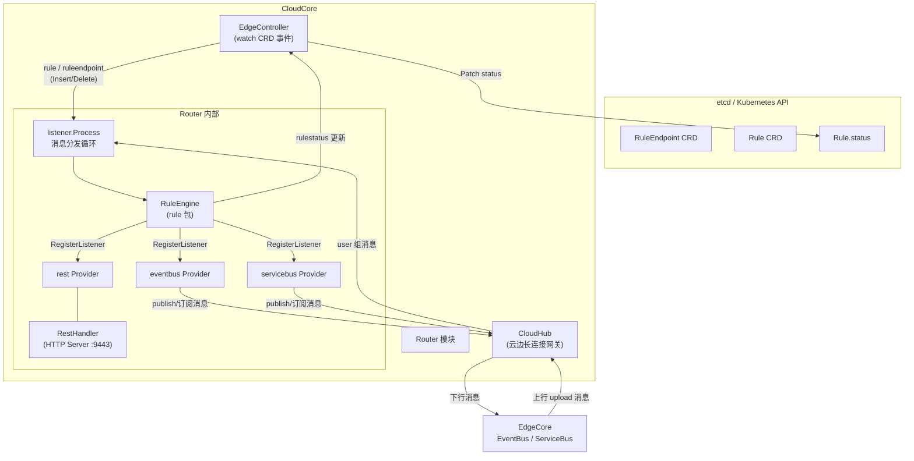
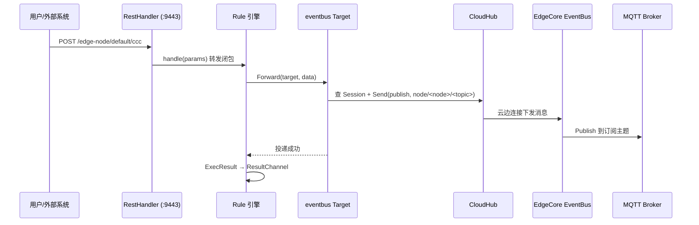
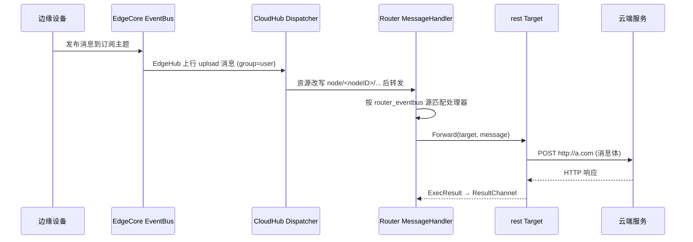

Router 是 KubeEdge 云端组件 CloudCore 中的一个可选模块，它为用户声明式地定义"云边消息如何流转"提供了统一的规则引擎：用户通过创建 `RuleEndpoint`（消息的源/汇端点）和 `Rule`（端点之间的转发规则）两个 CRD 资源，即可让消息在 REST 接口、边缘 MQTT 事件总线（EventBus）与边缘本地 HTTP 服务（ServiceBus）之间自动转发，而无需编写任何胶水代码。本页将从数据模型、模块架构、转发链路与状态回写四个层面剖析 Router 的实现，所有结论均以仓库源码为据。

## 核心数据模型：RuleEndpoint 与 Rule

Router 的全部行为由两个 CRD 驱动。`RuleEndpoint` 描述一个消息端点，其 `spec.ruleEndpointType` 只允许 `rest`、`eventbus`、`servicebus` 三种取值，并可通过 `spec.properties` 携带端点属性（例如 servicebus 类型需要声明 `service_port`）；`Rule` 则通过 `spec.source`/`spec.sourceResource` 声明消息从哪来、通过 `spec.target`/`spec.targetResource` 声明消息到哪去，`status` 字段记录转发的成功/失败计数与错误列表。

Sources: [router_v1_ruleEndpoint.yaml](build/crds/router/router_v1_ruleEndpoint.yaml#L18-L44), [router_v1_rule.yaml](build/crds/router/router_v1_rule.yaml#L18-L60), [types.go](staging/src/github.com/kubeedge/api/apis/rules/v1/types.go#L56-L73)

一个 `Rule` 通过名字字符串关联两个 `RuleEndpoint`：`source` 与 `target` 的值分别等于对应 RuleEndpoint 资源的名称。以官方示例为例：先创建名为 `my-rest` 的 rest 端点与名为 `my-eventbus` 的 eventbus 端点，再创建一条 `source: "my-rest"`、`sourceResource: {"path":"/test"}`、`target: "my-eventbus"`、`targetResource: {"topic":"test"}` 的规则，即完成"从云端 REST 接口向边缘 MQTT 主题 `test` 推送消息"的声明。

Sources: [ruleEndpoint-rest.yaml](build/crd-samples/router/ruleEndpoint-rest.yaml#L1-L10), [rule-rest-eventbus.yaml](build/crd-samples/router/rule-rest-eventbus.yaml#L1-L12)

## 模块架构与启动流程

Router 是一个标准的 Beehive 模块：`router.Register()` 在 CloudCore 启动时被调用，先初始化配置单例，再向 Beehive 注册模块实例；模块的 `Start()` 方法只有一行——启动 `listener.Process()` 消息分发循环。值得注意的是 `router.go` 顶部的四个匿名导入（`provider/eventbus`、`provider/rest`、`provider/servicebus`、`rule`），它们利用 Go 的 `init()` 机制在编译期把三类 Provider 工厂与规则装载器"注入"进进程，这是典型的注册表模式。

Sources: [router.go](cloud/pkg/router/router.go#L3-L53), [server.go](cloud/cmd/cloudcore/app/server.go#L170-L178)

Router 默认处于关闭状态：`componentconfig` 中 `Router` 结构体的默认值为 `Enable: false`、`Address: "0.0.0.0"`、`Port: 9443`、`RestTimeout: 60`。要启用 Router，需在 CloudCore 配置文件中将 `modules.router.enable` 设为 `true`，RestHandler 的监听地址、端口与 REST 超时即来自这份配置。

Sources: [types.go](staging/src/github.com/kubeedge/api/apis/componentconfig/cloudcore/v1alpha1/types.go#L536-L542), [default.go](staging/src/github.com/kubeedge/api/apis/componentconfig/cloudcore/v1alpha1/default.go#L140-L145), [config.go](cloud/pkg/router/config/config.go#L12-L22)

## 规则装载引擎：从 CRD 事件到监听器

Router 自身不直接 watch Kubernetes API，而是复用 EdgeController 的 informer 体系：EdgeController 的下游控制器以共享 informer 监听 `Rule` 与 `RuleEndpoint` 的增删事件，将事件包装为 Beehive 消息发送。关键在于 `ContextMessageLayer.Send()` 中的分支判断——当消息资源类型为 `rule` 或 `ruleendpoint` 时，消息被改发到 `router` 模块而非 CloudHub，这一"偷梁换柱"让 Router 无需独立的 API 连接。

Sources: [downstream.go](cloud/pkg/edgecontroller/controller/downstream.go#L253-L339), [context.go](cloud/pkg/common/messagelayer/context.go#L48-L72), [util.go](cloud/pkg/common/messagelayer/util.go#L111-L117)

Router 侧，`rule` 包在 `init()` 时向全局单例 `MessageHandlerInstance` 注册了两个监听键：`edgecontroller/ruleendpoint` 与 `edgecontroller/rule`。`listener.Process()` 循环从 Beehive 收到消息后，`HandleMessage` 按"消息源/资源类型"查表找到处理器，并以 goroutine 异步执行——每条 CRD 事件由此进入 `handleRule`/`handleRuleEndpoint`。

Sources: [rule.go](cloud/pkg/router/rule/rule.go#L17-L32), [message.go](cloud/pkg/router/listener/message.go#L55-L102)

规则与端点分别缓存在两个进程内的 `sync.Map` 中（`rules` 与 `ruleEndpoints`），键为 `namespace/name`。新增端点只是简单写入缓存；新增规则（`addRule`）则要完成三步：从缓存解析出 `Source` 与 `Target` 对象、调用 `source.RegisterListener()` 挂接一个"转发闭包"、把规则写入缓存。转发闭包内调用 `source.Forward(target, data)` 完成实际投递，并无论成败都构造一个 `ExecResult` 推入 `ResultChannel`，为状态回写闭环提供数据。

Sources: [rule.go](cloud/pkg/router/rule/rule.go#L86-L137)

两条健壮性设计值得注意。其一，`addRuleWithRetry` 最多重试 3 次、每次等待时间线性递增（5s、10s、15s），用于容忍"Rule 先于 RuleEndpoint 创建"这类时序问题；其二，删除规则时若源端点已不存在则跳过 `UnregisterListener`，避免删除流程被悬挂。此外，EdgeController 只会把 `Added`/`Deleted` 事件下发给 Router，`Modified` 事件被显式忽略——即规则不支持热更新，修改 CRD 需先删后建。

Sources: [rule.go](cloud/pkg/router/rule/rule.go#L139-L160), [rule.go](cloud/pkg/router/rule/rule.go#L206-L215), [downstream.go](cloud/pkg/edgecontroller/controller/downstream.go#L276-L287)

## Provider 抽象：Source 与 Target 双工厂模式

Router 的可扩展性核心在 `provider` 包。`Source` 接口定义了消息源的三种能力：`RegisterListener`（注册转发回调）、`UnregisterListener`（注销回调）与 `Forward`（把数据投递给某个 Target）；`Target` 接口只有一个方法 `GoToTarget`（接收数据并返回响应）。两者各自配套一个工厂接口（`SourceFactory`/`TargetFactory`），工厂按 `RuleEndpointType` 类型注册到全局 map，运行时由规则引擎按端点类型查表实例化。新增一种端点类型只需实现这对接口并在 `init()` 中调用 `RegisterSource`/`RegisterTarget`，`router.go` 无需任何改动。

Sources: [source.go](cloud/pkg/router/provider/source.go#L10-L41), [target.go](cloud/pkg/router/provider/target.go#L9-L38)

| 端点类型 | Source 含义 | sourceResource | Target 含义 | targetResource | 端点属性 |
| --- | --- | --- | --- | --- | --- |
| `rest` | 云端 Router 的 HTTP 路径 | `{"path":"/test"}` | 任意外部 HTTP 服务 | `{"resource":"http://a.com"}` | 无 |
| `eventbus` | 某边缘节点订阅的 MQTT 主题 | `{"topic":"...","node_name":"..."}` | 向某边缘节点的 MQTT 主题发布 | `{"topic":"..."}` | 无 |
| `servicebus` | 某边缘节点上 ServiceBus 暴露的 URL | `{"target_url":"...","node_name":"..."}` | 边缘节点本地 HTTP 服务路径 | `{"path":"/request_path"}` | `service_port` |

Sources: [rest.go](cloud/pkg/router/provider/rest/rest.go#L42-L72), [eventbus.go](cloud/pkg/router/provider/eventbus/eventbus.go#L40-L92), [servicebus.go](cloud/pkg/router/provider/servicebus/servicebus.go#L40-L122), [constants.go](cloud/pkg/router/constants/constants.go#L3-L13)

由于 rest、eventbus、servicebus 三个工厂同时注册为 Source 工厂和 Target 工厂，理论上 3×3 共九种组合的规则都可以创建。但各 Provider 的 `Forward`/`GoToTarget` 对入参 map 的键有硬性依赖（例如 rest 的 `Forward` 要求 `request`、`timeout` 键），因此并非所有组合在实践中都有意义，使用时应以上表描述的方向为准。

## REST 监听器：路径匹配与多 CloudCore 转发

当第一条 rest 类型的规则被装载时，`restFactory.GetSource` 会通过 `atomic.CompareAndSwapInt32` 保证全局只初始化一次 `RestHandlerInstance`，随后启动内嵌 HTTP Server 监听配置端口（默认 9443）。每个 rest 规则的 `sourceResource.path` 被规范化后以 `/{namespace}/{path}` 为键注册进 `RestHandler.handlers`（一个 `sync.Map`）。

Sources: [rest.go](cloud/pkg/router/provider/rest/rest.go#L46-L59), [rest.go](cloud/pkg/router/provider/rest/rest.go#L78-L85), [http.go](cloud/pkg/router/listener/http.go#L40-L85)

路径匹配不是简单的前缀比较，而是基于正则：`URLToURLRegex` 会把路径中的 `{param}` 占位符替换为 `[-A-Za-z0-9+&@#%?=~_|!:,.;]+` 正则片段，支持 `/abc/{id}` 形式的通配；当多个规则同时命中时，`RuleContains` 会选择更精确（更长）的路径。这套机制定义在 `utils/path.go`，是 rest 源端灵活路由的基础。

Sources: [path.go](cloud/pkg/router/utils/path.go#L10-L56), [http.go](cloud/pkg/router/listener/http.go#L87-L107)

`httpHandler` 处理请求时有两个工程细节。第一，请求体大小被 `http.MaxBytesReader` 限制在 12MB（`MaxMessageBytes`）。第二，在高可用部署下，边缘节点可能通过注解 `constants.EdgeMappingCloudKey` 记录的 IP 连接到另一个 CloudCore 实例；此时当前实例会从 kube-API 查询该节点的 `EdgeMappingCloudKey` 注解，若目标 IP 与本机不一致，则把整个请求原样转发给持有该边缘会话的 CloudCore（最多重试 3 次、固定间隔 1 秒），避免 HA 场景下消息落到"无会话"实例上而被丢弃。

Sources: [http.go](cloud/pkg/router/listener/http.go#L27), [http.go](cloud/pkg/router/listener/http.go#L109-L231), [http.go](cloud/pkg/router/listener/http.go#L256-L266)

## 端到端消息流：REST → EventBus 下行链路

以"云端 REST 接口向边缘 MQTT 主题推送消息"为例，完整链路如下。用户请求 `http://<cloudcore>:9443/<edge-node>/<namespace>/<path>`（可从 e2e 测试 `SendMsg("http://127.0.0.1:9443/edge-node/default/ccc", ...)` 印证），RestHandler 命中规则后将请求体与元信息打包进 `params` map 调用转发闭包；rest 源的 `Forward` 从 URL 中解析出节点名、方法、头部与剩余参数，异步调用目标 `GoToTarget` 并以 `restTimeout`（默认 60s）为窗口等待响应、超时或客户端断开；eventbus 目标的 `GoToTarget` 先通过 CloudHub 的 SessionManager 确认目标节点在线，再以 `node/<nodeName>/<topic>` 为资源、`publish` 为操作构造消息发给 CloudHub，由其沿云边连接下发；边缘侧 EventBus 模块收到 `publish` 操作后，直接把 payload 发布到 MQTT broker 的对应主题上。

Sources: [http.go](cloud/pkg/router/listener/http.go#L181-L221), [rest.go](cloud/pkg/router/provider/rest/rest.go#L87-L127), [eventbus.go](cloud/pkg/router/provider/eventbus/eventbus.go#L120-L157), [eventbus.go](edge/pkg/eventbus/eventbus.go#L157-L169), [rule.go](tests/e2e/rule/rule.go#L97-L99)

## 端到端消息流：EventBus → REST 上行链路与订阅生命周期

上行方向（设备数据上云）依赖一条隐式的订阅链。当 eventbus 类型的规则被装载时，其源的 `RegisterListener` 除了向 `MessageHandlerInstance` 注册 `bus/node/<nodeName>/<namespace>/<topic>` 键的处理器外，还会向 CloudHub 发送一条 `subscribe` 操作消息（路由源标记为 `router_eventbus`、组标记为 `user`）；删除规则时发送 `unsubscribe` 并移除本地监听。这条消息经云边连接到达边缘后，由边缘 EventBus 完成对 MQTT broker 的实际订阅。

Sources: [eventbus.go](cloud/pkg/router/provider/eventbus/eventbus.go#L64-L79)

此后，边缘设备发布到该主题的消息经 EdgeHub 上云。CloudHub 的 `DispatchUpstream` 对"操作为 `upload` 且组为 `user`"的消息做特殊处理：把资源改写为 `node/<nodeID>/<原资源>` 后直接发给 `router` 模块。Router 的消息循环按源 `router_eventbus` 命中注册的处理器，`Forward` 闭包将消息内容交给目标——例如 rest 目标会构造一个 `POST` 请求打到 `targetResource.resource` 指定的 URL，从而完成"设备数据上云后回调云端服务"的闭环。

Sources: [message_dispatcher.go](cloud/pkg/cloudhub/dispatcher/message_dispatcher.go#L185-L187), [eventbus.go](cloud/pkg/router/provider/eventbus/eventbus.go#L98-L118), [rest.go](cloud/pkg/router/provider/rest/rest.go#L194-L216)

servicebus 类型的规则走同一套骨架，但语义是"调用边缘本地 HTTP 服务"。其目标 `GoToTarget` 把 HTTP 方法、头部、请求体封装为 `HTTPRequest` 填入消息体，资源格式为 `node/<nodeName>/<service_port>:<path>` 发往 CloudHub；若处于同步调用场景，还会通过 `MessageHandlerInstance.SetCallback` 以 `messageID` 注册回调并阻塞等待边缘响应。边缘侧 `servicebus` 模块只处理源为 `router_servicebus` 的消息：`start` 操作把 URL 写入本地数据库（对应云侧 `RegisterListener` 发出的 start 消息），HTTP 方法操作则执行真实的本地 HTTP 转发。与 eventbus 目标"发后即忘"不同，servicebus 的 `Forward` 会读取边缘返回的响应体，并通过 `SendToGroup` 把响应回传给 CloudHub。

Sources: [servicebus.go](cloud/pkg/router/provider/servicebus/servicebus.go#L63-L78), [servicebus.go](cloud/pkg/router/provider/servicebus/servicebus.go#L124-L168), [servicebus.go](cloud/pkg/router/provider/servicebus/servicebus.go#L84-L109), [servicebus.go](edge/pkg/servicebus/servicebus.go#L43-L46), [servicebus.go](edge/pkg/servicebus/servicebus.go#L188-L199)

## 规则状态回写闭环

Router 会把每次转发的成败结果写回 Rule CRD 的 status，形成可观测的闭环。`statushandler.go` 中的守护 goroutine `SendMessageToController` 持有一个容量 1024 的 `ResultChannel`，把每条 `ExecResult` 封装为资源类型 `rulestatus` 的 Beehive 消息发回 EdgeController；上游控制器的 `updateRuleStatus` worker 收到后按消息中的 namespace 与规则名 GET 最新的 Rule 对象，累计 `SuccessMessages`/`FailMessages` 并以 MergePatch 方式 PATCH 回 API Server。需要注意的是 `ruleStatusChan` 的缓冲大小复用了 `UpdateNodeStatus` 的 buffer 配置，且失败详情 `Errors` 每次只保留最近一条错误信息。

Sources: [statushandler.go](cloud/pkg/router/rule/statushandler.go#L15-L57), [upstream.go](cloud/pkg/edgecontroller/controller/upstream.go#L274-L275), [upstream.go](cloud/pkg/edgecontroller/controller/upstream.go#L345-L400), [upstream.go](cloud/pkg/edgecontroller/controller/upstream.go#L1672)

## 配置参数与使用清单

| 参数 | 默认值 | 说明 |
| --- | --- | --- |
| `enable` | `false` | Router 模块开关，默认关闭 |
| `address` | `0.0.0.0` | RestHandler HTTP 服务绑定地址 |
| `port` | `9443` | REST 规则入口监听端口（代码中兜底 9443） |
| `restTimeout` | `60` 秒 | REST 转发等待目标响应的超时窗口 |

Sources: [default.go](staging/src/github.com/kubeedge/api/apis/componentconfig/cloudcore/v1alpha1/default.go#L140-L145), [http.go](cloud/pkg/router/listener/http.go#L40-L52), [types.go](staging/src/github.com/kubeedge/api/apis/componentconfig/cloudcore/v1alpha1/types.go#L536-L542)

使用 Router 的标准流程为四步：启用 CloudCore 的 router 模块 → 创建 `RuleEndpoint`（源与目标各一个）→ 创建 `Rule` → 通过对应端点收发消息。e2e 测试 `E2E_CREATE_RULE_1` 展示了完整时序：创建 rest/eventbus 端点与 rest→eventbus 规则后，向 `http://127.0.0.1:9443/edge-node/default/ccc` 发送 POST，订阅 MQTT 主题的客户端在 30 秒内应收到消息内容。

Sources: [rule.go](tests/e2e/rule/rule.go#L69-L104), [rule-rest-servicebus.yaml](build/crd-samples/router/rule-rest-servicebus.yaml#L1-L12), [ruleEndpoint-servicebus.yaml](build/crd-samples/router/ruleEndpoint-servicebus.yaml#L1-L10)

## 设计权衡与当前局限

从实现看，Router 选择了"轻量内嵌"而非独立控制器进程：规则存储是进程内 `sync.Map` 而非持久化缓存，规则装载依赖 EdgeController 的消息旁路而非独立 informer——这使模块足够小（`router.go` 仅 54 行），但代价是 CloudCore 重启后规则需依赖 CRD 事件重放来重建内存态，且源端点订阅（如 MQTT subscribe 消息）依赖 Rule 的增删事件触发。理解这一点，有助于解释为什么 Router 的状态与 `Rule.Status` 的计数是"尽力而为"的统计而非强一致账本。

Sources: [rule.go](cloud/pkg/router/rule/rule.go#L17-L20), [downstream.go](cloud/pkg/edgecontroller/controller/downstream.go#L356-L360)

代码中留有几处明确的待完善标记，使用时应纳入评估：REST 入口尚未启用 TLS（`Serve` 中 TODO，当前为 `ListenAndServe` 明文监听）；EdgeController 明确忽略 `Modified` 事件，规则变更需删除重建；`rule.Status.Errors` 每次失败仅覆盖为单条错误；此外 rest 目标的 `GoToTarget` 中也标注了"need to get ACK"的 TODO。这些是当前版本的行为边界，而非文档遗漏。

Sources: [http.go](cloud/pkg/router/listener/http.go#L54-L67), [downstream.go](cloud/pkg/edgecontroller/controller/downstream.go#L281-L287), [upstream.go](cloud/pkg/edgecontroller/controller/upstream.go#L377-L381), [rest.go](cloud/pkg/router/provider/rest/rest.go#L194-L196)

## 延伸阅读

Router 是连接云端与边缘业务通道的"软件定义交换机"，其三类端点分别与边缘组件深度耦合：eventbus 端点依赖边缘 MQTT 总线的订阅与发布能力，servicebus 端点依赖边缘本地 HTTP 代理。建议按以下路径继续阅读：先通过 [CloudHub：云边长连接网关与消息分发](8-cloudhub-yun-bian-chang-lian-jie-wang-guan-yu-xiao-xi-fen-fa) 理解上行 `upload`/下行分发与 SessionManager 的机制（Router 上下行的必经之路），再通过 [EdgeController：边缘资源下发与状态上报](9-edgecontroller-bian-yuan-zi-yuan-xia-fa-yu-zhuang-tai-shang-bao) 掌握 Rule CRD 事件如何流入 Router；边缘侧配合 [EventBus：MQTT 消息总线与设备接入](19-eventbus-mqtt-xiao-xi-zong-xian-yu-she-bei-jie-ru) 与 [ServiceBus 与 EdgeStream：边缘 HTTP 服务访问与隧道客户端](21-servicebus-yu-edgestream-bian-ye-http-fu-wu-fang-wen-yu-sui-dao-ke-hu-duan) 补全端到端视角；如需为 Router 增加新端点类型，可先阅读 [Beehive：模块化消息通信框架](22-beehive-mo-kuai-hua-xiao-xi-tong-xin-kuang-jia) 理解模块注册与消息路由原语。