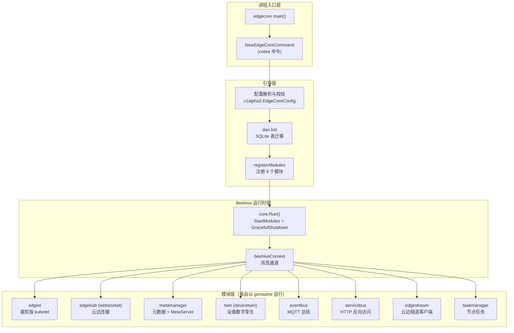
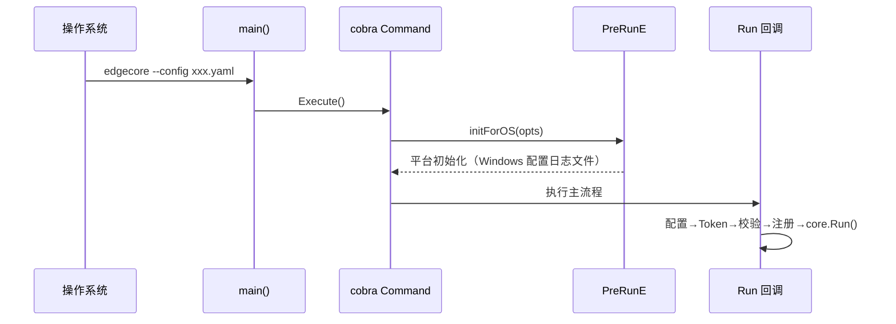
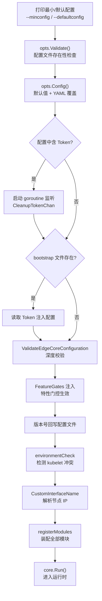
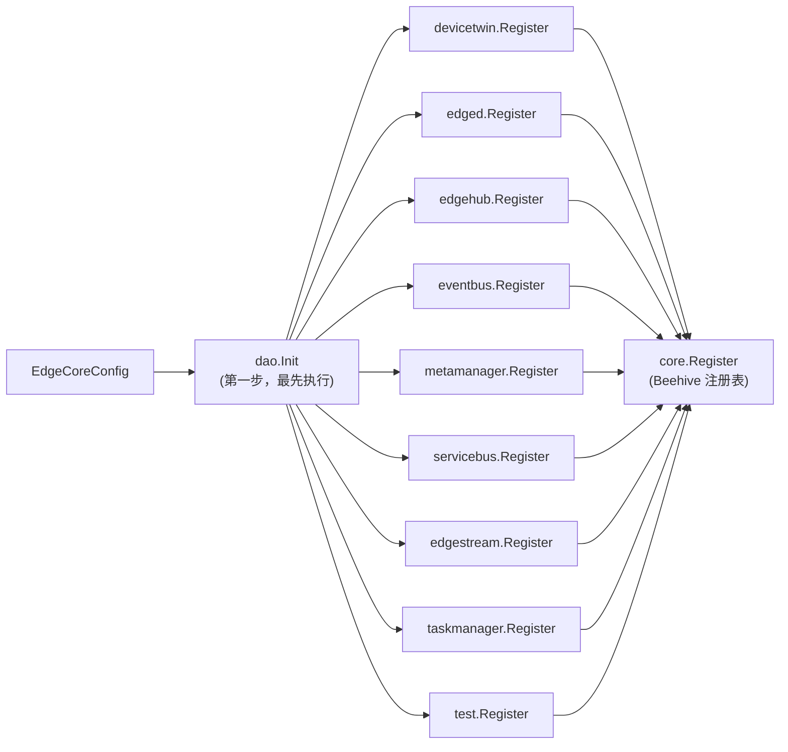
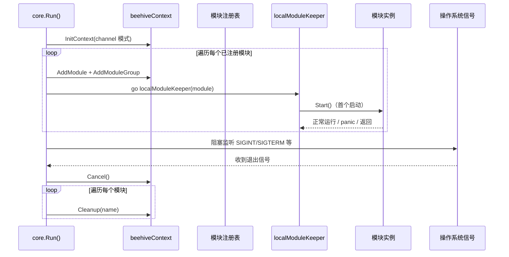
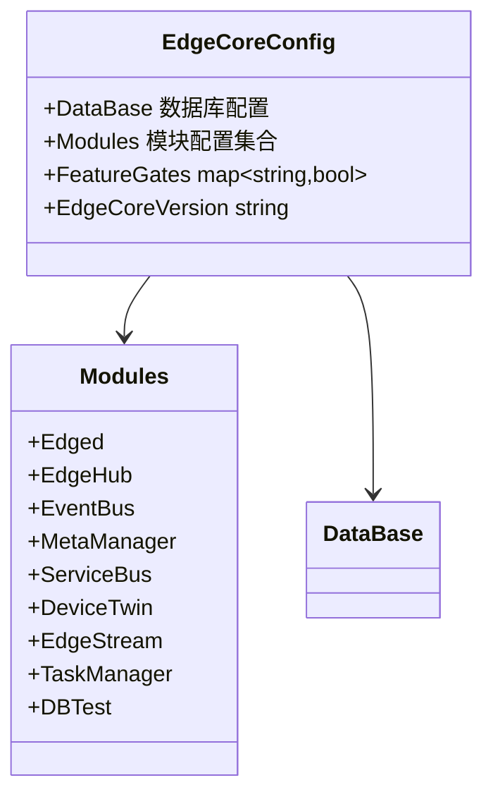

EdgeCore 是 KubeEdge 架构中运行在每个边缘节点上的**单一核心进程**，它将容器管理、云边通信、元数据存储、设备接入等多个职责封装为一组可独立启停的模块，并通过 Beehive 消息框架将它们装配进同一个进程地址空间。本页面向具备 Go 与 Kubernetes 基础概念的开发者，解析 EdgeCore 的进程入口、启动生命周期、模块注册机制与配置体系，帮助您建立"一个命令如何演化为一组协作模块"的完整心智模型。各模块的内部实现（如 Edged、EdgeHub、MetaManager）将在后续页面逐一展开。

## 定位与总体架构

从第一性原理出发，EdgeCore 解决的核心问题是：**如何在资源受限、网络不稳定的边缘节点上，以一个进程承载原本需要多个系统组件（kubelet、kube-proxy 的部分职责、设备代理等）协同完成的工作**。它的答案是"进程内微内核"——所有功能单元实现统一的 `Module` 接口，由 Beehive 框架统一注册、启动与守护，模块之间通过消息通道通信而非直接函数调用，这带来了天然的解耦：任何一个模块可以单独关闭而不影响其余模块的装配。

下面的架构图展示了 EdgeCore 进程内部的全景：入口层（cobra 命令）负责配置引导，注册层将九个模块装配进 Beehive 注册表，运行时层提供消息上下文与守护机制。



进程的真正入口极其精简：`main()` 函数仅构建一个 cobra 命令并执行，所有实质逻辑都下沉到 `app` 包中。这种"薄入口、厚应用层"的组织方式与 Kubernetes 自身的组件（kubelet、kube-apiserver）保持一致，降低了代码考古的成本。

Sources: [edgecore.go](edge/cmd/edgecore/edgecore.go#L11-L19)、[server.go](edge/cmd/edgecore/app/server.go#L42-L45)

## 进程入口与命令行框架

`app.NewEdgeCoreCommand()` 构建的 cobra 命令声明了 EdgeCore 的六大经典模块（devicetwin、edged、edgehub、eventbus、metamanager、servicebus）——这段命令帮助文本本身就是理解进程职责划分的第一手文档。命令的标志（flags）由 `EdgeCoreOptions` 提供，其中最关键的是 `--config`，指向 YAML 配置文件，默认路径为 `/etc/kubeedge/config/edgecore.yaml`（Windows 平台为 `C:\etc\kubeedge\config\`）。



命令执行前有一个 `PreRunE` 钩子调用 `initForOS`，这是**编译期平台分叉**的典型应用：在非 Windows 平台上它是空操作，而在 Windows 上它会初始化 klog 标志集，将日志重定向到 `--log-file` 指定的文件（默认 `C:\var\log\kubeedge\edgecore.log`）并适配 klog 的 stderr 阈值行为。同样的构建标签（build tags）模式也应用于 `OSExclusive` 选项结构体——Windows 版本额外携带 `LogFilePath` 字段，其他平台则为空结构体，使 `EdgeCoreOptions` 可以无差别地内嵌它。

Sources: [server.go](edge/cmd/edgecore/app/server.go#L46-L59)、[options.go](edge/cmd/edgecore/app/options/options.go#L47-L59)、[init_windows.go](edge/cmd/edgecore/app/init_windows.go#L30-L47)、[options_windows.go](edge/cmd/edgecore/app/options/options_windows.go#L29-L38)

## 启动生命周期全景

EdgeCore 的 `Run` 回调是一条**严格线性的引导管线**，每个阶段失败都会直接终止进程（通过 `klog.Exit`），保证不会以半初始化状态对外服务。理解这条管线是排查边缘节点启动故障的基础。



管线的第一阶段处理配置对象：`opts.Config()` 先调用 `NewDefaultEdgeCoreConfig()` 构造完整的默认配置，再用 `Parse` 将 YAML 文件的内容覆盖其上，形成"**默认值打底、文件增量覆盖**"的两层模型。这意味着配置文件可以只写关心的字段，未写字段自动回退到与代码同步维护的默认值，避免了配置漂移。

Sources: [server.go](edge/cmd/edgecore/app/server.go#L60-L72)、[options.go](edge/cmd/edgecore/app/options/options.go#L70-L77)、[default.go](staging/src/github.com/kubeedge/api/apis/componentconfig/edgecore/v1alpha2/default.go#L32-L50)

### Token 引导：从令牌到证书

第二阶段专为此前未注册过的节点设计。若配置中携带 Token（通常由 `keadm join` 写入），EdgeCore 会启动一个后台 goroutine 阻塞在 `certificate.CleanupTokenChan` 上——当证书申请成功后该通道被关闭，goroutine 随即调用 `cleanupToken` 将 Token 从配置文件中抹除后写回磁盘。这一设计的意图很明确：**Token 只是引导期凭证，不应长期驻留磁盘**成为攻击面。此外还支持从独立的 bootstrap 文件（`/etc/kubeedge/bootstrap-edgecore.conf`）读取 Token，其优先级行为是覆盖配置文件中的值。

Sources: [server.go](edge/cmd/edgecore/app/server.go#L74-L96)、[server.go](edge/cmd/edgecore/app/server.go#L164-L173)、[default_others.go](staging/src/github.com/kubeedge/api/apis/common/constants/default_others.go#L32-L33)

### 环境检查与节点 IP 决策

深度校验通过后，`environmentCheck` 会扫描系统进程表，若发现 `kubelet` 正在运行则拒绝启动——这是防止**边缘节点上双代理并存**的保护机制：Edged 本质是裁剪版 kubelet，与真实 kubelet 同时运行会导致容器运行时和节点状态的争用。值得注意的是，当 MetaServer 启用或设置了 `CHECK_EDGECORE_ENVIRONMENT=false` 环境变量时该检查被跳过，为开发调试保留了逃生门。随后，若用户显式配置了 `CustomInterfaceName`，EdgeCore 会通过该网卡解析绑定 IP 写入 `NodeIP`，否则沿用配置中的默认 IP。

Sources: [server.go](edge/cmd/edgecore/app/server.go#L98-L114)、[server.go](edge/cmd/edgecore/app/server.go#L116-L133)、[server.go](edge/cmd/edgecore/app/server.go#L177-L199)

## 模块注册：registerModules 的装配流水线

`registerModules` 是理解 EdgeCore 模块化的关键函数，它完成三件事：**先初始化数据库，再逐个初始化各模块的配置单例，最后将模块实例提交给 Beehive 注册表**。



`dao.Init` 被特意放在所有模块注册之前，因为它用 GORM 打开 SQLite 数据库（`once.Do` 保证单例），并**按模块的 Enable 状态条件迁移数据表**：DeviceTwin 启用才建设备表（`Device`/`DeviceAttr`/`DeviceTwin`），MetaManager 启用才建元数据表（`Meta`/`MetaV2`），EventBus 建订阅表（`SubTopics`），ServiceBus 建目标 URL 表（`TargetUrls`）。禁用的模块自动跳过迁移，确保边缘数据库的最小足迹。

Sources: [server.go](edge/cmd/edgecore/app/server.go#L201-L220)、[init.go](edge/pkg/metamanager/dao/init.go#L34-L106)

每个模块的 `Register` 函数遵循统一的三段式模式，以 EdgeHub 为例：先调用模块内部 `config.InitConfigure` 将 v1alpha2 配置段写入模块级单例，再执行模块特有的预初始化（如注册消息处理器），最后构造实例并调用 `core.Register`。这是一个**配置注入与对象构造的边界层**——模块实例在注册阶段就绑定了启用状态与必要参数，之后运行时不再触碰配置文件。

Sources: [edgehub.go](edge/pkg/edgehub/edgehub.go#L128-L136)、[edged.go](edge/pkg/edged/edged.go#L102-L111)、[metamanager.go](edge/pkg/metamanager/metamanager.go#L31-L36)

### 模块清单与命名空间

EdgeCore 中全部模块的名称常量与消息分组定义在 `edge/pkg/common/modules` 包中。**名称是消息路由的地址**（Beehive 消息按模块名投递），**分组是广播的域**（同组模块可组播）。下表汇总了九个模块的路由元数据与职责：

| 模块 | `Name()` 返回 | `Group()` 返回 | 核心职责 | 参考实现 |
|------|--------------|----------------|----------|----------|
| Edged | `edged` | `edged` | 裁剪版 kubelet，Pod 生命周期与容器管理 | [edged.go](edge/pkg/edged/edged.go#L113-L124) |
| EdgeHub | `websocket` | `hub` | 云边 WebSocket/QUIC 长连接与证书认证 | [edgehub.go](edge/pkg/edgehub/edgehub.go#L139-L151) |
| MetaManager | `metamanager` | `meta` | 元数据持久化、离线自治、MetaServer | [metamanager.go](edge/pkg/metamanager/metamanager.go#L38-L48) |
| DeviceTwin | `twin` | `twin` | 设备数字孪生与状态同步 | [devicetwin.go](edge/pkg/devicetwin/devicetwin.go#L41-L53) |
| EventBus | `eventbus` | `bus` | MQTT 消息总线与设备接入 | [eventbus.go](edge/pkg/eventbus/eventbus.go#L45-L56) |
| ServiceBus | `servicebus` | `bus` | 云端访问边缘 HTTP 服务的反向代理 | [servicebus.go](edge/pkg/servicebus/servicebus.go#L137-L147) |
| EdgeStream | `edgestream` | `edgestream` | kubectl exec/logs/metrics 云边隧道客户端 | [edgestream.go](edge/pkg/edgestream/edgestream.go#L62-L72) |
| TaskManager | `taskmanager` | `taskmanager` | 节点升级等任务执行 | [taskmanager.go](edge/pkg/taskmanager/taskmanager.go#L55-L65) |
| testManager | `testManager` | `meta` | DBTest 联调测试模块 | [test.go](edge/test/test.go#L38-L49) |

值得注意的是两个"名实分离"的设计：EdgeHub 的模块名是 `websocket` 而非 `edgehub`（历史命名遗留，消息路由时需用此名），ServiceBus 的实际分组是 `bus`（与 EventBus 同组）而非常量注释中提到的 `user` 组——**以代码为准而非注释**，这是阅读该代码库时需要留意的细节。

Sources: [names.go](edge/pkg/common/modules/names.go#L3-L20)、[group.go](edge/pkg/common/modules/group.go#L3-L20)、[servicebus.go](edge/pkg/servicebus/servicebus.go#L141-L143)

### Module 接口契约

Beehive 定义了模块必须实现的五方法接口，这是整个边缘侧架构的**最小公共契约**：

```go
type Module interface {
    Name() string
    Group() string
    Enable() bool
    Start()
    RestartPolicy() *ModuleRestartPolicy
}
```

`Enable()` 是注册阶段的**门控点**：`core.Register` 内部检查该返回值，启用的模块进入 `modules` 注册表，禁用的模块进入 `disabledModules` 并打印警告日志——这意味着关闭一个模块（如 `modules.deviceTwin.enable: false`）的代价仅仅是它不参与启动与消息路由，主进程照常运行。代码库中所有模块都以 `var _ core.Module = (*Xxx)(nil)` 的编译期断言声明接口符合性，将契约违规提前到编译阶段暴露。

Sources: [module.go](staging/src/github.com/kubeedge/beehive/pkg/core/module.go#L46-L95)、[edgehub.go](edge/pkg/edgehub/edgehub.go#L65)、[devicetwin.go](edge/pkg/devicetwin/devicetwin.go#L23)

## Beehive 运行时：启动、守护与优雅退出

`registerModules` 完成后，控制权移交 `core.Run()`。这一函数是 EdgeCore 进程的"心跳起点"，由三部分组成：初始化消息上下文、并发启动全部模块、阻塞等待退出信号。



`StartModules` 首先将全局上下文初始化为 channel 模式（模块间通信基于 Go channel 而非 socket），随后遍历注册表：每个模块先在上下文中登记自己的名称与分组（建立消息路由表），然后被一个独立的 `localModuleKeeper` goroutine 接管启动。**模块启动顺序在 Go map 遍历下是不确定的**——这是有意为之的设计，模块间的依赖通过消息机制异步协商（例如 EdgeStream 在 `Start` 中阻塞等待 EdgeHub 的证书就绪信号 `GetCertSyncChannel`），而非启动顺序保证。

Sources: [core.go](staging/src/github.com/kubeedge/beehive/pkg/core/core.go#L17-L55)、[edgestream.go](edge/pkg/edgestream/edgestream.go#L84-L93)

### 模块守护与重启策略

`localModuleKeeper` 实现了进程内的模块级"supervisor"模式。当 `ModuleRestart` 特性门控开启时，各模块会返回一个 `OnFailure` 重启策略：模块因 panic 崩溃后，keeper 会捕获并按**指数退避**重启——初始间隔 1 秒，每次乘以增长率（各模块均配置为 2.0），上限 30 秒（`DefaultRestartIntervalLimit`），重试次数超过 `Retries` 后触发自定义 `ErrorHandler`。若门控关闭（默认值），`RestartPolicy()` 返回 nil，模块崩溃即退出且不重启，行为与旧版本兼容。

| 配置项 | 默认值 | 语义 |
|--------|--------|------|
| `RestartType` | `OnFailure` | 正常返回不重启，崩溃/panic 后重启 |
| `Retries` | 0 | 0 表示无限重启，>0 限制最大重试次数 |
| `IntervalSecond` | 1 | 重启初始间隔（秒） |
| `IntervalTimeGrowthRate` | 2.0（各模块设定） | 间隔增长率，≤1 时忽略 |
| `RestartIntervalLimit` | 30 秒 | 间隔上限，防止退避失控 |

`moduleRestart` 门控目前处于 **alpha 阶段（v1.17 引入，默认关闭）**，需在配置的 `featureGates` 中显式置为 `true` 才能激活。同一配置项还控制着 `requireAuthorization`（边缘元数据访问鉴权）与 `disableNodeTaskV1alpha2`（节点任务 API 版本切换）两个实验特性。

Sources: [core.go](staging/src/github.com/kubeedge/beehive/pkg/core/core.go#L96-L145)、[core.go](staging/src/github.com/kubeedge/beehive/pkg/core/core.go#L157-L173)、[features.go](pkg/features/features.go#L29-L49)、[edgehub.go](edge/pkg/edgehub/edgehub.go#L153-L161)

### 优雅退出

`GracefulShutdown` 以信号驱动的方式补全生命周期闭环：进程捕获 `SIGINT`、`SIGTERM` 等八类信号后，先 `Cancel()` 全局上下文（所有模块通过 `beehiveContext.Done()` 感知并退出各自的事件循环），再逐个 `Cleanup` 模块的消息通道。前文模块代码中反复出现的 `select { case <-beehiveContext.Done(): ... }` 模式正是为此服务——**每个模块的长循环都必须响应上下文取消**，否则进程无法干净退出。这也解释了为什么各模块的 `Start()` 都是一个阻塞式循环而非后台 goroutine：keeper 与模块的存活状态保持同步。

Sources: [core.go](staging/src/github.com/kubeedge/beehive/pkg/core/core.go#L57-L80)、[eventbus.go](edge/pkg/eventbus/eventbus.go#L136-L144)、[servicebus.go](edge/pkg/servicebus/servicebus.go#L168-L175)

## 配置体系：结构、默认值与版本管理

EdgeCore 的全部配置收敛于 `EdgeCoreConfig` 结构，采用 Kubernetes 风格的类型化配置模型（TypeMeta + 强类型段 + 序列化版本标注），顶层仅四个字段：`DataBase`、`Modules`、`FeatureGates`、`EdgeCoreVersion`。



其中 `Modules` 下的每个字段对应一个模块的完整配置段，字段上的 `+Required` 标记表示该模块随默认配置强制生成。配置对象上挂载的关键方法构成一个小型生命周期 API：`NewDefaultEdgeCoreConfig` 生成全套默认值、`Parse` 从文件加载覆盖、`ValidateEdgeCoreConfiguration` 深度校验、`WriteTo` 回写磁盘（启动时用于持久化 `EdgeCoreVersion`，实现配置文件与二进制版本的自动对齐）。

以下默认路径由平台相关常量定义，是运维排障时的高频访问点：

| 用途 | Linux 路径 | 说明 |
|------|-----------|------|
| 配置文件 | `/etc/kubeedge/config/edgecore.yaml` | `--config` 默认值 |
| 边缘数据库 | `/var/lib/kubeedge/edgecore.db` | SQLite 数据源 |
| Bootstrap Token | `/etc/kubeedge/bootstrap-edgecore.conf` | 证书申请引导凭证 |
| 根 CA 证书 | `/etc/kubeedge/ca/rootCA.crt` | 云边 TLS 校验 |
| 客户端证书 | `/etc/kubeedge/certs/server.crt` | EdgeHub 身份凭证 |
| 静态 Pod 目录 | `/etc/kubeedge/manifests` | Edged 静态 Pod 加载 |

Sources: [types.go](staging/src/github.com/kubeedge/api/apis/componentconfig/edgecore/v1alpha2/types.go#L44-L97)、[server.go](edge/cmd/edgecore/app/server.go#L109-L114)、[default_others.go](staging/src/github.com/kubeedge/api/apis/common/constants/default_others.go#L7-L45)

## 小结

EdgeCore 的架构可以用一句话概括：**一个 cobra 命令驱动的线性引导管线，将九个实现统一 Module 接口的功能单元装配进 Beehive 运行时，以消息通道为纽带、以配置门控为开关、以守护协程为保险丝**。这套机制使边缘节点在保持单进程低资源占用的同时，获得了接近系统级服务管理的模块自治能力。

理解了进程骨架之后，建议沿以下路线深入各模块内部：

- **Edged 如何裁剪 kubelet 并桥接元数据客户端**：[Edged：轻量级边缘节点代理与容器管理](16-edged-qing-liang-ji-bian-yuan-jie-dian-dai-li-yu-rong-qi-guan-li)
- **EdgeHub 的重连风暴防护与证书轮换**：[EdgeHub：云边消息收发枢纽与证书认证](17-edgehub-yun-bian-xiao-xi-shou-fa-shu-niu-yu-zheng-shu-ren-zheng)
- **MetaManager/MetaServer 的离线自治机制**：[MetaManager 与 MetaServer：离线元数据存储与本地 API Server](18-metamanager-yu-metaserver-chi-xian-yuan-shu-ju-cun-chu-yu-ben-di-api-server)
- **支撑一切的消息框架原理**：[Beehive：模块化消息通信框架](22-beehive-mo-kuai-hua-xiao-xi-tong-xin-kuang-jia)
- **配置中的证书与 Token 体系**：[云边安全与认证体系（证书、令牌与边缘鉴权）](26-yun-bian-an-quan-yu-ren-zheng-ti-xi-zheng-shu-ling-pai-yu-bian-yuan-jian-quan)