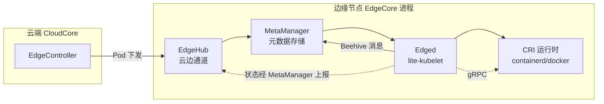
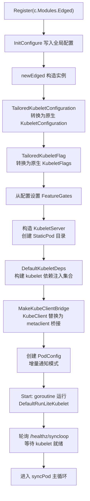
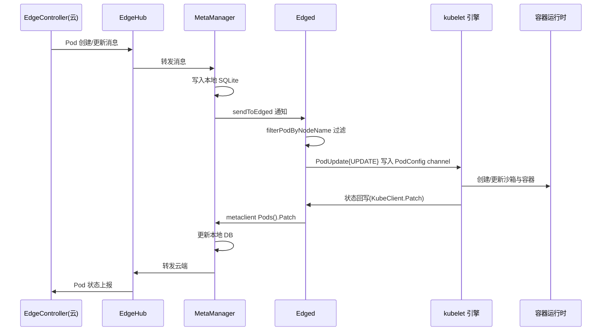

Edged 是 KubeEdge 边缘节点守护进程 EdgeCore 中负责容器工作负载管理的核心模块。它的定位是一个"轻量级 kubelet"——通过直接复用 Kubernetes 官方 kubelet 的运行时引擎，并将其数据通路重定向到 KubeEdge 的云边消息体系，从而让边缘节点在无直连 kube-apiserver 的前提下，依然具备完整的 Pod 生命周期管理能力。本文面向中间级开发者，从架构定位、启动流程、客户端桥接、Pod 同步机制到配置体系，系统剖析 Edged 的实现原理。

Sources: [edged.go](edge/pkg/edged/edged.go#L16-L21)

## 定位与设计哲学：复用 kubelet，而非重写

理解 Edged 的第一步是认清它的本质：**Edged 是运行在 EdgeCore 进程内部的 kubelet，而非独立实现的副本**。源文件头部明确记载了这一设计决策——代码从 `k8s.io/kubernetes/pkg/kubelet/kubelet.go` 派生，目标是"为边缘部署场景创建 mini-kubelet"。这意味着 kubelet 数十年积累的容器编排能力（Pod 生命周期控制、探测、垃圾回收、驱逐、卷挂载等）被完整继承，KubeEdge 只需解决"数据从哪里来、状态往哪里去"的问题。

Sources: [edged.go](edge/pkg/edged/edged.go#L16-L21)

实现层面，`edged` 结构体直接内嵌了 kubelet 的三大核心对象：`KubeletServer`（启动参数与配置）、`KubeletDeps`（依赖注入集合，包含 CRI 运行时服务、PodConfig 等）和 `FeatureGate`（特性开关）。同时，Edged 保留了两个可替换的函数指针作为扩展点：`DefaultKubeletDeps` 指向 `kubeletserver.UnsecuredDependencies`，`DefaultRunLiteKubelet` 指向 `kubeletserver.Run`——后者正是 kubelet 的主入口函数。注释说明这两个默认值只在 Edgemark（大规模压测工具）场景下才会被替换。

Sources: [edged.go](edge/pkg/edged/edged.go#L69-L96)

上图概括了 Edged 在整个体系中的位置：**kubelet 引擎向下通过标准 CRI 接口操控容器运行时，向上则完全不感知 kube-apiserver 的存在**——所有资源读写都被桥接到 MetaManager。这是 KubeEdge 边缘自治能力的基石。

Sources: [edged.go](edge/pkg/edged/edged.go#L86-L98)

## 模块化集成：作为 Beehive 模块的 Edged

EdgeCore 采用 Beehive 框架进行模块化组装（详见 [EdgeCore：模块化边缘核心与启动生命周期](15-edgecore-mo-ku-hua-bian-yuan-he-xin-yu-qi-dong-sheng-ming-zhou-qi)），Edged 实现了 `core.Module` 接口并注册到框架中。它的模块名为 `edged`，分组为 `edged`，启用状态由配置项 `Enable` 控制；EdgeCore 启动时通过 `edged.Register(c.Modules.Edged)` 完成装配，与其他边缘模块（EdgeHub、MetaManager、EventBus 等）并列初始化。

Sources: [edge/cmd/edgecore/app/server.go](edge/cmd/edgecore/app/server.go#L211-L219)

`Register` 函数先将配置写入全局单例 `edgedconfig.Config`，随后调用 `newEdged` 构造实例；若初始化失败会直接终止进程，这是一种"快速失败"策略，避免节点以残缺状态运行。值得注意的是，即使 `Enable` 为 false，`newEdged` 也会返回一个空壳对象以保持模块注册结构的一致性。

Sources: [edge/pkg/edged/edged.go](edge/pkg/edged/edged.go#L102-L111)

此外，Edged 支持模块级自动重启策略：当全局 `ModuleRestart` 特性门控开启时，返回一个指数退避（增长率为 2.0）的"失败即重启"策略，提升边缘环境弱依赖下的健壮性。

Sources: [edge/pkg/edged/edged.go](edge/pkg/edged/edged.go#L126-L134)

## 启动流程：从配置转换到 kubelet 就绪

Edged 的启动过程本质上是一次**配置翻译 + 依赖组装**的过程，可以用下面的流程图完整表达：

Sources: [edge/pkg/edged/edged.go](edge/pkg/edged/edged.go#L213-L281)

配置转换是其中的关键一步。Edged 的配置类型 `TailoredKubeletConfiguration` 是对 Kubernetes 原生 `KubeletConfiguration` 的裁剪版映射，`ConvertEdgedKubeletConfigurationToConfigKubeletConfiguration` 函数逐字段完成约七十项参数的搬运——涵盖静态 Pod 路径、DNS、驱逐阈值、镜像 GC、cgroup 驱动、CPU/内存管理器等 kubelet 核心配置面。这种"字段级显式转换"而非反射复制的写法，保证了 KubeEdge 配置模型与上游 kubelet 版本的兼容性边界清晰可见。

Sources: [edge/pkg/edged/config/config.go](edge/pkg/edged/config/config.go#L35-L193)

启动阶段还有两个防御性细节值得关注。其一，在 goroutine 中运行 kubelet 前，代码临时替换了 `klog.OsExit`，使得 kubelet 内部任何退出调用都会先执行 `cleanupContainers`（清理非 Running 状态的 Kubernetes 容器）再退出，防止异常退出时在 CRI 运行时中残留脏容器。其二，`Start` 并不阻塞在 kubelet 主循环上，而是通过健康检查协程轮询 `http://localhost:10350/healthz/syncloop`（端口由 `ReadOnlyPort` 配置），只有当 kubelet 的同步循环真正就绪后，才开始注入 Pod 数据——**这一时序控制避免了 Pod 更新在 kubelet 尚未初始化完成时被丢弃**。

Sources: [edge/pkg/edged/edged.go](edge/pkg/edged/edged.go#L136-L175)

Sources: [edge/pkg/edged/edged.go](edge/pkg/edged/edged.go#L643-L667)

## 核心机制一：KubeClient 桥接——无 API Server 的"伪客户端"

kubelet 内部代码对 `kubeDeps.KubeClient`（用于 Pod 更新、节点注册、事件上报等）有大量调用，而边缘节点无法直连 kube-apiserver。KubeEdge 的解法是**客户端桥接**：构造一个实现了 `clientset.Interface` 完整接口的 `Clientset`，其底层继承自 client-go 的 fake 客户端（提供类型安全的空实现），关键方法则重定向到 `metaclient`。

Sources: [edge/pkg/edged/kubeclientbridge/clientset_bridge.go](edge/pkg/edged/kubeclientbridge/clientset_bridge.go#L42-L65)

`MakeKubeClientBridge` 在 kubelet 依赖构建完成后被调用，将 `KubeClient` 和 `HeartbeatClient` 统一替换为桥接客户端；`EventClient` 则受 `ReportEvent` 配置控制——默认关闭时直接置为 nil，kubelet 将跳过事件上报，这在资源受限的边缘设备上是显著的性能优化开关。

Sources: [edge/pkg/edged/edged.go](edge/pkg/edged/edged.go#L368-L379)

桥接的底层是 metaclient：一个把 Kubernetes API 调用翻译为 Beehive 同步消息的轻量客户端。它向 MetaManager 模块发送 `SendSync` 消息（超时 1 分钟，失败自动重试至多 3 次），由 MetaManager 决定"查本地 SQLite 还是转发云端"。

Sources: [edge/pkg/metamanager/client/metaclient.go](edge/pkg/metamanager/client/metaclient.go#L108-L143)

以 Pod 和 Node 两类核心资源为例，可以看清桥接的委托关系：

| 资源类型 | 桥接实现 | 委托目标（MetaClient 方法） | 用途 |
| --- | --- | --- | --- |
| Pod | `PodsBridge` | `Pods(ns).Get/Patch/Delete/Create` | 状态回写、强制删除、静态/孤儿 Pod 处理 |
| Node | `NodesBridge` | `Nodes(NullNamespace).Create/Get/Update/Patch` | 节点注册、节点状态上报 |
| ConfigMap/Secret | 各自 Bridge | 对应 Getter 接口 | 挂载卷数据读取 |
| Lease | `CoordinationV1Bridge` | `Leases(ns)` | NodeLease 心跳续约 |
| VolumeAttachment | `StorageV1Bridge` | `VolumeAttachments(ns)` | 存储 attachment 状态 |

Sources: [edge/pkg/edged/kubeclientbridge/typed/core/v1/pod_bridge.go](edge/pkg/edged/kubeclientbridge/typed/core/v1/pod_bridge.go#L33-L54)

Sources: [edge/pkg/edged/kubeclientbridge/typed/core/v1/node_bridge.go](edge/pkg/edged/kubeclientbridge/typed/core/v1/node_bridge.go#L39-L66)

Sources: [edge/pkg/edged/kubeclientbridge/clientset_bridge.go](edge/pkg/edged/kubeclientbridge/clientset_bridge.go#L53-L65)

对 kubelet 而言，它"以为"自己在调用 kube-apiserver；对边缘自治而言，所有请求实际上都落入了 MetaManager 的管辖。这套设计的精妙之处在于：**上游 kubelet 代码零改动，云边语义差异完全收敛在桥接层**。关于 MetaManager 如何存储与转发这些请求，详见 [MetaManager 与 MetaServer：离线元数据存储与本地 API Server](18-metamanager-yu-metaserver-chi-xian-yuan-shu-ju-cun-chu-yu-ben-di-api-server)。

## 核心机制二：Pod 下发与消息同步

Edged 与 kubelet 的第二个接缝是 **Pod 数据源**。原生 kubelet 支持从 apiserver、文件、HTTP 等多种来源接收 Pod 清单，Edged 选择了 apiserver 模式，但.channel 的背后是 Beehive 消息总线。启动时，Edged 创建增量通知模式的 `PodConfig`，随后进入 `syncPod` 主循环。

Sources: [edge/pkg/edged/edged.go](edge/pkg/edged/edged.go#L267-L278)

主循环启动的第一件事是向 MetaManager 发送一次 Pod 查询，获取本地数据库中已存在的 Pod 列表——这是**边缘自治重启恢复**的关键：节点断网重启后，kubelet 依然能从本地持久化元数据中重建工作负载。

Sources: [edge/pkg/edged/edged.go](edge/pkg/edged/edged.go#L283-L296)

此后，循环持续消费来自两个上游的 Pod 消息，并按操作类型翻译为 kubelet 的 `PodUpdate` 事件：

| 消息来源 | 识别方式 | 处理函数 | kubelet 操作映射 |
| --- | --- | --- | --- |
| MetaManager 启动响应 | `ResponseOperation` + 空 resID + 源为 metamanager | `handlePodListFromMetaManager` | `SET`（全量设定） |
| EdgeController 云端推送 | `ResponseOperation` + 空 resID + 源为 cloud controller | `handlePodListFromEdgeController` | `SET`（全量设定） |
| 单个 Pod 增删改 | `Insert/Update/DeleteOperation` | `handlePod` | `UPDATE` / `UPDATE` / `REMOVE` |

Sources: [edge/pkg/edged/edged.go](edge/pkg/edged/edged.go#L317-L351)

所有 Pod 都会经过 `filterPodByNodeName` 过滤（`pod.Spec.NodeName == nodeName`），确保本节点只处理属于自己的工作负载。还有一个针对"离线期强制删除"的兜底逻辑：若收到 Delete 操作但消息中 Pod Spec 为空（说明是 SyncController 补偿消息，只携带名称与 UID），Edged 会重新向 MetaManager 发起全量查询，通过本地数据库比对完成删除同步。

Sources: [edge/pkg/edged/edged.go](edge/pkg/edged/edged.go#L381-L399)

Sources: [edge/pkg/edged/edged.go](edge/pkg/edged/edged.go#L639-L641)

完整的下行链路可以用时序图表达：

Sources: [edge/pkg/metamanager/process.go](edge/pkg/metamanager/process.go#L229-L298)

上行链路中，MetaManager 的 `processPatch` 承担了**双写职责**：先把状态补丁持久化到本地数据库（离线时数据不丢失），再在云边连接正常时转发云端；若此时处于断连状态，则向 kubelet 返回连接丢失错误，由 kubelet 的重试机制自然完成"断网期间状态缓存、恢复后补报"。而 Pod 状态类 Update 消息会被同步等待云端响应后才向 Edged 回执，保证状态上报的可靠性。

Sources: [edge/pkg/metamanager/process.go](edge/pkg/metamanager/process.go#L283-L298)

Sources: [edge/pkg/metamanager/client/pod.go](edge/pkg/metamanager/client/pod.go#L113-L131)

## 升级保持机制：hold-upgrade 注解

Edged 内嵌了一个与节点任务体系（NodeTask，详见 [ControllerManager：EdgeApplication、节点组与节点任务管理](12-controllermanager-edgeapplication-jie-dian-zu-yu-jie-dian-ren-wu-guan-li)）配合的精细控制：当 Pod 携带注解 `edge.kubeedge.io/hold-upgrade: "true"` 且处于 Pending 阶段时，针对该 Pod 的更新不会立即下发到 kubelet，而是被缓存在 `heldPodUpdates` 中，同时向 MetaManager 写入一条 `HeldUpgrade` 状态条件，让云端可观测到"升级被挂起"这一事实。

Sources: [edge/pkg/edged/edged.go](edge/pkg/edged/edged.go#L433-L500)

解除挂起由 `unhold-upgrade` 操作触发（常量定义于 Beehive 消息模型），Edged 从缓存中回放所有被暂扣的 `PodUpdate`，kubelet 随即继续执行升级。该机制为"批量升级中控制单节点升级窗口"提供了边缘侧的执行点。

Sources: [edge/pkg/edged/edged.go](edge/pkg/edged/edged.go#L333-L344)

Sources: [staging/src/github.com/kubeedge/beehive/pkg/core/model/message.go](staging/src/github.com/kubeedge/beehive/pkg/core/model/message.go#L23)

## 存储卷操作与容器清理

除了 Pod 通道，Edged 还经由同一条 Beehive 消息链路处理 CSI 存储卷的 Controller 端操作。当 `handleVolume` 收到消息后，按操作类型分发到 `csiplugin.NewController()` 对应方法，支持 `CreateVolume`、`DeleteVolume`、`ControllerPublishVolume`、`ControllerUnpublishVolume` 四类请求——这正是 KubeEdge 在边缘侧支持 CSI 的"云边协同卷"实现路径之一。

Sources: [edge/pkg/edged/edged.go](edge/pkg/edged/edged.go#L552-L564)

进程退出路径上，`cleanupContainers` 通过 CRI 的 `ListContainers` 枚举所有携带 `io.kubernetes.pod.name` 标签的容器，并删除其中非 Running 状态的实例。结合前述 `klog.OsExit` 钩子与 `Start` 的 defer 调用，EdgeCore 无论是优雅停止还是异常退出，都尽可能避免在运行时留下无法归位的容器尸体。

Sources: [edge/pkg/edged/edged.go](edge/pkg/edged/edged.go#L177-L211)

## 配置体系与关键参数

Edged 的配置结构 `Edged` 除了启用开关外，核心是 `TailoredKubeletConfig` 与 `TailoredKubeletFlag` 两块直通 kubelet 的配置面，外加边缘特有的 `ReportEvent`、`CustomInterfaceName` 与 `RegisterNodeNamespace`。

Sources: [staging/src/github.com/kubeedge/api/apis/componentconfig/edgecore/v1alpha2/types.go](staging/src/github.com/kubeedge/api/apis/componentconfig/edgecore/v1alpha2/types.go#L99-L122)

下表汇总了边缘场景下最具辨识度的默认值：

| 配置项 | 默认值 | 说明 |
| --- | --- | --- |
| `Enable` | `true` | 模块启用开关 |
| `ReportEvent` | `false` | 是否上报事件至云端（关闭可显著降低消息量） |
| `StaticPodPath` | `/etc/kubeedge/manifests` | 静态 Pod 清单目录 |
| `ReadOnlyPort` | `10350` | 健康检查/只读服务端口 |
| `NodeStatusUpdateFrequency` | `10s` | 节点状态计算与上报周期 |
| `NodeStatusReportFrequency` | `5m` | 状态无变化时的低频上报周期 |
| `NodeLeaseDurationSeconds` | `40` | NodeLease 租约时长 |
| `ContainerRuntimeEndpoint` | `unix:///run/containerd/containerd.sock`（Linux）/ `npipe://./pipe/containerd-containerd`（Windows） | CRI 运行时端点 |
| `PodSandboxImage` | `kubeedge/pause:3.6` | Pod 沙箱镜像 |
| `RegisterSchedulable` | `true` | 节点是否可调度 |
| `RegisterNodeNamespace` | `default` | 节点注册命名空间 |

Sources: [staging/src/github.com/kubeedge/api/apis/componentconfig/edgecore/v1alpha2/default.go](staging/src/github.com/kubeedge/api/apis/componentconfig/edgecore/v1alpha2/default.go#L51-L71)

Sources: [staging/src/github.com/kubeedge/api/apis/componentconfig/edgecore/v1alpha2/types.go](staging/src/github.com/kubeedge/api/apis/componentconfig/edgecore/v1alpha2/types.go#L124-L244)

Sources: [staging/src/github.com/kubeedge/api/apis/componentconfig/edgecore/v1alpha2/default_kubelet_configuration.go](staging/src/github.com/kubeedge/api/apis/componentconfig/edgecore/v1alpha2/default_kubelet_configuration.go#L101-L111)

Sources: [staging/src/github.com/kubeedge/api/apis/common/constants/default_others.go](staging/src/github.com/kubeedge/api/apis/common/constants/default_others.go#L36-L37)

默认运行时类型为 `remote`，即通过标准 CRI gRPC 协议对接 containerd 等外部运行时；`DefaultPodSandboxImage` 的版本号需要与 vendored Kubernetes 版本保持一致，这一约束在常量注释中有明确说明。

Sources: [staging/src/github.com/kubeedge/api/apis/common/constants/default.go](staging/src/github.com/kubeedge/api/apis/common/constants/default.go#L11-L24)

由于 `TailoredKubeletConfig` 覆盖了 kubelet 绝大多数原生配置面，**凡是 kubelet 支持的工作负载能力（探针、资源限额、驱逐、镜像 GC、cgroup 治理、拓扑管理等），Edged 原则上都可开箱即用**；开发者真正需要理解的边界在于"哪些配置会影响云边协同语义"，例如 `NodeStatusUpdateFrequency` 直接决定节点心跳流量，`ReportEvent` 决定事件通道是否激活。

Sources: [edge/pkg/edged/config/config.go](edge/pkg/edged/config/config.go#L195-L214)

## 与其他组件的协作边界

最后，明确 Edged 的职责边界有助于建立正确的心智模型。**Edged 只做容器工作负载**：设备接入（EventBus/DeviceTwin）、云边证书认证（EdgeHub）、元数据本地 API（MetaServer）均不属于它的管辖范围，这些主题分别在 [EventBus：MQTT 消息总线与设备接入](19-eventbus-mqtt-xiao-xi-zong-xian-yu-she-bei-jie-ru)、[DeviceTwin：设备数字孪生与状态管理](20-devicetwin-she-bei-shu-zi-luan-sheng-yu-zhuang-tai-guan-li) 与 [EdgeHub：云边消息收发枢纽与证书认证](17-edgehub-yun-bian-xiao-xi-shou-fa-shu-niu-yu-zheng-shu-ren-zheng) 中展开。理解 Edged 之后，建议继续阅读以下页面以补全上下游图景：

- [EdgeCore：模块化边缘核心与启动生命周期](15-edgecore-mo-ku-hua-bian-yuan-he-xin-yu-qi-dong-sheng-ming-zhou-qi)——Edged 如何被装配与编排
- [MetaManager 与 MetaServer：离线元数据存储与本地 API Server](18-metamanager-yu-metaserver-chi-xian-yuan-ju-cun-chu-yu-ben-di-api-server)——桥接层背后的存储与查询引擎
- [CloudStream：kubectl exec/logs/metrics 云边隧道](13-cloudstream-kubectl-exec-logs-metrics-yun-bian-sui-dao)——如何穿透到 Edged 的 10350 流式接口
- [可靠消息传递与边缘自治机制](27-ke-kao-xiao-xi-chuan-di-yu-bian-yuan-zi-zhi-ji-zhi)——断网自治的全局视角