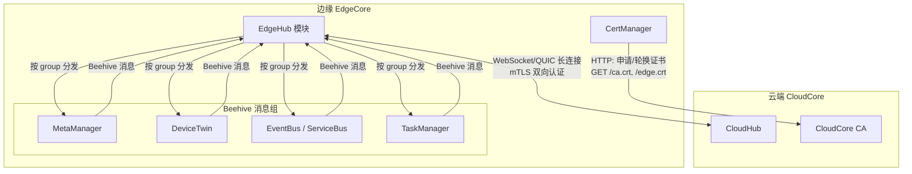
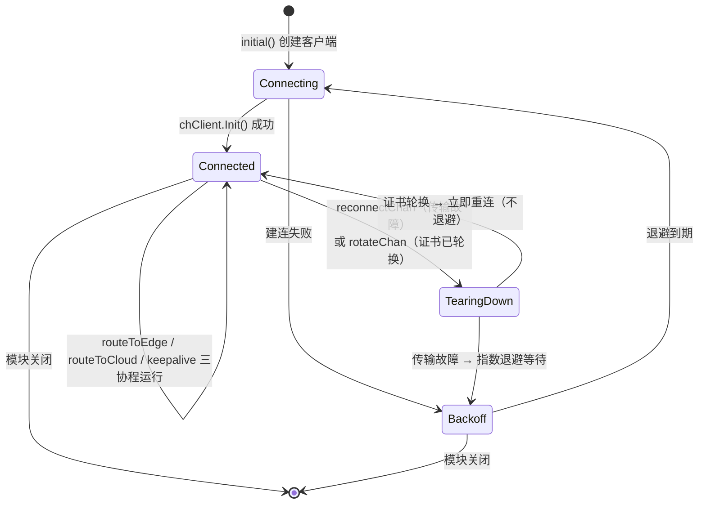
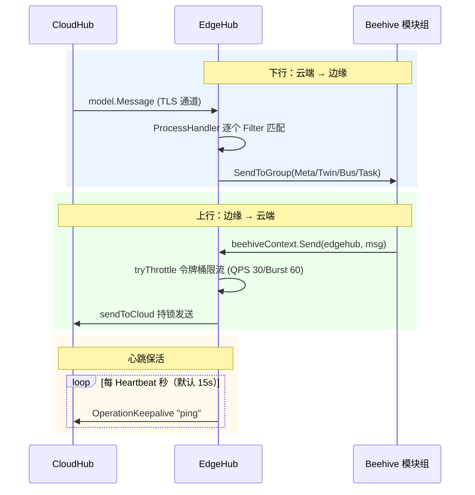
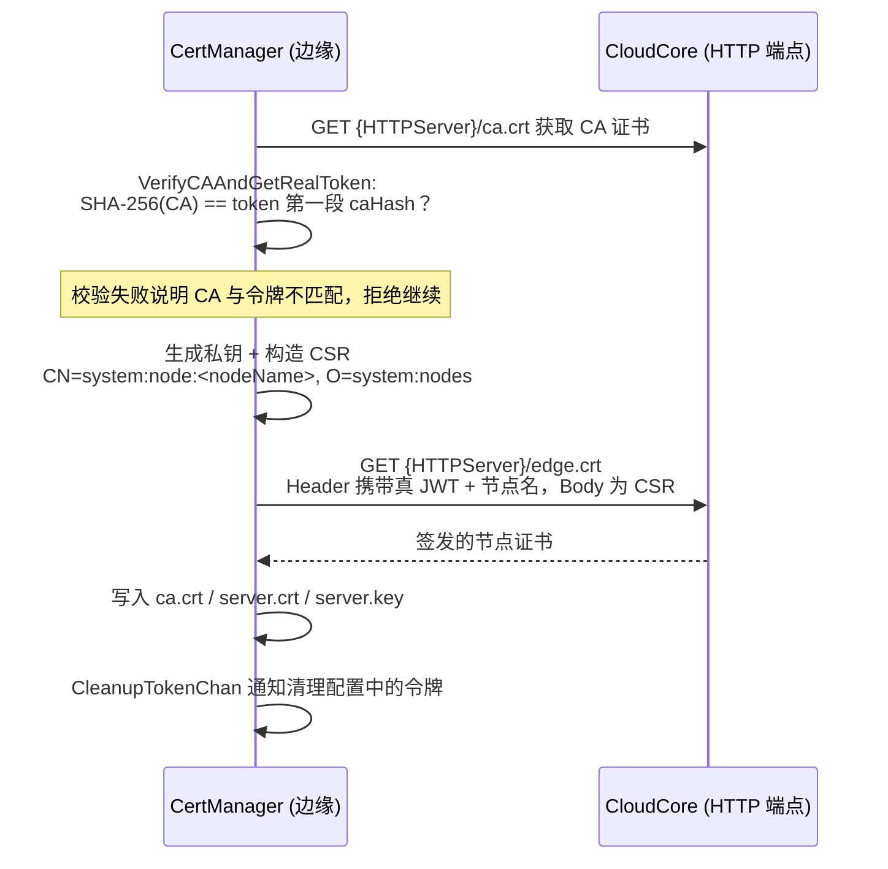

EdgeHub 是 KubeEdge 边缘侧（EdgeCore）与云端（CloudCore）之间**唯一的常驻消息通道**。它以 Beehive 模块的形式运行，负责三件事：维持与 CloudHub 的双向长连接、在云边两个方向收发消息、以及管理节点证书的申请与轮换。本文基于源码拆解其连接生命周期、消息路由、证书引导（bootstrap）与轮换机制，并剖析断线重连策略中的工程细节。

## 模块定位：边缘的"南向网络出口"

在 KubeEdge 的模块化架构中，EdgeHub 自身不做业务处理，而是扮演**消息枢纽**角色：其他边缘模块（MetaManager、DeviceTwin、EventBus、TaskManager）通过 Beehive 消息框架将上行消息交给 EdgeHub，由它经 TLS 加密通道发往 CloudHub；云端下发的消息也由 EdgeHub 接收后按消息组分发回各模块。证书层面，EdgeHub 持有由 CloudCore CA 签发的节点证书，以双向 TLS（mTLS）完成身份认证。



EdgeHub 与 CloudHub 的连接本身基于 Viaduct 传输框架实现（详见 [Viaduct：云边消息传输通道（WebSocket/QUIC）](23-viaduct-yun-bian-xiao-xi-chuan-shu-tong-dao-websocket-quic)），云端对端的接入逻辑则在 [CloudHub：云边长连接网关与消息分发](8-cloudhub-yun-bian-chang-lian-jie-wang-guan-yu-xiao-xi-fen-fa) 中展开。

Sources: [edgehub.go](edge/pkg/edgehub/edgehub.go#L42-L63), [adapter.go](edge/pkg/edgehub/clients/adapter.go#L8-L17)

## 模块注册与启动入口

EdgeHub 实现了 Beehive 的 `core.Module` 接口：模块名为 `edgehub`，归属于 `HubGroup` 消息组。`Register` 函数完成三步初始化——加载配置（组装 WebSocket URL：`wss://<server>/<projectID>/<nodeName>/events`）、注册四个消息处理器、将自身注册进 Beehive 框架。

`Start` 方法揭示了启动顺序的关键设计：**先启动证书管理器，再进入连接循环**。`certManager.Start()` 保证磁盘上存在有效的证书密钥对（无证书时用令牌引导申请），随后通过 `certSync` 通道通知依赖方（如 EdgeStream），并启动证书轮换监听协程 `ifRotationDone`，最后才调用 `run` 进入连接主循环。这一顺序确保了首次建连时 TLS 握手材料必然就绪。

```go
// edge/pkg/edgehub/edgehub.go
func (eh *EdgeHub) Start() {
    eh.certManager = certificate.NewCertManager(config.Config.EdgeHub, config.Config.NodeName)
    eh.certManager.Start()
    // ... certSync 通知 + 轮换监听 ...
    eh.run(beehiveContext.Done())
}
```

Sources: [edgehub.go](edge/pkg/edgehub/edgehub.go#L128-L136), [edgehub.go](edge/pkg/edgehub/edgehub.go#L164-L174), [config.go](edge/pkg/edgehub/config/config.go#L19-L27)

## 连接主循环：一个由三类信号驱动的状态机

`run` 方法是一个无限循环，可理解为围绕单条连接的状态机。每轮循环依次执行：初始化客户端 → 建连 → 拉起三个工作协程 → 阻塞等待"终止信号"→ 清理并重连。



连接成功后，`run` 会启动三个协程：`routeToEdge`（下行接收）、`routeToCloud`（上行发送）、`keepalive`（心跳），并通过 `stop` channel 在连接拆除时统一回收它们——注释明确指出，这是对旧实现"依赖心跳超时让僵尸协程自然消亡"的改进，因为新退避策略可能短于一个心跳周期。

驱动状态机的是两个语义不同的信号通道，这是整个实现中最精妙的设计：

| 通道 | 触发者 | 缓冲策略 | 断连时处理 | 语义 |
|------|--------|----------|-----------|------|
| `reconnectChan` | routeToEdge / routeToCloud / keepalive 的传输错误 | 缓冲 1，非阻塞发送（信号可合并） | 建连前后都会 drain（丢弃陈旧信号） | "连接已坏，重连即可" |
| `rotateChan` | `ifRotationDone` 协程（证书轮换完成） | 缓冲 1，非阻塞发送（但**从不 drain**） | 仅在断连且即将重读证书前丢弃一次 | "证书已换，必须重连加载新证书" |

代码注释详细解释了这一区分的动机：丢弃一个轮换信号可能导致连接**一直使用过期证书运行**，直到下一次自然断连——这是安全隐患；而丢弃合并后的重连信号则无害，因为一个信号足以驱动重连循环。源码中甚至处理了一个极端竞态：若轮换发生在 `Init()` 执行期间，新信号会在成功建连后存活下来，触发一次额外的快速重连以加载新证书。

Sources: [edgehub.go](edge/pkg/edgehub/edgehub.go#L179-L289), [edgehub.go](edge/pkg/edgehub/edgehub.go#L98-L117), [process.go](edge/pkg/edgehub/process.go#L160-L184)

### 指数退避与"防连接风暴"设计

`reconnectBackoff` 返回从 2 秒起步、按 2 倍因子增长、上限 30 秒并带 0.2 抖动的指数退避策略。源码注释揭示了两个防御性考量：其一，初始退避很短（2 秒），是为了让网络快速恢复时节点能在几秒内重新 Ready，而非等待旧实现的 `2×Heartbeat`（心跳 120 秒时最长 4 分钟）；其二，`shouldResetBackoff` **不在每次握手成功时重置退避**，而是要求连接存活超过退避上限（30 秒）才重置——否则"连上就断"的死循环（如 CloudHub 过载或负载均衡故障）会让大规模边缘节点集群以 2 秒间隔持续冲击云端，形成连接风暴。

另外，证书轮换触发的重连被明确定义为"健康的有意重连"，跳过退避立即执行。

Sources: [edgehub.go](edge/pkg/edgehub/edgehub.go#L23-L40), [edgehub.go](edge/pkg/edgehub/edgehub.go#L261-L283)

## 消息收发路径与处理器路由

三个工作协程构成了消息的双向通路：

**上行（routeToCloud）**：从 Beehive 上下文接收其他边缘模块发往 `edgehub` 模块的消息，先经过基于令牌桶的客户端限流器（`tryThrottle`，等待超过 1 秒会记录日志），再由 `sendToCloud` 持有 `keeperLock` 写锁发送。发送失败会触发重连信号。

**下行（routeToEdge）**：阻塞式调用客户端 `Receive()` 读取云端消息，交给 `ProcessHandler` 按处理器链匹配分发。读取错误同样触发重连。

**心跳（keepalive）**：周期性（默认 15 秒）构造 `OperationKeepalive` 消息发往云端，作为链路活性探测。

云端消息按 `group` 字段经四级处理器链路由，处理器按注册顺序匹配、首个命中者负责处理：

| 处理器 | 匹配的 group | 分发目标 | 分发逻辑 |
|--------|-------------|----------|----------|
| MetaHandler | `resource` / `function` | MetaManager 模块组 | 有 ParentID 则回送响应，否则转发 MetaGroup |
| TwinHandler | `twin`（TwinGroup） | DeviceTwin 模块组 | 直接 SendToGroup |
| BusHandler | `user`（UserGroup） | EventBus 或 ServiceBus | 按 source 区分：`router_eventbus` → EventBus，`router_servicebus` → ServiceBus |
| TaskHandler | TaskManagerGroup | TaskManager 模块组 | 直接 SendToGroup |

无处理器命中的消息会返回错误并被记录，不会静默丢弃。



连接状态的对外广播也在此层完成：`pubConnectInfo` 在每次建连/断连时，向 Twin、Meta、Bus、TaskManager 四个消息组广播 `CloudConnected` / `CloudDisconnected` 事件，并更新全局连接状态供其他模块查询（例如 metamanager 据此决定缓存策略，详见 [可靠消息传递与边缘自治机制](27-ke-kao-xiao-xi-chuan-di-yu-bian-yuan-zi-zhi-ji-zhi)）。

Sources: [process.go](edge/pkg/edgehub/process.go#L43-L109), [process.go](edge/pkg/edgehub/process.go#L111-L139), [process.go](edge/pkg/edgehub/process.go#L143-L158), [handler.go](edge/pkg/edgehub/messagehandler/handler.go#L51-L74), [handler_meta.go](edge/pkg/edgehub/messagehandler/handler_meta.go#L29-L48), [handler_bus.go](edge/pkg/edgehub/messagehandler/handler_bus.go#L31-L54)

## 证书认证：从引导令牌到节点证书

EdgeHub 的证书体系解决"边缘节点如何安全获得第一张身份证书"的引导问题。核心组件 `CertManager` 在 `Start` 时首先调用 `getCurrent` 尝试从磁盘加载现有证书，并**严格校验证书 CN 必须等于 `system:node:<nodeName>`**——这防止了误用其他节点的证书。加载失败（首次部署或证书损坏）则进入令牌引导流程：



引导令牌的构造包含一层防中间人的哈希绑定：令牌格式为 `caHash.jwtToken`，其中 `caHash` 是 CA 证书的 SHA-256 十六进制摘要，`jwtToken` 是用 CA 私钥以 HS256 签名的 JWT（有效期为申请间隔的两倍）。`VerifyCAAndGetRealToken` 会先验证下载到的 CA 证书哈希与令牌前缀一致，再剥离前缀取出真实 JWT——边缘节点由此确认"我要把 CSR 发给令牌签发时指向的那朵云"。令牌用后即清（配置文件中不再保留），后续身份认证完全依赖证书。

Sources: [certmanager.go](edge/pkg/edgehub/certificate/certmanager.go#L77-L141), [certmanager.go](edge/pkg/edgehub/certificate/certmanager.go#L253-L295), [token.go](pkg/security/token/token.go#L29-L45), [token.go](pkg/security/token/token.go#L69-L79)

## 证书轮换：无感续期与信号驱动的连接重载

证书长期有效但终会过期，`RotateCertificates` 配置项（默认开启）启用了自动轮换。轮换时机的计算方式颇具匠心：`jitteryDuration` 在证书**生命周期总长度的 40%~60% 区间**随机取值加到 NotBefore 上，使实际轮换点落在生命周期的 **70%~90%**。注释说明目的：同批创建的节点不会在余生每个轮换周期都同时冲向云端申请证书——把"羊群效应"打散在时间轴上。

轮换的具体流程与首次申请高度相似，但有两点关键差异：请求不再携带令牌，而是**以当前仍有效的证书做 mTLS 认证**（`GetEdgeCert` 的 `tlscert` 参数）；失败后的重试采用两级策略——先以 2 秒起步、5 步封顶的指数退避，耗尽后转入 32 秒间隔的无限轮询，保证轮换最终必然成功。

轮换成功后的闭环由两个信号接力完成：`rotateCert` 写盘后向 `CertManager.Done` 通道发信号 → `ifRotationDone` 协程监听到后向 `rotateChan` 发信号 → 主循环立即拆除现有连接（无需退避）→ 下一轮 `Init()` 从磁盘重新加载新证书建连。整个过程中业务模块几乎无感，仅在连接状态广播中体现为一次快速的断连-重连。

Sources: [certmanager.go](edge/pkg/edgehub/certificate/certmanager.go#L29-L39), [certmanager.go](edge/pkg/edgehub/certificate/certmanager.go#L144-L225), [process.go](edge/pkg/edgehub/process.go#L160-L184), [edgehub.go](edge/pkg/edgehub/edgehub.go#L248-L267)

## 传输客户端：WebSocket 与 QUIC 的双协议支持

`clients` 包通过 `Adapter` 接口（`Init`/`UnInit`/`Send`/`Receive`/`Notify` 五个方法）抽象传输层，`GetClient` 工厂函数按配置优先选择 WebSocket，其次 QUIC，两者都未启用则报错。两种客户端的 TLS 配置均加载节点证书与 CA 证书池，并在握手请求头中携带 `node_id` 与 `project_id` 供 CloudHub 识别节点身份。

| 维度 | WebSocketClient | QuicClient |
|------|-----------------|------------|
| 启用优先级 | 优先（配置 `websocket.enable`） | 次选 |
| 建连重试 | 内置 5 次重试、间隔 5 秒 | 无内置重试（依赖上层退避） |
| 服务地址 | 拼接的 `wss://` URL（含 projectID/nodeName/events） | 独立 QUIC 地址 `ip:port` |
| 服务端校验 | `InsecureSkipVerify: false`，严格校验 | `InsecureSkipVerify: true` |
| 底层实现 | Viaduct WebSocket 连接 | Viaduct QUIC 连接 |

值得注意的是两者的 `InsecureSkipVerify` 取值相反：QUIC 客户端跳过了服务端证书校验，这与 QUIC 场景下的安全权衡相关，属于部署时需要知晓的细节。证书轮换后，客户端由主循环重建（`initial()` 每次重连都新建实例），`Init` 中重新 `LoadX509KeyPair` 天然加载新证书。

Sources: [factory.go](edge/pkg/edgehub/clients/factory.go#L13-L44), [websocket.go](edge/pkg/edgehub/clients/wsclient/websocket.go#L50-L100), [quicclient.go](edge/pkg/edgehub/clients/quicclient/quicclient.go#L44-L84)

## 配置速查

EdgeHub 的全部行为由 `edgecore.yaml` 中 `modules.edgeHub` 段配置，关键字段如下：

| 配置项 | 默认值 | 说明 |
|--------|--------|------|
| `enable` | `true` | 模块开关 |
| `heartbeat` | `15` 秒 | 心跳间隔，驱动 keepalive 周期 |
| `messageQPS` / `messageBurst` | `30` / `60` | 上行消息令牌桶限流参数 |
| `rotateCertificates` | `true` | 是否启用证书自动轮换 |
| `token` | 空 | 引导令牌（申请证书成功后从配置清理） |
| `httpServer` | — | 证书申请 HTTP 服务地址（CloudCore 10000 端口） |
| `tlsCaFile` | `/etc/kubeedge/ca/rootCA.crt` | CA 证书路径 |
| `tlsCertFile` / `tlsPrivateKeyFile` | `/etc/kubeedge/certs/server.crt` / `.key` | 节点证书与私钥路径 |
| `websocket.enable` | `true` | WebSocket 协议开关 |
| `quic.enable` | `false` | QUIC 协议开关 |
| `projectID` | `e632aba927ea4ac2b575ec1603d56f10` | 项目标识，参与握手头与 URL 拼接 |

Sources: [types.go](staging/src/github.com/kubeedge/api/apis/componentconfig/edgecore/v1alpha2/types.go#L864-L905), [default.go](common/constants/default.go#L25-L30)

## 小结与延伸阅读

EdgeHub 的代码呈现出三个值得借鉴的工程设计：**信号语义分离**（reconnect 与 rotate 双通道，杜绝证书更新信号被合并吞掉）、**退避重置的健康判定**（连接存活超过退避上限才重置，防御连接风暴）、以及**证书轮换的抖动设计**（70%~90% 生命周期随机轮换，打散集群羊群效应）。理解了 EdgeHub，你已掌握云边通道的边缘侧全貌，推荐按以下路径继续深入：

- 想了解对端实现：[CloudHub：云边长连接网关与消息分发](8-cloudhub-yun-bian-chang-lian-jie-wang-guan-yu-xiao-xi-fen-fa)
- 想理解消息从 EdgeHub 分发后如何被离线缓存：[MetaManager 与 MetaServer：离线元数据存储与本地 API Server](18-metamanager-yu-metaserver-chi-xian-yuan-shu-ju-cun-chu-yu-ben-di-api-server)
- 想深挖传输协议细节：[Viaduct：云边消息传输通道（WebSocket/QUIC）](23-viaduct-yun-bian-xiao-xi-chuan-shu-tong-dao-websocket-quic)
- 想全面掌握云边安全体系（含 CloudHub 侧证书签发）：[云边安全与认证体系（证书、令牌与边缘鉴权）](26-yun-bian-an-quan-yu-ren-zheng-ti-xi-zheng-shu-ling-pai-yu-bian-yuan-jian-quan)
- 想了解断连期间边缘自治的完整图景：[可靠消息传递与边缘自治机制](27-ke-kao-xiao-xi-chuan-di-yu-bian-yuan-zi-zhi-ji-zhi)