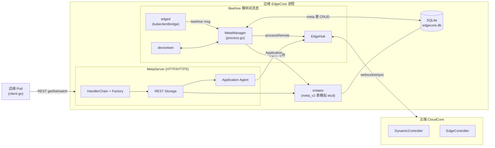
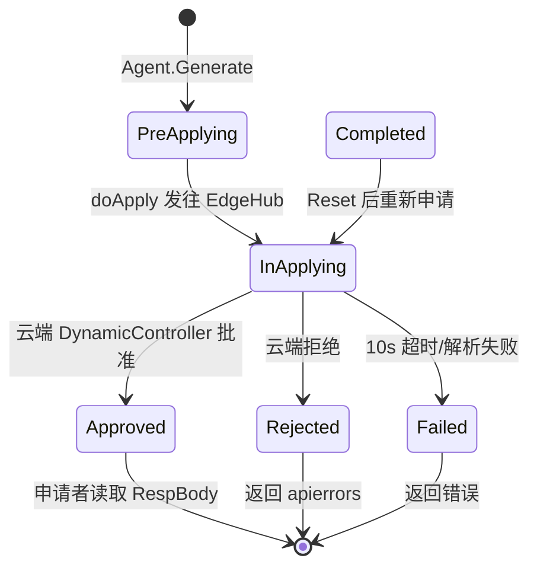
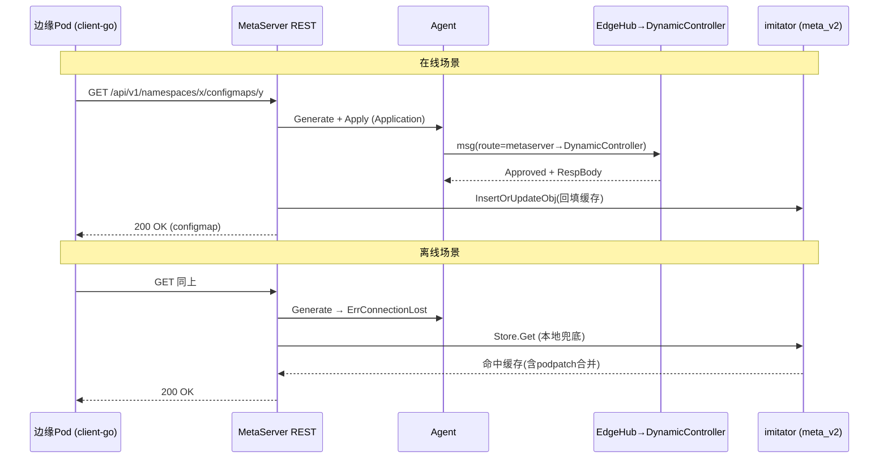

MetaManager 与 MetaServer 是 KubeEdge 边缘自治能力的元数据基座：前者作为 EdgeCore 内部的 Beehive 模块，负责云边消息与本地 SQLite 之间的元数据读写仲裁；后者则是在边缘节点上内嵌的一个"迷你 Kubernetes API Server"，让边缘 Pod 与客户端可以使用标准 `client-go` 直接访问本地数据。本文从源码出发，剖析两者的启动生命周期、消息协议、存储模型、watch 模拟机制以及向云端申请资源的 Application 协议。

## 一、设计动机：一份数据，两类访问面

边缘自治的根本矛盾在于：Kubernetes 的权威数据在云端，而边缘节点必须在断网时依然能够独立消费这些数据。KubeEdge 的解法是在每个边缘节点维护一份持久化的元数据副本（SQLite），并围绕这份数据提供两种互补的访问面——**MetaManager 面向 EdgeCore 内部模块**（edged、devicetwin 等），以 Beehive 消息为载体；**MetaServer 面向外部进程**（边缘 Pod 中的 Ingress、Prometheus Operator 等使用 `client-go` 的组件），以标准 RESTful API 为载体。两者读写同一数据库，共同构成"云端数据边缘化"的完整闭环。

MetaServer 的代码注释明确自我定位为 `simplification of server.GenericAPIServer`——它复用了 `k8s.io/apiserver` 的请求解析、认证鉴权过滤器与通用 REST handler，但把存储后端从 etcd 替换为本地 SQLite，从而在几 MB 级的内存占用下提供与真实 API Server 兼容的语义（参见 [第 29 页测试体系](29-ce-shi-ti-xi-duan-dao-duan-yu-ji-cheng-ce-shi-kuang-jia) 中的集成测试，直接用官方 `kubernetes.NewForConfig` 指向 MetaServer 地址完成 Get/Create）。

Sources: [metamanager.go](edge/pkg/metamanager/metamanager.go#L1-L68), [server.go](edge/pkg/metamanager/metaserver/server.go#L49-L58), [access_test.go](tests/integration/metaserver/access_test.go#L18-L27)

## 二、MetaManager：消息驱动的元数据中枢

### 2.1 模块注册与启动生命周期

MetaManager 是一个标准的 Beehive `core.Module`，模块名为 `metamanager`，归属 `meta` 组。EdgeCore 启动时 `registerModules` 会**先**调用 `dao.Init` 完成建库建表，**再**注册各模块——这个顺序是硬约束，因为 MetaServer 的配置初始化依赖 EdgeHub 已注册的 `NodeName`（config.go 中的注释直言 "so edgehub must register before metamanager"）。

`Start()` 方法浓缩了整个模块的启动编排：若 MetaServer 开关（`metaserverconfig.Config.Enable`）打开，先执行 `imitator.StorageInit()` 从 `meta_v2` 表恢复全局 resourceVersion 水位，再以 goroutine 拉起 MetaServer HTTP 服务；随后进入 `runMetaManager` 消息循环。此外模块实现了 `RestartPolicy`——在 `ModuleRestart` 特性门控开启后，故障时按 2.0 增长率指数退避自动重启，提升了元数据服务的存活韧性。

Sources: [metamanager.go](edge/pkg/metamanager/metamanager.go#L21-L68), [server.go(EdgeCore启动)](edge/cmd/edgecore/app/server.go#L201-L220), [config.go(MetaServer配置)](edge/pkg/metamanager/metaserver/config/config.go#L21-L27), [client.go(StorageInit)](edge/pkg/metamanager/metaserver/kubernetes/storage/sqlite/imitator/client.go#L57-L66)

### 2.2 消息协议：资源解析与远程查询决策

MetaManager 处理的 Beehive 消息采用 `<namespace>/<restype>[/resid]` 的资源路径约定，由 `parseResource` 统一解析出存储 key、资源类型与资源 ID。该函数对 ServiceAccountToken 类型做了特判——需要从消息体反序列化 `TokenRequest` 并参与 key 生成，因为同一 SA 的不同 token 请求必须映射到不同记录。

是否需要"问云端"由 `requireRemoteQuery` 决策：ConfigMap、Secret、PV、PVC、VolumeAttachment、ServiceAccountToken、Lease、CSR、K8sCA 这九类资源在云端可变性强（例如 Secret 轮换），即使本地有缓存，在线时也必须远程查询以获取最新值；而 Pod、Node 等以边缘下发为主的类型则直接读本地。这个白名单是理解 KubeEdge 云边数据新鲜度模型的关键。

Sources: [process.go](edge/pkg/metamanager/process.go#L83-L122), [process.go(远程查询调用点)](edge/pkg/metamanager/process.go#L341-L348)

### 2.3 操作处理矩阵：五类操作 × 多种消息源

`processInsert/Update/Patch/Response/Delete/Query` 六个入口构成了一个"路由矩阵"：**写入本地永远是第一步**（`handleMessage` 落库），然后依据消息来源决定向云、向 edged、向 devicetwin 的转发方向。注意所有 Insert/Update/Delete 都会先执行 `imitator.DefaultV2Client.Inject(message)`，把 Beehive 消息同步翻译成 `meta_v2` 表记录与 watch 事件——这是两个存储视图保持一致的核心纽带。

| 操作 | 本地处理 | 来源=edged | 来源=云端控制器 | 特殊逻辑 |
|---|---|---|---|---|
| Insert | `meta` 表 InsertOrUpdate | 需在线，转 `processRemote` | 写库后通知 edged（DeviceController 的额外路由到 twin） | Event 类型直接上云不落库 |
| Update | 同上 + Inject | 仅 Lease 需在线转云端；Pod 状态更新**同步等待**云端响应后才回执 edged | EdgeController/DynamicController 写库并下发（Node 例外） | MetaManager 自身来源 → 转发 twin（设备更新） |
| Patch | 写库 + Inject | 在线则上云，断网回 `ErrConnectionLost` | — | Event 直通 |
| Delete | Pod 按 key+PodUID 删除并联动清理 `podpatch`；其余按 key 删除 | Pod 删除直接上云 | 写库后通知 edged/twin | PolicyController 不通知 edged |
| Query | `meta` 表查询 | 白名单类型在线时走 `processRemote` | — | 断网时白名单类型也降级读本地 |

`processDeletePodDB` 值得展开：删除 Pod 记录时使用 `value LIKE '%<podUID>%'` 精确匹配，并通过 `RowsAffected == 0` 判断是否真的存在记录；命中后还会级联删除对应的 `podpatch` 键，避免残留的"补丁记录"污染后续同 Pod 恢复。

Sources: [process.go(Insert)](edge/pkg/metamanager/process.go#L192-L227), [process.go(Update)](edge/pkg/metamanager/process.go#L229-L281), [process.go(Delete)](edge/pkg/metamanager/process.go#L314-L339), [process.go(Query)](edge/pkg/metamanager/process.go#L341-L364), [process.go(PodDB删除)](edge/pkg/metamanager/process.go#L164-L190), [meta.go(DB访问)](edge/pkg/metamanager/dao/dbclient/meta.go#L44-L78)

### 2.4 离线自治语义：`processRemote` 与降级路径

`processRemote` 是在线远程查询的执行体：通过 `beehiveContext.SendSync` 将消息发给 EdgeHub（超时取自配置 `RemoteQueryTimeout`，默认 60 秒），并根据响应内容分三路处理——`OK` 字符串视为成功回执、error 类型透传错误、map 结构（含 `Err` 字段）则判断为对象响应后回写本地。整个调用运行在独立 goroutine 中，不阻塞消息循环。

**断网时行为分野清晰**：edged 发起的 Insert 直接触发 `errNotConnected` 错误回执；Query 的白名单类型在 `connect.IsConnected()` 为假时静默降级为本地查询——这正是"边缘自治"在代码层面的表达。Patch 则更为严格：断网时以 `connect.ErrConnectionLost` 明确报错，因为 patch 语义往往意味着状态收敛，静默吞掉会产生不一致。

Sources: [process.go(Remote)](edge/pkg/metamanager/process.go#L366-L399), [process.go(断网分支)](edge/pkg/metamanager/process.go#L203-L216), [config.go(RemoteQueryTimeout)](edge/pkg/metamanager/config/config.go#L13-L25)

### 2.5 metaclient 与 kubeclientbridge：让 edged 无感知地"像连着 apiserver"

edged（kubelet 裁剪版）的代码大量使用 `k8s.io/client-go` 接口。KubeEdge 的做法不是改造 edged，而是提供两层桥接：`client` 包的 **metaclient** 把类型化的 Pod/ConfigMap/Secret/Node/PV/PVC/VolumeAttachment/Lease/CSR 等操作封装为 Beehive 同步消息发给 metamanager（`SendSync` 内置 1 分钟超时与 3 次重试轮询）；**kubeclientbridge** 则基于 fake clientset 机制将这些 metaclient 注入标准 `clientset.Interface`。于是 edged 的 `podManager`、`statusManager` 调用 `CoreV1().Pods().Get()` 时，数据实际来自本地 SQLite 或经由 MetaManager 的远程查询。

Sources: [metaclient.go](edge/pkg/metamanager/client/metaclient.go#L34-L47), [metaclient.go(SendSync)](edge/pkg/metamanager/client/metaclient.go#L104-L125), [clientset_bridge.go](edge/pkg/edged/kubeclientbridge/clientset_bridge.go#L22-L66)

## 三、持久化层：单实例 SQLite 与双表模型

### 3.1 按模块裁剪的表迁移

整个 EdgeCore 只有一个 SQLite 实例（默认位于 `/var/lib/kubeedge/edgecore.db`），通过 GORM 以 `sync.Once` 单例初始化。表迁移按**模块启用状态**裁剪：DeviceTwin 启用才建 `device/device_attr/device_twin`，EventBus 启用才建 `sub_topics`，MetaManager 启用才建 `meta` 与 `meta_v2`。这一设计直接服务于 KubeEdge 的内存最小化目标——禁用设备模块的纯计算节点不会产生任何设备表开销。

Sources: [init.go](edge/pkg/metamanager/dao/init.go#L27-L111), [default_others.go](staging/src/github.com/kubeedge/api/apis/componentconfig/edgecore/v1alpha2/default_others.go#L16-L19)

### 3.2 `meta` 与 `meta_v2`：面向两个世界的两套键空间

同一数据库中的两张表对应两套元数据视角，这是理解本模块最重要的数据模型：

| 维度 | `meta` 表（V1） | `meta_v2` 表（V2） |
|---|---|---|
| Key 格式 | `default/configmap/my-cm` | `/core/v1/configmaps/default/my-cm` |
| Schema | Key(PK)、Type、Value | Key(PK)、GVR、Namespace、Name、ResourceVersion、Value |
| 主要写入方 | MetaManager 消息处理 | imitator.Inject / REST Get 缓存 |
| 消费方 | edged 经 metaclient 的旧式查询 | MetaServer 的 Get/List/Watch |
| 语义 | 平面 KV（type+value） | 模拟 etcd：五段 key、全局 RV 单调递增 |

`meta_v2` 的 `ResourceVersion` 列与 imitator 内存中的 revision 构成了 List/Watch 语义的基石；V2 层还通过 `ON CONFLICT UPDATE ALL` 加 3 次重试保证写入健壮性，并承载 NodeUpgradeJobRequest / NodeTaskRequest 等升级任务的持久化。

Sources: [models/meta.go](edge/pkg/metamanager/dao/models/meta.go#L15-L29), [models/constants.go](edge/pkg/metamanager/dao/models/constants.go#L23-L48), [metav2.go](edge/pkg/metamanager/dao/dbclient/metav2.go#L31-L96)

## 四、MetaServer：内嵌的迷你 API Server

### 4.1 启动模式：明文 HTTP 与安全 HTTPS（含 Dummy 接口）

`MetaServer.Start` 依据 `RequireAuthorization` 特性门控选择两条路径：门控关闭时仅启动一个明文 HTTP Server（默认 `127.0.0.1:10550`，仅本机可达）；门控开启时进入完整安全模式——先在内核创建名为 `edge-dummy0` 的 dummy 网络设备并绑定 `DummyServer` 地址（默认 `169.254.30.10:10550`，链路本地地址，永不对外路由），再初始化证书管理器（证书目录 `/etc/kubeedge/pki/metaserver`，向云端动态签发服务证书），随后**同时**在真实 IP 与 dummy IP 上启动两个 HTTPS 实例。

DummyServer 的设计意图：Pod 内使用 `client-go` 的组件（如 serviceaccount 的 in-cluster 配置）可以把 API Server 指向这个链路本地地址，即使节点网络配置变化、Pod 所在网络命名空间不同，也能通过 dummy 设备稳定回环到 MetaServer，同时走 TLS 与云端签发的同一套 CA 信任链。TLS 配置采用 `VerifyClientCertIfGiven`——Pod 侧无客户端证书时仍可凭 SA token 认证。

Sources: [server.go(Start)](edge/pkg/metamanager/metaserver/server.go#L184-L195), [server_linux.go](edge/pkg/metamanager/metaserver/server_linux.go#L14-L35), [server.go(TLS)](edge/pkg/metamanager/metaserver/server.go#L321-L346), [manager.go(证书目录)](edge/pkg/metamanager/metaserver/certificate/manager.go#L46-L47)

### 4.2 请求处理链与动词路由

MetaServer 完整复用了 `k8s.io/apiserver` 的过滤器栈：`WithPanicRecovery` → `WithRequestInfo`（将 URL 解析为标准 RequestInfo）→ `WithWaitGroup`（配合 `BasicLongRunningRequestCheck` 识别 watch 长连接实现优雅关停）→ 可选的 `WithAuthentication`/`WithAuthorization`。核心路由逻辑在一个手工编写的 `BuildBasicHandler` 中按动词分发：

| RequestInfo 特征 | 分发目标 | 说明 |
|---|---|---|
| verb=get，subresource=log | `Factory.Logs` | 容器日志（经云边隧道） |
| verb=get/list/watch | `Factory.Get` / `Factory.List` | 常规读，List 兼具 watch 升级 |
| verb=create，name=restart | `Factory.Restart` | Pod 重启（直连 CRI） |
| verb=create，name=confirm-upgrade / unhold-upgrade | 升级确认/解锁 | NodeUpgradeJob 流程 |
| verb=create，subresource=exec | `Factory.Exec` | kubectl exec 隧道 |
| verb=update / patch / delete | `Factory.Update` / `Patch` / `Delete` | 常规写 |
| 非资源请求且命中 pass-through 路径 | `Factory.PassThrough` | 云端代理 + 本地缓存 |

非资源路径的 pass-through 判定被抽到了 `pkg/util/pass-through` 包中集中维护，认证层的 `AlwaysAllowDiscoveryAuthorizer` 复用同一判定，保证发现类路径（`/api`、`/apis`、`/openapi` 等）在任何鉴权模式下匿名可达——这是 `client-go` 建立连接前的协商前提。

Sources: [server.go(路由)](edge/pkg/metamanager/metaserver/server.go#L197-L258), [server.go(HandlerChain)](edge/pkg/metamanager/metaserver/server.go#L260-L273), [server.go(Discovery放行)](edge/pkg/metamanager/metaserver/server.go#L67-L84)

### 4.3 HandlerFactory：通用 handler 的按需实例化

`Factory` 是 handler 的惰性缓存工厂：读操作（Get/List）在首次调用时构造并缓存，写操作（Create/Update/Delete）则因需要按请求动态确定 GVK 的 RequestScope 而每次构造。真正"干活"的是 `k8s.io/apiserver/pkg/endpoints/handlers` 里的官方通用函数（`GetResource`、`ListResource`、`CreateResource`……），配合 `fakers.NewAlwaysAdmit()` 跳过准入——边缘不重复云端已做过的校验。扩展端点体现了 MetaServer 作为"边缘 API 扩展点"的角色：`updateEdgeDevice` 让设备更新请求绕过存储直达 devicetwin，`Exec/Logs` 则桥接到 EdgeStream 云边隧道（详见 [第 13 页 CloudStream](13-cloudstream-kubectl-exec-logs-metrics-yun-bian-sui-dao)）。

Sources: [factory.go](edge/pkg/metamanager/metaserver/handlerfactory/factory.go#L15-L42), [standard_read.go](edge/pkg/metamanager/metaserver/handlerfactory/standard_read.go#L28-L46), [standard_write.go](edge/pkg/metamanager/metaserver/handlerfactory/standard_write.go#L53-L92)

## 五、imitator：用 SQLite 模拟 etcd

### 5.1 Client 接口与 revision 水位

imitator 的定位写在代码注释里："a storage based on metav2 that imitate the behavior of etcd"。它实现了一个双面接口：面向 MetaManager 的 `Inject/InsertOrUpdateObj/DeleteObj`（写），以及面向上层 `storage.Interface` 的 `Get/List/Watch`（读）。进程内只有 `DefaultV2Client` 一个实例，因为它独占维护全局 revision——`StorageInit` 启动时从 `meta_v2` 表取最大 ResourceVersion 作为初始水位，此后每次写入高于水位的对象都会推进 revision，保证 List 返回的 `metadata.resourceVersion` 与后续 Watch 的 bookmark 语义自洽。

Sources: [imitator.go](edge/pkg/metamanager/metaserver/kubernetes/storage/sqlite/imitator/imitator.go#L28-L48), [client.go](edge/pkg/metamanager/metaserver/kubernetes/storage/sqlite/imitator/client.go#L22-L66)

### 5.2 Inject：Beehive 消息到 watch 事件的翻译器

`Inject` 是双表一致性的关键枢纽。MetaManager 每收到云端下发的 Insert/Update/Delete 消息，都会调用 `Inject` 将其转换为 `watch.Added/Modified/Deleted` 事件序列：先按事件类型写/删 `meta_v2` 记录（JSON 编码 unstructured 对象、解析 RV 并单调推进 revision），再触发 `watchhook.Trigger(e)` 唤醒所有匹配的本地 watcher。于是云端的一次 Pod 下发，同时完成了"旧视图给 edged 回执"与"新视图给边缘 Pod 推 watch 事件"两件事。

Sources: [imitator.go(Inject)](edge/pkg/metamanager/metaserver/kubernetes/storage/sqlite/imitator/imitator.go#L31-L48), [imitator.go(InsertOrUpdateObj)](edge/pkg/metamanager/metaserver/kubernetes/storage/sqlite/imitator/imitator.go#L50-L86)

### 5.3 watchhook 与 sqlite store：本地 watch 的完整闭环

`WatchHook` 是 watch 订阅的注册单元：以 GVR + Namespace + Name + 起始 ResourceVersion 描述监听范围，`Do` 方法在持锁状态下把事件递给 Receiver 通道。上层 `sqlite` 包把 imitator 封装为 `storage.Interface`（`genericregistry.Store` 所需），其 `Get/GetList` 有一处精妙处理：**Pod 对象读取时会调用 `MergePatchedResource` 合并 `podpatch` 记录**——云端对边缘 Pod 的原地修改（如资源调整）以补丁形式存储，读取时再叠加，这保证了"云端修改未整对象下发"场景下边缘视图的正确性。List 过滤支持 label selector 全量匹配与 `metadata.name/namespace` 字段匹配。

Sources: [watchhook.go](edge/pkg/metamanager/metaserver/kubernetes/storage/sqlite/imitator/watchhook/watchhook.go#L20-L46), [store.go](edge/pkg/metamanager/metaserver/kubernetes/storage/sqlite/store.go#L56-L147)

## 六、Application 协议：向云端申请资源的边缘侧 RPC

### 6.1 Application 模型与去重标识

MetaServer 的写路径与云依赖读路径并不直接发消息，而是构建 `Application`——一个携带 Key、Verb、Nodename、Option、ReqBody 等完整请求语义的结构体。其 `Identifier` 是请求五元组的 SHA256，配合 Agent 内的 `sync.Map` 实现**请求合并**：并发 Pod 同时 Get 同一个 ConfigMap 时，后到者通过 `LoadOrStore` 复用已有 Application 并递增引用计数，云端只需处理一次。引用计数归零后记录关闭时间戳，由每 5 分钟一轮的 GC 协程回收僵尸条目。

Sources: [application.go](pkg/metaserver/application.go#L40-L101), [agent.go(Generate)](edge/pkg/metamanager/metaserver/agent/agent.go#L61-L88), [agent.go(GC)](edge/pkg/metamanager/metaserver/agent/agent.go#L152-L162)

### 6.2 申请状态机：从 PreApplying 到 Approved

Application 的生命周期是一台显式状态机，状态由边缘与云端共同驱动：

`Agent.Apply` 是状态机的门面：`Approved` 直接返回（热路径零开销）；`PreApplying`/`Completed` 触发异步 `doApply`；`Rejected` 返回云端附带的 `apierrors.StatusError`（例如 RBAC 拒绝会以标准 403 语义回给 Pod）。`doApply` 将 Application 封装为 Beehive 消息，路由标注为 `metaserver → DynamicController` 组，经 EdgeHub 的云边长连接送达云端，随后把返回的 Status/Reason/RespBody 合并回本地对象并 `Cancel` 唤醒所有等待者。

Sources: [constants.go(状态与动词)](pkg/metaserver/constants.go#L24-L49), [agent.go(Apply)](edge/pkg/metamanager/metaserver/agent/agent.go#L90-L119), [agent.go(doApply)](edge/pkg/metamanager/metaserver/agent/agent.go#L121-L141)

### 6.3 断连防护与 watch 重同步

`Agent.Generate` 的第一行就是连接检查——断网时直接返回 `connect.ErrConnectionLost`，从源头避免请求堆积。对长连接的 watch 类 Application，Agent 维护一个限速工作队列：每次与云端重新建立连接（`CloseApplication` 或连接恢复路径触发 `SyncWatchAppOnConnected`），都会通过 `WatchAppSync` 操作把现存 watch 申请清单重新同步给云端，恢复事件推送。这补全了自治闭环：**断网期间** watch 退化为本地 imitator 事件流（云端下发经 Inject 照常触发），**重连之后**云端 watch 监听自动重建。

Sources: [agent.go(连接检查)](edge/pkg/metamanager/metaserver/agent/agent.go#L61-L68), [agent.go(watchSync)](edge/pkg/metamanager/metaserver/agent/agent.go#L164-L229)

## 七、读写路径走查：云优先、本地兜底

REST 存储层（`storage.REST`）内嵌了 `genericregistry.Store` 与 `agent.Agent` 两个结构，读策略统一为 **cloud-first with local fallback**。以 Get 为例——先生成 Get 类 Application 问云端，成功后把响应对象回写 `meta_v2`（回填本地缓存，供断网后消费）；失败则降级 `r.Store.Get` 读本地 SQLite。List 同理但**不回写缓存**（列表结果体积大且局部性差，仅 `decorateList` 补齐 GVK）。Watch 的做法更具巧思：向云端申请 watch 监听资格后立即返回 `r.Store.Watch` 的本地事件通道——事件的来源依然依赖云端下发经 Inject 写入，而 Application 保证云端 DynamicController 知道"这个节点要 watch 什么"。

写路径则是**纯云端执行**：Create/Update/Patch/Delete 全部经 Agent 送达云端，由 apiserver 完成真正的校验与持久化，随后变化经 EdgeController 正常下发回边——边缘不做任何本地写提交，避免产生"边缘独有状态"。PassThrough 路径例外地支持本地兜底：云端代理响应会以原始字节存入 `meta_v2`（key 即请求路径），断网后可直接返回缓存。

Sources: [storage.go(Get)](edge/pkg/metamanager/metaserver/kubernetes/storage/storage.go#L80-L114), [storage.go(List)](edge/pkg/metamanager/metaserver/kubernetes/storage/storage.go#L152-L212), [storage.go(Watch)](edge/pkg/metamanager/metaserver/kubernetes/storage/storage.go#L214-L243), [storage.go(Create/Delete/Update/Patch)](edge/pkg/metamanager/metaserver/kubernetes/storage/storage.go#L245-L335), [storage.go(PassThrough)](edge/pkg/metamanager/metaserver/kubernetes/storage/storage.go#L117-L149)

## 八、认证与鉴权：把 apiserver 安全栈搬到边缘

开启 `RequireAuthorization` 后，MetaServer 的认证器是 JWT SA token 验证器与匿名验证器的 union——请求携带 Bearer token 时走 `JWTTokenAuthenticator`：先校验 issuer 是否在 `ServiceAccountIssuers` 白名单，再尝试用 `ServiceAccountKeyFiles` 公钥验签；**若未配置公钥文件，则降级为在本地 `meta` 表中查找该 token 是否曾被云端下发过**（`client.CheckTokenExist`），这使边缘可以在没有 SA 私钥材料的情况下依然完成 token 有效性判断。通过验签后还需经过 `serviceaccount.Validator`（背后是通过 metaclient 读取的本地 SA 缓存）完成 SA 存在性与泄漏检查。

鉴权器复用了 Kubernetes 的 `rbac.New`，但 Role/RoleBinding/ClusterRole/ClusterRoleBinding 四个 getter 全部由 metaclient 提供数据——**RBAC 决策基于边缘本地缓存的策略对象**，断网时依然可执行。鉴权语义与云端 apiserver 一致的前提是策略及时同步，其可靠性由 [第 11 页 SyncController](11-synccontroller-ke-kong-bu-chang-ji-zhi) 的补偿机制保障。

Sources: [server.go(buildAuth)](edge/pkg/metamanager/metaserver/server.go#L86-L117), [auth.go](edge/pkg/metamanager/metaserver/auth/auth.go#L24-L126), [types.go(MetaServer配置)](staging/src/github.com/kubeedge/api/apis/componentconfig/edgecore/v1alpha2/types.go#L1026-L1038)

## 九、配置参考

MetaManager 与 MetaServer 的全部配置位于 edgecore 配置文件的 `modules.metaManager` 下，默认值汇总如下：

| 配置项 | 默认值 | 说明 |
|---|---|---|
| `metaManager.enable` | `true` | MetaManager 模块开关 |
| `contextSendGroup` | `hub` | 远程查询消息的目标组（EdgeHub） |
| `contextSendModule` | `websocket` | 远程查询消息的目标模块（EdgeHub 的 Beehive 名） |
| `remoteQueryTimeout` | `60`（秒） | `processRemote` 同步等待云端响应的超时 |
| `metaServer.enable` | `false` | MetaServer 开关（关闭则不启动 HTTP 服务与 imitator 初始化） |
| `metaServer.server` | `127.0.0.1:10550` | MetaServer 监听地址 |
| `metaServer.dummyServer` | `169.254.30.10:10550` | dummy 接口上的第二监听地址 |
| `metaServer.tlsCaFile / tlsCertFile / tlsPrivateKeyFile` | `/etc/kubeedge/...` | 安全模式证书材料 |
| `metaServer.serviceAccountIssuers` | `https://kubernetes.default.svc.cluster.local` | SA token 签发者白名单 |
| `metaServer.apiAudiences` / `serviceAccountKeyFiles` | 空 | token 受众与验签公钥 |

Sources: [types.go](staging/src/github.com/kubeedge/api/apis/componentconfig/edgecore/v1alpha2/types.go#L1010-L1038), [default.go](staging/src/github.com/kubeedge/api/apis/componentconfig/edgecore/v1alpha2/default.go#L121-L135), [constants/default.go](staging/src/github.com/kubeedge/api/apis/common/constants/default.go#L35-L38)

## 十、小结与延伸阅读

MetaManager/MetaServer 体系展示了"把 Kubernetes 控制平面语义压缩进边缘"的工程范式：**双表存储**分离内部消息视图与 REST 语义视图，**imitator** 以百行级代码在 SQLite 上复刻 etcd 的 List/Watch 契约，**Application 协议**用请求合并与状态机驯服了边缘到云端的按需取数，而**apiserver 过滤器栈的复用**则让边缘认证鉴权与云端零语义偏差。三条设计主线——离线降级路径的显式化、本地缓存作为云响应副产品的回填、以及断连重同步——贯穿了全部代码路径，是阅读其他边缘组件时可迁移的分析框架。

建议按以下路径继续深入：理解消息如何在云端对端响应本模块，请阅读 [DynamicController 相关的云端控制器解析](9-edgecontroller-bian-yuan-zi-yuan-xia-fa-yu-zhuang-tai-shang-bao)；理解 exec/logs 如何经本模块 Factory 桥接隧道，请阅读 [CloudStream](13-cloudstream-kubectl-exec-logs-metrics-yun-bian-sui-dao) 与 [ServiceBus 与 EdgeStream](21-servicebus-yu-edgestream-bian-yuan-http-fu-wu-fang-wen-yu-sui-dao-client)；而本模块依赖的 Beehive 通信原语（`SendSync`、`SendResp`、模块组路由）在 [Beehive：模块化消息通信框架](22-beehive-mo-kuai-hua-xiao-xi-tong-xin-kuang-jia) 中有系统阐述。