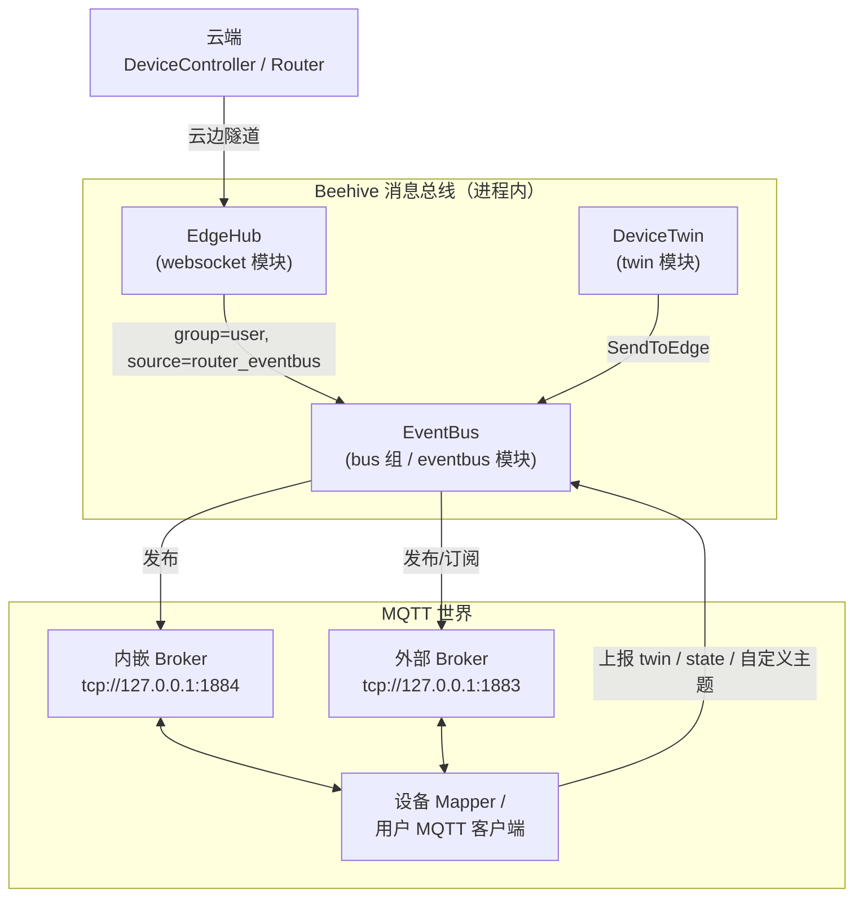
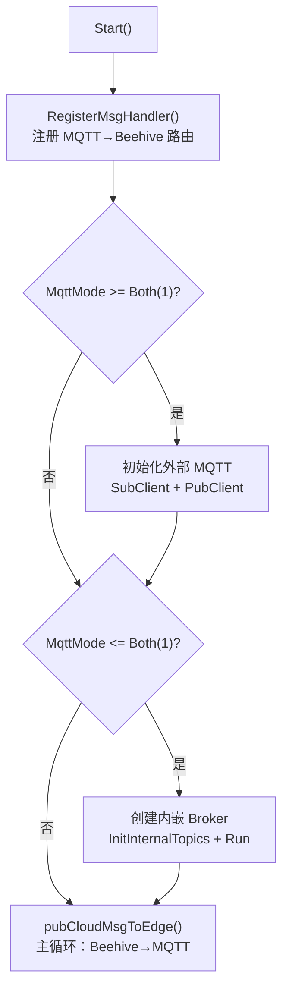
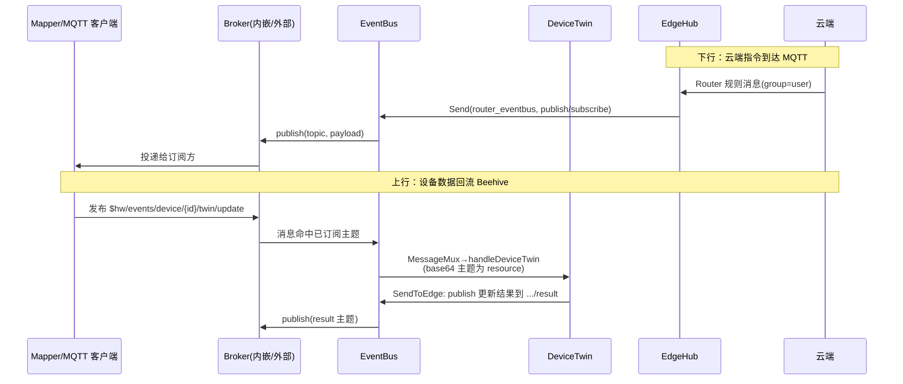

EventBus 是 EdgeCore 中负责 MQTT 消息收发的核心模块：它作为 Beehive 模块化消息世界与 MQTT 消息世界之间的双向桥梁，一方面把云端（经 EdgeHub 转发）和 DeviceTwin 产生的消息发布到 MQTT Broker，另一方面把设备侧 Mapper 或用户客户端发布到 Broker 的消息按主题分发给 DeviceTwin、EdgeHub 等内部模块。本文从架构定位、运行模式、启动流程、消息路由、订阅持久化等维度，结合源码逐层剖析其设计。

## 模块定位：Beehive 世界与 MQTT 世界的桥接器

从架构上看，EventBus 并不"拥有"设备，它只是一个纯粹的消息交换枢纽：模块注册名为 `eventbus`，隶属于 `bus` 消息组，实现 Beehive 的 `core.Module` 接口，由 EdgeCore 启动时统一注册。它内部持有两个关键能力——外部 MQTT 客户端（`mqttBus.Client`，基于 paho.mqtt.golang）与内嵌 MQTT Broker（`mqttBus.Server`，基于 gomqtt），并通过 `dbclient.EventBusService` 把动态订阅的主题持久化到本地数据库，以支撑断线重连后的订阅恢复。

模块的身份定义非常精简：`eventbus` 结构体仅包含 `enable` 开关与一个数据库服务句柄；`Name()` 返回 `modules.EventBusModuleName`（即 `"eventbus"`），`Group()` 返回 `modules.BusGroup`（即 `"bus"`）。EdgeCore 启动时会调用 `eventbus.Register(c.Modules.EventBus, c.Modules.Edged.HostnameOverride)` 完成配置初始化与模块注册。此外，EventBus 还实现了模块级故障重启策略：当 `ModuleRestart` 特性门控开启时，按 2.0 的间隔增长率进行失败自动重启。

Sources: [eventbus.go](edge/pkg/eventbus/eventbus.go#L24-L66), [names.go](edge/pkg/common/modules/names.go#L4-L8), [group.go](edge/pkg/common/modules/group.go#L4-L9), [server.go](edge/cmd/edgecore/app/server.go#L214-L214)

## MQTT 运行模式：internal / both / external 三态设计

EventBus 通过一个 `MqttMode` 枚举同时支持三种运行模式：`MqttModeInternal=0`（仅内嵌 Broker）、`MqttModeBoth=1`（内嵌 + 外部同时启用）、`MqttModeExternal=2`（仅外部 Broker，为默认值）。代码中巧妙地利用比较运算实现模式的正交组合——`MqttMode >= MqttModeBoth` 时启用外部客户端，`MqttMode <= MqttModeBoth` 时启动内嵌 Broker——这使得"双模式"天然被两条分支同时命中。配置校验要求该值必须落在 [0, 2] 区间内。

| 模式 | 枚举值 | 内嵌 Broker | 外部 Broker | 典型场景 |
|------|--------|:-----------:|:-----------:|----------|
| 仅内嵌 | `0` | ✅ | ❌ | 单机自包含部署，Mapper 直连本地 1884 端口 |
| 双模式 | `1` | ✅ | ✅ | 本地设备与远端订阅方（如云侧规则引擎）并存 |
| 仅外部 | `2`（默认） | ❌ | ✅ | 生产环境自建 EMQX/Mosquitto，功能完整 |

需要特别注意的是，默认配置为 `MqttMode: MqttModeExternal`，即 EdgeCore 默认**不会**启动内嵌 Broker，而会尝试连接 `tcp://127.0.0.1:1883` 的外部 Broker。这意味着在默认配置下，节点上必须预先运行一个标准 MQTT Broker，设备侧的 Mapper 才有接入点。两种模式的 Broker 地址分别由 `MqttServerInternal`（默认 `tcp://127.0.0.1:1884`）与 `MqttServerExternal`（默认 `tcp://127.0.0.1:1883`）配置。

Sources: [types.go](staging/src/github.com/kubeedge/api/apis/componentconfig/edgecore/v1alpha2/types.go#L28-L32), [types.go](staging/src/github.com/kubeedge/api/apis/componentconfig/edgecore/v1alpha2/types.go#L982-L988), [default.go](staging/src/github.com/kubeedge/api/apis/componentconfig/edgecore/v1alpha2/default.go#L102-L120), [validation.go](staging/src/github.com/kubeedge/api/apis/componentconfig/edgecore/v1alpha2/validation/validation.go#L110-L113)

## 启动流程：先挂路由，再起 Broker，最后进入主循环

`Start()` 的执行顺序体现了清晰的初始化依赖：首先调用 `mqttBus.RegisterMsgHandler()` 注册 MQTT 主题到 Beehive 模块的路由规则；随后若外部模式启用，则以配置中的 URL、ClientID、用户名密码构造 `mqttBus.Client` 并分别初始化订阅客户端（`InitSubClient`）与发布客户端（`InitPubClient`）；若内嵌模式启用，则创建内嵌 Broker，注入默认主题与数据库中恢复的主题后启动监听；最后进入 `pubCloudMsgToEdge()` 无限循环——这是 EventBus 的"出站泵"，负责从 Beehive 接收待发布到 MQTT 的消息。

值得注意的是，若内嵌 Broker 启动失败（例如端口被占用），代码会直接 `os.Exit(1)` 终止 EdgeCore 进程——内嵌 Broker 的端口是模块的硬性依赖，而非可降级的可选项。这一设计决策反映出 KubeEdge 对配置一致性的严格要求：宁可快速失败，也不让模块处于"半可用"状态。

Sources: [eventbus.go](edge/pkg/eventbus/eventbus.go#L68-L102)

## 外部 MQTT 客户端：读写分离的双客户端模型

针对外部 Broker，EventBus 采用**订阅/发布双客户端分离**的设计：`SubCli` 专门负责接收消息，`PubCli` 专门负责发布消息，两者各自持有独立的 ClientID（未配置时按 `hub-client-sub-<时间戳>` / `hub-client-pub-<时间戳>` 自动生成）。这种读写分离避免了 paho 客户端在单连接上收发竞争导致的队头阻塞，也让连接故障的处理策略可以各自独立——两个客户端分别注册了 `onSubConnectionLost` 与 `onPubConnectionLost` 回调，连接断开时异步重建对应方向的连接。

订阅客户端的连接建立回调 `onSubConnect` 值得细读：它先重订六个静态主题，再从数据库 `QueryAllTopics()` 读取动态主题逐个补订。配合 `CleanSession(true)` 与 `AutoReconnect=false`（由 `LoopConnect` 每 5 秒手动重试直到成功），KubeEdge 没有依赖 MQTT 协议层的持久会话，而是把订阅状态完全托管给自己的存储层，重连后显式恢复——这是"边缘自治"原则在 MQTT 接入层的具体体现。

静态订阅主题列表（`SubTopics`）勾勒出 EventBus 关心的消息边界：

| 主题 | 通配方式 | 用途 |
|------|----------|------|
| `$hw/events/upload/#` | 多层通配 | 设备状态/孪生数据上报 |
| `$hw/events/device/+/+/state/update` | 单层通配 | 设备状态更新请求 |
| `$hw/events/device/+/+/twin/+` | 单层通配 | 设备孪生操作 |
| `$hw/events/node/+/membership/get` | 单层通配 | 成员设备查询 |
| `SYS/dis/upload_records` | 精确匹配 | 上传记录至云端 |
| `+/user/#` | 前缀通配 | 用户自定义主题（配合 Router 规则） |

Sources: [client.go](edge/pkg/eventbus/mqtt/client.go#L43-L50), [client.go](edge/pkg/eventbus/mqtt/client.go#L62-L89), [client.go](edge/pkg/eventbus/mqtt/client.go#L91-L124), [client.go](edge/pkg/eventbus/mqtt/client.go#L126-L163), [common.go](edge/pkg/eventbus/common/util/common.go#L16-L21), [common.go](edge/pkg/eventbus/common/util/common.go#L94-L107)

## 内嵌 MQTT Broker：进程内内存实现

内嵌 Broker 基于 `github.com/256dpi/gomqtt` 库构建，本质上是一个**纯内存的轻量级 MQTT 服务**：`Server` 结构体聚合了监听地址（`transport.Server`）、线程安全的主题匹配树（`topic.Tree`）、内存后端（`broker.MemoryBackend`）以及 QoS、retain、sessionQueueSize 三个行为参数。它不具备持久化、集群等生产级特性，定位是"同一节点上设备 Mapper 的零依赖接入点"。

其消息分发机制充分利用了 Broker 回调：`Run()` 在 `MemoryBackend` 的 Logger 回调上监听 `MessagePublished` 事件，当发布消息的主题命中主题树时触发 `onSubscribe`，进而交给 `MessageMux.Dispatch` 做路由决策；而 EventBus 自身向内嵌 Broker 的发布则通过 `Publish()` 直接调用 `backend.Publish` 注入内存后端，无需经过 TCP 环回。主题管理通过 `SetTopic`/`RemoveTopic` 直接增删主题树节点。`InitInternalTopics` 在启动时把静态主题与数据库恢复的动态主题全部装入主题树，其行为与外部模式的 `onSubConnect` 严格对称。

| 维度 | 内嵌 Broker（gomqtt） | 外部 Broker（paho 客户端） |
|------|----------------------|---------------------------|
| 进程关系 | EdgeCore 进程内 | 独立进程，经 TCP 连接 |
| 存储 | 纯内存，重启即失 | 由 Broker 自身决定 |
| 认证 | 无 | 用户名/密码 + 可选 TLS 双向认证 |
| QoS/retain | 由配置全局指定 | 发布固定 QoS 1 |
| 适用规模 | 单节点设备少量接入 | 生产级大规模设备 |

Sources: [server.go](edge/pkg/eventbus/mqtt/server.go#L29-L66), [server.go](edge/pkg/eventbus/mqtt/server.go#L68-L99), [server.go](edge/pkg/eventbus/mqtt/server.go#L101-L146)

## 消息路由：正则模式的 MessageMux

从 MQTT 世界到 Beehive 世界的入站路由由 `MessageMux` 完成——这是一个轻量的正则表达式路由器：`GetExpression` 把形如 `$hw/events/device/` 的模式编译为 `^\$hw/events/device(/.*)?$` 形式的正则（支持 `{param}` 占位符语法），`Dispatch` 按注册顺序逐条匹配，命中即执行对应 Handler 并返回，全部未命中则兜底走 `handleUploadTopic`。

`RegisterMsgHandler` 只注册了两类路由，构成了清晰的两级分发规则：

| MQTT 主题前缀 | Handler | 目标 | 说明 |
|---------------|---------|------|------|
| `$hw/events/device/` | `handleDeviceTwin` | TwinGroup（DeviceTwin） | 设备孪生/状态事件 |
| `$hw/events/node/` | `handleDeviceTwin` | TwinGroup（DeviceTwin） | 节点成员关系事件 |
| 其他主题（含 `SYS/dis/upload_records`） | `handleUploadTopic` | HubGroup（EdgeHub） | 上传云端/用户自定义消息 |

`handleDeviceTwin` 的实现揭示了两个重要约定：其一，主题字符串经 **Base64 URL 编码**后作为 Beehive 消息的 resource 字段（避免特殊字符破坏消息路由格式）；其二，消息以 `BusGroup` 为源、`UserGroup` 为目标组、`response` 为操作构造后 `SendToGroup(TwinGroup)`。这与 DeviceTwin 侧的解析逻辑严格成对，属于 KubeEdge 边缘消息协议的一部分。而 `handleUploadTopic` 则以 `upload` 操作将消息投递给 HubGroup，由 EdgeHub 经云边通道上送云端。

Sources: [filter.go](edge/pkg/eventbus/mqtt/filter.go#L34-L93), [filter.go](edge/pkg/eventbus/mqtt/filter.go#L138-L158), [handler.go](edge/pkg/eventbus/mqtt/handler.go#L15-L33)

## 入站与出站：pubCloudMsgToEdge 主循环详解

`pubCloudMsgToEdge` 是 EventBus 的"出站泵"，也是五种 Beehive 操作到 MQTT 行为的映射中心。该循环通过 `beehiveContext.Receive("eventbus")` 接收来自其他模块的消息，按 `operation` 字段分发：

| Beehive 操作 | 行为 | MQTT 侧效果 |
|--------------|------|-------------|
| `subscribe` | `eb.subscribe(resource)` | 内嵌 Broker 挂载主题树 + 外部 Broker 订阅 + 写入数据库 |
| `unsubscribe` | `eb.unsubscribe(resource)` | 三处同步移除 |
| `message` | 解析 `body["message"]["topic"]` 后发布 | 面向 Router 消息格式 |
| `publish` | resource 即主题，content 为 payload（兼容 []byte/string） | 标准 MQTT 发布 |
| `get_result` | 仅处理 `auth_info` 资源，发布至 `$hw/events/node/<节点>/authInfo/get/result` | 边缘组临时凭证下发 |

`publish()` 内部按模式同时或择一投递到外部/内嵌 Broker（外部固定 QoS 1）。这五类消息的**来源**只有两个入口：一是云端经 EdgeHub 转发的消息——EdgeHub 的消息处理器按组过滤 `user` 组，识别出 `source == "router_eventbus"` 后直接 `Send("eventbus", msg)`，这正是云侧 Router 规则引擎选择 `eventbus` 端点类型时的落地路径；二是 DeviceTwin 的 `SendToEdge` 动作——DeviceTwin 的通信模块把设备状态更新结果（如 `$hw/events/device/<id>/state/update/result`）以 `BusGroup` + `publish` 操作直发 eventbus 模块。

Sources: [eventbus.go](edge/pkg/eventbus/eventbus.go#L104-L194), [handler_bus.go](edge/pkg/edgehub/messagehandler/handler_bus.go#L29-L54), [handler.go](edge/pkg/edgehub/messagehandler/handler.go#L51-L58), [communicate.go](edge/pkg/devicetwin/dtmanager/communicate.go#L77-L85), [device.go](edge/pkg/devicetwin/dtmanager/device.go#L137-L151), [constants.go](cloud/pkg/router/constants/constants.go#L3-L7)

## 订阅持久化与边缘自治

EventBus 对"动态订阅主题"的持久化设计是理解其自治能力的关键：每当收到 `subscribe` 操作，主题在挂载到 Broker 的同时会经 `InsertTopics` 写入本地 SQLite 的 `sub_topics` 表（GORM 的 `INSERT OR REPLACE` 语义保证幂等）；`unsubscribe` 则对称地删除记录。数据库访问层 `EventBusService` 仅暴露插入、删除、全量查询三个方法，接口面极小，且在测试中可通过 `EventBusServiceFactory` 函数变量注入 mock 实现。

重连场景下该机制的价值立即显现：无论是外部模式的 `onSubConnect` 还是内嵌模式的 `InitInternalTopics`，都会执行 `QueryAllTopics()` 恢复历史订阅。换言之，**EdgeCore 重启或 MQTT 链路中断期间用户通过 Router 规则动态建立的订阅不会丢失**——设备侧无需云端干预即可恢复完整的消息拓扑，这正是"边缘自治"在消息总线层的落地形态。

Sources: [dbclient/eventbus.go](edge/pkg/metamanager/dao/dbclient/eventbus.go#L29-L73), [client.go](edge/pkg/eventbus/mqtt/client.go#L52-L59), [client.go](edge/pkg/eventbus/mqtt/client.go#L100-L117), [server.go](edge/pkg/eventbus/mqtt/server.go#L107-L119)

## 配置参考与安全选项

EventBus 的完整配置由 `v1alpha2.EventBus` 结构定义，经 `InitConfigure` 以 `sync.Once` 方式加载为包级单例。除 MQTT 核心参数外，`TLS` 子结构控制外部 Broker 连接的传输安全：启用后加载 CA、客户端证书与私钥构成双向认证；未启用时则以 `InsecureSkipVerify: true` 跳过校验（仅建议测试环境）。

| 配置项 | 默认值 | 说明 |
|--------|--------|------|
| `enable` | `true` | 模块总开关 |
| `mqttMode` | `2`（仅外部） | 0 仅内嵌 / 1 双模式 / 2 仅外部 |
| `mqttServerInternal` | `tcp://127.0.0.1:1884` | 内嵌 Broker 监听地址 |
| `mqttServerExternal` | `tcp://127.0.0.1:1883` | 外部 Broker 地址 |
| `mqttQOS` | `0` | 内嵌 Broker 的 QoS（0/1/2） |
| `mqttRetain` | `false` | 内嵌 Broker 是否保留消息 |
| `mqttSessionQueueSize` | `100` | 会话队列长度 |
| `mqttSubClientID` / `mqttPubClientID` | `""`（自动生成） | 双客户端的 ClientID |
| `mqttUsername` / `mqttPassword` | `""` | 外部 Broker 认证凭证 |
| `eventBusTLS.enable` | `false` | 是否启用 TLS |
| `eventBusTLS.tlsMqttCAFile` | `/etc/kubeedge/ca/rootCA.crt` | CA 证书路径 |
| `eventBusTLS.tlsMqttCertFile` | `/etc/kubeedge/certs/server.crt` | 客户端证书路径 |
| `eventBusTLS.tlsMqttPrivateKeyFile` | `/etc/kubeedge/certs/server.key` | 私钥路径 |

发布操作的超时行为也有讲究：`pubMQTT` 使用 `WaitTimeout(TokenWaitTime)`（120 秒）等待 paho 发布结果，超时或出错仅记录日志而不重试——可靠投递的职责交给上层（如 SyncController 的补偿机制）而非 MQTT 层的 QoS 语义，这一取舍在选型外部 Broker 的 QoS 等级时值得纳入考量。

Sources: [types.go](staging/src/github.com/kubeedge/api/apis/componentconfig/edgecore/v1alpha2/types.go#L945-L1007), [default.go](staging/src/github.com/kubeedge/api/apis/componentconfig/edgecore/v1alpha2/default.go#L102-L120), [config.go](edge/pkg/eventbus/config/config.go#L9-L24), [common.go](edge/pkg/eventbus/common/util/common.go#L36-L92), [eventbus.go](edge/pkg/eventbus/eventbus.go#L104-L111)

## 调试与验证

EventBus 的行为可通过集成测试直观验证：`edge/test/integration/device` 套件以 `"eventbus"` 作为 ClientID 连接 Broker，围绕 `$hw/events/device/+/state/update`、`$hw/events/device/+/twin/+`、`$hw/events/node/+/membership/get`、`SYS/dis/upload_records` 等真实主题构造端到端用例。排查现场问题时，结合日志中的三个关键事件——`OnSubMessageReceived receive msg from topic`（外部模式入站）、`OnSubscribe receive msg from topic`（内嵌模式入站）与 `Success in pubMQTT with topic`（出站）——即可定位消息是在 Broker、路由层还是出站泵中丢失。

Sources: [device_suite_test.go](edge/test/integration/device/device_suite_test.go#L51-L97), [client.go](edge/pkg/eventbus/mqtt/client.go#L119-L124), [server.go](edge/pkg/eventbus/mqtt/server.go#L95-L99)

## 与相关组件的协作边界

EventBus 在边缘消息体系中处于"承上启下"的位置，但各职责归属应严格区分：设备孪生的状态机、同步确认等逻辑全部在 DeviceTwin 中实现，EventBus 只负责其 MQTT 侧的进出；云边长连接与证书认证由 EdgeHub 承担，EventBus 不感知云边通道细节；基于 Router 规则的云边消息路由决策在云侧完成，EventBus 仅作为 `eventbus` 端点类型的执行器；而新一代 Mapper 通过 DMI/gRPC 直连 DeviceTwin 的接入方式则完全绕开了 MQTT 总线。理解这些边界，才能准确判断"某条设备消息到底该在哪一层排查"。

深入阅读建议按以下路径继续：设备消息在 DeviceTwin 中的处理逻辑详见 [DeviceTwin：设备数字孪生与状态管理](20-devicetwin-she-bei-shu-zi-luan-sheng-yu-zhuang-tai-guan-li)；EventBus 依赖的 Beehive 消息收发原语详见 [Beehive：模块化消息通信框架](22-beehive-mo-kuai-hua-xiao-xi-tong-xin-kuang-jia)；`get_result` 操作背后的边缘组认证机制详见 [云边安全与认证体系（证书、令牌与边缘鉴权）](26-yun-bian-an-quan-yu-ren-zheng-ti-xi-zheng-shu-ling-pai-yu-bian-yuan-jian-quan)；若关注设备协议映射本身，请参阅 [Mapper Framework 与 DMI 设备映射接入](25-mapper-framework-yu-dmi-she-bei-ying-she-jie-ru)；与 EventBus 平行存在的 HTTP 消息入口对比可阅读 [ServiceBus 与 EdgeStream：边缘 HTTP 服务访问与隧道客户端](21-servicebus-yu-edgestream-bian-yuan-http-fu-wu-fang-wen-yu-sui-dao-ke-hu-duan)。