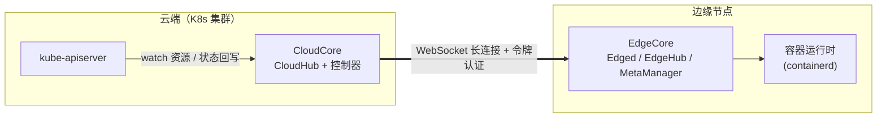
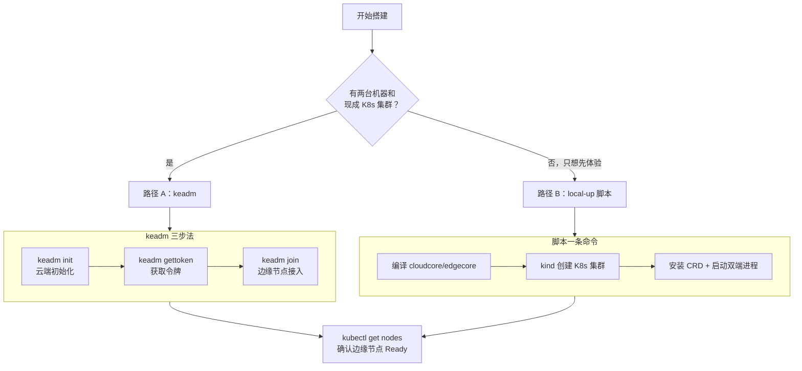

本页面向初次接触 KubeEdge 的开发者，目标是带你以最快路径搭建一套可运行的"云端 + 边缘"协同环境。你将了解两种部署方式的选择依据、逐步执行部署命令，并理解每一步背后发生了什么。完成本页后，你将拥有一个可以通过 `kubectl` 统一管理的边缘节点。

## 部署全景：你要搭建什么

一套最小可用的 KubeEdge 环境由两部分组成：**云端**是一个标准 Kubernetes 集群，其上运行云组件 CloudCore（含消息网关 CloudHub、边缘资源控制器等）；**边缘端**是一台普通机器（虚拟机或物理设备），运行轻量代理 EdgeCore，通过长连接接入云端。KubeEdge 基于 Kubernetes 构建，将原生容器化应用的编排与管理能力扩展到边缘设备，并同步云边元数据 [README_zh.md](README_zh.md#L11-L19)。

对初学者而言，理解云边组件的分工有助于后续排障：云上部分负责监听 Kubernetes 资源变化并向边缘分发消息；边缘部分（EdgeHub、Edged、EventBus、DeviceTwin、MetaManager 等）负责接收指令、管理容器与设备、并在断网时维持本地自治 [README_zh.md](README_zh.md#L33-L53)。整体拓扑如下：



动手之前，请先确认版本兼容性：官方矩阵表明 KubeEdge 1.23 与 Kubernetes 1.30/1.31/1.32 完全兼容，越旧组合可能出现 API 缺失 [README_zh.md](README_zh.md#L55-L83)。keadm 自身要求 Kubernetes 最低版本为 1.11，当前代码默认安装的 KubeEdge 版本为 1.23.0 [constant.go](keadm/cmd/keadm/app/cmd/common/constant.go#L126-L130)。

**前置条件汇总**：

| 角色 | 必备项 | 说明 |
|------|--------|------|
| 云端机器 | 可用的 K8s 集群 + `kubectl` | keadm init 会检测集群是否就绪 |
| 边缘机器 | 容器运行时 | 默认使用 containerd（CRI 接口） |
| 边缘机器 | 网络可达云端 | 需能访问 CloudHub 的 10000 端口 |
| 两者 | 版本匹配 | 参见上方兼容性矩阵 |

Sources: [README_zh.md](README_zh.md#L11-L53) [init.go](keadm/cmd/keadm/app/cmd/cloud/init.go#L33-L57)

## 部署路径选择：keadm 与本地脚本两条路

KubeEdge 提供两条面向不同场景的搭建路径，选择前请对照下表判断自己的目标：

| 维度 | 路径 A：keadm 命令行 | 路径 B：local-up 脚本 |
|------|---------------------|----------------------|
| 适用场景 | 搭建真实云边环境（两台机器） | 单机快速体验/本地开发 |
| 机器数量 | 云端 1 台 + 边缘 1 台 | 仅 1 台 Linux 机器 |
| 云端组件形态 | 以 Helm Chart 部署为 Pod | 源码编译、以进程方式运行 |
| 前置依赖 | 现成 K8s 集群 | Go、kind、kubectl、containerd |
| 阅读深度 | 生产化部署的入口 | 快速看到端到端效果 |

keadm 是官方推荐的安装器，通过 Helm 渲染并安装云端 Chart，再由 `join` 子命令引导边缘节点接入 [init.go](keadm/cmd/keadm/app/cmd/cloud/init.go#L59-L70)；而 `hack/local-up-kubeedge.sh` 会用 kind 在本地拉起 K8s 集群并直接运行编译好的 cloudcore/edgecore 二进制，专为快速验证设计 [local-up-kubeedge.sh](hack/local-up-kubeedge.sh#L133-L135)。两条路径的执行流程如下：



Sources: [init.go](keadm/cmd/keadm/app/cmd/cloud/init.go#L33-L57) [local-up-kubeedge.sh](hack/local-up-kubeedge.sh#L365-L425)

## 路径 A：keadm 三步搭建云边环境

### 第 1 步：云端初始化（keadm init）

在云端机器上执行 `keadm init`。该命令要求 Kubernetes 集群已就绪，然后以 Helm 方式渲染并安装 CloudCore 的 Chart 资源 [init.go](keadm/cmd/keadm/app/cmd/cloud/init.go#L33-L57)。典型用法如下（命令示例直接来自源码注释）：

```bash
keadm init --advertise-address=<云端对外IP> --kubeedge-version=v1.23.0 --kube-config=/root/.kube/config
```

其中 `--advertise-address` 会被写入 CloudHub 证书的 SubAltNames 字段并作为边缘回连地址；`--kube-config` 指定 cloudcore 与 kube-apiserver 之间的认证配置 [init.go](keadm/cmd/keadm/app/cmd/cloud/init.go#L96-L133)。安装器内部会下载对应版本组件、生成默认配置并启动 CloudCore，完成后打印 "CloudCore started" [cloudinstaller.go](keadm/cmd/keadm/app/cmd/util/cloudinstaller.go#L25-L75)。

常用 flag 速查：

| Flag | 作用 | 备注 |
|------|------|------|
| `--advertise-address` | 云端对外地址（可逗号分隔多个） | 写入证书 SubAltNames |
| `--kubeedge-version` | 指定安装版本 | 默认 1.23.0 |
| `--kube-config` | kubeconfig 绝对路径 | 默认 `$HOME/.kube/config` |
| `--set` / `--dry-run` | Helm 风格覆盖值 / 仅打印不执行 | 调试 Chart 时使用 |

Sources: [init.go](keadm/cmd/keadm/app/cmd/cloud/init.go#L33-L133) [constant.go](keadm/cmd/keadm/app/cmd/common/constant.go#L126-L130)

### 第 2 步：获取入群令牌（keadm gettoken）

边缘节点加入集群需要凭据。在云端机器执行：

```bash
keadm gettoken --kube-config /root/.kube/config
```

该命令从 `kubeedge` 命名空间中名为 `tokensecret` 的 Secret 里读取 `tokendata` 字段并打印 [gettoken.go](keadm/cmd/keadm/app/cmd/cloud/gettoken.go#L31-L52)。令牌的作用是建立**双向信任**：边缘节点携带令牌发起证书申请，CloudCore 审批后签发证书，完成安全接入 [gettoken.go](keadm/cmd/keadm/app/cmd/cloud/gettoken.go#L33-L38)。值得注意的是，local-up 脚本中也能看到同一机制——云端启动后循环等待 `tokensecret` 生成，边缘侧再用它取出令牌写入配置 [local-up-kubeedge.sh](hack/local-up-kubeedge.sh#L233-L236)。

Sources: [gettoken.go](keadm/cmd/keadm/app/cmd/cloud/gettoken.go#L31-L94) [local-up-kubeedge.sh](hack/local-up-kubeedge.sh#L276-L280)

### 第 3 步：边缘节点接入（keadm join）

切换到边缘机器，执行（`--cloudcore-ipport` 为必填项，示例取自源码）：

```bash
keadm join --cloudcore-ipport=<云端IP>:10000 --edgenode-name=testing123 --token=<第2步的令牌> --kubeedge-version=v1.23.0
```

join 命令负责引导 KubeEdge 的边缘工作节点组件，与云端建立连接以接收指令并回传设备遥测数据 [join.go](keadm/cmd/keadm/app/cmd/edge/join.go#L33-L48)。执行前有三道预检：确认 EdgeCore 进程未在运行、管理目录（`/etc/kubeedge`）为空、目标节点名未被占用——若节点已存在同名注册，会直接报错终止 [join.go](keadm/cmd/keadm/app/cmd/edge/join.go#L53-L86)。

join 的实际执行序列为：**创建必要目录 → 生成 systemd 服务文件 → 生成 EdgeCore 默认配置 → 以守护进程方式运行 EdgeCore → 输出 Install Complete** [join_others.go](keadm/cmd/keadm/app/cmd/edge/join_others.go#L200-L235)。安装器会先下载指定版本的 KubeEdge 压缩包，再生成配置文件（含节点名、cgroup 驱动、令牌引导文件等），最后启动进程 [edgecoreinstaller.go](keadm/cmd/keadm/app/cmd/util/edgecoreinstaller.go#L46-L73)。常用 flag 如下：

| Flag | 作用 | 默认值/说明 |
|------|------|------------|
| `--cloudcore-ipport` | 云端 CloudHub 地址（必填） | 格式 `ip:port`，默认端口 10000 |
| `--edgenode-name` | 边缘节点唯一标识 | 缺省使用主机名 |
| `--token` | 入群令牌 | 来自 `keadm gettoken` |
| `--remote-runtime-endpoint` | 容器运行时端点 | 默认 containerd sock |
| `--cgroupdriver` | cgroup 驱动 | `cgroupfs` 或 `systemd` |
| `--labels` | 为节点追加 Kubernetes 标签 | 格式 `key=value` |

Sources: [join.go](keadm/cmd/keadm/app/cmd/edge/join.go#L45-L86) [join_others.go](keadm/cmd/keadm/app/cmd/edge/join_others.go#L200-L235) [constant.go](keadm/cmd/keadm/app/cmd/common/constant.go#L89-L105)

### 验证部署

回到云端机器，运行：

```bash
kubectl get nodes
```

当输出中出现你的边缘节点且 `STATUS` 列为 `Ready`，说明云边协同通道已建立。local-up 脚本采用完全相同的验证标准——循环等待 `edge-node` 变为 Ready 后才宣告成功 [local-up-kubeedge.sh](hack/local-up-kubeedge.sh#L445-L447)。此时你在云端创建的 Deployment 可被调度至边缘节点运行，就像操作普通 Kubernetes 集群一样 [README_zh.md](README_zh.md#L22-L24)。

Sources: [local-up-kubeedge.sh](hack/local-up-kubeedge.sh#L427-L447)

## 路径 B：单机零门槛体验（local-up 脚本）

没有第二台机器也没关系。`hack/local-up-kubeedge.sh` 会在单机上完成"源码编译 → kind 拉起 K8s → 部署云边组件"的完整闭环。脚本顶部集中定义了可调环境变量：`PROTOCOL`（默认 WebSocket）、`CONTAINER_RUNTIME`（默认 containerd，也支持 docker/cri-o/isulad）、`KIND_IMAGE`（默认 `kindest/node:v1.32.2`）、`SKIP_CR_INSTALL` 等 [local-up-kubeedge.sh](hack/local-up-kubeedge.sh#L20-L34)。使用方式：

```bash
# 在仓库根目录执行（需先安装 Go、kind、kubectl、containerd）
ENABLE_DAEMON=true bash hack/local-up-kubeedge.sh
```

脚本默认以前台方式运行并持续健康检查，`ENABLE_DAEMON=true` 则让它后台运行、等待节点 Ready 后自动为 `edge-node` 打上 `disktype=test` 标签用于后续测试 [local-up-kubeedge.sh](hack/local-up-kubeedge.sh#L440-L447)。其内部执行顺序为：检查前置依赖（Go 版本、kubectl、kind、容器运行时）→ `make WHAT=cloudcore/edgecore` 编译二进制 → `kind create cluster` 拉起集群 → 创建 `kubeedge` 命名空间并批量安装 CRD → 生成 stream 证书 → 启动 cloudcore（等待令牌生成）→ 安装 CNI 插件 → 启动 edgecore [local-up-kubeedge.sh](hack/local-up-kubeedge.sh#L365-L425)。成功后脚本会提示日志位置（`/tmp/cloudcore.log`、`/tmp/edgecore.log`）与验证命令 [local-up-kubeedge.sh](hack/local-up-kubeedge.sh#L427-L437)。

一个对初学者友好的细节：脚本退出时会自动清理——杀掉 cloudcore/edgecore 进程、删除 `/tmp` 下的数据目录、并 `kind delete cluster` 移除整个集群 [local-up-kubeedge.sh](hack/local-up-kubeedge.sh#L86-L108)。这意味着你可以反复实验而无需手动清理残留。

Sources: [local-up-kubeedge.sh](hack/local-up-kubeedge.sh#L20-L34) [local-up-kubeedge.sh](hack/local-up-kubeedge.sh#L365-L447) [local-up-kubeedge.sh](hack/local-up-kubeedge.sh#L86-L108)

## 部署背后发生了什么：机制速览

初学者常把部署命令当"黑盒"，这里拆开三个关键机制，帮助你在出问题时定位到正确的层面。

**其一，CRD 先行。** KubeEdge 通过 CRD 扩展 Kubernetes API 来管理边缘专属对象。local-up 脚本在启动组件前依次安装设备类 CRD（Device/DeviceModel/DeviceStatus）、可靠同步类 CRD（ObjectSync/ClusterObjectSync）、路由规则 CRD（Rule/RuleEndpoint）、节点任务 CRD（NodeUpgradeJob 等）以及 ServiceAccountAccess [local-up-kubeedge.sh](hack/local-up-kubeedge.sh#L167-L196)。这些清单全部维护在仓库的 `build/crds/` 目录下，按功能分子目录管理（apps、devices、operations、policy、reliablesyncs、router）。若云端缺装 CRD，后续设备管理或升级任务会因 API 不存在而失败。

**其二，令牌换证书的双向信任。** 云端将令牌存入 Secret，边缘节点把令牌写入本地引导文件后向 CloudCore 申请证书，CloudCore 验证令牌后签发，从此云边之间使用双向 TLS 通信——gettoken 命令的注释对此有明确说明：令牌用于边缘节点加入集群时，由 CloudCore 审批证书请求 [gettoken.go](keadm/cmd/keadm/app/cmd/cloud/gettoken.go#L33-L38)。

**其三，长连接承载一切消息。** 边缘接入后，EdgeCore 与 CloudCore 之间维持一条长连接通道（默认 WebSocket，可切换 QUIC），云端资源下发与边缘状态上报都复用该通道。local-up 脚本的环境变量 `PROTOCOL` 即用于控制此选择 [local-up-kubeedge.sh](hack/local-up-kubeedge.sh#L22-L26)。连接的建立依赖 `--cloudcore-ipport` 指向的 CloudHub 端口，这也是排查"边缘节点 NotReady"时首先应检查的网络通路。

Sources: [local-up-kubeedge.sh](hack/local-up-kubeedge.sh#L167-L196) [gettoken.go](keadm/cmd/keadm/app/cmd/cloud/gettoken.go#L33-L38) [README_zh.md](README_zh.md#L41-L46)

## 常见问题排查

| 现象 | 可能原因 | 定位手段 |
|------|----------|----------|
| `keadm join` 报 "EdgeCore is already running" | 节点上已有残留进程 | 预检逻辑显式拦截；先执行 `keadm reset` 清理 [join.go](keadm/cmd/keadm/app/cmd/edge/join.go#L57-L64) |
| `keadm join` 报管理目录非空 | `/etc/kubeedge` 存在历史文件 | 清空该目录后重试 [join.go](keadm/cmd/keadm/app/cmd/edge/join.go#L65-L85) |
| 边缘节点始终 NotReady | 云边网络不通 / 令牌错误 | 检查 CloudHub 端口连通性与 `/tmp/edgecore.log` |
| 本地体验中 cloudcore 起不来 | kind 集群未就绪或 CRD 缺失 | 查看脚本阶段输出与 `/tmp/cloudcore.log` [local-up-kubeedge.sh](hack/local-up-kubeedge.sh#L427-L437) |
| 创建 Device 对象失败 | CRD 未安装 | 重新安装 `build/crds/devices/` 下清单 |

Sources: [join.go](keadm/cmd/keadm/app/cmd/edge/join.go#L53-L86) [local-up-kubeedge.sh](hack/local-up-kubeedge.sh#L427-L437)

## 下一步

环境就绪只是起点。建议按以下路线继续深入：若你想理解这套云边协同系统的整体设计，请阅读 [云边协同总体架构：云端与边缘组件全景](7-yun-bian-xie-tong-zong-ti-jia-gou-yun-duan-yu-bian-yuan-zu-jian-quan-jing)；若你希望了解 keadm init 背后的 Helm Chart 细节与更多安装形态，请转向 [keadm 一键部署与 Helm Charts 安装配置](4-keadm-jian-bu-shu-yu-helm-charts-an-zhuang-pei-zhi)；若你打算修改源码并希望理解 local-up 脚本所依赖的构建体系，请参考 [源码编译与构建指南（Makefile 与构建规则）](3-yuan-ma-bian-yi-yu-gou-jian-zhi-nan-makefile-yu-gou-jian-gui-ze)；想复用本页的单机环境做二次开发调试，可进入 [本地开发与调试环境（local-up 与代码生成）](5-ben-di-kai-fa-yu-diao-shi-huan-jing-local-up-yu-dai-ma-sheng-cheng)。