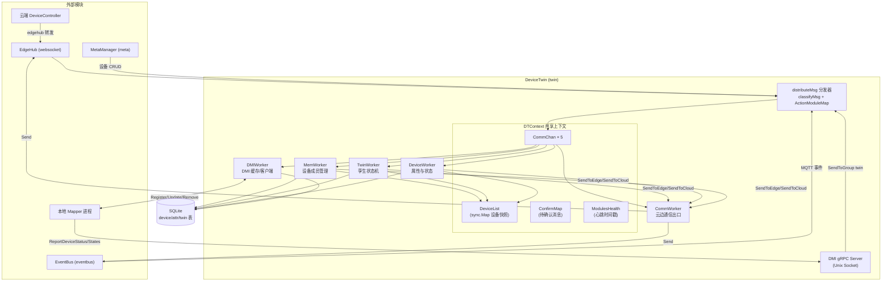
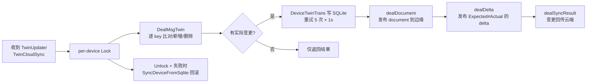
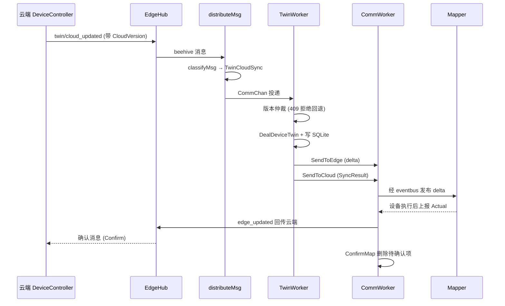

DeviceTwin（模块名 `twin`）是 EdgeCore 中负责设备数字孪生管理的边缘模块。它在边缘侧维护每台设备的"影子"状态——即期望值（Expected）与实际值（Actual）的双值模型，并充当四个方向的枢纽：接收云端 DeviceController 下发的元数据变更、接收 EventBus 转发的设备侧 MQTT 事件、通过 gRPC（DMI 协议）与本地 Mapper 交互、以及将状态变化回写云端与本地 SQLite。其整体设计采用 **Actor 模式**：一个共享上下文（DTContext）之上运行五个自治 Worker，通过通道通信、心跳探活与消息确认机制协作。本文基于对 `edge/pkg/devicetwin` 包的源码分析，剖析其架构分层、消息路由、孪生状态机与可靠同步机制。

Sources: [devicetwin.go](edge/pkg/devicetwin/devicetwin.go#L16-L21), [dtcommon/common.go](edge/pkg/devicetwin/dtcommon/common.go#L97-L112)

## 总体架构：一个上下文，五个 Worker

DeviceTwin 在 EdgeCore 启动时通过 `devicetwin.Register()` 注册为 Beehive 模块（模块名 `twin`，分组 `TwinGroup`）。`Start()` 执行三步初始化：创建共享上下文 `DTContext`、从 SQLite 恢复设备快照（`SyncSqlite`）、启动消息循环。这是边缘自治的关键一环——即使云端长期失联，边缘侧设备孪生状态依然完整可查。

整个模块的架构可概括为"**1 个分发器 + 1 个共享上下文 + 5 个自治 Worker**"：



五个 Worker 各自独占一个接收通道（缓冲 128），通过 `InitWorker` 注入三条通道（接收、确认、心跳）与共享上下文。模块启动时逐个注册并 `go Start()`，此后主循环只做两件事：从 Beehive 接收组内消息并分发给对应 Worker，以及每 60 秒执行一轮健康检查——若某 Worker 心跳时间戳超过 120 秒未更新则重启之，同时向所有通道发送 `ping` 维持存活。

Sources: [devicetwin.go](edge/pkg/devicetwin/devicetwin.go#L66-L75), [process.go](edge/pkg/devicetwin/process.go#L302-L351), [dtmodule/dtmodule.go](edge/pkg/devicetwin/dtmodule/dtmodule.go#L19-L60)

### 模块注册与生命周期

模块在 `edgecore` 启动流程中被注册，并支持失败自动重启策略（增长率为 2.0 的退避间隔，受 `ModuleRestart` 特性门控控制）。启动阶段最关键的动作是 **SQLite 快照恢复**：`SyncSqlite` 遍历设备表中的所有设备，逐台调用 `SyncDeviceFromSqlite`，将设备基础信息、属性列表、孪生列表重建到内存 `DeviceList` 中，并为每个设备初始化专属互斥锁。这保证了 EdgeCore 重启后孪生状态零丢失——这是"边缘自治"叙事中设备维度的具体实现。

Sources: [process.go](edge/pkg/devicetwin/process.go#L129-L198), [devicetwin.go](edge/pkg/devicetwin/devicetwin.go#L34-L63), [server.go](edge/cmd/edgecore/app/server.go#L211)

## 消息路由：两级映射表驱动

DeviceTwin 不含任何硬编码的 if-else 分发树，而是用两张映射表完成路由解耦：

| 映射表 | 键 → 值 | 作用 |
|---|---|---|
| `EventActionMap` | MQTT 主题前缀+后缀 → 动作名 | 将 `$hw/events/...` 主题解析为 `TwinUpdate`、`MemUpdated` 等语义动作 |
| `ActionModuleMap` | 动作名 → Worker 名 | 将动作路由到 Mem/Twin/Device/Comm/DMI 五个 Worker 之一 |

`distributeMsg` 的路由规则包含一个重要细节：凡是 `ParentID` 非空的消息（即对先前消息的应答），一律转为 `Confirm` 动作发往 CommModule——这是可靠同步机制的前置条件，下文详述。其余消息经 `classifyMsg` 分类后按映射表投递。

Sources: [process.go](edge/pkg/devicetwin/process.go#L56-L127)

`classifyMsg` 按**消息来源**分四类处理，构成理解 DeviceTwin 输入的钥匙：

| 来源（msg.Source） | 触发场景 | 解析方式 | 产出动作 |
|---|---|---|---|
| `bus` | EventBus 转发的设备侧 MQTT 消息 | Base64 解码主题，拆分前缀/后缀查 `EventActionMap` | TwinUpdate、DeviceStateUpdate、LifeCycle 等 |
| `edgemgr` / `devicecontroller` | 云端下发的成员/孪生变更 | 按 Resource 字符串匹配 | MemUpdated、MemDetailResult、TwinCloudSync、DeviceUpdated |
| `edgehub` | 云连接状态通知 | 匹配 `node/connection` | LifeCycle |
| `meta` / `metamanager` | 本地 API Server 的设备 CRUD | 统一归类 | MetaDeviceOperation（交给 DMI 模块） |

值得注意的是，`bus` 来源的主题采用 Base64 URL 编码嵌入消息 Resource 字段（注释中给出了完整的路由键格式 `$hw.<project_id>.events.user.bus.response.cluster.<cluster_id>.node.<node_id>.<base64_topic>`），这是 KubeEdge 云边消息复用统一主题空间的惯例。

Sources: [process.go](edge/pkg/devicetwin/process.go#L200-L300), [dmiserver/server.go](edge/pkg/devicetwin/dmiserver/server.go#L178-L200)

## DTContext：共享上下文与并发模型

`DTContext` 是五个 Worker 协作的神经中枢，其字段设计体现了典型的"**并发安全优先**"哲学：

| 字段 | 类型 | 职责 |
|---|---|---|
| `DeviceList` | `*sync.Map` | 设备快照缓存（ID → `*dttype.Device`），Worker 读写的主数据 |
| `DeviceMutex` | `*sync.Map` | 每设备一把互斥锁，粒度化并发控制 |
| `CommChan` | `map[string]chan interface{}` | 分发器到各 Worker 的消息通道 |
| `ConfirmMap` | `*sync.Map` | 已发往云端但未收到确认的消息（msgID → DTMessage） |
| `ModulesHealth` | `*sync.Map` | 各 Worker 最近心跳时间戳 |
| `State` | `string` | 云连接状态（`connected` / `disconnected`） |
| `ConfirmChan` | `chan interface{}`（容量 1000） | 确认消息专用通道 |

并发控制采用**两级锁**：`Lock(deviceID)` 先取全局读锁、再锁设备级互斥锁，保证单设备操作串行化而不同设备互不阻塞；`LockAll()` 则取全局写锁，用于成员全量同步这类需要冻结所有设备操作的场合。这在中规模设备（数百上千台）场景下，比单把全局锁显著降低争用。

Sources: [dtcontext/dtcontext.go](edge/pkg/devicetwin/dtcontext/dtcontext.go#L19-L49), [dtcontext/dtcontext.go](edge/pkg/devicetwin/dtcontext/dtcontext.go#L72-L116)

## 五大管理器职责分解

| Worker | 触发动作 | 核心职责 | 数据出口 |
|---|---|---|---|
| **MemWorker** | MemGet、MemUpdated、MemDetailResult | 维护节点设备成员表：云端全量/增量增删设备 | SQLite + 云端成员结果 |
| **TwinWorker** | TwinUpdate、TwinGet、TwinCloudSync | 孪生状态机：Expected/Actual 版本仲裁与同步 | Delta/Document（边）、SyncResult（云）、SQLite |
| **DeviceWorker** | DeviceUpdated、DeviceStateUpdate | 设备属性更新与连接状态（online/offline 等）维护 | SQLite、边缘 MQTT、云端 |
| **CommWorker** | SendToEdge、SendToCloud、LifeCycle、Confirm | 统一通信出口：向 eventbus/websocket 发消息、确认追踪、断线重发 | eventbus、websocket |
| **DMIWorker** | MetaDeviceOperation | 将本地 MetaManager 的设备/模型 CRUD 转发为 DMI gRPC 调用 | Mapper 进程、SQLite |

Sources: [membership.go](edge/pkg/devicetwin/dtmanager/membership.go#L76-L83), [twin.go](edge/pkg/devicetwin/dtmanager/twin.go#L93-L100), [device.go](edge/pkg/devicetwin/dtmanager/device.go#L73-L79), [communicate.go](edge/pkg/devicetwin/dtmanager/communicate.go#L69-L75), [dmiworker.go](edge/pkg/devicetwin/dtmanager/dmiworker.go#L103-L106)

### TwinWorker：数字孪生的状态机核心

TwinWorker 是本模块的灵魂，实现了完整的**孪生版本仲裁协议**。理解它的关键是 `MsgTwin` 数据模型（见下节）与四种处理类型（dealType）：

| dealType | 常量 | 语义 | 版本规则 |
|---|---|---|---|
| 0 | `RestDealType` | 来自设备侧 MQTT 的更新 | EdgeVersion 自增 +1 |
| 1 | `SyncDealType` | 来自云端 `twin/cloud_updated` 同步 | 必须携带版本，拒绝回退（云端/边缘版本冲突即 409） |
| 2 | `DetailDealType` | 云端成员详情全量下发 | 同步规则 |
| 3 | `SyncTwinDeleteDealType` | 同步过程中的孪生删除 | 允许空版本 |

Sources: [twin.go](edge/pkg/devicetwin/dtmanager/twin.go#L23-L38), [twin.go](edge/pkg/devicetwin/dtmanager/twin.go#L402-L423)

一次孪生更新（`DealDeviceTwin`）的完整流水线如下：



三个出口对应三种经典孪生语义：**Document**（记录 LastState → CurrentState 的完整变更历史，发布到 `$hw/events/device/<id>/twin/update/document`）、**Delta**（仅含 Expected 与 Actual 不一致的字段，即"设备需要执行的动作"，发布到 `.../twin/update/delta`，由 Mapper 或应用消费）、**SyncResult**（边缘变更回传云端 `.../twin/edge_updated`，由 EdgeHub 送往 DeviceController）。任何持久化失败都会触发从 SQLite 重新加载该设备快照，保证内存与磁盘最终一致。

Sources: [twin.go](edge/pkg/devicetwin/dtmanager/twin.go#L194-L285), [twin.go](edge/pkg/devicetwin/dtmanager/twin.go#L287-L346)

### 孪生数据模型：Expected/Actual 双值与双版本

孪生的最小单元是 `MsgTwin`，其结构是理解整个协议的钥匙：

```go
type MsgTwin struct {
    Expected        *TwinValue    // 期望值：云端/用户希望设备达到的状态
    Actual          *TwinValue    // 实际值：设备上报的真实状态
    Optional        *bool         // 是否可选
    Metadata        *TypeMetadata // 值类型（string/int/...，"deleted" 表软删）
    ExpectedVersion *TwinVersion  // 期望值版本
    ActualVersion   *TwinVersion  // 实际值版本
}

type TwinVersion struct {
    CloudVersion int64 `json:"cloud"` // 云侧修改计数
    EdgeVersion  int64 `json:"edge"`  // 边侧修改计数
}
```

**双值 + 双版本**的设计直接解决了 IoT 场景两大经典难题：其一，设备离线期间用户修改期望值，上线后 Delta 机制保证设备最终收敛到期望状态；其二，云边同时修改同一孪生时，版本号比对（云端版本只增不减、边缘版本低于请求版本即拒绝）以乐观并发控制方式裁决冲突，返回 HTTP 409 语义的错误码。

Sources: [dttype/types.go](edge/pkg/devicetwin/dttype/types.go#L123-L143), [dttype/types.go](edge/pkg/devicetwin/dttype/types.go#L156-L168), [dtcommon/common.go](edge/pkg/devicetwin/dtcommon/common.go#L114-L119)

### CommWorker：可靠同步的执行者

CommWorker 是所有对外通信的**唯一出口**，其价值在三个细节中体现：

1. **断线熔断**：`dealSendToCloud` 检查 `context.State`，若处于 `disconnected` 则直接丢弃上行消息（状态由 LifeCycle 事件维护），避免无谓的网络堆积。
2. **确认追踪**：每条发往云端的消息在发送后写入 `ConfirmMap`；当云端应答（ParentID 匹配的消息）到达时由 `dealConfirm` 删除。若 60 秒内未获确认，`checkConfirm` 会重放 `ConfirmMap` 中全部待确认消息——这是一个极简的**应用层 ACK + 超时重发**协议，与云端 SyncController 的补偿机制（见 [SyncController：可靠同步与补偿机制](11-synccontroller-ke-kao-tong-bu-yu-bu-chang-ji-zhi)）共同构成端到端可靠同步。
3. **上线补拉**：`dealLifeCycle` 检测到云连接从断开转为连接时，主动向云端发起 `membership/detail` 请求全量设备成员——这是断网恢复后边缘状态对齐的入口。

Sources: [communicate.go](edge/pkg/devicetwin/dtmanager/communicate.go#L86-L133), [communicate.go](edge/pkg/devicetwin/dtmanager/communicate.go#L135-L175)

### DeviceWorker 与 MemWorker：状态与成员

DeviceWorker 处理设备连接状态的维护：`dealDeviceStateUpdate` 校验状态值必须属于 `{online, offline, ok, unknown, unhealthy}` 五个合法值，online/ok 状态会刷新 `last_online` 时间戳，随后以重试方式写库、更新内存，并将结果同时发布到边缘 MQTT（`.../state/update/result`）与云端（`device/<id>/state/updated`）——一次上报，双路通知。

MemWorker 负责节点设备成员表。全量同步（`dealMembershipDetail`）采用 `LockAll` 冻结期间做差集计算（`getRemoveList` 找出本地有而云端没有的设备），再执行增删，保证成员视图原子切换。

Sources: [device.go](edge/pkg/devicetwin/dtmanager/device.go#L81-L157), [membership.go](edge/pkg/devicetwin/dtmanager/membership.go#L101-L162)

### DMIWorker 与 DMI gRPC Server：Mapper 接入的新通道

自 v1.17 起，KubeEdge 通过 DMI（Device Mapper Interface）协议重构了设备接入路径，DeviceTwin 随之新增了第五个 Worker。DMIWorker 消费 MetaManager 转发的设备/设备模型 CRUD 消息（`MetaDeviceOperation`），在本地 `DMICache` 维护副本后，通过 gRPC 客户端调用对应 Mapper 的 `RegisterDevice`/`UpdateDevice`/`CreateDeviceModel` 等接口。

反向路径上，DeviceTwin 内嵌一个 gRPC 服务器（监听 Unix Socket，路径可配置），提供三个服务：

| gRPC 方法 | 方向 | 功能 |
|---|---|---|
| `MapperRegister` | Mapper → Twin | Mapper 注册；带 `WithData` 时返回该协议匹配的全部设备与模型列表 |
| `ReportDeviceStatus` | Mapper → Twin | 上报孪生值，转换为 `TwinUpdate` 动作注入标准消息流 |
| `ReportDeviceStates` | Mapper → Twin | 上报设备状态，转换为 `DeviceStateUpdate` 动作 |

两个上报接口均受 `rate.Limiter`（每 1000ms 补充 100 令牌）保护。设计上的精妙之处在于：DMI 上报消息被重新组装为 Base64 主题后经 `SendToGroup` 送入与 MQTT 上报**完全相同**的 TwinUpdate 管道——新旧两条设备接入路径在孪生状态机处归一，上层协议完全复用。

Sources: [dmiworker.go](edge/pkg/devicetwin/dtmanager/dmiworker.go#L53-L106), [dmiworker.go](edge/pkg/devicetwin/dtmanager/dmiworker.go#L108-L199), [dmiserver/server.go](edge/pkg/devicetwin/dmiserver/server.go#L54-L156), [dmiserver/server.go](edge/pkg/devicetwin/dmiserver/server.go#L225-L258)

## 端到端数据流示例

以一次完整的孪生更新为例，将上述组件串联：



Sources: [twin.go](edge/pkg/devicetwin/dtmanager/twin.go#L102-L135), [communicate.go](edge/pkg/devicetwin/dtmanager/communicate.go#L100-L133)

## 配置与容错参数速查

| 配置/常量 | 值 | 说明 |
|---|---|---|
| `enable` | bool | 模块开关（edgecore 配置 `modules.deviceTwin.enable`） |
| `DMISockPath` | 默认 `/var/lib/kubeedge/` | DMI gRPC Unix Socket 所在目录 |
| `RetryTimes` / `RetryInterval` | 5 次 / 1 秒 | SQLite 写入重试策略 |
| 心跳检查周期 / 判死阈值 | 60s / 120s | Worker 无心跳超时即重启 |
| Confirm 超时重发 | 60s | 未获云端确认的消息周期性重放 |
| 每设备锁 + 全局读写锁 | — | 单设备串行、跨设备并行 |

Sources: [config/config.go](edge/pkg/devicetwin/config/config.go#L12-L28), [dtcommon/common.go](edge/pkg/devicetwin/dtcommon/common.go#L5-L9), [process.go](edge/pkg/devicetwin/process.go#L326-L350)

## 总结与延伸阅读

DeviceTwin 的设计有三点值得借鉴：其一，**Actor 化的 Worker 拆分**使五类职责（成员、孪生、状态、通信、DMI）各自独立演化，心跳与自愈机制让单 Worker 崩溃不影响整体；其二，**双值双版本的孪生模型**以最小数据结构覆盖了离线设定期望、上线收敛、云边并发写三大 IoT 状态同步难题；其三，**归一化消息管道**让 MQTT 与 DMI 两种设备接入路径共享同一套状态机，避免了逻辑分叉。

- 理解孪生更新如何从云端一路下发至此，请阅读 [DeviceController：设备元数据的云边同步](10-devicecontroller-she-bei-yuan-shu-ju-de-yun-bian-tong-bu)
- 理解 MQTT 设备事件如何进入 DeviceTwin，请阅读 [EventBus：MQTT 消息总线与设备接入](19-eventbus-mqtt-xiao-xi-zong-xian-yu-she-bei-jie-ru)
- 深入 Mapper 与 DMI 协议细节，请阅读 [Mapper Framework 与 DMI 设备映射接入](25-mapper-framework-yu-dmi-she-bei-ying-she-jie-ru)
- 本模块所依赖的 Beehive 消息机制，请阅读 [Beehive：模块化消息通信框架](22-beehive-mo-kuai-hua-xiao-xi-tong-xin-kuang-jia)
- 欲了解孪生状态在离线场景下的持久化底座，请阅读 [MetaManager 与 MetaServer：离线元数据存储与本地 API Server](18-metamanager-yu-metaserver-chi-xian-yuan-shu-ju-cun-chu-yu-ben-di-api-server)