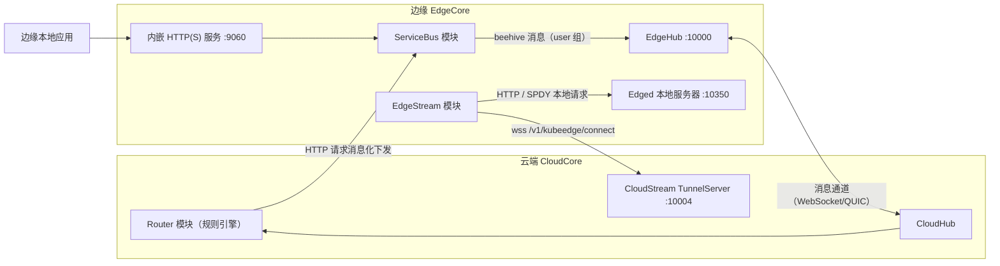
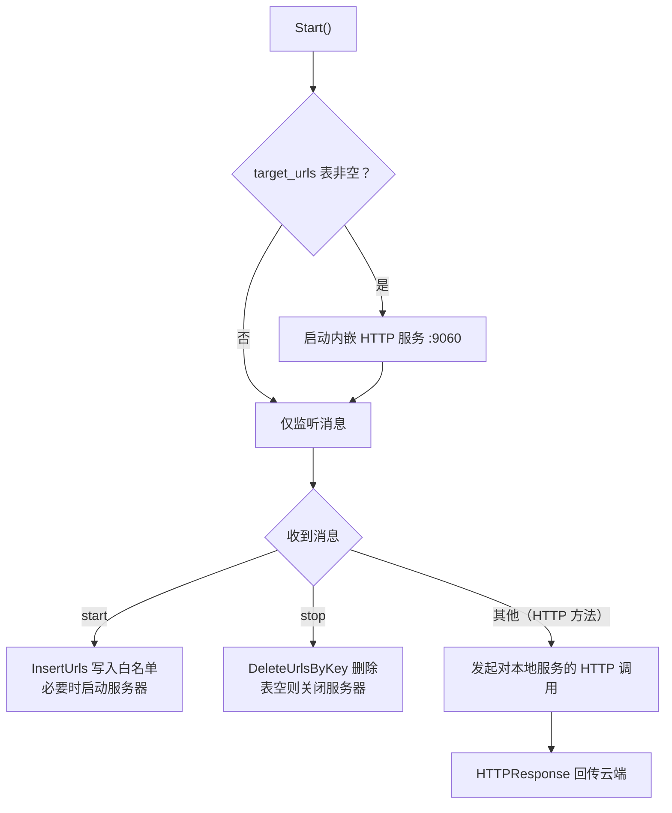
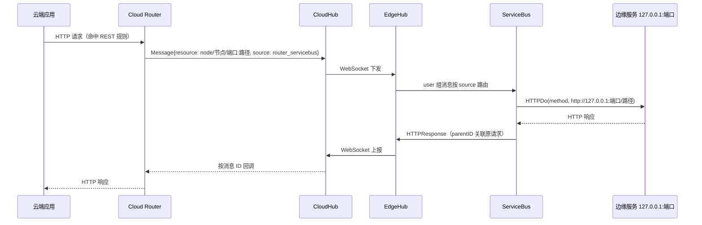
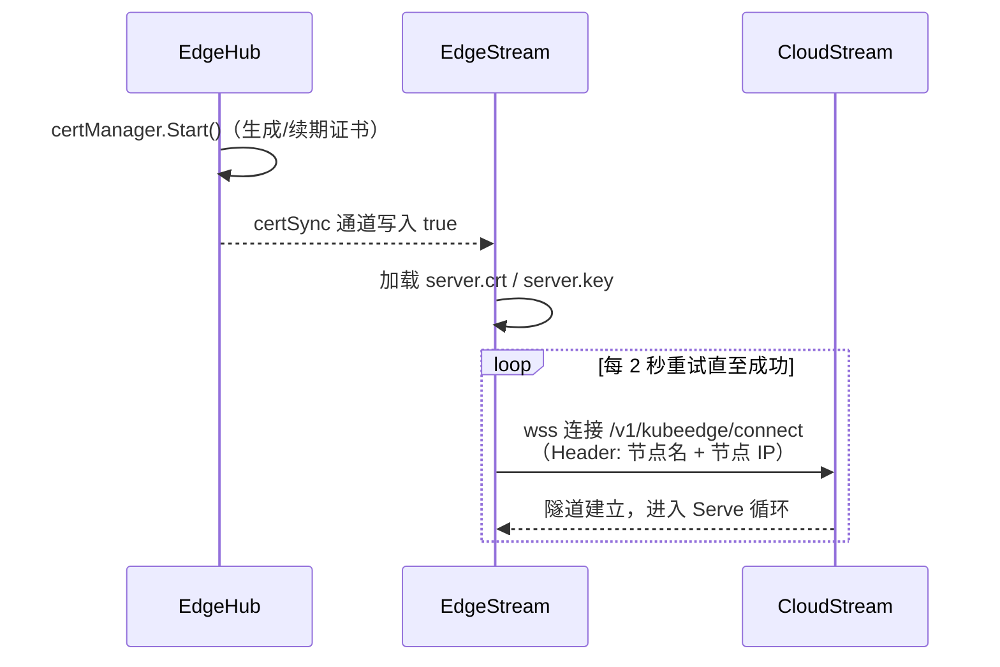
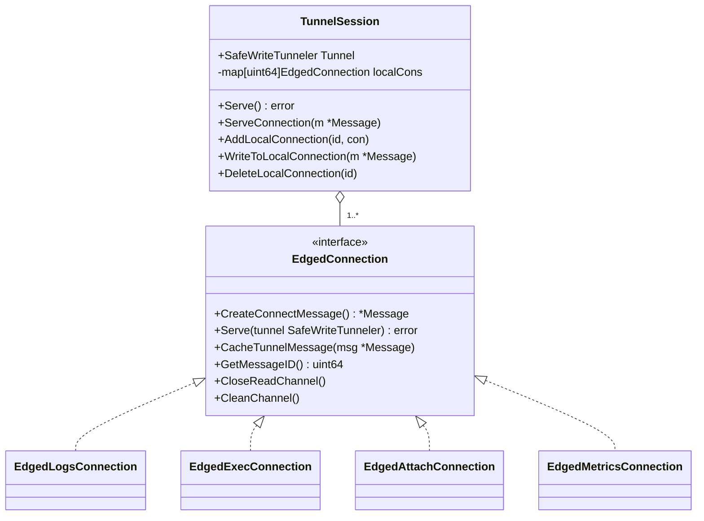
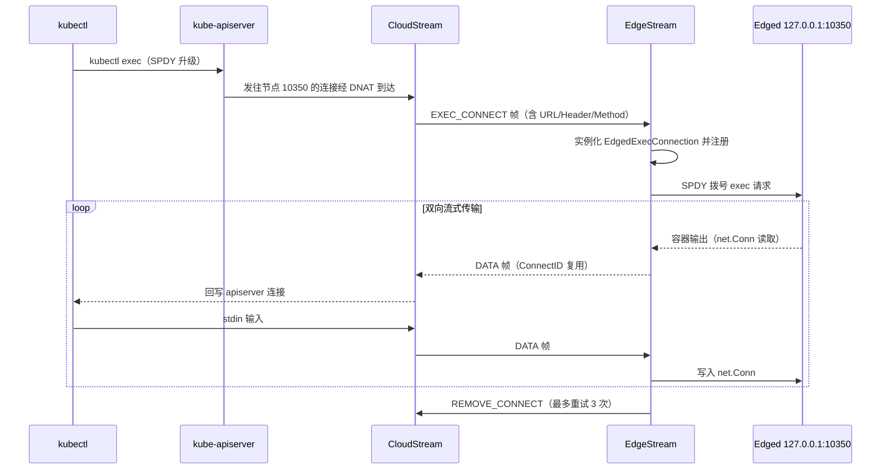

在 KubeEdge 的边缘模块族谱中，`servicebus` 与 `edgestream` 是两个相互独立却常被并置讨论的组件：它们都解决"云边网络边界"问题，但走的是完全不同的技术路线。**ServiceBus** 把云端 HTTP 请求封装成 beehive 消息穿越 CloudHub/EdgeHub 消息通道，在边缘侧还原为对本地服务的 HTTP 调用；**EdgeStream** 则主动向云端建立一条专属 WebSocket 隧道，让 `kubectl exec/logs/attach/metrics` 这类流式 API 能够"借道"访问处于私有网络中的边缘节点。本页聚焦这两个模块的边缘侧实现，云端对偶组件（CloudStream、Router）仅作衔接性说明。

## 定位总览：两条通道，两种范式

从第一性原理出发，云边通信只有两条可持续的基础通道：一是 EdgeHub 与 CloudHub 之间的消息通道（WebSocket/QUIC，承载结构化消息），二是各模块自行建立的数据连接。ServiceBus 复用前者，把 HTTP"翻译"成消息；EdgeStream 选择后者，为流式数据单开一条隧道。这一选择直接决定了两者的可靠性模型、数据形态与适用场景，详见文末对比表。

两个模块都遵循 EdgeCore 的标准模块协议：实现 `Name/Group/Enable/Start` 并通过 `Register` 注册进 beehive 框架。ServiceBus 注册在 `bus` 组，EdgeStream 注册在 `edgestream` 组；两者默认均处于关闭状态，需要显式启用。

Sources: [names.go](edge/pkg/common/modules/names.go#L8-L11), [group.go](edge/pkg/common/modules/group.go#L4-L17), [server.go](edge/cmd/edgecore/app/server.go#L211-L219), [default.go](staging/src/github.com/kubeedge/api/apis/componentconfig/edgecore/v1alpha2/default.go#L136-L141)

## ServiceBus：消息驱动的边缘 HTTP 访问代理

### 模块身份与生命周期

ServiceBus 的核心结构体只持有五个字段：开关、监听地址（默认 `127.0.0.1`）、端口（默认 `9060`）、同步超时（默认 60 秒）和一个数据库客户端。`Start` 方法揭示了一个重要的启动门控逻辑：**只有当本地数据库的 `target_urls` 白名单表非空时，内嵌 HTTP 服务器才会启动**；随后进入主循环，从 beehive 上下文持续收消息，每条消息交给独立 goroutine 异步处理——这保证了单条请求的阻塞不会拖垮整个模块。

值得注意的工程细节是模块重启策略：在启用 `ModuleRestart` 特性门控时，ServiceBus 声明"失败即重启、间隔按 2.0 倍指数增长"的策略，与 EdgeStream 保持一致。

Sources: [servicebus.go](edge/pkg/servicebus/servicebus.go#L91-L186), [servicebus.go](edge/pkg/servicebus/servicebus.go#L149-L157), [servicebus.go](edge/pkg/servicebus/config/config.go#L12-L23)

### 云到边：HTTP 请求的消息化转发

ServiceBus 只处理来源为 `router_servicebus` 的消息。这个来源标识与云端 Router 的 ServiceBus Provider 严格对应：当用户创建"REST 源 → ServiceBus 终点"的路由规则后，云端 Provider 构造资源路径为 `node/<节点名>/<端口>:<路径>` 的消息，经 CloudHub 下发。边缘侧收到后按 `:` 拆分资源，还原出目标 URL `http://127.0.0.1:<端口><路径>`，用 `URLClient.HTTPDo` 携带原始 Header 与 Body 发起真实 HTTP 调用。**消息在这里完成了一次"协议降维"：云端是结构化消息，边缘还原为标准 HTTP 流量**，边缘应用因此完全无感知地被云端访问。

响应回传的关联机制依赖 beehive 的父子消息 ID：ServiceBus 用 `NewMessage(msg.GetID())` 构造应答，云端通过 listener 回调按 ID 匹配。错误路径同样规范化——资源格式错误返回 400、目标不可达返回 404、响应体超限返回 500，统一封装为 `HTTPResponse` 后仍走 Hub 组上报。防护方面，请求体通过 `io.LimitReader` 限制在 5MB（`maxBodySize`）以内。

Sources: [servicebus.go](edge/pkg/servicebus/servicebus.go#L43-L46), [servicebus.go](edge/pkg/servicebus/servicebus.go#L215-L281), [servicebus.go](edge/pkg/servicebus/servicebus.go#L512-L519), [servicebus.go](cloud/pkg/router/provider/servicebus/servicebus.go#L124-L168), [handler_bus.go](edge/pkg/edgehub/messagehandler/handler_bus.go#L31-L54), [http.go](common/types/http.go#L6-L24)

### 边到云：内嵌 HTTP 服务器与 URL 白名单

容易被忽略的是，ServiceBus 还内嵌了一个 HTTP 服务器，提供**反向能力**：边缘本地应用向 `http://127.0.0.1:9060` 发送携带 `{method, targetURL, payload}` 的 JSON 请求，服务器将其转为 beehive 消息 `SendSync` 给 EdgeHub 上送云端，再由 Router 规则（ServiceBus 源 → REST 终点）转发到云端目标服务。这条路径让边缘应用无需直连云端 API，即可经由规则体系访问云端 HTTP 端点。

安全闸门是 `target_urls` 白名单表（SQLite）：内嵌服务器只放行云端规则注册时通过 `start` 操作写入的 URL；未注册的 `targetURL` 会收到 *"url is not allowed and please make a rule for this url in the cloud"* 的明确报错。规则删除时云端发送 `stop` 操作，白名单条目随之移除，若表被清空则服务器自动关闭。**这是一种"规则即授权"的模型：边缘能访问哪些云端服务，完全由云端规则定义决定。**

Sources: [servicebus.go](edge/pkg/servicebus/servicebus.go#L446-L510), [servicebus.go](edge/pkg/servicebus/servicebus.go#L196-L214), [servicebus.go](edge/pkg/metamanager/dao/dbclient/servicebus.go#L38-L84), [servicebus.go](cloud/pkg/router/provider/servicebus/servicebus.go#L63-L78)

### 传输层 TLS 加固

内嵌服务器默认以明文 HTTP 运行（向后兼容），但支持配置 `tlsCertFile`/`tlsPrivateKeyFile` 启用 HTTPS。这里的实现有几个值得学习的防御性设计：**其一，TLS 意图一旦表达就不可静默降级**——任一证书字段非空即视为启用 TLS，配置不完整（只配了证书没配私钥）时服务器拒绝启动而非回退明文；**其二，启动时强制校验证书的 `ExtKeyUsageServerAuth` 扩展用途**，防止误用只有 ClientAuth 的 EdgeHub 客户端证书；**其三，通过 `GetCertificate` 回调在每次握手时重新读盘**，替换磁盘上的证书文件即可完成轮转，无需重启 EdgeCore，且轮转后的证书会再次过 EKU 校验。

| TLS 设计决策 | 实现位置 | 效果 |
|---|---|---|
| 配置不完整即拒绝启动 | `buildTLSConfig` 返回错误，`server()` 不回退 | 防止安全属性静默丢失 |
| EKU ServerAuth 启动校验 | `validateServerAuthEKU` | 拦截误配的 EdgeHub 客户端证书 |
| GetCertificate 动态加载 | 每次握手重读证书 | 无重启轮转，轮转后复查 EKU |
| 仅服务端 TLS（NoClientCert） | `ClientAuth: tls.NoClientCert` | 本地应用无客户端证书工作流，mTLS 留作后续演进 |

需要明确边界：TLS 只解决传输加密与服务器身份认证，**不限制哪个本地进程可以提交请求**——任何能访问 9060 端口的进程仍可发起调用，调用方认证（mTLS、应用凭据、受控 Unix socket）属于独立议题。

Sources: [servicebus.go](edge/pkg/servicebus/servicebus.go#L317-L367), [servicebus.go](edge/pkg/servicebus/servicebus.go#L374-L395), [servicebus.go](edge/pkg/servicebus/servicebus.go#L397-L444), [server.go](edge/cmd/edgecore/app/server.go#L222-L245), [servicebus-tls.md](docs/proposals/sig-node/servicebus-tls.md#L1-L14)

### 配置参考

`edgecore.yaml` 中 `modules.serviceBus` 的完整配置项如下（均来自 v1alpha2 API 定义）：

| 字段 | 默认值 | 说明 |
|---|---|---|
| `enable` | `false` | 模块总开关 |
| `server` | `127.0.0.1` | 内嵌 HTTP(S) 服务器监听地址 |
| `port` | `9060` | 监听端口 |
| `timeout` | `60` | 内嵌服务器 `SendSync` 等待响应的超时（秒） |
| `tlsCertFile` | `""` | 服务端证书路径，须含 ServerAuth EKU 与匹配 SAN |
| `tlsPrivateKeyFile` | `""` | 与证书配对的私钥路径 |

Sources: [types.go](staging/src/github.com/kubeedge/api/apis/componentconfig/edgecore/v1alpha2/types.go#L1040-L1066), [default.go](staging/src/github.com/kubeedge/api/apis/componentconfig/edgecore/v1alpha2/default.go#L136-L141)

## EdgeStream：云边流式隧道客户端

### 设计动机与总体结构

原生 Kubernetes 中 `kubectl exec` 的原理是 kube-apiserver 与 kubelet 之间建立 SPDY 长连接，但边缘节点多处于私有网络，apiserver 无法主动发起连接。KubeEdge 的设计提案给出了关键决策：**不复用 CloudHub/EdgeHub 的消息通道（其定位是资源元数据传输，不适合流式数据），而是新建一条支持 TLS 的 WebSocket 隧道专责转发流式数据**；同时把 edged 上报的 `KubeletEndpoint.Port` 统一改为 10350，云端通过 iptables DNAT 把 apiserver 发往边缘节点 10350 端口的连接重定向到 CloudStream。方向反转是精髓：**不是云端连边缘，而是边缘（EdgeStream）主动连云端（CloudStream），隧道由此建立**。

Sources: [exec-logs.md](docs/proposals/sig-node/exec-logs.md#L29-L104), [exec-logs.md](docs/proposals/sig-node/exec-logs.md#L140-L215)

### 启动时序与证书同步

EdgeStream 的 `Start` 展现了一个跨模块启动依赖的典型处理：它并不自己生成证书，而是**阻塞等待 EdgeHub 通过证书同步通道发出的就绪信号**（EdgeHub 完成 `certManager.Start()` 后向 `certSync["edgestream"]` 写入 `true`），之后才加载节点证书对（默认 `/etc/kubeedge/certs/server.crt`/`server.key`）发起连接。TLS 配置中 `InsecureSkipVerify: true` 表示跳过对 CloudCore 服务端证书的校验，节点身份由客户端证书证明。

连接维持采用"2 秒 Ticker + 主动重连"的朴素循环：`TLSClientConnect` 失败后由 Ticker 驱动再次尝试。一个健壮性细节是，若配置未指定节点 IP，**每次重连都会重新探测本地 IP**，以适应边缘网络环境变化（如 DHCP 换址）。连接握手时通过 HTTP Header 携带 `SessionHostNameOverride` 与 `SessionInternalIP`，供云端 Session 管理器按节点名/IP 建立索引。

Sources: [edgestream.go](edge/pkg/edgestream/edgestream.go#L84-L118), [edgestream.go](edge/pkg/edgestream/edgestream.go#L120-L152), [edgehub.go](edge/pkg/edgehub/edgehub.go#L67-L77), [edgehub.go](edge/pkg/edgehub/edgehub.go#L164-L174), [constants.go](pkg/stream/constants.go#L3-L6)

### TunnelSession：隧道多路复用核心

一条物理隧道要承载任意数量的并发 exec/logs/metrics 会话，复用机制是关键。`TunnelSession` 用两级结构实现：**外层是 `Tunnel`（`SafeWriteTunneler` 接口，内部用互斥锁保护 WebSocket 写操作，避免多 goroutine 并发写崩溃）；内层是 `localCons` 映射表**，以 `ConnectID`（即 apiserver 侧连接 ID）为键索引本节点的所有 `EdgedConnection`，读写锁保护。

`Serve` 主循环的工作模式是一个标准的"读循环 + 类型分发"：从隧道读取一帧消息后，`LOGS/EXEC/METRIC/ATTACH_CONNECT` 四种连接建立请求会启动独立 goroutine 处理，`DATA` 与 `REMOVE_CONNECT` 帧则按 ConnectID 转投给已注册的本地连接的读缓存通道。收到 `CLOSE_CONNECT` 意味着云端要求关闭整条隧道。会话结束后连接从注册表删除，并清理其缓存通道。

Sources: [tunnel.go](edge/pkg/edgestream/tunnel.go#L33-L48), [tunnel.go](edge/pkg/edgestream/tunnel.go#L108-L133), [tunnel.go](edge/pkg/edgestream/tunnel.go#L168-L208), [tunnel.go](edge/pkg/edgestream/tunnel.go#L210-L233), [tunnel.go](pkg/stream/tunnel.go#L27-L68), [edgedconnection.go](pkg/stream/edgedconnection.go#L6-L14)

### 四种 EdgedConnection 的本地对接

隧道消息中携带的连接描述（URL、Header、Method）由云端 CloudStream 构造：目标一律是 `http://127.0.0.1:10350`，即 edged 监听的本地服务器端口。EdgeStream 侧只负责按类型实例化对应的 `EdgedConnection` 并调用其 `Serve` 方法，四种连接在"如何与 edged 交互"上各有侧重：

| 连接类型 | 与 edged 的交互方式 | 数据搬运特征 |
|---|---|---|
| `EdgedLogsConnection` | 普通 HTTP GET，`bufio.Reader` 读取响应流 | 256 字节定长块封装为 DATA 帧 |
| `EdgedMetricsConnection` | 普通 HTTP GET | 强制 `accept-encoding: identity` 禁用压缩，逐行扫描并以 `\n` 补齐 |
| `EdgedExecConnection` | SPDY RoundTripper 拨号，得到 `net.Conn` | `net.Conn` 与隧道间双向字节搬运 |
| `EdgedAttachConnection` | 同 exec，SPDY 长连接 | 同 exec |

三个实现细节值得咀嚼。**其一**，exec/attach 之所以走 SPDY 而非普通 HTTP，是因为 apiserver 侧的连接升级协议就是 SPDY，边缘侧必须"对等地"与 edged 重建同一协议的流。**其二**，metrics 禁用压缩是个务实的妥协：当前隧道帧仅支持文本消息，gzip 压缩后的二进制无法通过，代码注释中明确留有"支持二进制帧后移除"的 TODO。**其三**，每种连接都遵循统一的生命周期模板：`Serve` 中并发启动"读云通道→写本地"与"读本地→写隧道"两条数据路径，退出时最多重试 3 次发送 `REMOVE_CONNECT` 帧通知云端对偶清理。

Sources: [containerexec_connection.go](cloud/pkg/cloudstream/containerexec_connection.go#L77-L90), [edgedexecconnection.go](pkg/stream/edgedexecconnection.go#L106-L141), [edgedlogconnection.go](pkg/stream/edgedlogconnection.go#L83-L143), [edgedmetricsconnection.go](pkg/stream/edgedmetricsconnection.go#L81-L138), [default.go](common/constants/default.go#L66-L74)

### 隧道消息协议与保活

隧道帧格式极为紧凑：**ConnectID 与 MessageType 两个 varint 变长整数后直接拼接 Data**，单帧数据上限 1MiB（`MaxRespBodyLength`）。消息类型按 iota 枚举，语义如下：

| 类型 | 值 | 方向 | 语义 |
|---|---|---|---|
| LOGS_CONNECT | 0 | 云→边 | 建立 logs 连接 |
| EXEC_CONNECT | 1 | 云→边 | 建立 exec 连接 |
| METRIC_CONNECT | 2 | 云→边 | 建立 metrics 连接 |
| DATA | 3 | 双向 | 流式数据载荷 |
| REMOVE_CONNECT | 4 | 双向 | 拆除单个连接 |
| CLOSE_CONNECT | 5 | 云→边 | 关闭整条隧道 |
| ATTACH_CONNECT | 6 | 云→边 | 建立 attach 连接 |

保活由独立的 `startPing` goroutine 承担：每 5 秒经 `WriteControl`（同样受锁保护）发送 WebSocket Ping 帧。提案文档中明确了一个取舍——边缘网络不稳定导致的隧道断连被认为是可接受的，**第一阶段不为隧道内消息提供可靠传输保障**，exec 会话断连即中断，依赖用户重试。这也是 EdgeStream 与消息通道类模块（有可靠同步机制）在设计哲学上的分野。

Sources: [message.go](pkg/stream/message.go#L52-L100), [constants.go](pkg/stream/constants.go#L8-L16), [tunnel.go](edge/pkg/edgestream/tunnel.go#L150-L166), [exec-logs.md](docs/proposals/sig-node/exec-logs.md#L85-L90)

### 配置参考

`edgecore.yaml` 中 `modules.edgeStream` 的配置项如下：

| 字段 | 默认值 | 说明 |
|---|---|---|
| `enable` | `false` | 模块总开关 |
| `tunnelServer` | `127.0.0.1:10004` | CloudStream TunnelServer 地址 |
| `tlsTunnelCAFile` | `/etc/kubeedge/ca/rootCA.crt` | CA 文件路径 |
| `tlsTunnelCertFile` | `/etc/kubeedge/certs/server.crt` | 节点证书（客户端身份） |
| `tlsTunnelPrivateKeyFile` | `/etc/kubeedge/certs/server.key` | 节点私钥 |
| `handshakeTimeout` | `30` | WebSocket 握手超时（秒） |
| `readDeadline` / `writeDeadline` | `15` | 读写超时（秒） |

Sources: [types.go](staging/src/github.com/kubeedge/api/apis/componentconfig/edgecore/v1alpha2/types.go#L1087-L1116), [default.go](staging/src/github.com/kubeedge/api/apis/componentconfig/edgecore/v1alpha2/default.go#L149-L158), [default.go](staging/src/github.com/kubeedge/api/apis/common/constants/default.go#L31)

## 模式对比：消息代理 vs 流式隧道

将两个模块并置观察，可以看到 KubeEdge 在"穿越云边边界"这个问题上的两种范式取舍。ServiceBus 是**请求-响应范式**：完整 HTTP 请求被序列化进消息体，借道通用消息通道，天然继承消息通道的鉴权与连接管理，代价是实时性与流式能力缺位。EdgeStream 是**连接复用范式**：一条长连接按帧多路复用，字节级搬运支撑交互式流，代价是需要独立的证书、保活与会话管理。二者不可互相替代，恰好覆盖了边缘计算中"数据访问"与"终端调试"两类刚性需求。

| 维度 | ServiceBus | EdgeStream |
|---|---|---|
| 通信范式 | 请求-响应（消息序列化） | 长连接多路复用（帧流） |
| 承载通道 | CloudHub/EdgeHub 消息通道 | 独立 WebSocket 隧道（:10004） |
| 数据形态 | 完整 `HTTPRequest`/`HTTPResponse` | DATA 帧分片，单帧 ≤1MiB |
| 双向能力 | 云→边调用 + 边→云白名单访问 | 本质为云→边，数据双向流动 |
| 连接保障 | 依赖消息通道；同步等待有超时 | 断连即中断，2 秒 Ticker 重连 |
| 安全模型 | 可选服务端 TLS，规则即授权 | 节点客户端证书 + wss |
| 典型场景 | 云端调用边缘 REST 服务、规则路由 | kubectl exec/logs/attach/metrics |
| 本地对接目标 | 边缘任意本地 HTTP 服务 | edged 服务器（127.0.0.1:10350） |

Sources: [servicebus.go](edge/pkg/servicebus/servicebus.go#L215-L281), [tunnel.go](edge/pkg/edgestream/tunnel.go#L168-L208), [exec-logs.md](docs/proposals/sig-node/exec-logs.md#L81-L92)

## 延伸阅读

理解了这两个模块，建议沿以下路径继续深入：云端隧道服务端的会话与连接管理（apiserver 请求如何映射为隧道帧）详见 [CloudStream：kubectl exec/logs/metrics 云边隧道](13-cloudstream-kubectl-exec-logs-metrics-yun-bian-sui-dao)；承载 ServiceBus 消息的通道与证书体系详见 [EdgeHub：云边消息收发枢纽与证书认证](17-edgehub-yun-bian-xiao-xi-shou-fa-shu-niu-yu-zheng-shu-ren-zheng)；REST 规则的云端定义与事件源/终点模型详见 [Router：基于规则的云边消息路由](14-router-ji-yu-gui-ze-de-yun-bian-xiao-xi-lu-you)；EdgeStream 对接的本地容器管理服务详见 [Edged：轻量级边缘节点代理与容器管理](16-edged-qing-liang-ji-bian-yuan-jie-dian-dai-li-yu-rong-qi-guan-li)；两个模块所依赖的 beehive 消息机制与传输层细节分别参见 [Beehive：模块化消息通信框架](22-beehive-mo-kuai-hua-xiao-xi-tong-xin-kuang-jia) 与 [Viaduct：云边消息传输通道（WebSocket/QUIC）](23-viaduct-yun-bian-xiao-xi-chuan-shu-tong-dao-websocket-quic)；证书签发与边缘鉴权的整体设计参见 [云边安全与认证体系（证书、令牌与边缘鉴权）](26-yun-bian-an-quan-yu-ren-zheng-ti-xi-zheng-shu-ling-pai-yu-bian-yuan-jian-quan)。