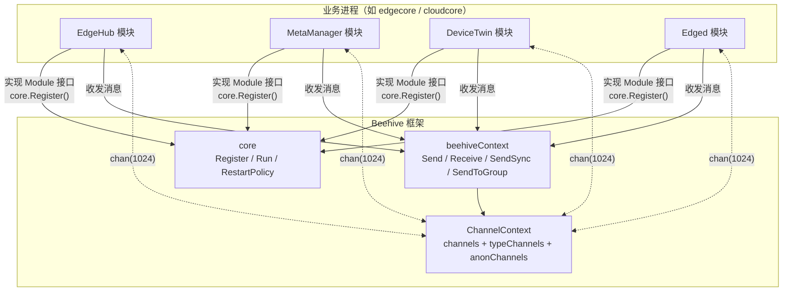
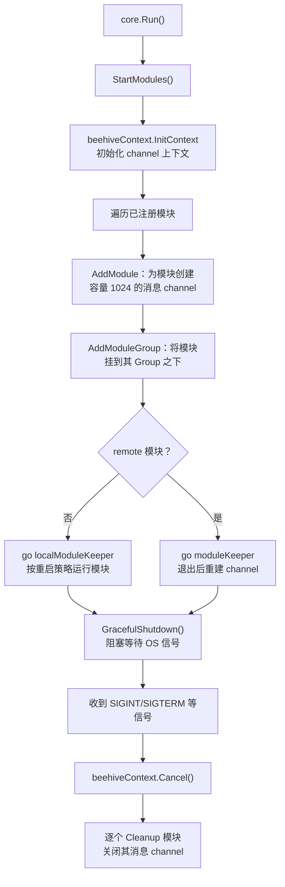
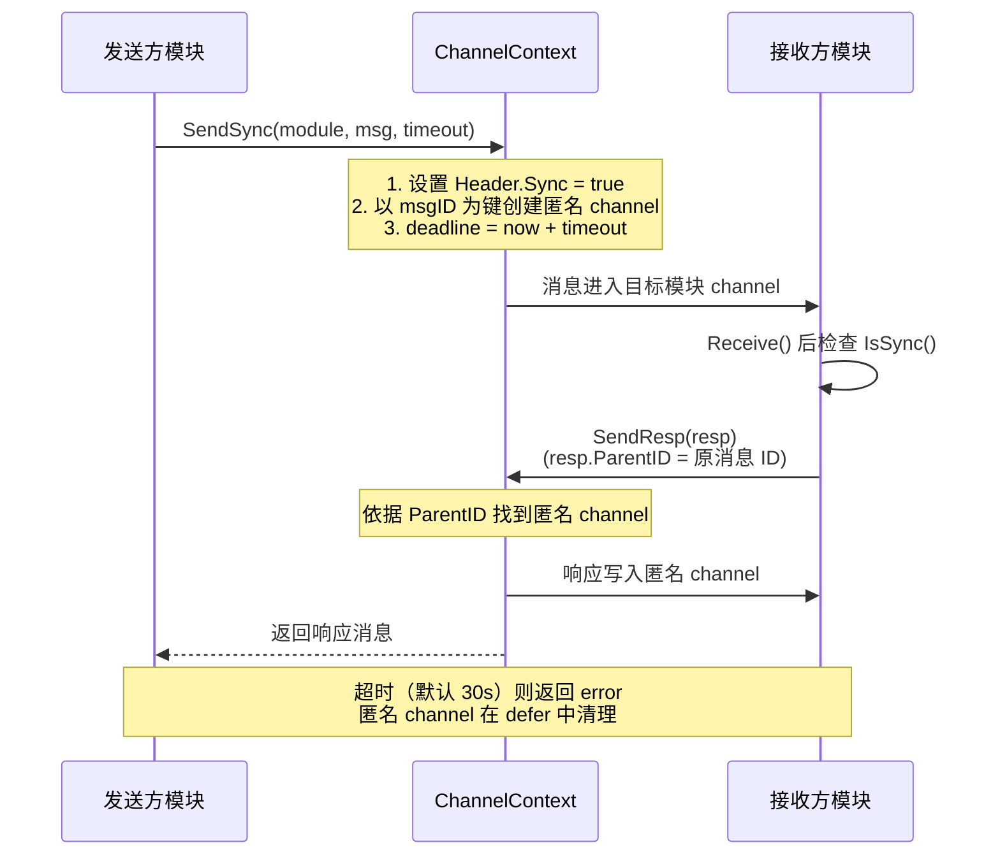
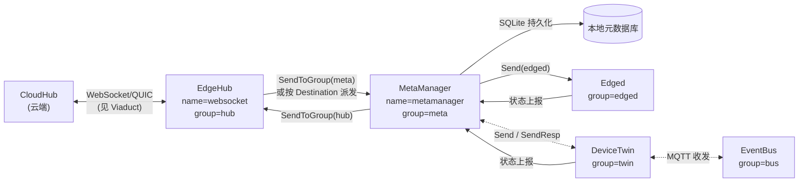

Beehive 是 KubeEdge 的进程内消息通信框架，位于 `staging/src/github.com/kubeedge/beehive`，作为独立 Go 模块发布。它的设计哲学可以概括为一句话：**组件之间不直接调用，一切皆消息**。CloudCore 和 EdgeCore 内部的各个模块（EdgeHub、MetaManager、DeviceTwin 等）都构建在 Beehive 之上，通过统一的模块注册、消息路由和生命周期管理机制协作。本页将剖析 Beehive 的核心抽象（Module、Message、Context）、channel 模式的实现细节，并结合 EdgeCore 的真实代码展示其实际用法。

## 设计定位与总体架构

Beehive 的定位类似于操作系统的"微内核 + 进程间通信"：框架本身只提供三样东西——**模块管理**（注册与生命周期）、**消息总线**（进程内 channel 或跨进程 unix socket）、**统一消息信封**（Message 模型）。业务逻辑全部下沉到各个 Module 中，模块之间通过消息解耦，任何一个模块的启停都不会影响其他模块的编译与依赖关系。

这一设计带来了极低的依赖负担：从 `go.mod` 可以看到，Beehive 整个框架仅依赖 `google/uuid`（生成消息 ID）、`k8s.io/klog/v2`（日志）和 `sigs.k8s.io/yaml`（配置解析），没有任何重量级框架依赖。

```
架构角色一览（前置说明）：
- core            ：模块注册与生命周期引擎（Module 接口、Register、Run）
- context         ：消息上下文工厂，屏蔽 channel / socket 两种传输模式
- channel         ：进程内实现，基于 Go 原生 channel
- socket          ：跨进程实现，基于 unix socket（含 broker、store、wrapper）
- model           ：统一消息模型 Message
```



Sources: [README.md](staging/src/github.com/kubeedge/beehive/README.md#L1-L3), [go.mod](staging/src/github.com/kubeedge/beehive/go.mod#L1-L22)

## Module 接口：一切皆模块

Beehive 将所有业务组件抽象为 `Module` 接口，任何想接入框架的组件只需实现 5 个方法：`Name()`、`Group()`、`Enable()`、`Start()` 和 `RestartPolicy()`。其中 `Name()` 定义模块的唯一标识（消息寻址的目标），`Group()` 定义模块所属的逻辑分组（组播的目标），`Enable()` 决定模块是否参与运行，`Start()` 是模块的业务入口（长驻运行），`RestartPolicy()` 则返回重启策略或 `nil` 表示不需要。

| 接口方法 | 职责 | 说明 |
| --- | --- | --- |
| `Name() string` | 模块唯一名称 | 消息按名称投递到对应 channel |
| `Group() string` | 模块所属分组 | 支持 `SendToGroup` 组播 |
| `Enable() bool` | 是否启用 | 未启用的模块进入 disabledModules，不参与运行 |
| `Start()` | 模块业务入口 | 长驻函数，错误处理由开发者控制，可用 `panic()` 触发 OnFailure 重启 |
| `RestartPolicy()` | 重启策略 | 返回 `nil` 表示模块退出即退出 |

框架还提供了 `SimpleModule` 快捷封装：大多数开发者只关心 `Start()` 的实现，其余方法属于"明显冗余的工作"。`SimpleModule` 通过 `NewSimpleModule(name, group, opts...)` 构造，支持 `WithEnable`、`WithRestartPolicy` 两个选项函数，并允许直接注入 `StartFunc`（无返回值）或 `StartEFunc`（返回 error，出错时自动 panic 以触发重启策略）。

模块通过 `core.Register()` 注册，该函数的要点有三处：其一，默认使用 `channel` 上下文模式，若传入 `opts` 参数则切换为 socket 远程模式；其二，注册通常放在包的 `init()` 函数中，借助 Go 的包初始化机制实现"导入即注册"；其三，只有 `Enable()` 返回 `true` 的模块才会进入运行时注册表 `modules`，否则进入 `disabledModules` 并打印告警日志。

Sources: [module.go](staging/src/github.com/kubeedge/beehive/pkg/core/module.go#L46-L95), [module_simple.go](staging/src/github.com/kubeedge/beehive/pkg/core/module_simple.go#L28-L99)

## 生命周期：从注册到优雅退出

模块的生命周期由 `core.Run()` 驱动，它由两个阶段组成：`StartModules()` 负责启动，`GracefulShutdown()` 负责退出。理解这个流程需要先记住一个前提：所有模块在 `Run()` 调用之前已完成注册（通常在 `init()` 中）。



**重启策略**是理解模块可靠性的关键。`ModuleRestartPolicy` 支持两种类型：`RestartTypeAlways`（无论模块 `Start()` 是否返回错误都重启）和 `RestartTypeOnFailure`（仅当 `Start()` 内部发生 panic 时重启）。策略还提供精细的退避控制：`IntervalSecond` 设置初始间隔（默认 1 秒），`IntervalTimeGrowthRate` 设置间隔增长率（必须大于 1 才生效），`RestartIntervalLimit` 限制最大间隔（默认 30 秒），`Retries` 限制最大重试次数（0 表示无限重试），`ErrorHandler` 在重试耗尽时提供自定义错误处理钩子。`localModuleKeeper` 中的 `calculateIntervalTime` 按 `当前间隔 × 增长率` 逐次放大重启间隔，直到触及上限，避免故障模块陷入"风暴式重启"。

**优雅退出**通过 `signal.Notify` 监听 `SIGINT`、`SIGTERM`、`SIGQUIT` 等七类信号实现：收到信号后先调用 `beehiveContext.Cancel()` 取消全局 context（各模块的 `Start()` 循环通过监听 `beehiveContext.Done()` 感知退出），再逐个 `Cleanup` 模块，关闭其消息 channel。

Sources: [core.go](staging/src/github.com/kubeedge/beehive/pkg/core/core.go#L74-L93), [core.go](staging/src/github.com/kubeedge/beehive/pkg/core/core.go#L95-L174), [module.go](staging/src/github.com/kubeedge/beehive/pkg/core/module.go#L14-L43)

## 统一消息模型 Message

Message 是 Beehive 中所有通信的载体，采用"信封"结构：**Header**（信封元数据）+ **Router**（路由信息）+ **Content**（信件正文，`interface{}` 类型）。这一设计与 HTTP 请求的"头 + 体"分离思路一致，但路由字段由消息自身携带，而非依赖传输层。

| 结构 | 字段 | 语义 |
| --- | --- | --- |
| MessageHeader | `ID` | UUID，消息唯一标识 |
| MessageHeader | `ParentID` | 父消息 ID，响应消息与请求消息借此关联 |
| MessageHeader | `Timestamp` | 毫秒级创建时间 |
| MessageHeader | `ResourceVersion` | 资源版本，KubeEdge 借此实现可靠传输 |
| MessageHeader | `Sync` | 同步标志，由 SendSync 自动设置 |
| MessageHeader | `MessageType` | 上下文类型（channel/unixsocket），空则默认 channel |
| MessageRoute | `Source` | 消息来源模块 |
| MessageRoute | `Destination` | 点对点目标模块 |
| MessageRoute | `Group` | 组播目标分组 |
| MessageRoute | `Operation` / `Resource` | 对资源的操作类型与资源定位符 |

消息的构造采用链式 API，典型写法为 `model.NewMessage(parentID).BuildRouter(source, group, resource, operation).FillBody(content)`。此外，框架预置了响应消息的构造函数 `NewRespByMessage`：它自动继承请求的 ID（作为 ParentID）、路由信息和资源操作（Operation 固定为 `response`），调用方只需填入响应内容——这保证了"请求-响应"配对不依赖手工维护 ID。

`Operation` 与 `Resource` 是 KubeEdge 云边语义的载体。框架预定义了 `insert`、`delete`、`query`、`update`、`patch`、`upload`、`response`、`error` 等操作常量，以及 `pod`、`configmap`、`secret`、`node`、`nodestatus` 等数十种资源类型常量。下游模块（如 MetaManager）正是依据 `GetOperation()` 的值分发处理逻辑的。特别值得注意 `ResourceVersion` 字段的注释：KubeEdge 利用消息资源版本实现可靠传输，这一机制的完整设计在[可靠消息传递与边缘自治机制](27-ke-kao-xiao-xi-chuan-di-yu-bian-yuan-zi-zhi-ji-zhi)中详述。

Sources: [message.go](staging/src/github.com/kubeedge/beehive/pkg/core/model/message.go#L59-L103), [message.go](staging/src/github.com/kubeedge/beehive/pkg/core/model/message.go#L88-L110), [message.go](staging/src/github.com/kubeedge/beehive/pkg/core/model/message.go#L242-L266)

## Context 抽象：双模式通信上下文

Beehive 将通信能力拆分为两个接口：`ModuleContext` 管理模块的注册（`AddModule`、`AddModuleGroup`、`Cleanup`），`MessageContext` 管理消息的收发。消息 API 覆盖三种通信拓扑：

| API | 模式 | 语义 |
| --- | --- | --- |
| `Send(module, message)` | 异步点对点 | 投递后立即返回 |
| `Receive(module)` | 异步接收 | 阻塞读取本模块 channel |
| `SendSync(module, message, timeout)` | 同步点对点 | 等待目标模块响应或超时 |
| `SendResp(message)` | 同步响应 | 回复收到的同步消息 |
| `SendToGroup(group, message)` | 异步组播 | 向组内所有模块广播 |
| `SendToGroupSync(group, message, timeout)` | 同步组播 | 等待组内所有成员响应 |

所有 API 都以包级函数形式暴露在 `beehiveContext` 包中。其背后是 `GlobalContext` 单例工厂：它维护 `context type → 上下文实现` 的映射（目前支持 `channel` 和 `unixpacket` 两种），并通过 `moduleContextType`、`groupContextType` 两张表记录每个模块/分组归属哪种上下文，从而在 `Send`/`Receive` 调用时自动路由到正确的实现。

| 特性 | Channel 模式 | Socket 模式（unixpacket） |
| --- | --- | --- |
| 通信边界 | 进程内（Go channel） | 跨进程（unix socket） |
| 典型场景 | EdgeCore/CloudCore 内部模块协作 | 跨进程模块集成 |
| 序列化 | 无需，直接传 Message 结构体 | 需要网络封装（broker/wrapper） |
| 当前使用状态 | KubeEdge 生产默认（`core.go` 仅初始化 channel 模式） | 预留能力，启用需显式传入 `MsgCtxTypeUS` |

需要指出的是，socket 模式的实现（broker、PipeStore、synckeeper 等组件）在代码库中完整保留，但从 `StartModules()` 的注释可以看出，当前生产路径只注册 channel 模式，socket 模式属于框架预留的扩展能力。

Sources: [context.go](staging/src/github.com/kubeedge/beehive/pkg/core/context/context.go#L13-L30), [context_factory.go](staging/src/github.com/kubeedge/beehive/pkg/core/context/context_factory.go#L60-L108), [type.go](staging/src/github.com/kubeedge/beehive/pkg/common/type.go#L6-L28)

## Channel 上下文实现剖析

Channel 模式是 Beehive 的核心实现，其数据结构由**三张 map** 构成：`channels`（模块名 → 消息 channel）、`typeChannels`（分组名 → 模块名 → channel，服务组播）、`anonChannels`（消息 ID → 匿名 channel，服务同步响应）。每个模块注册时获得一个容量为 **1024** 的 `chan model.Message`，这是进程内消息总线的物理载体。

三种发送方式的实现机制差异显著：

**异步 Send** 直接向目标 channel 投递消息，并利用 `defer recover` 兜底 channel 关闭时的 panic——这是模块退出竞态下的防御性设计。若目标模块名不存在，仅打印告警而不报错。

**同步 SendSync** 是最精妙的部分。由于 Go channel 没有内建的"请求-响应"概念，Beehive 为每次同步调用创建一个**匿名 channel**（以消息 ID 命名，注册进 `anonChannels`），然后：



接收方的配合模式体现在响应构造上：先 `Receive()` 取消息，若 `IsSync()` 为 true，则用 `NewRespByMessage` 构造响应并 `SendResp` 发回——响应会沿着 ParentID 精确送回发起同步调用的那个 goroutine。

**组播 SendToGroup** 为组内每个模块单独启动一个 goroutine 并发投递，投递时先尝试非阻塞发送，若 channel 满则告警后阻塞写入。**同步组播 SendToGroupSync** 则将匿名 channel 的容量设为组内成员数，并发投递后以 20ms 的 ticker 轮询响应是否集齐，超时后进入清理阶段并校验响应的 ParentID 是否匹配（防止串扰响应）。

| 关键常量 | 默认值 | 用途 |
| --- | --- | --- |
| `ChannelSizeDefault` | 1024 | 每模块消息 channel 缓冲容量 |
| `MessageTimeoutDefault` | 30s | SendSync 未指定 timeout 时的默认超时 |
| `TickerTimeoutDefault` | 20ms | SendToGroupSync 轮询响应的周期 |

Sources: [context_channel.go](staging/src/github.com/kubeedge/beehive/pkg/core/channel/context_channel.go#L12-L46), [context_channel.go](staging/src/github.com/kubeedge/beehive/pkg/core/channel/context_channel.go#L95-L166), [context_channel.go](staging/src/github.com/kubeedge/beehive/pkg/core/channel/context_channel.go#L191-L238)

## 在 KubeEdge 中的实际应用

### EdgeCore 的模块注册

EdgeCore 启动时的流程是理解 Beehive 用法的最佳样本：`edgecore` 命令在解析配置后，先调用 `registerModules(config)` 注册全部 9 个模块，然后一行 `core.Run()` 启动整个框架。注册顺序为 devicetwin、edged、edgehub、eventbus、metamanager、servicebus、edgestream、taskmanager 和 test（DBTest）——每个模块的 `Register` 函数负责初始化自身配置，再调用 `core.Register()` 将自己交给 Beehive。

| 模块名（Name） | 分组（Group） | 职责概要 |
| --- | --- | --- |
| `websocket`（EdgeHub） | `hub` | 云边消息收发枢纽 |
| `metamanager` | `meta` | 元数据本地持久化与消息中转 |
| `twin`（DeviceTwin） | `twin` | 设备数字孪生 |
| `edged` | `edged` | 轻量级节点代理 |
| `eventbus` | `bus` | MQTT 设备接入 |
| `servicebus` | `user` | 边缘 HTTP 服务访问 |
| `edgestream` | `edgestream` | 云边隧道客户端 |
| `taskmanager` | `taskmanager` | 节点任务执行 |

分组的设计意图清晰可见：`hub` 组是唯一的"云端出口"，本地模块发往 `hub` 组的消息都会被 EdgeHub 转发上云；`meta`、`twin`、`edged` 等组构成边缘内部的消息拓扑。云端侧（CloudCore）同样基于 Beehive，其模块名与分组同名（如 `cloudhub`、`edgecontroller`、`devicecontroller`、`synccontroller` 等），各云侧控制器收到边缘上报后在本进程内继续组内协作。

Sources: [server.go](edge/cmd/edgecore/app/server.go#L200-L218), [names.go](edge/pkg/common/modules/names.go#L1-L21), [group.go](edge/pkg/common/modules/group.go#L1-L21), [modules.go](cloud/pkg/common/modules/modules.go#L5-L43)

### 模块实现实例：EdgeHub 与 MetaManager

EdgeHub 是教科书式的 Module 实现。它的 `Register()` 函数串联了"初始化配置 → 注册消息处理器 → 注册自身"三步；`Name()` 返回 `modules.EdgeHubModuleName`（值为 `websocket`），`Group()` 返回 `HubGroup`（值为 `hub`）。特别值得关注的是 `RestartPolicy()` 的实现：它通过 `ModuleRestart` 特性门控判断是否启用重启策略，启用时返回 `RestartTypeOnFailure` 且增长率为 2.0 的策略——这是新重启机制灰度上线的典型手法。`Start()` 中通过 `beehiveContext.Done()` 获取全局退出信号，传入内部各协程循环，保证优雅退出时所有 goroutine 同步终止。

MetaManager 则展示了消息驱动的处理范式。其 `runMetaManager()` 主循环以 `beehiveContext.Receive(m.Name())` 阻塞等待消息，收到后按 `message.GetOperation()` 分发到 `processInsert/Update/Patch/Delete/Query/Response` 等处理器。处理过程中的消息转发呈现三种典型路径：`sendToCloud` 用 `SendToGroup(hub组)` 把消息交给 EdgeHub 上云；`sendToEdged` 用 `Send(edged)` 点对点下发；对同步请求则用 `SendResp` 直接回复。

```
消息流转示例（前置说明）：
云端 configmap 更新 → EdgeHub 收到 → 派发给 meta 组 → MetaManager 持久化到 SQLite
→ 转发给 edged 应用 → edged 处理结果经 meta 组原路回复 → EdgeHub 上报云端
```



Sources: [edgehub.go](edge/pkg/edgehub/edgehub.go#L128-L174), [metamanager.go](edge/pkg/metamanager/metamanager.go#L38-L67), [process.go](edge/pkg/metamanager/process.go#L49-L60), [process.go](edge/pkg/metamanager/process.go#L430-L476), [process.go](edge/pkg/edgehub/process.go#L62-L105)

## 实战：编写一个自定义模块

Beehive 自带的测试模块完整演示了全部三种通信方式，可以直接作为开发模板。发送方模块（`testModuleSource`）在 `init()` 中调用 `core.Register` 完成注册，`Start()` 中依次演示了异步发送、同步发送和组播：

```go
// 异步：构建消息 → 发送
message := model.NewMessage("").SetRoute(SourceModule, "").
    SetResourceOperation("test", model.InsertOperation).FillBody("hello")
beehiveContext.Send(DestinationModule, *message)

// 同步：5 秒超时等待响应
message = model.NewMessage("").SetRoute(SourceModule, "").
    SetResourceOperation("test", model.UpdateOperation).FillBody("how are you")
resp, err := beehiveContext.SendSync(DestinationModule, *message, 5*time.Second)

// 组播：发送到目标分组
message = model.NewMessage("").SetRoute(SourceModule, DestinationGroup).
    SetResourceOperation("test", model.DeleteOperation).FillBody("fine")
beehiveContext.SendToGroup(DestinationGroup, *message)
```

接收方模块（`testModuleDest`）则演示了标准的接收与响应模式：循环调用 `beehiveContext.Receive(DestinationModule)` 获取消息，检查 `message.IsSync()` 判断是否需要应答，需要时构造 `NewRespByMessage` 并调用 `beehiveContext.SendResp`。注意响应构造必须使用 `NewRespByMessage` 而非手工拼装——同步机制依赖 ParentID 匹配匿名 channel，错误的 ParentID 会导致响应无法送达发送方。

将这一模式落到真实项目时，遵循 KubeEdge 的惯例即可：包内定义模块结构体并实现 `core.Module` 接口（或直接内嵌 `SimpleModule`）、提供 `Register()` 函数完成配置初始化与 `core.Register()` 调用、在组件入口（如 `edgecore` 的 `registerModules`）按序注册各模块、`Start()` 中用 `beehiveContext.Done()` 驱动退出。若要为模块接入重启保护，参照 EdgeHub 的做法返回 `ModuleRestartPolicy` 并用特性门控控制灰度。

Sources: [test_source.go](staging/src/github.com/kubeedge/beehive/test/modules/test_source.go#L17-L59), [test_destination.go](staging/src/github.com/kubeedge/beehive/test/modules/test_destination.go#L15-L63), [core_test.go](staging/src/github.com/kubeedge/beehive/pkg/core/core_test.go#L25-L81)

## 小结与延伸阅读

Beehive 用不到三千行代码为 KubeEdge 提供了三大能力：以 `Module` 接口和重启策略为中心的**模块生命周期管理**，以 Message 信封和 Operation/Resource 语义为中心的**统一消息模型**，以及以 channel 实现为主的**多拓扑消息总线**（点对点异步、点对点同步、组播）。它让 EdgeCore 内部十余个模块保持了"零直接依赖"的松耦合形态，也让云端与边缘共享同一套进程内协作范式。理解了 Beehive，KubeEdge 其余组件的代码阅读就有了主线——所有组件交互都归结为"构造消息 → 选择发送模式 → 按 Name/Group 寻址"。

建议按以下路径继续深入：

- [EdgeCore：模块化边缘核心与启动生命周期](15-edgecore-mo-kuang-hua-bian-yuan-he-xin-yu-qi-dong-sheng-ming-zhou-qi) —— 查看 Beehive 之上 EdgeCore 的整体启动编排
- [EdgeHub：云边消息收发枢纽与证书认证](17-edgehub-yun-bian-xiao-xi-shou-fa-shu-niu-yu-zheng-shu-ren-zheng) —— 查看 `hub` 组出口模块的连接与重连设计
- [Viaduct：云边消息传输通道（WebSocket/QUIC）](23-viaduct-yun-bian-xiao-xi-chuan-shu-tong-dao-websocket-quic) —— 查看 Message 跨越云边网络时的传输层封装
- [可靠消息传递与边缘自治机制](27-ke-kao-xiao-xi-chuan-di-yu-bian-yuan-zi-zhi-ji-zhi) —— 查看 Message.ResourceVersion 如何支撑断网续传