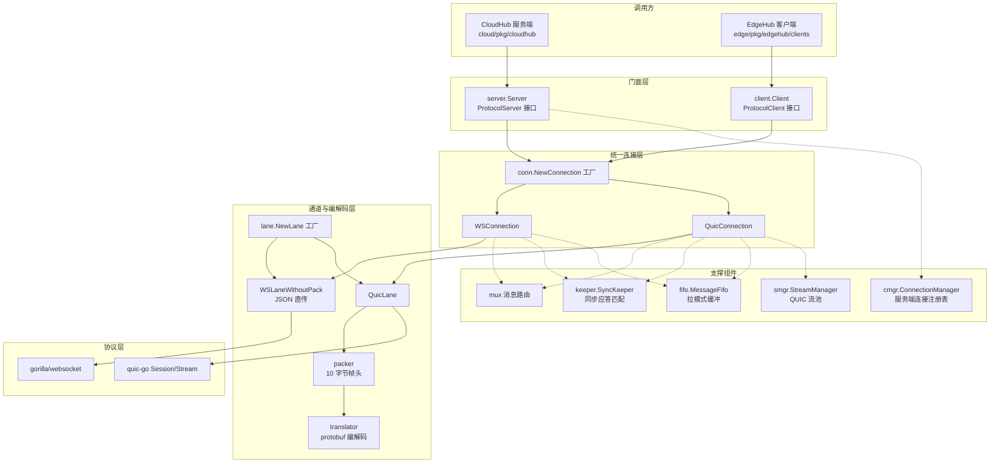
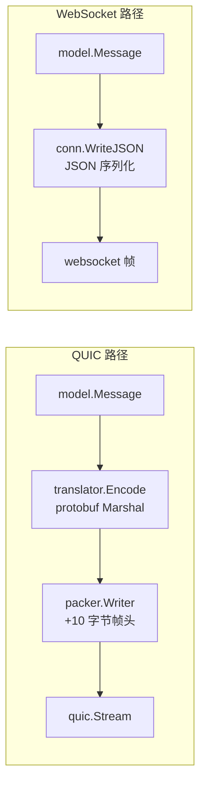
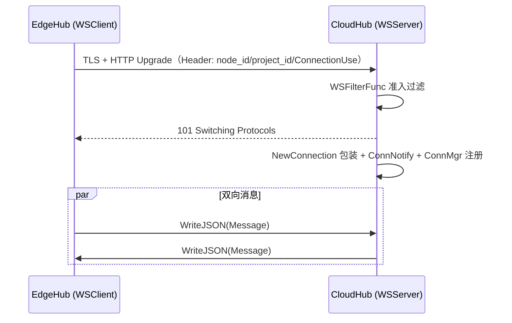
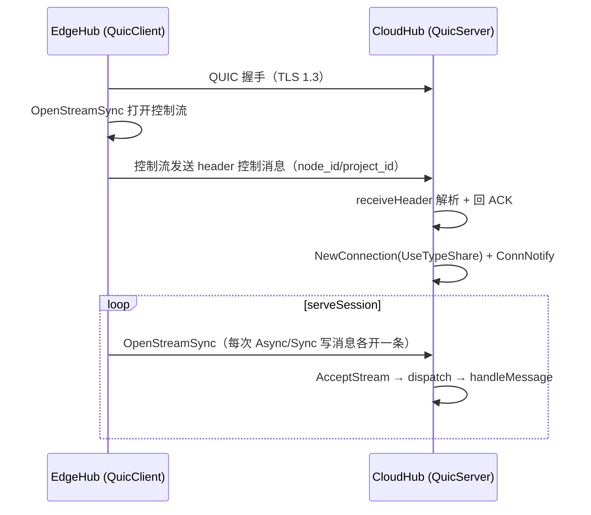
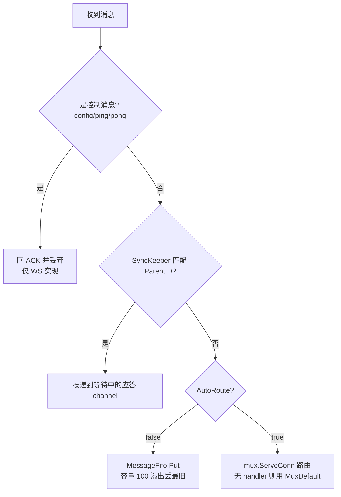

Viaduct（高架桥）是 KubeEdge 自研的云边消息传输库，位于仓库根目录的 `pkg/viaduct`。它的名字来自官方 README 的比喻：**云端与边缘之间的鸿沟是"峡谷"，而 Viaduct 就是横跨峡谷的"高架桥"**。它将 Beehive 框架定义的 `model.Message` 序列化后，通过 WebSocket（gorilla/websocket）或 QUIC（quic-go）两种底层协议在云边之间传输，并以统一的 `Connection` 接口向调用方屏蔽协议差异。在 KubeEdge 的整体架构中，云端 CloudHub 与边缘 EdgeHub 之间的**消息通道**正是由本库承载的。本文面向高级开发者，从分层架构、线缆协议（wire format）、连接生命周期到可靠性机制，逐层剖析其设计与实现。

Sources: [README.md](pkg/viaduct/README.md#L1-L13), [message.proto](pkg/viaduct/pkg/protos/message/message.proto#L1-L34)

## 设计动机与协议支撑

Viaduct 解决的核心问题是：Beehive 模块间通信使用的是内存中的 `model.Message` 结构，而云边两端分属不同进程、不同网络，必须将这一消息模型跨网络传输。Viaduct 因此提供了两件事：**消息序列化**（基于 protobuf 3.0 定义的 `Message` wire 格式）与**连接管理 API**（连接、消息读写、同步应答）。它刻意只做传输层的事——不关心消息语义、不缓存元数据、不参与认证决策，这些职责分别属于 MetaManager、CloudHub 等上层模块。

当前 Viaduct 支持两种基础传输协议：`websocket`（基于 gorilla/websocket）与 `quic`（基于 quic-go/lucas-clemente 分支）。协议类型以字符串常量定义在 `api` 包中，贯穿所有工厂函数的分发逻辑。值得注意的是，README 中明确列出的 TODO（补充单元测试、e2e 测试与基准测试）说明该库仍处于持续演进状态，阅读代码时应留意注释中的 `TODO` 标记。

Sources: [README.md](pkg/viaduct/README.md#L1-L13), [type.go](pkg/viaduct/pkg/api/type.go#L7-L14)

## 分层架构总览

Viaduct 内部呈现出清晰的五层结构：**API 常量层 → Server/Client 门面层 → Connection 统一连接层 → Lane 通道抽象层 → 协议编解码层**。上层只依赖下层接口，协议差异（WebSocket 与 QUIC）被逐层吸收。下图展示了各层的组成与依赖关系（先读懂图例：`Server/Client` 是调用方直接接触的门面，`Connection` 是消息读写的统一入口，`Lane` 屏蔽"一条通道上如何读写一帧消息"，最底层才是真正的网络协议实现）：

各模块的职责与关键文件汇总如下：

| 模块 | 职责 | 关键类型/函数 |
|------|------|--------------|
| `api` | 协议常量与扩展选项 | `ProtocolTypeQuic/WS`、`UseType`、`QuicServerOption` 等 |
| `server` | 协议无关的服务端门面 | `Server`、`ProtocolServer`、`WSServer`、`QuicServer` |
| `client` | 协议无关的客户端门面 | `Client.Connect()`、`WSClient`、`QuicClient` |
| `conn` | 统一连接接口与双实现 | `Connection` 接口、`NewConnection` 工厂、`WSConnection`、`QuicConnection` |
| `lane` | 单通道消息帧读写 | `Lane` 接口、`QuicLane`、`WSLaneWithoutPack` |
| `packer` | 二进制帧头打包/解包 | `PackageHeader`、`Reader`、`Writer` |
| `translator` | Beehive 消息与 protobuf 互转 | `MessageTranslator.Encode/Decode` |
| `mux` | 按资源+操作路由消息 | `MessageMux`、`MessagePattern`、`MuxDefault` |
| `keeper` | 同步消息应答匹配 | `SyncKeeper.MatchAndNotify/WaitResponse` |
| `fifo` | 拉模式消息缓冲队列 | `MessageFifo`（容量 100，溢出丢最旧） |
| `smgr` | QUIC 流池化管理 | `StreamManager`、`PoolManager`（idle/busy 双池） |
| `cmgr` | 服务端连接注册表 | `ConnectionManager`（按自定义 key 存取） |
| `comm` | 控制消息类型与公共常量 | `ControlTypeHeader/Ping/Pong`、`MessageFiFoSizeMax` |

Sources: [factory.go](pkg/viaduct/pkg/conn/factory.go#L14-L53), [lane.go](pkg/viaduct/pkg/lane/lane.go#L13-L31), [comm.go](pkg/viaduct/pkg/comm/comm.go#L6-L26)

## 核心抽象：Connection 接口与工厂模式

`conn.Connection` 是 Viaduct 对外暴露的最核心接口，它把"一条云边连接"抽象为消息收发与原始字节流两套操作集合。消息侧提供 `WriteMessageAsync`（发后即忘）、`WriteMessageSync`（发送并阻塞等待应答）、`ReadMessage`（拉模式阻塞读取）三个语义级别的方法；字节流侧提供裸的 `Read/Write`，服务于 QUIC 的流式传输场景。此外还有 `ServeConn`（启动接收循环）、读写超时设置、连接状态查询与 `ConnectionState`（保存 HTTP 头与对端 `x509` 证书，供上层做鉴权）。

工厂函数 `conn.NewConnection` 依据 `ConnectionOptions.ConnType` 分发到 `NewQuicConn` 或 `NewWSConn`，这正是整个库的分层契约：**Server/Client 层负责建立底层连接（`websocket.Conn` 或 `quic.Session`），再把它作为 `Base` 字段交给工厂包装成统一接口**。理解了这一点，阅读任意一段云边建连代码都可以按"先建底层连接、再包装、最后 `ServeConn`"的三段式来拆解。

| 接口方法 | 语义 | 备注 |
|---------|------|------|
| `ServeConn()` | 启动消息接收循环 | 服务端在 `ConnNotify` 回调后调用，客户端在 `Connect` 内异步调用 |
| `WriteMessageAsync(msg)` | 异步发送 | 置 `Header.Sync=false` |
| `WriteMessageSync(msg)` | 同步发送并等待应答 | 置 `Header.Sync=true`，经 `SyncKeeper` 匹配应答 |
| `ReadMessage(msg)` | 拉模式读取 | 阻塞在 `MessageFifo`，要求 `AutoRoute=false` |
| `Read/Write(raw)` | 原始字节流 | QUIC 打开独立流，WS 直接读写帧 |
| `ConnectionState()` | 连接状态 | 含对端证书与头部（`node_id`/`project_id`） |

Sources: [conn.go](pkg/viaduct/pkg/conn/conn.go#L16-L70), [factory.go](pkg/viaduct/pkg/conn/factory.go#L46-L53), [client.go](pkg/viaduct/pkg/client/client.go#L67-L87)

## 线缆协议：两种截然不同的帧格式

Viaduct 最容易被误解的一点是：**WS 与 QUIC 走的线缆格式完全不同**。`lane` 包通过 `Lane` 接口统一了"在一条通道上读写一条消息"的操作，但工厂 `NewLane` 为两种协议返回的实现的编码策略不同——QUIC 侧使用 `packer + translator` 的完整编解码链路，WS 侧则使用名为 `WSLaneWithoutPack` 的实现，**直接以 JSON 序列化 `model.Message`，每个 WebSocket 帧就是一条完整消息，不经过 packer 帧头**。这意味着 Viaduct 的"统一"是接口层面的统一，而非字节流层面的统一，两端必须使用相同协议才能互通。

QUIC 路径的 `QuicLane.WriteMessage` 先经 `translator` 将 `model.Message` 映射为 protobuf `message.Message`（Header/Router/Content 三段结构），再经 `packer.Writer` 加帧头写入流；读方向则先 `packer.Reader.Read` 剥离帧头，再 `translator.Decode` 还原消息。而 WS 路径的 `WSLaneWithoutPack.WriteMessage` 一行 `WriteJSON` 即完成发送。

packer 帧头共 10 字节，布局如下（大端序）：

| 偏移 | 长度 | 字段 | 说明 |
|------|------|------|------|
| 0 | 4B | `Version` | major\|minor\|fix 三段版本号，当前 1.1.1 |
| 4 | 1B | `PackageType` | `0x01` Message / `0x02` Stream / `0x04` UserDefined |
| 5 | 1B | `Flags` | 如 `FlagCompressed`（0x80） |
| 6 | 4B | `PayloadLen` | 载荷长度，上限 `MaxPayloadLen = 32 MiB` |

`Reader.Read` 的读取协议是经典的"读定长头 → 校验载荷上限 → 读定长载荷"三步，其中对载荷超限（大于 32 MiB）直接报错拒绝，防止恶意长度字段导致的内存耗尽；对 EOF 与读超时则静默处理，交由上层统一判定断连。

Sources: [lane.go](pkg/viaduct/pkg/lane/lane.go#L17-L31), [quic.go](pkg/viaduct/pkg/lane/quic.go#L27-L43), [wsnopack.go](pkg/viaduct/pkg/lane/wsnopack.go#L35-L53), [package.go](pkg/viaduct/pkg/packer/package.go#L11-L50), [reader.go](pkg/viaduct/pkg/packer/reader.go#L38-L70), [message.go](pkg/viaduct/pkg/translator/message.go#L53-L100)

## 消息路由：mux 模块

当连接以推模式（`AutoRoute=true`）运行时，收到的消息不会入队等待拉取，而是被路由到 `mux.MessageMux`。其设计仿照 `net/http` 的路由器：注册条目时给出 `MessagePattern`（资源表达式 + 操作通配符），匹配时对 `message.GetResource()` 做正则提取、对 `GetOperation()` 做等值或 `*` 通配比较，命中后把消息包装成 `MessageContainer`（附 HTTP 头、对端证书与路径参数）回调业务函数。业务函数可通过 `ResponseWriter.WriteResponse` 直接回写应答。

路由前还留有 `MessageFilter` 扩展点：`ServeConn` 先执行过滤器（如鉴权），未通过则直接丢弃。KubeEdge 自身的使用方式极为粗粒度——CloudHub 仅注册一条 `mux.NewPattern("*").Op("*")` 通配条目，把所有上行消息交给 `HandleMessage` 统一处理，真正的细粒度鉴权在 CloudHub 的 authorizer 中完成。因此 mux 的正则参数提取能力（`container.Parameter(name)`）更多是提供给二次开发者的能力，KubeEdge 内部并未深度使用。

Sources: [mux.go](pkg/viaduct/pkg/mux/mux.go#L20-L119), [pattern.go](pkg/viaduct/pkg/mux/pattern.go#L52-L57), [message_handler.go](cloud/pkg/cloudhub/handler/message_handler.go#L90-L117)

## 连接生命周期：WS 与 QUIC 的建连对比

两条协议路径在建连阶段的行为差异显著，这是理解 Viaduct 运行时行为的关键。共同点是：**身份信息（`node_id`、`project_id`）都随建连过程传递**，最终落入 `ConnectionState.Headers`，供 CloudHub 侧的会话管理与鉴权使用；`ConnectionUse` 类型（`msg`/`str`/`shr`）决定连接后续的消息处理模式。

**WebSocket 路径**复用 HTTP 语义：客户端通过 gorilla `Dialer` 发起 TLS + Upgrade 握手，身份头直接放在 HTTP Header 中，同时附加 `ConnectionUse` 头声明用途；服务端可注册 `WSFilterFunc` 在升级前拦截（CloudHub 用它做节点准入校验）。升级成功后，服务端在 `ServeHTTP` 中用请求头与 `req.TLS.PeerCertificates` 构造 `ConnectionState`，经工厂包装为 `WSConnection`，回调 `ConnNotify`、注册进 `ConnectionManager`，最后起 goroutine 执行 `ServeConn`。

**QUIC 路径**则要先经过一次**应用层控制流握手**：客户端 `quic.DialAddr` 建立 QUIC 会话后，第一件事是 `OpenStreamSync` 打开一条**永不关闭的控制流**，并在其上发送 `operation="header"` 的控制消息，把扩展选项中的 `http.Header` 作为消息体传给服务端；服务端 `handleSession` 先 `AcceptStream` 等到这条控制流，`receiveHeader` 解出头并回 ACK，之后才创建 `QuicConnection`（固定 `UseTypeShare`，即消息与流式数据共用会话）。连接建立后，服务端循环 `AcceptStream` 接受对端新开的流，按流的 `UseType` 分派给 `handleMessage`（消息）或 `handleRawData`（字节流拷贝到 `Consumer`）。

这一差异带来一个重要的运维提示：QUIC 模式下**每条上下行消息都可能伴随一次流的开合**（`WriteMessageAsync/Sync` 从 `StreamManager` 取流，用完即归还），而 WS 模式下所有消息复用同一条 TCP 连接上的帧。两种模式的吞吐与连接数权衡，正是 CloudHub 默认启用 WebSocket、QUIC 需显式开启的原因之一。

Sources: [ws.go](pkg/viaduct/pkg/server/ws.go#L72-L109), [client/ws.go](pkg/viaduct/pkg/client/ws.go#L43-L89), [quic.go](pkg/viaduct/pkg/server/quic.go#L100-L175), [client/quic.go](pkg/viaduct/pkg/client/quic.go#L62-L131), [conn/quic.go](pkg/viaduct/pkg/conn/quic.go#L104-L126)

## 消息处理与可靠性机制

`WSConnection.handleMessage` 与 `QuicConnection.handleMessage` 是两条对称的接收循环，处理顺序完全一致，构成 Viaduct 的消息分发决策树：

**同步应答**由 `SyncKeeper` 实现：`WriteMessageSync` 发送前置位 `Header.Sync=true`，并以消息 ID 注册一个 channel 后阻塞在 `WaitResponse`（超时上限为 `WriteDeadline`）；对端应答回来后，接收循环发现应答的 `ParentID` 能在 keeper 中命中，便投递到该 channel 唤醒等待者。**拉模式缓冲**由 `MessageFifo` 实现：容量固定 100，队列满时丢弃最旧消息并告警，`Close` 时向所有阻塞在 `Get` 上的调用者广播错误——这正是 EdgeHub 断连后能立即感知并触发重连的机制。

**半开连接检测**是 WS 实现中最近强化的细节：仅靠读超时会误杀"空闲但健康"的连接（EdgeHub 的 keepalive 是单向的，CloudHub 不回应），因此 `handleMessage` 在配置了 `ReadDeadlineInterval` 时会启动 `pingLoop`，以间隔的一半周期发送 WebSocket 协议层 ping，对端 gorilla 读循环自动回 pong，每个 pong 都会重置读超时；只有对端完全停摆导致超时到期，才判定为半开连接并触发重连。连接级错误统一通过 `OnReadTransportErr(nodeID, projectID)` 回调上抛，CloudHub 借此清理该节点的会话与分发器状态。

| 机制 | 触发条件 | 行为 | 所在实现 |
|------|---------|------|---------|
| 控制消息 ACK | operation ∈ {config,ping,pong} | 自动回 ACK，不进业务 | 仅 `WSConnection` |
| 同步应答 | `Header.Sync=true` | `ParentID` 匹配 + channel 唤醒 | 双方一致 |
| FIFO 溢出 | 队列满 100 | 丢最旧消息 + Warning | 双方一致 |
| WS 半开检测 | `ReadDeadlineInterval > 0` | ping/pong 保活 + 读超时到期断连 | 仅 `WSConnection` |
| 传输错误回调 | 读循环返回错误 | `OnReadTransportErr` 通知上层 | 双方一致 |

Sources: [conn/ws.go](pkg/viaduct/pkg/conn/ws.go#L64-L82), [conn/ws.go](pkg/viaduct/pkg/conn/ws.go#L104-L239), [conn/quic.go](pkg/viaduct/pkg/conn/quic.go#L216-L254), [synckeeper.go](pkg/viaduct/pkg/keeper/synckeeper.go#L14-L79), [msgfifo.go](pkg/viaduct/pkg/fifo/msgfifo.go#L13-L54)

## QUIC 流池：StreamManager

QUIC 连接的每个并发操作都需要一条独立的 stream，`smgr.StreamManager` 为此维护 **messagePool 与 binaryPool 两个独立的 idle/busy 双池**。写入路径调用 `GetStream(UseTypeMessage, true, openStreamSync)` 时，优先从空闲池随机取流；空闲池为空时检查总流数是否达到 `NumStreamsMax`（当前为 99），未达上限则通过回调 `openStreamSync` 向 QUIC 会话同步开新流，已达上限则阻塞在条件变量上等待归还。使用完毕后 `ReleaseStream` 将流从 busy 池移回 idle 池并唤醒等待者。

值得注意的是代码中的 `autoFree` 变量当前硬编码为 `false`，即"空闲流超过总数 80% 时批量销毁"的回收策略（`checkThreshold`）实际上不会触发，流会一直在池中复用。这个细节解释了长连接场景下 QUIC 模式的流数量下限：每个 EdgeNode 连接会维持一批已接受的流供复用，而不会自动收缩。`Read/Write` 裸字节流接口则走 `binaryPool`，配合 `Consumer`（`io.Writer`）实现流式数据透传。

Sources: [smgr.go](pkg/viaduct/pkg/smgr/smgr.go#L11-L16), [smgr.go](pkg/viaduct/pkg/smgr/smgr.go#L199-L322), [conn/quic.go](pkg/viaduct/pkg/conn/quic.go#L24-L25), [conn/quic.go](pkg/viaduct/pkg/conn/quic.go#L128-L172)

## 在 KubeEdge 中的集成：CloudHub 与 EdgeHub

Viaduct 的生产使用者只有一对组件：云端 CloudHub 充当服务端，边缘 EdgeHub 充当客户端。**kubectl exec/logs/metrics 的云边隧道（CloudStream/EdgeStream）并不经过 Viaduct**，它们基于 `pkg/stream` 的另一套 WebSocket 隧道实现，两套机制并行存在、职责互斥——这是划分代码归属时常被混淆的边界。

CloudHub 侧，`StartCloudHub` 依据配置分别启动 WebSocket 与 QUIC 两个 `server.Server`，共同点是 `AutoRoute=true`、`ConnNotify=messageHandler.HandleConnection`、`OnReadTransportErr=messageHandler.OnReadTransportErr`，TLS 配置强制双向证书认证（`RequireAndVerifyClientCert`）并限定 ECDSA 套件。默认配置下 WebSocket 监听 10000 端口且默认启用，QUIC 监听 10001 端口但默认关闭（`MaxIncomingStreams` 默认 10000），身份头为 `node_id`/`project_id`。

EdgeHub 侧，`wsclient` 与 `quicclient` 是对 `viaduct.Client` 的薄封装，两者配置策略一致且与云端相反：`AutoRoute=false`（拉模式）+ `ConnUse=UseTypeMessage`，`Send` 走 `WriteMessageAsync`、`Receive` 走 `ReadMessage`。区别在于 WS 客户端 `Init` 内置 5 次重试（间隔 5 秒）并显式校验 CA（`InsecureSkipVerify=false`），而 QUIC 客户端不重试且当前设置了 `InsecureSkipVerify: true`——依赖 TLS 双向证书认证保证对端身份。

| 配置项 | WebSocket | QUIC |
|--------|-----------|------|
| 默认端口 | 10000 | 10001 |
| 默认启用 | 是 | 否 |
| 默认地址 | 0.0.0.0 | 0.0.0.0 |
| 特有选项 | `Path`、升级前 `Filter` | `MaxIncomingStreams=10000` |
| 线缆格式 | JSON 直传 | protobuf + 10 字节帧头 |
| 连接用途 | 头部 `ConnectionUse` 决定 | 服务端固定 `UseTypeShare` |

Sources: [servers/server.go](cloud/pkg/cloudhub/servers/server.go#L21-L31), [servers/server.go](cloud/pkg/cloudhub/servers/server.go#L33-L60), [servers/server.go](cloud/pkg/cloudhub/servers/server.go#L61-L88), [default.go](staging/src/github.com/kubeedge/api/apis/componentconfig/cloudcore/v1alpha1/default.go#L63-L77), [websocket.go](edge/pkg/edgehub/clients/wsclient/websocket.go#L74-L116), [quicclient.go](edge/pkg/edgehub/clients/quicclient/quicclient.go#L43-L110)

## 上手实践：chat 示例

`pkg/viaduct/examples/chat` 是理解库用法的最小闭环：服务端构造 `server.Server`（指定协议类型、TLS、`AutoRoute`、`ConnMgr` 与 `ConnNotify`），注册通配 mux 条目 `handleServer`（收到同步消息时经 `writer.WriteResponse` 回 "success"），随后阻塞在标准输入上，把用户输入封装为 `model.NewMessage("").BuildRouter(...).FillBody(...)` 并遍历 `ConnectionManager` 中的所有连接 `WriteMessageAsync` 广播。客户端对称地构造 `client.Client`（`AutoRoute=true` + `ConnUse=UseTypeMessage`）后 `Connect`，同样注册 mux 条目接收广播。`examples/mirror` 则演示了 `UseTypeStream` 的原始字节流用法。两个示例共同印证了本库的推荐姿势：**推模式配 mux 路由，协议类型一个字符串参数切换，其余代码零改动**。

Sources: [examples/chat/server.go](pkg/viaduct/examples/chat/server.go#L23-L31), [examples/chat/server.go](pkg/viaduct/examples/chat/server.go#L83-L107), [examples/chat/client.go](pkg/viaduct/examples/chat/client.go#L44-L87)

## 小结与延伸阅读

Viaduct 的设计可以浓缩为三条主线：**接口统一**（`Connection`/`Lane` 双层抽象消化协议差异）、**双模消息语义**（同步 SyncKeeper 与异步/拉模式 FIFO）、**握手内嵌身份**（WS 头部直传、QUIC 控制流交换头）。它的短板同样清晰：WS 与 QUIC 线缆格式不互通、QUIC 读超时（`SetReadDeadline`）尚未生效、`autoFree` 流回收策略未启用，这些都标注在代码注释与 TODO 中。理解了 Viaduct 之后，建议沿着云边消息的完整旅程继续深入：

- 消息到达云端后的会话管理与分发机制，见 [CloudHub：云边长连接网关与消息分发](8-cloudhub-yun-bian-chang-lian-jie-wang-guan-yu-xiao-xi-fen-fa)
- 边缘侧如何驱动 Viaduct 客户端完成重连与证书轮换，见 [EdgeHub：云边消息收发枢纽与证书认证](17-edgehub-yun-bian-xiao-xi-shou-fa-shu-niu-yu-zheng-shu-ren-zheng)
- `model.Message` 的路由字段设计与模块间通信模型，见 [Beehive：模块化消息通信框架](22-beehive-mo-kuai-hua-xiao-xi-tong-xin-kuang-jia)
- 并行的另一条云边隧道（exec/logs/metrics），见 [CloudStream：kubectl exec/logs/metrics 云边隧道](13-cloudstream-kubectl-exec-logs-metrics-yun-bian-sui-dao)