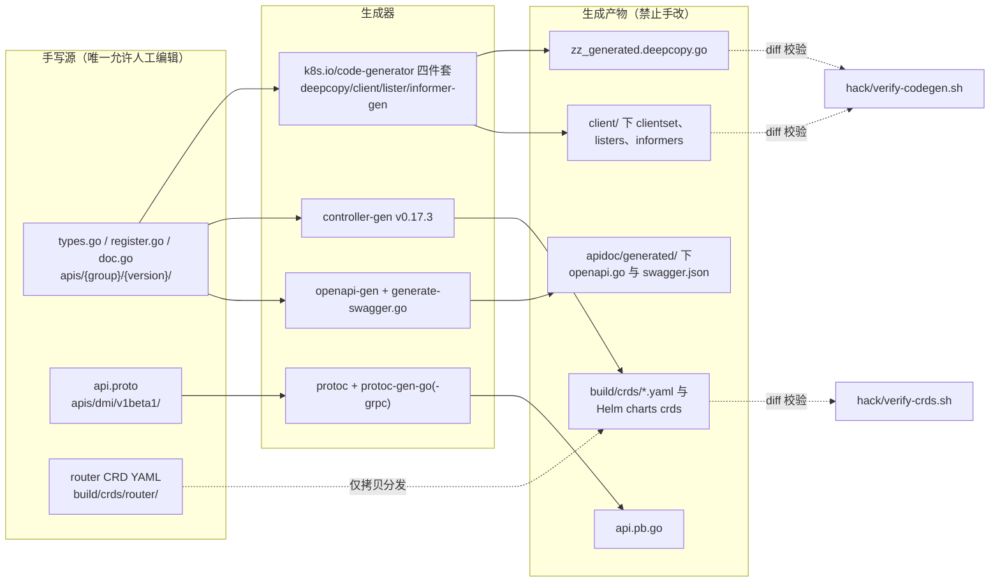
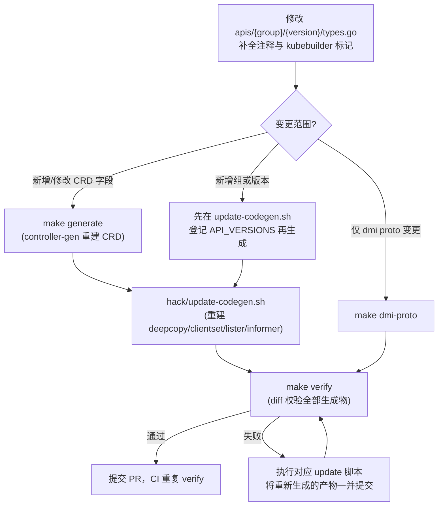

KubeEdge 对 Kubernetes 的 API 工程范式做了完整继承：所有对外暴露的类型（CRD 资源、组件配置、gRPC 接口）集中定义在一个独立发布的 API 仓库中，客户端代码、CRD YAML、协议绑定与 API 文档全部由注释标记（directive）驱动自动生成，并通过 `make verify` 的 diff 机制保证"提交的生成物"与"重新生成的产物"严格一致。本文页拆解这条从 **Go 结构体到 CRD 到客户端代码**的完整生成链路，帮助开发者理解"改一个字段要动哪些东西、哪些东西绝不能手改"。

## 体系总览：以 staging API 仓库为单一事实源

KubeEdge 的 API 定义的规范位置是 `staging/src/github.com/kubeedge/api`，它是一个独立的 Go module（`module github.com/kubeedge/api`），依赖 client-go v0.32.10 等核心库。仓库 README 明确了其定位：这是 KubeEdge API 的**规范定义位置**，单独发布是为了避免依赖多个 KubeEdge 组件的用户陷入"菱形依赖"问题，同时该库对外提供 CRD 的 informer/lister/clientset 与 API 文档。它通过根目录的 `go.work` 与主仓库、beehive、mapper-framework 共同构成多模块工作区。

整个体系可以概括为"**一份手写源，四条生成链路，一道 diff 门禁**"：

Sources: [README.md](staging/src/github.com/kubeedge/api/README.md#L1-L10)、[go.mod](staging/src/github.com/kubeedge/api/go.mod#L1-L15)、[go.work](go.work#L1-L9)

## API 定义三件套：types.go、register.go 与 doc.go

每个 CRD 组/版本目录都遵循 Kubernetes 社区的"三件套"布局。以 `devices/v1beta1` 为例，`types.go` 承载全部资源结构：资源类型嵌入 `metav1.TypeMeta` 与 `metav1.ObjectMeta`，业务字段收敛在 `Spec` 中；`register.go` 声明 `GroupName = "devices.kubeedge.io"` 与 `SchemeGroupVersion`，并通过 `addKnownTypes` 把 `Device/DeviceModel/DeviceStatus` 及其 List 类型注册进 Scheme。值得注意的一个工程细节：**apps 组的 register.go 头部标注 "Code generated by register-gen. DO NOT EDIT"，而 devices 组的是手写文件**——两种风格并存，后者还额外提供了按资源粒度注册的 `AddDeviceCrds` 辅助函数。

真正驱动一切生成的是**注释标记**。以 `DeviceModel` 类型为例，`+genclient` 触发客户端生成，`+k8s:deepcopy-gen:interfaces` 触发深拷贝函数，`+kubebuilder:storageversion` 声明 CRD 存储版本；字段层面的 `+kubebuilder:validation:Enum=INT;FLOAT;...` 会直接转化为 CRD schema 中的枚举校验，`+kubebuilder:validation:XPreserveUnknownFields` 则转化为 `x-kubernetes-preserve-unknown-fields: true`，允许自定义协议透传任意配置。包级开关则集中在 `doc.go`（`+k8s:openapi-gen=true` 与 `+k8s:deepcopy-gen=package`）。

| 标记 | 作用位置 | 生效结果 |
|---|---|---|
| `+genclient` | 资源类型 | 生成该资源的 typed client |
| `+k8s:deepcopy-gen:interfaces=...runtime.Object` | 资源 / List 类型 | 生成 `DeepCopyInto` 等深拷贝方法 |
| `+k8s:deepcopy-gen=package` | 包级（doc.go） | 打开整包 deepcopy 生成 |
| `+k8s:openapi-gen=true` | 包级 / 类型 | 纳入 OpenAPI/swagger 生成范围 |
| `+kubebuilder:storageversion` | 资源类型 | CRD 的 storage 版本 |
| `+kubebuilder:validation:Enum=A;B` | 类型定义 | CRD schema 枚举校验 |
| `+kubebuilder:validation:XPreserveUnknownFields` | 字段 | schema 透传未知字段 |
| `+groupName=devices.kubeedge.io` | 包级（register.go） | 声明 API 组全名 |

Sources: [device_model_types.go](staging/src/github.com/kubeedge/api/apis/devices/v1beta1/device_model_types.go#L23-L104)、[register.go](staging/src/github.com/kubeedge/api/apis/devices/v1beta1/register.go#L19-L90)、[doc.go](staging/src/github.com/kubeedge/api/apis/devices/v1beta1/doc.go#L16-L20)、[apps/v1alpha1/register.go](staging/src/github.com/kubeedge/api/apis/apps/v1alpha1/register.go#L16-L26)

## API 组全景与版本演进

`apis/` 目录下共存着三类 API：**CRD 型**（有组名、有 CRD 归档、有客户端生成）、**配置型**（`componentconfig`，描述 cloudcore/edgecore 配置文件的 schema，例如 `CloudCoreConfig` 使用 `+Required` 这套不同的标注体系）、**协议型**（`dmi`，以 proto 定义 gRPC 双向服务接口）。下表汇总了各组的资源与产物覆盖情况：

| API 组 | 版本 | 核心资源 | CRD 归档 | 客户端生成 |
|---|---|---|---|---|
| apps | v1alpha1 | EdgeApplication、NodeGroup | build/crds/apps | ✅ |
| devices | v1alpha2、v1beta1 | Device、DeviceModel、DeviceStatus（v1alpha2 另含 DeviceInstance 类型文件） | build/crds/devices | ⚠️ 仅 v1beta1 |
| operations | v1alpha1、v1alpha2 | NodeUpgradeJob、ImagePrePullJob；ConfigUpdateJob（v1alpha2） | build/crds/operations | ✅ 双版本 |
| policy | v1alpha1 | ServiceAccountAccess | build/crds/policy | ✅ |
| reliablesyncs | v1alpha1 | ObjectSync（命名空间级）、ClusterObjectSync（集群级） | build/crds/reliablesyncs | ✅ |
| rules | v1 | Rule、RuleEndpoint | build/crds/router（手工维护） | ✅ |
| dmi | v1alpha1、v1beta1 | gRPC 服务（DeviceManager/DeviceMapper 双向接口） | 无 CRD | ❌（protoc 生成） |
| componentconfig | v1alpha1、v1alpha2 | CloudCoreConfig、EdgeCoreConfig 等配置 schema | 无 CRD | ❌ |
| fsm / common / util | v1alpha1 / — | 状态机与跨组共享类型 | 无 | ❌ |

当前代码库中存在一处值得注意的**版本迁移中间态**：`build/crds/devices/devices_v1beta1_devicemodel.yaml` 文件名带 v1beta1，但文件内的 schema 版本实际是 `v1alpha2`（且 `served: true, storage: true`）；同时 Makefile 中 `generate` 目标的 `DEVICES_VERSION` 默认值已是 v1alpha2，而生成脚本自身的默认值仍是 v1beta1，`update-codegen.sh` 的客户端生成清单也仍只覆盖 `devices:v1beta1`。这说明 devices API 正处于 v1beta1 → v1alpha2 的迁移过程中，开发者阅读该目录时应以 schema 内容而非文件名为准。

Sources: [generate-crds.sh](hack/generate-crds.sh#L21-L32)、[Makefile](Makefile#L200-L227)、[update-codegen.sh](hack/update-codegen.sh#L26-L34)、[devices_v1beta1_devicemodel.yaml](build/crds/devices/devices_v1beta1_devicemodel.yaml#L7-L17)、[devices_v1beta1_devicemodel.yaml](build/crds/devices/devices_v1beta1_devicemodel.yaml#L220-L255)、[types.go](staging/src/github.com/kubeedge/api/apis/componentconfig/cloudcore/v1alpha1/types.go#L24-L38)、[services.go](staging/src/github.com/kubeedge/api/apis/dmi/services.go#L23-L60)

## 客户端代码生成：client-go 四件套

客户端生成的入口是 `hack/update-codegen.sh`：它维护一张 `API_VERSIONS` 清单（devices:v1beta1、reliablesyncs:v1alpha1、rules:v1、apps:v1alpha1、operations:v1alpha1、operations:v1alpha2、policy:v1alpha1），随后调用 `hack/generate-groups.sh` 并指定生成器组合 `deepcopy,client,informer,lister`。这套脚本脱胎于 `k8s.io/code-generator`（与 Kubernetes 上游同源），执行时先以 `GOWORK=off GOFLAGS=-mod=vendor` 安装四个生成器二进制，再把组版本清单展开为全限定 API 路径列表，逐一分发给各生成器。

四个生成器的职责与产物路径由脚本参数固定：`deepcopy-gen` 在每个 API 包内输出 `zz_generated.deepcopy.go`（文件头明确标注 "Code generated by deepcopy-gen. DO NOT EDIT."）；`client-gen` 输出到 `staging/src/github.com/kubeedge/api/client/clientset/versioned`；`lister-gen` 输出到 `client/listers`；`informer-gen` 则需要引用前两者生成的 clientset 与 listers 包，输出到 `client/informers/externalversions`。生成器只处理出现在 `API_VERSIONS` 清单中的组版本——这也解释了为什么 dmi、componentconfig 等非 CRD 类型没有对应的 clientset。

| 生成器 | 输入 | 输出位置 |
|---|---|---|
| deepcopy-gen | 带标记的 API 包 | `apis/{group}/{version}/zz_generated.deepcopy.go` |
| client-gen | 全限定组版本列表 | `client/clientset/versioned`（含 fake 与 scheme） |
| lister-gen | 同上 | `client/listers/{group}/{version}` |
| informer-gen | 同上 + clientset/listers 包引用 | `client/informers/externalversions` |

Sources: [update-codegen.sh](hack/update-codegen.sh#L26-L50)、[generate-groups.sh](hack/generate-groups.sh#L47-L66)、[generate-groups.sh](hack/generate-groups.sh#L68-L92)、[zz_generated.deepcopy.go](staging/src/github.com/kubeedge/api/apis/devices/v1beta1/zz_generated.deepcopy.go#L20-L35)

## CRD 生成与分发：controller-gen 主链路

CRD 的生成由 `make generate` 触发 `hack/generate-crds.sh` 完成，链路分为四步：**安装工具 → 扫描生成 → 后处理补丁 → 重命名分发**。脚本检测到 `controller-gen` 不存在时会自动安装 `sigs.k8s.io/controller-tools/cmd/controller-gen@v0.17.3`，同时依赖 `yq` 做后处理。核心命令是 `controller-gen paths="./..."`，在 `apis/` 目录下扫描所有 kubebuilder 标记，产出 CRD v1（`apiextensions.k8s.io/v1`）YAML 到临时目录，并开启 `generateEmbeddedObjectMeta=true` 与 `allowDangerousTypes=true`（后者允许 devices API 中以 string 承载数值约束的字段）。

生成产物并非直接可用：脚本先用 `yq` 给 `serviceaccountaccesses` 的 secret name 打上 required 补丁（规避上游已知问题），再把临时目录中的文件按 `{group}_{version}_{resource}.yaml` 命名规则分发到两处——`build/crds/{组目录}`（仓库内归档）与 `manifests/charts/cloudcore/crds/`（Helm 安装直接引用）。**router 组的 Rule/RuleEndpoint CRD 是唯一例外**：它们不走 controller-gen，而是以手工编写的 YAML 存放在 `build/crds/router/`，脚本只负责将其拷贝到 Helm charts 目录。

生成的 CRD YAML 结构完全由 Go 标记推导：`metadata.name` 形如 `devicemodels.devices.kubeedge.io`，`spec.group/names/scope/versions` 描述资源身份，`versions[].schema.openAPIV3Schema` 中每个字段的 `description` 都来自 Go 注释，枚举与 preserve-unknown-fields 等约束一一对应前文表格中的 kubebuilder 标记。

Sources: [generate-crds.sh](hack/generate-crds.sh#L61-L91)、[generate-crds.sh](hack/generate-crds.sh#L109-L153)、[router_v1_rule.yaml](build/crds/router/router_v1_rule.yaml#L1-L25)、[devices_v1beta1_devicemodel.yaml](build/crds/devices/devices_v1beta1_devicemodel.yaml#L1-L17)

## DMI gRPC 接口：从 proto 到 Go 绑定

设备接入面向的是另一条生成链路。`make dmi-proto` 调用 `hack/generate-dmi-proto.sh`，对 `apis/dmi/{version}/api.proto` 执行 `protoc --go_out --go-grpc_out` 生成 `api.pb.go`。脚本还做了两件 Kubernetes 代码生成体系之外的"缝合"工作：用 `sed` 把生成文件的默认头替换为 Apache 许可证版权头，并在文件尾部追加 `NewMapperClient` 与 `NewDeviceManageClient` 两个便捷构造器，让 mapper 与 device manager 双方无需直接依赖 protoc-gen-go-grpc 的内部实现类型。

接口语义定义在 `apis/dmi/services.go`：`DeviceManagerService`（服务端为 edgecore 的 device manager 模块，mapper 上行注册与上报状态）与 `DeviceMapperService`（服务端为 mapper，device manager 下行注册/更新/删除设备）构成一对双向 gRPC 服务。这套接口是云端设备元数据与边缘 mapper 之间的契约，其架构背景在 [Mapper Framework 与 DMI 设备映射接入](25-mapper-framework-yu-dmi-she-bei-ying-she-jie-ru) 中展开。

Sources: [generate-dmi-proto.sh](hack/generate-dmi-proto.sh#L21-L84)、[services.go](staging/src/github.com/kubeedge/api/apis/dmi/services.go#L23-L60)、[Makefile](Makefile#L229-L249)

## API 文档生成：openapi-gen 与 swagger

API 文档同样纳入生成体系，工具链位于 `staging/src/github.com/kubeedge/api/apidoc/tools/`。`generate-openapi.sh` 调用 `k8s.io/kube-openapi` 的 `openapi-gen`，显式枚举 `--input-dirs`（覆盖 apps、policy、devices 双版本、operations、reliablesyncs、rules 以及 k8s.io 的核心元类型），产出 `apidoc/generated/openapi/zz_generated.openapi.go`，并清理生成文件中的构建标签注释。`update-swagger-docs.sh` 则运行仓库内的 `generate-swagger.go` 程序，把 OpenAPI 定义渲染为 `apidoc/generated/swagger/swagger.json`。仓库顶层 `apidoc/README.md` 仅做转发，指向 staging 中的最新文档位置。

Sources: [generate-openapi.sh](staging/src/github.com/kubeedge/api/apidoc/tools/generate-openapi.sh#L22-L62)、[update-swagger-docs.sh](staging/src/github.com/kubeedge/api/apidoc/tools/update-swagger-docs.sh#L19-L32)、[apidoc/README.md](apidoc/README.md#L1-L3)

## 一致性守护：make verify 的 diff 机制

生成体系的可靠性依赖一道简单而有效的门禁：**备份 → 重新生成 → diff**。`make verify` 聚合了五个子校验，其中与本文直接相关的是两个：`verify-codegen.sh` 备份整个 `staging/src/github.com/kubeedge/api` 到 `_tmp/api`，重新执行 `update-codegen.sh` 后逐文件 diff，若有差异则报错 "Please run hack/update-codegen.sh"；`verify-crds.sh` 对 `build/crds` 做同样的操作。这意味着任何手改生成产物、或改了 API 却忘记重新生成的行为，都会在 CI 阶段被拦截。

| 校验目标 | 保护的产物 | 失败时提示动作 |
|---|---|---|
| `make verify-codegen` | clientset / listers / informers / deepcopy | 运行 `hack/update-codegen.sh` |
| `make verify-crds` | build/crds 下的全部 CRD YAML | 运行 `hack/generate-crds.sh` |
| 其余三项 | golang 格式、vendor、license | 分别运行对应 verify 脚本 |

Sources: [Makefile](Makefile#L66-L94)、[verify-codegen.sh](hack/verify-codegen.sh#L26-L49)、[verify-crds.sh](hack/verify-crds.sh#L26-L50)

## 实战：修改 API 的标准工作流

把上述机制串起来，一次典型的 API 变更遵循以下闭环。关键纪律是：**只改手写源，让生成器负责其余一切，并在提交前跑 `make verify` 自证一致**：

常用入口命令速查：

| 命令 | 作用 | 幕后脚本 |
|---|---|---|
| `make generate` | 重建全部 CRD 并分发到 build/crds 与 Helm charts | hack/generate-crds.sh |
| `hack/update-codegen.sh` | 重建客户端四件套 | hack/generate-groups.sh |
| `make dmi-proto` | 重建 DMI gRPC 绑定 | hack/generate-dmi-proto.sh |
| `make verify` | 全量一致性校验（含 codegen 与 CRD diff） | hack/verify-*.sh |

Sources: [Makefile](Makefile#L200-L249)、[update-codegen.sh](hack/update-codegen.sh#L40-L51)

## 延伸阅读

理解本页的生成体系后，建议沿两条线深入：一是看这些 API 的**消费方**——[DeviceController：设备元数据的云边同步](10-devicecontroller-she-bei-yuan-shu-ju-de-yun-bian-tong-bu) 展示 Device CRD 的云端调谐，[ControllerManager：EdgeApplication、节点组与节点任务管理](12-controllermanager-edgeapplication-jie-dian-zu-yu-jie-dian-ren-wu-guan-li) 展示 apps/operations 组资源的实际用法，[SyncController：可靠同步与补偿机制](11-synccontroller-ke-kao-tong-bu-yu-bu-chang-ji-zhi) 则是 reliablesyncs 组的唯一消费者；二是看 API 的**另一半契约**——[Mapper Framework 与 DMI 设备映射接入](25-mapper-framework-yu-dmi-she-bei-ying-she-jie-ru) 承接 DMI gRPC 接口的边缘侧实现。若要搭建本地生成环境，请回到 [本地开发与调试环境（local-up 与代码生成）](5-ben-di-kai-fa-yu-diao-shi-huan-jing-local-up-yu-dai-ma-sheng-cheng)；提交变更的流程规范见 [贡献流程与社区规范](6-gong-xian-liu-cheng-yu-she-qu-gui-fan)。