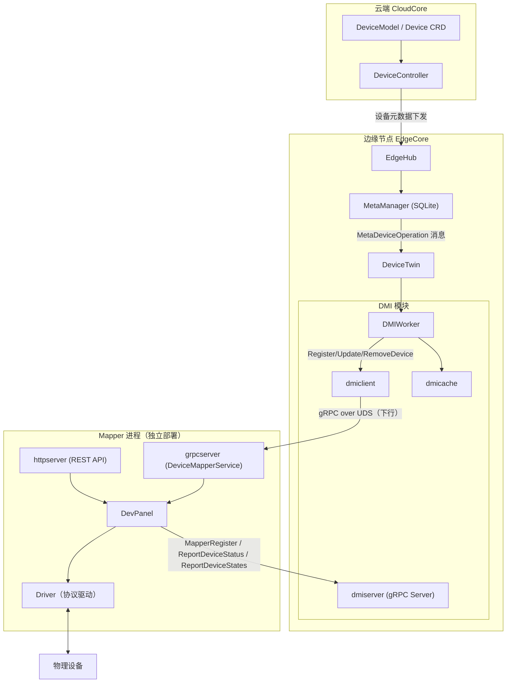
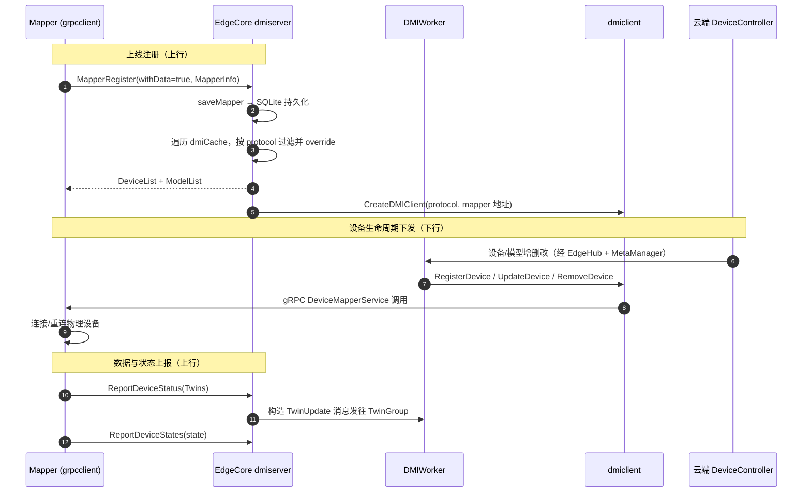
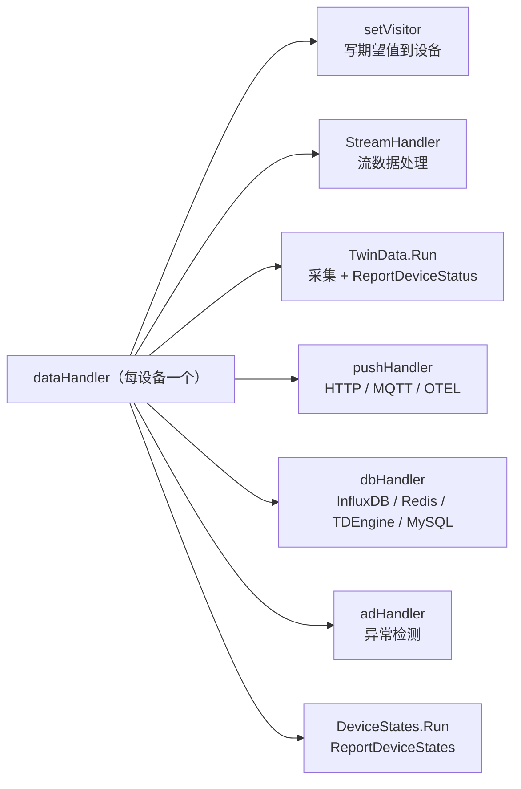
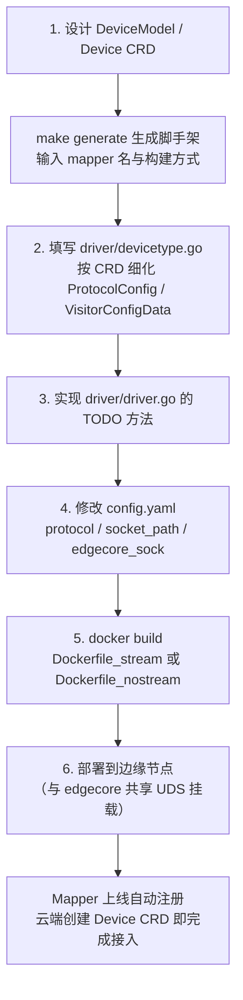

本页面向高级开发者，系统解析 KubeEdge 设备接入体系中的两大核心：**Mapper Framework**（设备映射器脚手架与运行时框架）与 **DMI**（Device Management Interface，设备管理接口协议）。内容覆盖 DMI 协议设计、EdgeCore 侧 Device Manager 的实现、mapper-framework 的运行时分层，以及从零开发一个自定义 Mapper 的完整路径。阅读本文前，建议先了解 [DeviceController：设备元数据的云边同步](10-devicecontroller-she-bei-yuan-shu-ju-de-yun-bian-tong-bu) 与 [DeviceTwin：设备数字孪生与状态管理](20-devicetwin-she-bei-shu-zi-luan-sheng-yu-zhuang-tai-guan-li) 中的基础概念。

## 设计定位与演进动机

Mapper 是 KubeEdge 与物理设备之间的桥梁组件：它负责按协议连接真实设备、采集属性数据、下发写操作，并向 EdgeCore 汇报设备孪生（Twin）与设备状态。一个 Mapper 通常对应一类设备协议（如 Modbus、OPC-UA、蓝牙），可同时管理多个同协议设备实例。早期的官方 Mapper 实现集中托管于独立仓库 mappers-go，主仓库中仅保留迁移说明。Sources: [mappers/README.md](mappers/README.md#L1-L4)，[mapper-design-v2.md](docs/proposals/sig-device-iot/mapper-design-v2.md#L1-L24)

设备接入方式在 KubeEdge 中经历了两代演进。**第一代（v1）** 中，Mapper 在启动时解析由云端生成的 ConfigMap，并通过 MQTT 主题（如 `$hw/events/device/+/twin/update/delta`）与 DeviceTwin 交互——配置变更需要 Mapper 订阅大量主题并回读 ConfigMap，流程复杂且耦合严重。**第二代（v2，即 DMI 方案）** 转为以 gRPC over Unix Domain Socket 为承载的同步接口：Mapper 主动注册到 EdgeCore，EdgeCore 将设备/设备模型的增删改查直接下发到 Mapper 进程，消除了对 ConfigMap 轮询与 MQTT 主题语义的依赖。设计提案中明确给出了这一动机：简化结构、抽取 SDK、以"重启容器"这一 K8S 风格手段处理配置变更。Sources: [mapper-design-v2.md](docs/proposals/sig-device-iot/mapper-design-v2.md#L36-L59)，[mapper-design-v2.md](docs/proposals/sig-device-iot/mapper-design-v2.md#L60-L89)

架构上最关键的一点是：**DMI 定义了一对方向相反的 gRPC 服务**。`DeviceManagerService` 由 EdgeCore 的 Device Manager 充当 Server、Mapper 充当 Client（承载"Mapper 注册 + 状态上报"的上行通道）；`DeviceMapperService` 由 Mapper 充当 Server、EdgeCore 充当 Client（承载"设备/模型生命周期管理"的下行通道）。两条通道均运行在本地 Unix Domain Socket 上，不占用网络端口。协议源文件为 `api.proto`，可通过 `hack/generate-dmi-proto.sh` 重新生成 Go 桩代码。Sources: [api.proto](staging/src/github.com/kubeedge/api/apis/dmi/v1beta1/api.proto#L28-L52)，[generate-dmi-proto.sh](hack/generate-dmi-proto.sh#L18-L84)

## DMI 协议详解：双向 gRPC 服务

### 下行方向：DeviceMapperService（Mapper 实现 Server）

`DeviceMapperService` 定义了 Device Manager 管理 Mapper 内设备生命周期的全部接口，注释中明确指出"server 端由 device mapper 实现、client 端由 edgecore 中的 device manager 模块实现"。共包含 7 个 RPC：设备实例的注册、注销、更新与查询，以及设备模型的创建、删除与更新。Mapper 收到 `RegisterDevice` 时应将设备加入设备列表并通过特定协议连接真实物理设备；收到 `RemoveDevice` 时则断开连接并移除设备。Sources: [api.proto](staging/src/github.com/kubeedge/api/apis/dmi/v1beta1/api.proto#L44-L79)

| RPC 方法 | 方向 | 职责 |
|---|---|---|
| `MapperRegister` | Mapper → EdgeCore | Mapper 上线时注册自身信息，EdgeCore 返回其应管理的设备与模型列表 |
| `ReportDeviceStatus` | Mapper → EdgeCore | 上报设备属性 Twin（observedDesired/reported 值对） |
| `ReportDeviceStates` | Mapper → EdgeCore | 上报设备连接/健康状态（ok、offline、unhealthy 等） |
| `RegisterDevice` / `RemoveDevice` / `UpdateDevice` | EdgeCore → Mapper | 设备实例生命周期管理，触发 Mapper 连接/断开/重连物理设备 |
| `CreateDeviceModel` / `RemoveDeviceModel` / `UpdateDeviceModel` | EdgeCore → Mapper | 设备模型生命周期管理 |
| `GetDevice` | EdgeCore → Mapper | 查询 Mapper 侧缓存的设备信息 |

### 上行方向：DeviceManagerService（EdgeCore 实现 Server）

`DeviceManagerService` 侧的 `MapperRegister` 语义值得特别注意：请求中的 `withData` 标志决定 EdgeCore 是否在响应中回传设备列表——`true` 时返回该 Mapper 应管理的全部 `DeviceModel` 与 `Device`，这是 Mapper 冷启动获取工作负载的核心途径。`MapperInfo` 消息携带 Mapper 的名称、版本、API 版本、**协议名（protocol）** 与 **UDS 地址**，其中协议名是 EdgeCore 将设备路由到正确 Mapper 的路由键，地址则是后续下行通道的连接目标。Sources: [api.proto](staging/src/github.com/kubeedge/api/apis/dmi/v1beta1/api.proto#L81-L91)，[api.proto](staging/src/github.com/kubeedge/api/apis/dmi/v1beta1/api.proto#L357-L374)

消息体中最核心的数据结构是 **Twin** 与 **DeviceProperty**。每个 Twin 由 `propertyName`、`observedDesired`（Mapper 观测到的期望值）与 `reported`（真实设备上报值）组成；`DeviceProperty` 则定义了期望值（desired）、访客配置（visitors，即如何访问该属性的协议细节）、采集周期 `collectCycle`、上报周期 `reportCycle`、是否上报云端 `reportToCloud`，以及数据外发方式 `pushMethod`。`ProtocolConfig` 与 `VisitorConfig` 均通过 `CustomizedValue`（`map<string, google.protobuf.Any>`）承载自定义协议数据，这是协议无关设计的基石——任何私有协议都能在不修改 DMI 协议本身的前提下嵌入自己的配置。Sources: [api.proto](staging/src/github.com/kubeedge/api/apis/dmi/v1beta1/api.proto#L200-L232)，[api.proto](staging/src/github.com/kubeedge/api/apis/dmi/v1beta1/api.proto#L392-L411)

## 设备 CRD 到 DMI 消息的映射

DMI 传输的是云端 `DeviceModel`/`Device` CRD（devices/v1beta1 API）的投影。`DeviceSpec` 包含指向模型的 `deviceModelRef`、调度目标节点 `nodeName`、属性列表、**协议配置 `ProtocolConfig`**（协议名 + 自定义 ConfigData）、方法列表与状态上报配置。模型侧的 `DeviceModelSpec` 定义属性模板（类型枚举为 INT/FLOAT/DOUBLE/STRING/BOOLEAN/BYTES/STREAM，访问模式为 ReadOnly/ReadWrite）、协议名与可被实例覆盖的 `protocolConfigData` 默认值。Sources: [device_instance_types.go](staging/src/github.com/kubeedge/api/apis/devices/v1beta1/device_instance_types.go#L26-L52)，[device_model_types.go](staging/src/github.com/kubeedge/api/apis/devices/v1beta1/device_model_types.go#L26-L66)

EdgeCore 在向 Mapper 下发设备前会执行一次**"模型默认值覆盖"（override）**：`dmicache.GetOverriddenDevice` 深拷贝设备实例，将模型中定义的协议默认配置与属性访客默认值合并进实例，再交由 `dtcommon.ConvertDevice` 转换为 DMI 消息。这意味着开发者可以在模型层声明协议共性，在实例层仅声明差异项，显著减少 CRD 冗余。Mapper 侧则通过反向转换函数 `parse.GetDeviceFromGrpc`/`GetDeviceModelFromGrpc` 将 gRPC 消息还原为框架内部数据结构。Sources: [dmicache.go](edge/pkg/devicetwin/dmicache/dmicache.go#L100-L131)，[device.go](staging/src/github.com/kubeedge/mapper-framework/pkg/grpcserver/device.go#L18-L64)

## EdgeCore 侧的 Device Manager：DeviceTwin 中的 DMI 模块

EdgeCore 并没有独立的 Device Manager 进程——DMI 服务端作为 **DeviceTwin 模块化架构中的一个子模块（DMIModule）** 存在。`DeviceTwin.Start()` 初始化上下文后进入 `runDeviceTwin()`，按模块名实例化各 Worker；`InitWorker` 的 switch 分支为 DMIModule 注入 `DMIWorker`，并挂接 SQLite 访问服务（`DeviceService` 与 `MetaService`）。Sources: [devicetwin.go](edge/pkg/devicetwin/devicetwin.go#L37-L76)，[dtmodule.go](edge/pkg/devicetwin/dtmodule/dtmodule.go#L26-L64)

`DMIWorker.Start()` 的启动序列体现了**边缘自治**设计：首先从 SQLite 元数据中恢复设备模型、设备实例与 Mapper 注册信息（`initDeviceModelInfoFromDB` 等三个 init 函数），随后启动 DMI gRPC Server 并进入消息循环。这意味着即使 Mapper 重启或 EdgeCore 重启，双方都能基于持久化状态重建连接，而无需依赖云端重新下发。Mapper 注册信息持久化由 `saveMapper` 完成，以 `ResourceTypeDeviceMapper` 类型写入 Meta 表。Sources: [dmiworker.go](edge/pkg/devicetwin/dtmanager/dmiworker.go#L59-L100)，[dmiworker.go](edge/pkg/devicetwin/dtmanager/dmiworker.go#L200-L261)，[server.go](edge/pkg/devicetwin/dmiserver/server.go#L265-L280)

**下行链路**中，云端设备变更经 [EdgeHub](17-edgehub-yun-bian-xiao-xi-shou-fa-shu-niu-yu-zheng-shu-ren-zheng) 与 MetaManager 落库后，以 `MetaDeviceOperation` 动作路由到 DMI 模块（`ActionModuleMap[dtcommon.MetaDeviceOperation] = dtcommon.DMIModule`）。`dealMetaDeviceOperation` 按 `ResourceTypeDevice`/`ResourceTypeDeviceModel` 分派 Insert/Delete/Update 操作：插入设备前先写入缓存并获取 override 后的设备；更新设备前通过 `CompareDeviceSpecHasChanged` 做深比较，仅当 Spec 真正变化时才触发对 Mapper 的 `UpdateDevice` 调用，避免无效重连。Sources: [process.go](edge/pkg/devicetwin/process.go#L120-L127)，[dmiworker.go](edge/pkg/devicetwin/dtmanager/dmiworker.go#L94-L197)，[dmicache.go](edge/pkg/devicetwin/dmicache/dmicache.go#L148-L177)

**上行链路**中，EdgeCore 侧的 `dmiserver` 监听在本地 UDS（默认路径经 `LocalEndpoint(KubeEdgePath, "dmi")` 计算，客户端配置为 `/etc/kubeedge/dmi.sock`）。出于自我保护，Server 为每个 RPC 施加了令牌桶限流（`rate.NewLimiter`，每 1000ms 一个令牌、突发 100），防止高频上报压垮 DeviceTwin。`ReportDeviceStatus` 收到 Twin 后并不直接写库，而是构造 `TwinUpdate` 消息发送到 Beehive 的 TwinGroup——复用了 [DeviceTwin](20-devicetwin-she-bei-shu-zi-luan-sheng-yu-zhuang-tai-guan-li) 既有的孪生处理管线。Sources: [server.go](edge/pkg/devicetwin/dmiserver/server.go#L41-L49)，[server.go](edge/pkg/devicetwin/dmiserver/server.go#L121-L172)，[server.go](edge/pkg/devicetwin/dmiserver/server.go#L228-L263)

Mapper 侧的连接管理同样有细节值得注意：`DMIClients` 按协议名维护连接池，`CreateDMIClient` 的 `tryConnect` 参数语义是——若无法连通某个 socket（例如 Mapper 未运行），说明该 Mapper 无需重新注册，EdgeCore 会容忍此失败而不阻塞启动。Mapper 侧调用 EdgeCore 时则每次新建 UDS 连接、设置 1 秒超时后即关闭（见 `ReportDeviceStatus` 的实现），属于典型的短连接低频 RPC 模式。Sources: [client.go](edge/pkg/devicetwin/dmiclient/client.go#L137-L196)，[report.go](staging/src/github.com/kubeedge/mapper-framework/pkg/grpcclient/report.go#L17-L43)

## Mapper Framework：脚手架与运行时分层

mapper-framework 是一个独立 staging 子项目，定位是"通过运行时库、脚手架与代码生成工具降低编写 Mapper 的成本"。主仓库 `mappers/` 目录已迁移至 mappers-go，新 Mapper 的推荐路径是基于 mapper-framework 生成工程。脚手架由 `make generate` 触发：`hack/make-rules/generate.sh` 拷贝 `_template/mapper` 模板，根据传入的 Mapper 名（如 `foo`）与构建方式（`stream`/`nostream`，决定流式数据处理代码的去留）执行占位符替换与 `go mod tidy`。Sources: [mapper-framework/README.md](staging/src/github.com/kubeedge/mapper-framework/README.md#L1-L37)，[Makefile](staging/src/github.com/kubeedge/mapper-framework/Makefile#L7-L17)，[generate.sh](staging/src/github.com/kubeedge/mapper-framework/hack/make-rules/generate.sh#L18-L67)

| 目录/文件 | 层次 | 开发者是否需要修改 |
|---|---|---|
| `cmd/main.go` | 主流程 | 几乎不需要 |
| `config.yaml` | DMI gRPC 配置 | 需填写 `protocol` 与 socket 路径 |
| `device/` | 设备控制层（DevPanel、数据面） | 几乎不需要 |
| `data/publish`、`data/dbmethod`、`data/stream` | 数据外发层（HTTP/MQTT/OTEL、InfluxDB/Redis/TDEngine/MySQL、流处理） | 按需扩展 |
| `driver/devicetype.go` | 驱动类型定义 | **需按 CRD 细化结构体** |
| `driver/driver.go` | 协议驱动实现 | **需填写全部 TODO** |

生成工程的 `main.go` 仅 60 余行，却完整勾勒了 Mapper 的运行时骨架：解析配置 → `grpcclient.RegisterMapper(true)` 向 EdgeCore 注册并取回设备/模型列表 → `DevPanel.DevInit/DevStart` 拉起设备协程 → 启动 REST HTTP Server → 启动 DMI gRPC Server（`DeviceMapperService`）阻塞主协程。Sources: [_template/mapper/cmd/main.go](staging/src/github.com/kubeedge/mapper-framework/_template/mapper/cmd/main.go#L24-L66)，[config.yaml](staging/src/github.com/kubeedge/mapper-framework/_template/mapper/config.yaml#L1-L10)

### DevPanel：设备生命周期中枢

`DevPanel` 以单例模式维护 `devices`（设备 ID 到驱动实例的映射）、`models`、`deviceMuxs`（每设备的 context 取消函数）三张表。`DevInit` 将 gRPC 返回的设备/模型经 `parse` 包转换为框架内部结构；`DevStart` 为每个设备启动独立协程，在协程内反序列化协议配置、调用驱动 `NewClient` + `InitDevice` 建立物理连接，随后进入 `dataHandler` 数据面循环；信号量监听保证进程退出时逐一调用 `StopDevice` 优雅断连。当 EdgeCore 下发 `RegisterDevice`/`UpdateDevice` 时，`UpdateDev` 会先停止旧设备协程再以新配置重启，实现热更新。Sources: [device.go](staging/src/github.com/kubeedge/mapper-framework/_template/mapper/device/device.go#L30-L91)，[device.go](staging/src/github.com/kubeedge/mapper-framework/_template/mapper/device/device.go#L358-L378)

`dataHandler` 是数据面的扇出中枢，为每个设备协程派生四类并行任务：

各任务的触发逻辑均由 CRD 字段驱动：`setVisitor` 仅当属性 `AccessMode` 为 ReadWrite 且 `observedDesired` 非空时调用驱动的 `SetDeviceData` 下写；`TwinData.Run` 与 `DeviceStates.Run` 均以 `reportToCloud` 为开关、以 `collectCycle`/`reportCycle` 为周期（缺省 1 秒）；`pushHandler` 按 `PushMethod.MethodName` 选择外发面板；`dbHandler` 按数据库名分派。流数据（如摄像头画面）直接进入 `stream.StreamHandler` 存帧/存视频，不再走通用推送路径。Sources: [device.go](staging/src/github.com/kubeedge/mapper-framework/_template/mapper/device/device.go#L93-L200)，[device.go](staging/src/github.com/kubeedge/mapper-framework/_template/mapper/device/device.go#L248-L320)，[devicetwin.go](staging/src/github.com/kubeedge/mapper-framework/_template/mapper/device/devicetwin.go#L86-L109)，[devicestatus.go](staging/src/github.com/kubeedge/mapper-framework/_template/mapper/device/devicestatus.go#L55-L79)

`TwinData.PushToEdgeCore` 展示了采集数据回流的完整路径：驱动 `GetDeviceData` 取值 → `common.CreateMessageTwinUpdate` 构造孪生更新载荷 → 反序列化后经 `parse.ConvMsgTwinToGrpc` 转为 DMI Twin 列表 → `grpcclient.ReportDeviceStatus` 发往 EdgeCore。整个链路对驱动开发者透明——开发者只需实现 `GetDeviceData`，上报逻辑完全复用。Sources: [devicetwin.go](staging/src/github.com/kubeedge/mapper-framework/_template/mapper/device/devicetwin.go#L34-L84)

### 本地 REST API：设备读写的旁路通道

除 DMI 通道外，Mapper 还内置一个 HTTP Server（默认挂载在 `DevPanel` 上），提供五组 REST 接口，供本地应用直接读写设备而不经过云端：

| API 路径 | 方法 | 功能 |
|---|---|---|
| `/api/v1/ping` | GET | 健康检查 |
| `/api/v1/device/{namespace}/{name}/{property}` | GET | 读取指定属性当前值 |
| `/api/v1/devicemethod/{namespace}/{name}` | GET | 查询设备全部方法及参数类型 |
| `/api/v1/devicemethod/{namespace}/{name}/{methodname}/{property}/{data}` | GET | 调用方法写入数据（`DeviceDataWrite`） |
| `/api/v1/meta/model/{namespace}/{name}` | GET | 按设备查询其设备模型 |
| `/api/v1/database/{namespace}/{name}` | GET | 查询数据库（WIP） |

`DeviceWrite` 是"方法（Methods）"控制面的入口：`DevPanel.WriteDevice` 将请求转交驱动的 `DeviceDataWrite(visitor, methodName, propertyName, data)`。REST 路由与响应格式均由框架固定，开发者无需改动。Sources: [restapi.go](staging/src/github.com/kubeedge/mapper-framework/pkg/httpserver/restapi.go#L9-L42)，[callback.go](staging/src/github.com/kubeedge/mapper-framework/pkg/httpserver/callback.go#L112-L135)，[router.go](staging/src/github.com/kubeedge/mapper-framework/pkg/httpserver/router.go#L5-L24)

## 开发自定义 Mapper 实战

**第一步：填充驱动类型。** `_template/mapper/driver/devicetype.go` 留有三个核心空结构体：`ConfigData`（协议级配置，如串口号、寄存器基地址）、`VisitorConfigData`（属性访客配置，如寄存器偏移量、数据类型）。框架已预置 `DataType` 字段（用于类型转换），开发者需按自己的协议补齐字段。`AnomalyDetectionRequest` 则是异常检测扩展的入参载体。Sources: [devicetype.go](staging/src/github.com/kubeedge/mapper-framework/_template/mapper/driver/devicetype.go#L17-L46)

**第二步：实现驱动接口。** `driver.go` 的 TODO 方法与框架调用点的对应关系如下表，这是整个开发过程中**唯一必须编写的业务代码**：

| 驱动方法 | 调用时机 | 框架调用方 |
|---|---|---|
| `NewClient(protocol)` | 每设备协程启动时 | `DevPanel.start` |
| `InitDevice()` | 建立与物理设备的连接 | `DevPanel.start` |
| `GetDeviceData(visitor)` | 按采集周期循环采集 | `TwinData` / `pushHandler` / `dbHandler` / `adHandler` |
| `SetDeviceData(data, visitor)` | 期望值下发（ReadWrite 属性） | `setVisitor` |
| `DeviceDataWrite(visitor, method, property, data)` | REST 方法调用写入 | `DeviceWrite` → `WriteDevice` |
| `GetDeviceStates()` | 按状态上报周期采集 | `DeviceStates.PushStatesToEdgeCore` |
| `StopDevice()` | 设备更新或进程退出 | `DevPanel.DevStart` / `UpdateDev` |
| `AnomalyDetectionProcess(req)` | 异常检测开启时按周期调用 | `adHandler` |

Sources: [driver.go](staging/src/github.com/kubeedge/mapper-framework/_template/mapper/driver/driver.go#L9-L56)，[devicestatus.go](staging/src/github.com/kubeedge/mapper-framework/_template/mapper/device/devicestatus.go#L26-L53)

**第三步：配置与构建。** `config.yaml` 中 `grpc_server.socket_path` 是 Mapper 自身对外提供 `DeviceMapperService` 的 UDS 路径，`common.edgecore_sock`（默认 `/etc/kubeedge/dmi.sock`）是注册与上报的目标，`common.protocol` 必须与 Device CRD 中 `spec.protocol.protocolName` 一致——它是 EdgeCore 路由下行请求的匹配键。构建时按是否处理流数据选择 `Dockerfile_stream` 或 `Dockerfile_nostream`。由于两条通道均基于 Unix Domain Socket，部署 Mapper 容器时需将宿主机的 socket 目录（如 `/etc/kubeedge/`）以卷形式挂载进容器。Sources: [config.yaml](staging/src/github.com/kubeedge/mapper-framework/_template/mapper/config.yaml#L1-L10)，[mapper-framework/README.md](staging/src/github.com/kubeedge/mapper-framework/README.md#L39-L60)

**第四步：接入验证。** Mapper 启动后自动完成 `MapperRegister` 并拉取该协议下的全部设备；此后在云端 `kubectl apply` 新的 Device CRD（`nodeName` 指向本节点、协议名匹配），变更经 DeviceController → EdgeHub → MetaManager 链路到达 DMI 模块，即可看到 Mapper 日志中的 `RegisterDevice` 与设备连接动作。设备属性值按 CRD 中定义的周期回流云端，可经由 [EventBus：MQTT 消息总线与设备接入](19-eventbus-mqtt-xiao-xi-zong-xian-yu-she-bei-jie-ru) 订阅或直接写入外部数据库。

## 接入模式对比：MQTT 主题 vs DMI

| 维度 | v1（ConfigMap + MQTT） | v2（DMI gRPC over UDS） |
|---|---|---|
| 配置获取 | Mapper 启动时解析 ConfigMap | `MapperRegister` 响应直接返回设备/模型列表 |
| 设备生命周期 | MQTT membership/twin 主题通知 | 同步 RPC：Register/Update/RemoveDevice |
| 配置变更 | 需订阅 delta 主题并回读 ConfigMap | UpdateDevice 增量下发；Spec 未变化时被深比较拦截 |
| 状态上报 | MQTT `$hw/events/device/+/twin/update` | `ReportDeviceStatus` / `ReportDeviceStates` RPC |
| 传输承载 | MQTT Broker（需额外部署与认证） | Unix Domain Socket（本地零配置、无网络暴露面） |
| 语义类型 | 主题 + JSON 约定（弱契约） | proto3 强类型接口 + 代码生成 |

需要说明的是，MQTT 主题体系在 DeviceTwin 内部仍在使用——`dmiserver` 收到上报后构造的 `TwinUpdate` 消息依然以 `$hw/events/device/{id}/twin/update` 形式的主题字符串作为路由资源发往 TwinGroup，只是 Mapper 与 EdgeCore 之间的边界已完全切换为 DMI。Sources: [server.go](edge/pkg/devicetwin/dmiserver/server.go#L162-L199)，[common.go](edge/pkg/devicetwin/dtcommon/common.go#L31-L59)

## 关键设计要点回顾

第一，**协议无关性**完全依赖 `CustomizedValue`（`map<string, google.protobuf.Any>`）与字符串化的 `protocolName`，DMI 本身不为任何具体协议定义字段，这使得 Mapper 生态可以独立于 KubeEdge 主版本演进。Sources: [api.proto](staging/src/github.com/kubeedge/api/apis/dmi/v1beta1/api.proto#L228-L240)

第二，**状态持久化与自治**：Mapper 注册信息、设备与模型均落 SQLite，DMI 模块启动时先行恢复，配合 `CreateDMIClient(tryConnect=false)` 的容错语义，保证边缘断云期间设备管理不中断——这与 [可靠消息传递与边缘自治机制](27-ke-kao-xiao-xi-chuan-di-yu-bian-yuan-zi-zhi-ji-zhi) 中的整体自治策略一脉相承。Sources: [dmiworker.go](edge/pkg/devicetwin/dtmanager/dmiworker.go#L200-L261)

第三，**职责边界清晰**：Mapper 侧 `grpcserver` 只做协议转换与 DevPanel 委托（`grpcserver/device.go` 中每个 RPC 最终都收敛到 `devPanel.UpdateDev/UpdateModel/RemoveDevice` 四五个调用），EdgeCore 侧 `dmiserver` 只做限流、持久化与消息转发，真正的业务逻辑都在 DevPanel 数据面与 DMIWorker 事件面中。Sources: [device.go](staging/src/github.com/kubeedge/mapper-framework/pkg/grpcserver/device.go#L18-L165)

## 延伸阅读

- 设备元数据如何从云端 CRD 传递到边缘 MetaManager，见 [DeviceController：设备元数据的云边同步](10-devicecontroller-she-bei-yuan-shu-ju-de-yun-bian-tong-bu)
- TwinUpdate 消息到达 TwinGroup 后的处理管线，见 [DeviceTwin：设备数字孪生与状态管理](20-devicetwin-she-bei-shu-zi-luan-sheng-yu-zhuang-tai-guan-li)
- DMI API 属于 staging API 子项目的一部分，代码生成体系见 [API 定义、CRD 规范与代码生成体系](24-api-ding-yi-crd-gui-fan-yu-dai-ma-sheng-cheng-ti-xi)
- Mapper 设计决策的完整背景，见 [设计提案导读：理解架构演进决策](30-she-ji-ti-an-dao-du-li-jie-jia-gou-yan-jin-jue-ce)，原始提案位于 `docs/proposals/sig-device-iot/mapper-design-v2.md`