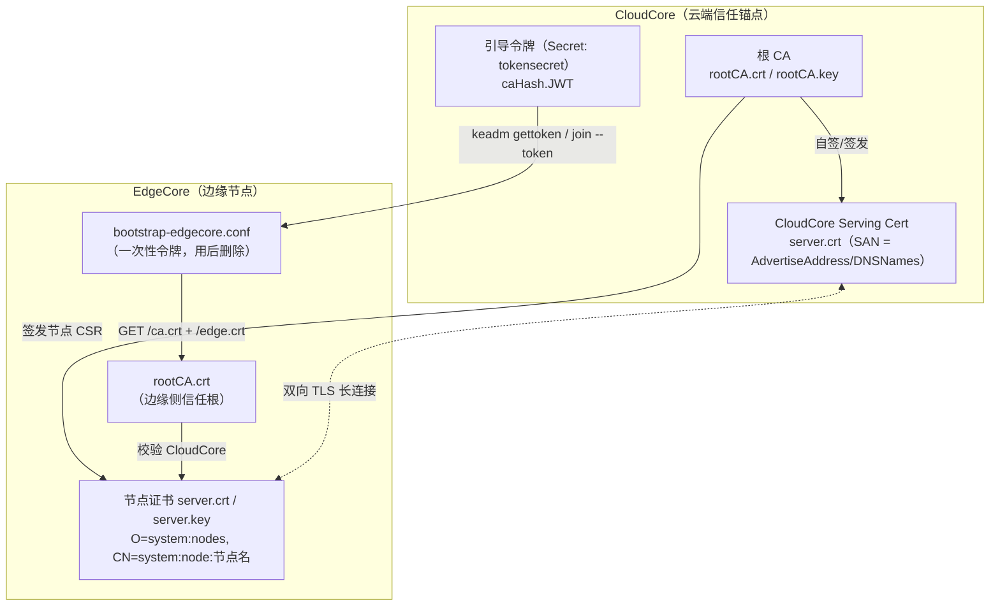
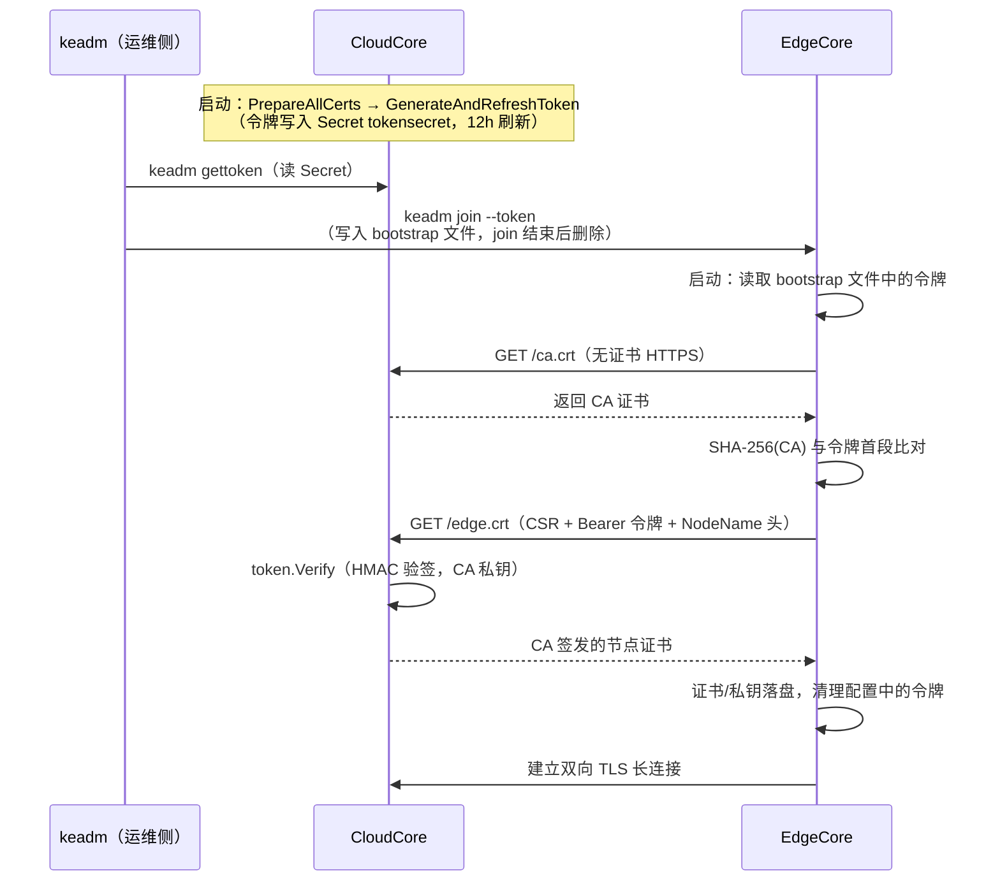
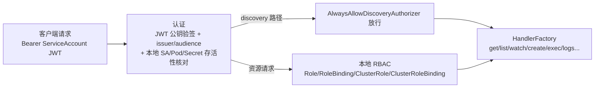

KubeEdge 的安全问题本质上是"如何在弱网、离线、大规模节点条件下建立云端与边缘的双向信任"。本页从代码层面拆解这套体系的三根支柱：**以 CloudCore 自签 CA 为核心的证书信任链**、**用于首次证书申请的引导令牌**、以及**云边连接与边缘本地 API 的鉴权机制**。文中所有结论均直接对应仓库中的实现代码，帮助你建立"设计意图 → 代码落点"的精确映射。

## 安全模型总览：一个信任根，两条信任链

理解 KubeEdge 安全体系的第一性原理是：**Token 只负责"第一次"**。它的唯一使命是在边缘节点尚无任何证书时，安全地引导其获得云端 CA 签发的节点证书；此后所有的云边通信（WebSocket/QUIC 长连接、HTTP 签发服务、证书轮换）全部回归标准的双向 X.509 TLS，令牌本身即被销毁。这一设计解决了提案文档中指出的早期痛点——"边缘节点接入云端需要人工复制证书，扩展性和灵活性差"——其目标是实现节点入群时自动申请证书、CloudCore 自动批准签发。这可以从设计提案中追溯决策背景。

整个体系的信任结构可以概括为下图：CloudCore 持有根 CA（`rootCA.crt/rootCA.key`），用它签发 CloudCore 自身的 serving 证书和每个边缘节点的客户端证书；引导令牌则是 CA 私钥签名的 JWT 与 CA 哈希的拼接体，作为"带外传递的临时信任凭证"。

Sources: [edge-authentication.md](docs/proposals/sig-security/edge-authentication.md#L18-L33), [edge-authentication.md](docs/proposals/sig-security/edge-authentication.md#L59-L81)

## 证书资产全景

在深入机制之前，先建立证书资产的完整清单。KubeEdge 实际上维护着**两个独立的证书域**：云边消息通道（CloudHub/EdgeHub）与云边运维隧道（CloudStream/EdgeStream，服务 kubectl exec/logs/metrics），后者拥有独立的 CA 与证书，互不共享信任根。此外，启用边缘鉴权特性后，MetaServer 还会持有由 Kubernetes `kubelet-serving` signer 签发的第三类证书。

| 证书/密钥 | 归属侧 | 默认路径 | 签发者 | 用途 |
|---|---|---|---|---|
| `rootCA.crt` / `rootCA.key` | CloudCore | `/etc/kubeedge/ca/` | 自签或用户预置 | 云边消息通道信任根 |
| `server.crt` / `server.key`（CloudHub） | CloudCore | `/etc/kubeedge/certs/` | 根 CA（有效期 100 年） | 证书签发 HTTPS 服务与长连接 serving |
| 节点证书 `server.crt` / `server.key` | EdgeCore | `/etc/kubeedge/certs/` | 云端根 CA | 长连接客户端证书 + 轮换凭证 |
| `bootstrap-edgecore.conf` | EdgeCore（临时） | `/etc/kubeedge/` | — | 引导令牌，证书落盘后删除 |
| `streamCA.crt` / `stream.crt` / `stream.key` | CloudCore / EdgeCore | `/etc/kubeedge/ca|certs/` | 独立 stream CA | kubectl exec/logs/metrics 隧道 |
| MetaServer 证书 | EdgeCore | `/etc/kubeedge/pki/metaserver/` | K8s `kubelet-serving` signer | 边缘本地 HTTPS API |

Sources: [default_others.go](staging/src/github.com/kubeedge/api/apis/common/constants/default_others.go#L16-L33), [config.go](cloud/pkg/cloudstream/config/config.go#L39-L72), [manager.go](edge/pkg/metamanager/metaserver/certificate/manager.go#L43-L48)

## 云端信任锚点：CloudCore 的 CA 自举

CloudCore 每次启动时都会执行一套确定性的证书准备流程 `PrepareAllCerts`，其查找顺序体现了"用户预置优先、集群状态次之、自动生成为兜底"的三级策略。首先是 CA：若配置文件指定了 `tlsCAFile/tlsCAKeyFile` 则直接加载本地 PEM；本地缺失时尝试从 `kubeedge` 命名空间下的 Secret `casecret` 读取；两者皆无时，通过 `pkg/security/certs` 的 `CAHandler` 工厂（当前仅 x509 实现）自签一个根 CA。CloudCore 的 serving 证书遵循同样逻辑，签发时 SAN 包含 `AdvertiseAddress` 的全部 IP 与配置的 `DNSNames`，有效期固定为 100 年，因为 CloudCore 证书本身不做轮换——真正的轮换压力被设计转移到了边缘节点证书上。

所有生成的 CA、CloudCore 证书与密钥都会回写到 Kubernetes Secret（`casecret` 与 `cloudcoresecret`），这是 CloudCore 支持多实例部署的关键：任一实例启动时都能从集群中恢复同一信任根。边缘侧的 `Configure.InitConfigure` 与之对称——优先本地文件、失败则从 Secret 补齐，并通过 `UpdateCA/UpdateCerts` 原子更新运行时配置。底层的证书能力被抽象为 `CAHandler`（生成私钥、自签 CA）与 `Handler`（生成私钥、创建 CSR、签发证书）两个接口，云边两侧共用同一实现。

Sources: [pre_server.go](cloud/pkg/cloudhub/servers/httpserver/pre_server.go#L49-L101), [pre_server.go](cloud/pkg/cloudhub/servers/httpserver/pre_server.go#L103-L167), [config.go](cloud/pkg/cloudhub/config/config.go#L24-L99), [types.go](pkg/security/certs/types.go#L34-L52), [factory.go](pkg/security/certs/factory.go#L27-L42)

## 引导令牌：caHash.JWT 的结构与安全属性

引导令牌的格式是 `<caHash>.<jwt>` 两段拼接。`caHash` 是 CA 证书 DER 编码的 SHA-256 十六进制摘要；JWT 部分使用 **CA 私钥做 HS256 签名**，仅含 `ExpiresAt` 一个声明。这个结构同时解决了两个威胁模型：边缘节点用 `caHash` 校验"我拿到的 CA 是不是发 token 的人想让我信任的那个"（防 CA 替换/中间人），CloudCore 用 JWT 签名验证"申请证书的人是否持有合法 token"（防伪造申请）。由于 HMAC 密钥就是 CA 私钥，token 的安全边界与 CA 私钥完全重合——CA 私钥泄露即意味着信任体系整体沦陷。

`token.Verify` 在验证时显式拒绝非 HMAC 的签名方法，防止算法混淆攻击（alg none / RS-HMAC 混淆类攻击）；`VerifyCAAndGetRealToken` 则在边缘侧完成"CA 哈希比对 + 剥离前缀还原真实 JWT"两步。值得注意的是过期时间的实现：令牌有效期被设置为 `2 × TokenRefreshDuration`，配合 CloudCore 每隔 `TokenRefreshDuration`（默认 12 小时）刷新一次 Secret 中的令牌，保证**任意时刻从 Secret 取出的令牌剩余有效期恒大于等于一个刷新周期**，令牌由此实现"永不过期"的运维语义——管理员随时 `keadm gettoken` 都能拿到有效凭证。

Sources: [token.go](pkg/security/token/token.go#L29-L50), [token.go](pkg/security/token/token.go#L53-L65), [token.go](pkg/security/token/token.go#L69-L79), [pre_server.go](cloud/pkg/cloudhub/servers/httpserver/pre_server.go#L169-L204), [default.go](staging/src/github.com/kubeedge/api/apis/componentconfig/cloudcore/v1alpha1/default.go#L61-L62)

## 令牌生命周期：生成、分发与用后即焚

令牌的完整生命周期横跨云端、运维侧与边缘侧三个主体。CloudCore 启动时生成令牌并写入 Secret `tokensecret`，之后由后台定时器持续刷新；运维人员通过 `keadm gettoken`（本质是读取该 Secret）取得令牌，再通过 `keadm join --token` 传递给边缘节点。`keadm join` 会将令牌写入引导文件 `/etc/kubeedge/bootstrap-edgecore.conf`（权限 0640），并**刻意不将令牌持久化到 edgecore.yaml**；当证书三件套（CA、证书、私钥）全部落盘后，join 进程随即删除引导文件，使 TLS 引导凭证从磁盘上彻底移除。

EdgeCore 进程启动时的处理同样严谨：优先读取引导文件中的令牌覆盖配置值；若配置文件中存在令牌，则注册一个监听 `certificate.CleanupTokenChan` 的协程——一旦 CertManager 成功申请到证书，立即将 edgecore.yaml 中的 `token` 字段清空并写回磁盘。这一整套"用后即焚"机制确保了令牌只在"节点从零到有证书"的窗口期内存在，缩短了泄露暴露面。

Sources: [pre_server.go](cloud/pkg/cloudhub/servers/httpserver/pre_server.go#L169-L218), [gettoken.go](keadm/cmd/keadm/app/cmd/cloud/gettoken.go#L79-L89), [join.go](keadm/cmd/keadm/app/cmd/edge/join.go#L174-L184), [join_others.go](keadm/cmd/keadm/app/cmd/edge/join_others.go#L122-L128), [join_others.go](keadm/cmd/keadm/app/cmd/edge/join_others.go#L222-L256), [server.go](edge/cmd/edgecore/app/server.go#L74-L96), [server.go](edge/cmd/edgecore/app/server.go#L164-L173)

## EdgeCore 证书申请与自动轮换

边缘侧的证书管理器 `CertManager` 在 EdgeHub 模块启动的最前端运行。`Start` 的逻辑是：先尝试 `getCurrent` 加载本地证书并**严格校验 CN 必须等于 `system:node:<本节点名>`**——这防止了"复用其他节点证书"的配置错误；加载失败（首次入群或证书损坏）则走令牌申请流程 `applyCerts`。申请流程的 TLS 策略值得细读：第一步拉取 CA 使用的是无验证客户端（此时边缘没有任何信任根，属首跳匿名信任）；拿到 CA 后切换为以该 CA 为 RootCAs 的严格验证客户端，再提交 CSR——CSR 的 Subject 固定为 `O=system:nodes, CN=system:node:<节点名>`，请求头同时携带 `Authorization: Bearer <真实JWT>`、`NodeName` 与可选的 `ExtKeyUsages`。

云端签发端点 `EdgeCoreClientCert` 对两种身份来源做了统一处理：若 TLS 握手已带客户端证书（轮换场景），用 CA 验证证书链并校验 Subject 与请求的 NodeName 一致（同时兼容旧版 `O=KubeEdge, CN=kubeedge.io` 证书，代码注释标明该兼容分支将在 v1.18 移除）；若无证书（首次申请场景），则走 Bearer 令牌验签。两种路径殊途同归于 `signEdgeCert`——用 CA 签发 CSR，默认用途为 `ExtKeyUsageClientAuth`，有效期 `EdgeCertSigningDuration`（默认 365 天）。

证书轮换是自动化且带防抖设计的：默认开启（`rotateCertificates: true`），轮换时点取证书生命周期的 **70%–90% 区间加随机抖动**，避免同批创建的节点在同一时刻集体轮换造成 CloudCore 请求风暴；轮换失败采用 2 秒起步、因子 2 的指数退避，穷尽后转入无限轮询。关键细节是**轮换时使用现有客户端证书而非令牌做身份凭证**——这也是为什么令牌可以在首次申请后被彻底删除。

Sources: [certmanager.go](edge/pkg/edgehub/certificate/certmanager.go#L77-L141), [certmanager.go](edge/pkg/edgehub/certificate/certmanager.go#L143-L188), [certmanager.go](edge/pkg/edgehub/certificate/certmanager.go#L253-L295), [certs.go](cloud/pkg/cloudhub/servers/httpserver/certificate/certs.go#L47-L162), [http.go](edge/pkg/edgehub/certificate/http/http.go#L69-L83), [default.go](staging/src/github.com/kubeedge/api/apis/componentconfig/edgecore/v1alpha2/default.go#L95-L100)

## 云边长连接的认证与授权：连接级 + 消息级双重防线

证书拿到手之后，EdgeHub 的 WebSocket/QUIC 客户端用它建立完整的双向 TLS：加载 `server.crt/server.key` 作为客户端证书、`rootCA.crt` 作为服务器验证根（`InsecureSkipVerify: false`），并在握手头中携带 `node_id` 与 `project_id`。这正是 viaduct 传输层（详见 [Viaduct：云边消息传输通道](23-viaduct-yun-bian-xiao-xi-chuan-shu-tong-dao-websocket-quic)）所依赖的安全底座。

CloudHub 侧则在**两个粒度**上执行安全策略，缺一不可。**连接级认证**发生在 `HandleConnection`：从 TLS 连接状态提取对端证书，复用 Kubernetes apiserver 的 x509 认证器（`CommonNameUserConversion`，即把 CN 映射为 `system:node:<id>` 用户）完成证书链验证，随后强制比对"证书 CN 中的节点名"与"握手头 node_id"的一致性——这阻止了持有合法证书的节点冒充其他节点建立会话；同时只接受单张对端证书，拒绝中间证书链。**消息级授权**发生在每条上行消息上：`AdmitMessage` 将消息路由信息转换为 Kubernetes 授权属性，交由与 apiserver 同源的授权器链（Node、RBAC 等 mode，可组合配置）裁决，拒绝即丢弃消息。授权器支持 `enable`/`debug` 开关，debug 模式下违规仅记录日志不阻断，便于灰度上线。

| 防线 | 触发时机 | 验证依据 | 失败后果 |
|---|---|---|---|
| TLS 握手 | 连接建立 | 双向证书链（rootCA 为根） | 连接无法建立 |
| 连接级认证 | `HandleConnection` | 证书 CN 与 `node_id` 头匹配 | 拒绝会话注册 |
| 消息级授权 | 每条上行消息 | Node/RBAC 授权器链 | 丢弃该消息 |

Sources: [websocket.go](edge/pkg/edgehub/clients/wsclient/websocket.go#L50-L86), [authorizer.go](cloud/pkg/cloudhub/authorization/authorizer.go#L101-L136), [authorizer.go](cloud/pkg/cloudhub/authorization/authorizer.go#L44-L99), [message_handler.go](cloud/pkg/cloudhub/handler/message_handler.go#L96-L139), [cloudhub.go](cloud/pkg/cloudhub/cloudhub.go#L139-L150), [config.go](cloud/pkg/cloudhub/authorization/config.go#L38-L78)

## 边缘本地鉴权：MetaServer 的认证与 RBAC

云边通道之外，KubeEdge 在边缘节点本地还维护着一个"小型 apiserver"——MetaServer（详见 [MetaManager 与 MetaServer：离线元数据存储与本地 API Server](18-metamanager-yu-metaserver-chi-xian-yuan-shu-ju-cun-chu-yu-ben-di-api-server)）。当 `requireAuthorization` 特性门控开启时，MetaServer 从纯 HTTP 切换为 HTTPS，并启用完整的认证/授权处理链：认证器是 ServiceAccount JWT 验证器，加载配置的 `ServiceAccountKeyFiles` 公钥验签，校验 issuer 与 audience，并复用 Kubernetes 的 token validator 语义——**通过本地元数据库逐项核对 ServiceAccount、Pod、Secret 的存在性与 UID 匹配**，保证被删除的对象立即令其令牌失效；未携带令牌的请求由匿名认证器兜底放行 discovery 类非资源路径。

授权器同样是 apiserver 原生组件的边缘复用：本地 RBAC 授权器基于同步到边缘 SQLite 的 Role/RoleBinding/ClusterRole/ClusterRoleBinding 数据裁决，前面串接一个仅放行 discovery 路径的自定义授权器。这套机制的设计动机（见 sig-security 提案）是在**离线场景**下限制边缘应用通过原生 K8s API 的越权访问——云端授权在断网时不可达，因此鉴权决策必须完全本地化。这体现了 KubeEdge 安全设计的一个贯穿性原则：信任锚在云端，但决策点尽量下沉到边缘以保证自治可用性（关于自治语义可延伸阅读 [可靠消息传递与边缘自治机制](27-ke-kao-xiao-xi-chuan-di-yu-bian-yuan-zi-zhi-ji-zhi)）。

Sources: [server.go](edge/pkg/metamanager/metaserver/server.go#L86-L117), [server.go](edge/pkg/metamanager/metaserver/server.go#L184-L195), [server.go](edge/pkg/metamanager/metaserver/server.go#L260-L273), [auth.go](edge/pkg/metamanager/metaserver/auth/auth.go#L61-L125), [claims.go](edge/pkg/metamanager/metaserver/auth/claims.go#L48-L130), [authentication-and-authorization-on-the-edge-node.md](docs/proposals/sig-security/authentication-and-authorization-on-the-edge-node.md#L14-L31)

## MetaServer Serving 证书：K8s CSR 与自动批准

MetaServer 的 HTTPS serving 证书走的是一条与云边 CA 完全不同的路径——它直接借用 **Kubernetes 集群原生的证书签发体系**。`ServerCertificateManager`（基于 client-go 的 `certificate.Manager`）以 `kubernetes.io/kubelet-serving` 为 signerName 创建 CSR，Subject 为 `O=system:nodes, CN=system:node:<节点名>`，IP SAN 覆盖 MetaServer 与 DummyServer 的监听地址。CSR 的批准由 CloudCore 内置的 `CSRApprover` 控制器完成——其 recognizer 只识别一类请求：签名者为 `kubelet-serving` 且形态符合 kubelet serving CSR 的申请，命中即自动写入 Approved 条件，随后由 apiserver 内置 signer 完成实际签名。

这套流程还依赖两个跨模块协作：其一，MetaServer 需要拿到 **kube-apiserver 的 CA** 才能验证 TLS 客户端（`ClientAuth: VerifyClientCertIfGiven`），该 CA 通过 EdgeHub 的同步消息（`k8sca` 资源查询）从云端拉取并落盘到 `/etc/kubeedge/pki/metaserver/ca.crt`，且必须等待云边连接建立后才可继续；其二，证书就绪前 MetaServer 会阻塞启动最多 4 分钟（`WaitForCertReady`）。至此，安全体系的三个证书域——云边消息域、云边隧道域（详见 [CloudStream：kubectl exec/logs/metrics 云边隧道](13-cloudstream-kubectl-exec-logs-metrics-yun-bian-sui-dao)）、边缘本地 API 域——各自独立又相互衔接。

Sources: [manager.go](edge/pkg/metamanager/metaserver/certificate/manager.go#L54-L149), [server.go](edge/pkg/metamanager/metaserver/server.go#L275-L346), [csrapprover.go](cloud/pkg/csrapprovercontroller/csrapprover.go#L206-L228)

## 运维视角：关键配置与证书工具

将上述机制收敛为可操作的配置项与默认值，便于在生产中校准安全参数：

| 参数 | 配置位置 | 默认值 | 安全语义 |
|---|---|---|---|
| `cloudHub.tokenRefreshDuration` | cloudcore.yaml | 12 | 令牌刷新周期；实际有效期为 2×，取出的令牌恒有 ≥12h 余量 |
| `cloudHub.edgeCertSigningDuration` | cloudcore.yaml | 365（天） | 节点证书有效期，决定轮换频率 |
| `modules.edgeHub.rotateCertificates` | edgecore.yaml | true | 生命周期 70%–90% 抖动点自动轮换 |
| `modules.edgeHub.httpServer` | edgecore.yaml | `https://<ip>:10002` | 证书签发服务地址（keadm join 的 `--certPort` 可覆盖端口） |
| `cloudHub.authorization.enable/modes` | cloudcore.yaml | nil（关闭） | CloudHub 消息级授权开关与 mode 组合（Node/RBAC/AlwaysAllow/AlwaysDeny/Webhook） |
| `featureGates.requireAuthorization` | 两侧 | false（alpha） | 开启 MetaServer HTTPS + 认证/RBAC 链 |

对于不依赖自动生成的场景（例如企业已有 PKI），`build/tools/certgen.sh` 提供了基于 openssl 的手动签发能力：支持 EC（默认 `prime256v1`）与 RSA 4096 两种密钥类型、可选私钥口令加密，CA 有效期 10 年，Subject 默认为 `/C=CN/ST=Zhejiang/L=Hangzhou/O=KubeEdge/CN=kubeedge.io`。需要提醒的是，手动签发的证书若 Subject 不符合云端校验规则（`system:nodes`/`system:node:<节点名>`），将在轮换与连接认证环节被拒——旧版 `O=KubeEdge, CN=kubeedge.io` 格式仅有过渡期兼容。此外，签发服务对所有响应体施加 1 MiB 上限，令牌传输依赖 HTTPS 加密通道（设计文档明确指出令牌本身只保护请求合法性，不替代传输安全）。

Sources: [default.go](staging/src/github.com/kubeedge/api/apis/componentconfig/cloudcore/v1alpha1/default.go#L54-L62), [default.go](staging/src/github.com/kubeedge/api/apis/componentconfig/edgecore/v1alpha2/default.go#L72-L100), [default.go](common/constants/default.go#L26-L30), [default.go](common/constants/default.go#L74-L78), [certgen.sh](build/tools/certgen.sh#L5-L60), [certs.go](cloud/pkg/cloudhub/servers/httpserver/certificate/certs.go#L99-L111)

## 延伸阅读

安全体系与多个模块存在深度耦合，建议按以下路径继续深入：理解证书申请的调用方上下文请读 [EdgeHub：云边消息收发枢纽与证书认证](17-edgehub-yun-bian-xiao-xi-shou-fa-shu-niu-yu-zheng-shu-ren-zheng)；理解连接级/消息级防线的宿主模块请读 [CloudHub：云边长连接网关与消息分发](8-cloudhub-yun-bian-chang-lian-jie-wang-guan-yu-xiao-xi-fen-fa)；理解 TLS 承载层请读 [Viaduct：云边消息传输通道](23-viaduct-yun-bian-xiao-xi-chuan-shu-tong-dao-websocket-quic)；独立集群形态下的安全边界请读 [EdgeSite：轻量级边缘独立集群](28-edgesite-qing-liang-ji-bian-yuan-du-li-ji-qun)；若想从架构演进视角理解认证体系从"人工拷贝证书"到"令牌引导 + 边缘 RBAC"的决策脉络，请读 [设计提案导读：理解架构演进决策](30-she-ji-ti-an-dao-du-li-jie-gou-yan-jin-jue-ce)。