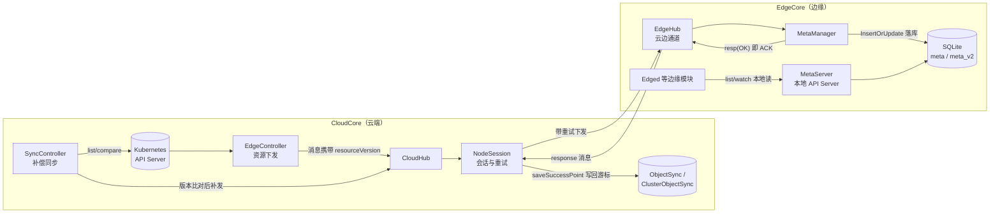
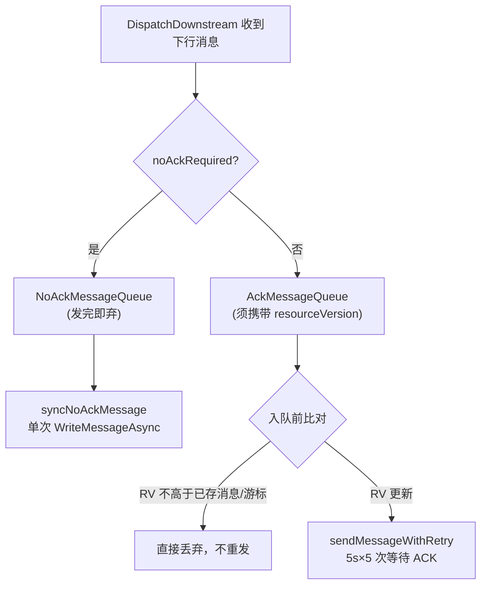
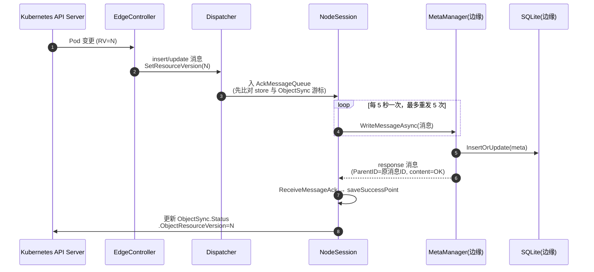
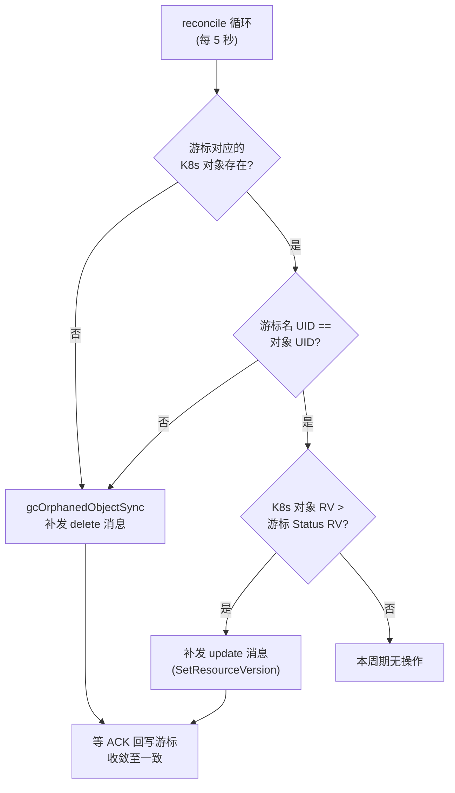
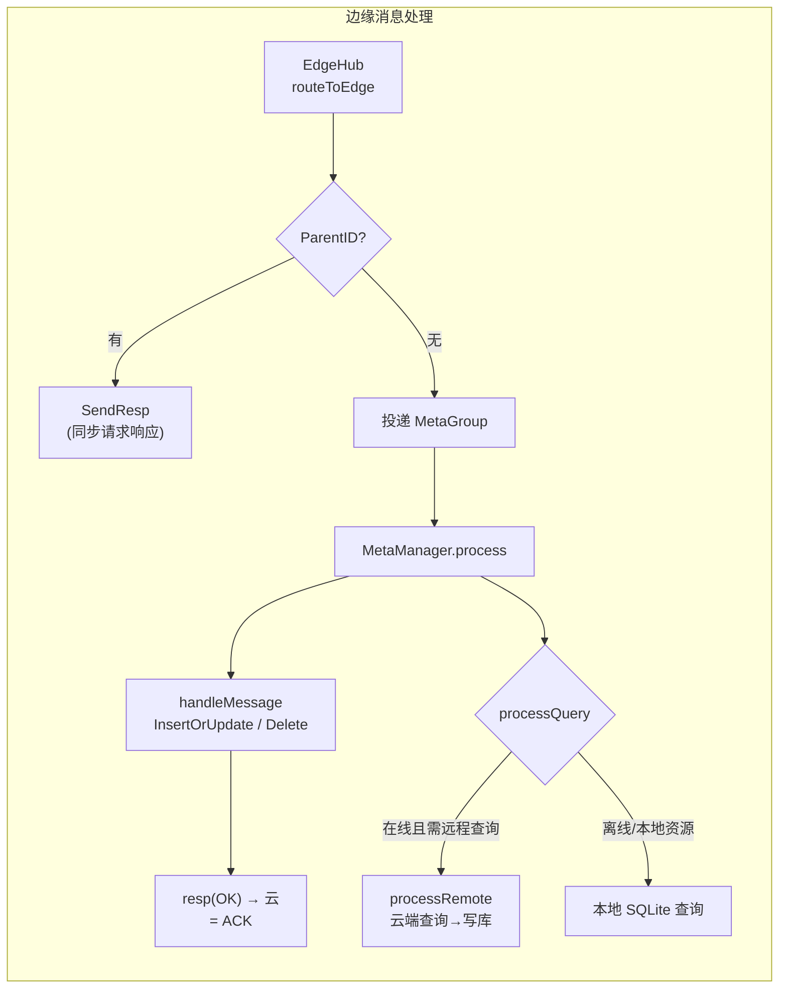
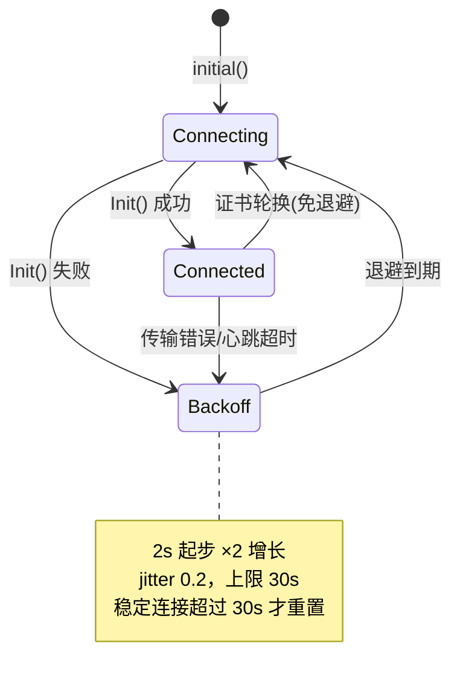

KubeEdge 的核心承诺是：**即使边缘节点长期与云端断连，边缘业务依然可控、可观测，且云端与边缘的元数据最终一致**。支撑这一承诺的是两套相互咬合的机制：一是下行方向的**可靠消息传递**——通过 ACK 确认、消息级 resourceVersion 比对、ObjectSync 持久化游标与 SyncController 周期补偿，保证云端资源变更最终抵达边缘；二是**边缘自治**——通过 MetaManager 本地元数据持久化、本地 etcd 模拟器、本地 API Server 与指数退避重连，保证断连期间边缘组件照常工作。本文以代码为线索，拆解这两套机制的完整实现。

## 全景架构：两条保障链路

理解本页内容需要先建立整体视图。云侧 `EdgeController` 负责资源下发、`SyncController` 负责补偿补发，二者都经由 `CloudHub` 的 `NodeSession` 发送消息；边侧 `EdgeHub` 是唯一云边通道，`MetaManager` 将收到的资源写进本地 SQLite 并回 ACK。ACK 抵达云侧后，`NodeSession` 把"已成功送达"的 resourceVersion 写回 `ObjectSync` CRD——这个 CRD 就是 SyncController 补偿判断的依据。而在边缘本地，`MetaServer` 直接面向本 SQLite 存储提供 Kube API Server 风格的 list/watch 服务，使 `Edged` 等组件在断连时仍能正常运作。

Sources: [message_dispatcher.go](cloud/pkg/cloudhub/dispatcher/message_dispatcher.go#L69-L92), [synccontroller.go](cloud/pkg/synccontroller/synccontroller.go#L131-L143), [metamanager.go](edge/pkg/metamanager/metamanager.go#L60-L67)

## 云边消息的两种确认模式：ACK 与 NO-ACK

`MessageDispatcher` 的接口注释明确定义了两种下行消息模式。**ACK 模式**要求边缘节点在成功处理消息后向 CloudHub 回送确认：MetaManager 成功将消息存储到边缘后，CloudHub 会收到 ACK；若连接在 ACK 回传前断开，服务端视为消息未处理成功，将持续重发直到收到确认为止。**NO-ACK 模式**则不要求确认——这类消息通常是边缘请求的响应（如 podlist 查询结果、ServiceAccountToken），若边缘没收到，边缘会重新发起请求，天然具备幂等性。

`noAckRequired` 的判定清单非常具体：podlist、membership、`twin/cloud_updated`、ServiceAccountToken、K8s CA 证书、CSI 卷操作、TaskManager/NodeUpgradeJob 的消息、用户组消息、以及"内容为 OK 的 response"等都无需 ACK；而 EdgeController 下发的 Node 更新、Lease、PodPatch、PodStatus、CSR 等资源类型也被排除在外（这些要么由边缘主动上报、要么允许丢失后重试）。需要 ACK 的消息还有一个硬性前提：**必须携带 resourceVersion**，否则入队时直接被丢弃——因为下游所有的可靠性判断都建立在版本可比对的基础上。

Sources: [message_dispatcher.go](cloud/pkg/cloudhub/dispatcher/message_dispatcher.go#L49-L67), [message_dispatcher.go](cloud/pkg/cloudhub/dispatcher/message_dispatcher.go#L448-L497), [message_dispatcher.go](cloud/pkg/cloudhub/dispatcher/message_dispatcher.go#L231-L236)

## 下行可靠投递链路：从资源变更到边缘落库

整条链路的起点在 `EdgeController` 的下行控制器。以 Pod 为例，`syncPod` 从 informer 事件队列取出变更，构造消息时**显式调用 `SetResourceVersion(pod.ResourceVersion)`**——beehive 消息头中的 `resourceversion` 字段注释直言"kubeedge 利用消息资源版本实现可靠传输"。ConfigMap、Secret、Node、Rule 等下行资源同样如此。

消息进入 CloudHub 后，`DispatchDownstream` 从 beehive 上下文收取消息、解析目标节点，按 ACK/NO-ACK 分流。ACK 队列入队前有一层**版本闸门**：若内存 store 中已存在同 key 消息，新消息版本不高于旧消息（或旧消息是删除操作）则直接丢弃，避免重复下发过期数据；若 store 中不存在，则继续与 ObjectSync/ClusterObjectSync 的持久化游标比对——首次出现时甚至会先创建游标 CRD（初始 resourceVersion 为 "0"）再入队。

`NodeSession` 是 ACK 模式的执行核心。`sendMessageWithRetry` 为每条消息注册一个 ACK 等待通道（`ackMessageCache`，键为消息 ID），随后以 `sendRetryInterval`（5 秒）为周期重发，累计 4 次重试仍未收到 ACK 则返回 `ErrWaitTimeout`，消息经 `AddRateLimited` 重新入队、按限速器节奏再次尝试。一旦 ACK 抵达（`ReceiveMessageAck` 用 `sync.Map.LoadAndDelete` 原子取出并关闭通道，容忍重复 ACK 并发到达），`saveSuccessPoint` 会按消息分组分流：`resource` 组的消息按命名空间归属更新 `ObjectSync` 或 `ClusterObjectSync` 的 Status.ObjectResourceVersion；**删除操作成功后则直接删除对应游标 CRD** 并从 ACK store 中移除消息。这意味着即使 CloudHub 重启、会话重建，"边缘已收到什么版本"这一事实依然持久在 API Server 中，不会随内存状态丢失。

Sources: [downstream.go](cloud/pkg/edgecontroller/controller/downstream.go#L53-L96), [message.go](staging/src/github.com/kubeedge/beehive/pkg/core/model/message.go#L68-L86), [node_session.go](cloud/pkg/cloudhub/session/node_session.go#L342-L375), [node_session.go](cloud/pkg/cloudhub/session/node_session.go#L127-L137), [node_session.go](cloud/pkg/cloudhub/session/node_session.go#L377-L474), [node_session.go](cloud/pkg/cloudhub/session/node_session.go#L551-L572), [node_session.go](cloud/pkg/cloudhub/session/node_session.go#L45)

## ObjectSync / ClusterObjectSync：云端持久化的同步游标

可靠性的记忆载体是两个 CRD。`ObjectSync` 记录"某命名空间对象成功持久化到某边缘节点"的状态，`ClusterObjectSync` 承担集群级（无命名空间）对象的同等职责。其 Spec 记录目标对象的 APIVersion、Kind、Name；Status 中唯一的字段 `ObjectResourceVersion` 表示**已成功送达边缘的版本**。CRD 的命名规则是 `节点名.对象UID`（`BuildObjectSyncName` 拼接），因此一条游标唯一绑定"一对"节点与资源，即使资源被重建（UID 变化）也会产生新的游标而非复用旧值。

| 维度 | ObjectSync | ClusterObjectSync |
|---|---|---|
| 作用域 | 命名空间级资源 | 集群级（nonNamespaced）资源 |
| 典型对象 | Pod、ConfigMap、Secret、Rule 等 | Node 等 |
| 创建时机 | Dispatcher 首次下发（入队前）或 ACK 首次回写时 | 同左 |
| 游标写入者 | NodeSession（ACK 后）、Dispatcher（首次创建置 0） | 同左 |
| 消费者 | SyncController（补偿判断）、Dispatcher（去重判断） | 同左 |
| GC 时机 | ACK 删除消息成功后；节点删除后由 SyncController 清理 | 同左 |

ACK 回写路径上有两处细节值得注意：其一，`saveNamespaceResourceSuccess` 在更新 Status 前会校验消息中的 ObjectKind，为空则拒绝创建游标并记录错误，防止脏数据；其二，Dispatcher 首次创建游标后立刻将 Status 置为 "0"，保证 SyncController 的 reconcile 循环不会因读到空版本而误判。

Sources: [type.go](staging/src/github.com/kubeedge/api/apis/reliablesyncs/v1alpha1/type.go#L27-L38), [type.go](staging/src/github.com/kubeedge/api/apis/reliablesyncs/v1alpha1/type.go#L57-L69), [type.go](staging/src/github.com/kubeedge/api/apis/reliablesyncs/v1alpha1/type.go#L86-L103), [synccontroller.go](cloud/pkg/synccontroller/synccontroller.go#L247-L250), [message_dispatcher.go](cloud/pkg/cloudhub/dispatcher/message_dispatcher.go#L289-L350)

## SyncController：每 5 秒一次的最终一致性引擎

有了持久化游标，补偿逻辑可以完全独立于连接状态运行。`SyncController` 启动时等待三个 informer 缓存同步（ObjectSync、ClusterObjectSync、Node），随后以 **5 秒为周期**循环 reconcile 两类游标。对每条 `ObjectSync`，它通过 Spec 中的 APIVersion+Kind 反解出 GVR，从 informer 的 Lister 取出 K8s 中的"当前对象"，然后做三重校验：对象已不存在则进入孤儿回收；游标名中编码的 UID 与对象实际 UID 不一致（对象被删除重建）同样回收；最后执行核心判断——`CompareResourceVersion(K8s 对象 RV, 游标 RV) > 0` 时，说明有更新的版本尚未确认送达，**构造一条 update 消息补发**给对应节点。

版本比较本身是一个无符号整数比较（resourceVersion 在 Kubernetes 中单调递增），`CompareResourceVersion` 在解析失败时直接 panic——代码注释标注这是"程序员错误"，即该函数的调用方必须保证输入合法。孤儿回收（`gcOrphanedObjectSync`）的设计体现了对边缘侧删除的尊重：它先向边缘补发 delete 消息，注释明确说明"收到 ACK 后 CloudHub 会直接删除 objectSync；若消息构造失败，则由 syncController 直接删除"。此外，Node informer 注册了 DeleteFunc 事件处理器，节点被删除时以最多 5 次重试删除其名下所有游标，防止垃圾 CRD 无限累积。

需要强调的是，SyncController 补发的消息与 EdgeController 原生下发的消息走完全相同的路径（同为 EdgeController 模块名、resource 组、带 resourceVersion），因此同样受到 ACK 确认与游标更新机制保护——补偿本身也是"可靠"的。

Sources: [synccontroller.go](cloud/pkg/synccontroller/synccontroller.go#L117-L129), [objectsync.go](cloud/pkg/synccontroller/objectsync.go#L26-L65), [objectsync.go](cloud/pkg/synccontroller/objectsync.go#L67-L88), [objectsync.go](cloud/pkg/synccontroller/objectsync.go#L90-L103), [objectsync.go](cloud/pkg/synccontroller/objectsync.go#L138-L160), [synccontroller.go](cloud/pkg/synccontroller/synccontroller.go#L159-L191), [synccontroller.go](cloud/pkg/synccontroller/synccontroller.go#L227-L235)

## 边缘侧基石：MetaManager 的本地元数据持久化

可靠投递的"最后一公里"由边缘的 `MetaManager` 完成。所有进入边缘的消息经 EdgeHub 分发（`handler_meta.go` 按 group 匹配后将 resource/function 组消息投递到 MetaGroup），由 MetaManager 按 insert/update/patch/delete/query/response 六种操作分发处理。写路径的核心是 `handleMessage`：将消息内容连同 resource key 构造为 `models.Meta`，执行 `InsertOrUpdate`——底层是一条 SQLite 的 `INSERT OR REPLACE` 语句。**落库成功之后才生成 `resp(OK)` 发回云端，这个 response 就是 CloudHub 等待的 ACK**——换言之，ACK 的语义是"已持久化到边缘本地存储"，而非"已到达网络层"。

读路径则实现了断连自治的第一层：`processQuery` 检查 `requireRemoteQuery` 与云连接状态，configmap、secret、PV/PVC、ServiceAccountToken、Lease、CSR、K8s CA 这些"边缘可能没有缓存"的资源类型在**在线时**走 `processRemote`（向云端发起同步请求、收到响应后同样写库再返回）；而一旦 `connect.IsConnected()` 为 false，查询会直接退化为**本地 SQLite 查询**（`QueryMeta`），返回最后缓存的版本。Pod、Node 等必缓存资源则始终优先读本地。

连接状态本身由一个极简的全局模块维护：`cloudconnection` 包以读写锁保护一个布尔值，并提供 `ErrConnectionLost` 哨兵错误；EdgeHub 在每次连接建立/断开时通过 `pubConnectInfo` 更新该值，同时向 Twin、Meta、Bus、TaskManager 四个组广播连接事件，让各边缘模块感知网络状态。

Sources: [process.go](edge/pkg/metamanager/process.go#L128-L162), [process.go](edge/pkg/metamanager/process.go#L229-L281), [process.go](edge/pkg/metamanager/process.go#L341-L364), [process.go](edge/pkg/metamanager/process.go#L112-L122), [process.go](edge/pkg/metamanager/process.go#L366-L410), [meta.go](edge/pkg/metamanager/dao/dbclient/meta.go#L78-L107), [handler_meta.go](edge/pkg/edgehub/messagehandler/handler_meta.go#L29-L48), [cloud_connection.go](edge/pkg/common/cloudconnection/cloud_connection.go#L25-L55), [process.go](edge/pkg/edgehub/process.go#L141-L158)

## 边缘自治的三层保障

边缘自治不是单一机制，而是连接层、数据层、API 层的叠加。

### 连接层：keepalive 与指数退避重连

EdgeHub 以三个 goroutine 支撑一条连接：`routeToEdge`（下行接收与分发）、`routeToCloud`（上行发送，带令牌桶限流）、`keepalive`（周期发送 ping 消息）。任何一条链路出现读写错误都会通过非阻塞的 `triggerReconnect` 发起重连信号——信号通道容量为 1，一次断连期间多次错误只会合并为一次重连。CloudHub 侧的对偶机制是 `KeepAliveCheck`：每个 NodeSession 按 `KeepaliveInterval`（默认 30 秒）计时，超时未收到边缘心跳即判定传输层故障并终止会话。

重连节奏由 `reconnectBackoff` 精心设计：从 2 秒起步、按 2 倍因子指数增长、带 0.2 抖动、上限 30 秒。代码注释解释了设计动机：快速恢复的网络应让节点在数秒内回到 Ready，而不是傻等 `Heartbeat×2`（Heartbeat 默认 15 秒时最长可达 4 分钟）；而"连接后立即断开"的病态循环（如 CloudHub 过载）不能永远以 2 秒间隔冲击云端——因此只有**稳定连接超过退避上限**才重置退避序列。证书轮换走独立的 `rotateChan`，被视为健康事件、立即重连且不消耗退避。

### 数据层：SQLite 元数据与本地 etcd 模拟器

MetaManager 启动时通过 GORM 打开 SQLite 数据库，并按启用的模块迁移表结构（MetaManager 的 `meta` 与 `meta_v2`、DeviceTwin 的设备三表、EventBus 的订阅表、ServiceBus 的目标表）。`meta` 表服务传统消息路径；`meta_v2` 表则由 **imitator** 管理——一个"模仿 etcd 行为"的存储实现。MetaServer 收到的云端消息经 `Inject` 转换为 watch.Event 写入 `meta_v2`（携带 GVR、namespace、name、resourceVersion），同时触发 `watchhook.Trigger` 推送事件。WatchHook 记录了订阅者的 GVR/namespace/name 与起始版本，使本地的 list/watch 请求能像访问真实 etcd 一样持续收到变更流。

### API 层：MetaServer 本地 API Server 与 Application Agent

当 `metaserver.enable` 开启时，EdgeCore 内运行着一个简化版 Kube API Server：`MetaServer` 复用 k8s.io/apiserver 的通用 handler 链，具备 ServiceAccount JWT 认证、RBAC 授权、discovery 路径放行等能力，其存储后端正是前述 imitator。边缘组件（以及通过 kubeconfig 指向本地的 kubectl）对它发起的 list/watch 完全离线可用；**写操作**则由 `Application Agent` 桥接：离线时 `Generate` 直接返回 `ErrConnectionLost`，在线时将请求封装为 Application 消息经 EdgeHub 同步送往云端 DynamicController 审核，Approved 后放行、Rejected 则返回错误。Agent 以 5 分钟为周期 GC 过期 Application，并在重连后自动同步 watch 类 Application 以恢复事件流。

三个层次共同构成自治闭环：连接断了，MetaManager 继续以本地数据服务 Edged；有组件需要 Kubernetes 语义的接口，MetaServer 在本地应答；云边恢复后，重连退避控制风暴、SyncController 补齐差量、watch 重订阅恢复实时流。

Sources: [edgehub.go](edge/pkg/edgehub/edgehub.go#L23-L40), [edgehub.go](edge/pkg/edgehub/edgehub.go#L98-L126), [edgehub.go](edge/pkg/edgehub/edgehub.go#L179-L289), [process.go](edge/pkg/edgehub/process.go#L43-L139), [node_session.go](cloud/pkg/cloudhub/session/node_session.go#L150-L186), [default.go](staging/src/github.com/kubeedge/api/apis/componentconfig/cloudcore/v1alpha1/default.go#L52), [default.go](staging/src/github.com/kubeedge/api/apis/componentconfig/edgecore/v1alpha2/default.go#L74), [init.go](edge/pkg/metamanager/dao/init.go#L34-L106), [imitator.go](edge/pkg/metamanager/metaserver/kubernetes/storage/sqlite/imitator/imitator.go#L27-L104), [watchhook.go](edge/pkg/metamanager/metaserver/kubernetes/storage/sqlite/imitator/watchhook/watchhook.go#L14-L43), [server.go](edge/pkg/metamanager/metaserver/server.go#L51-L128), [agent.go](edge/pkg/metamanager/metaserver/agent/agent.go#L41-L148), [metamanager.go](edge/pkg/metamanager/metamanager.go#L60-L67)

## 典型断连场景行为速查

| 场景 | 断连期间行为 | 恢复后收敛方式 |
|---|---|---|
| 云端修改 Deployment → Pod 模板 | 游标未更新，消息滞留云端队列/丢失 | SyncController ≤5s 发现 RV 差量，补发 update |
| 云端删除 Pod | delete 消息未确认，游标仍存在 | gcOrphanedObjectSync 补发 delete，ACK 后删游标 |
| 边缘 Pod 状态上报 | MetaManager 落库本地，`sendToCloud` 失败触发重连，本次上报丢弃 | Edged 周期性重报状态，最终一致 |
| 边缘读取 ConfigMap | `requireRemoteQuery` 且离线 → 直接读 SQLite 缓存 | 重连后 processRemote 拉取新版本写库 |
| kubectl 边缘 list/watch | MetaServer 基于 meta_v2 + watchhook 本地应答 | 重连后 Agent 重同步 watch Application |
| 新建 Pod（MetaServer 写请求） | Agent 生成 Application 失败，返回 ErrConnectionLost | 需等待重连后重新发起 |
| 边缘节点续约 | Lease 更新被 `IsConnected` 拦截并报错 | 重连后立即恢复上报 |

值得注意的是各机制对"丢失"的容忍度设计：下行资源变更零容忍（ACK + 补偿双保险）；上行状态容忍丢失（周期重报）；交互式写请求不自治（显式失败，由调用方重试）。这种分层容错是 KubeEdge 在弱网环境下的行为可预期性的来源。

Sources: [process.go](edge/pkg/metamanager/process.go#L238-L246), [process.go](edge/pkg/metamanager/process.go#L251-L257), [process.go](edge/pkg/metamanager/metaserver/agent/agent.go#L65-L90), [objectsync.go](cloud/pkg/synccontroller/objectsync.go#L67-L88), [metamanager.go](edge/pkg/metamanager/metamanager.go#L60-L67)

## 关键参数与代码锚点速查

| 参数/机制 | 位置 | 默认值/行为 |
|---|---|---|
| `sendRetryInterval`（ACK 消息重发间隔） | cloud/pkg/cloudhub/session/node_session.go#L45 | 5 秒，重试计数达 4 次后返回超时、限速重入队 |
| CloudHub `KeepaliveInterval` | staging .../cloudcore/v1alpha1/default.go#L52 | 30 秒，超时判定会话死亡 |
| EdgeHub `Heartbeat` | staging .../edgecore/v1alpha2/default.go#L74 | 15 秒，周期发送 ping |
| 重连退避 | edge/pkg/edgehub/edgehub.go#L23-L40 | 2s 起、×2、jitter 0.2、上限 30s |
| SyncController reconcile 周期 | cloud/pkg/synccontroller/synccontroller.go#L126-L128 | 5 秒 |
| 游标命名规则 | cloud/pkg/synccontroller/synccontroller.go#L247-L250 | `nodeName.objectUID` |
| ACK 判定 | cloud/pkg/cloudhub/dispatcher/message_dispatcher.go#L448-L497 | 默认 ACK，白名单豁免 |
| 本地存储 | edge/pkg/metamanager/dao/init.go#L34-L45 | SQLite（GORM），按模块迁移表 |

## 小结与延伸阅读

KubeEdge 的可靠性与自治性可以浓缩为一个不变式：**边缘本地存储中的 resourceVersion，是云边双方对"同步进度"的唯一共识载体**。下行方向，消息带版本、入队先比对、发送等 ACK、ACK 后写游标、SyncController 兜底比对补发；上行方向，本地持久化兜住所有读路径，连接恢复后退避重连与 watch 重订阅自然恢复。理解了这一不变式，`NodeMessagePool` 的 store/queue 四件套、`ObjectSync` 的 Status 字段、imitator 的 meta_v2 表，都只是这一思想在不同层面的具体化。

若希望继续深入，建议按以下路径阅读：CloudHub 消息入口与连接治理详见 [CloudHub：云边长连接网关与消息分发](8-cloudhub-yun-bian-chang-lian-jie-wang-guan-yu-xiao-xi-fen-fa)；EdgeController 下行控制器的完整资源矩阵见 [EdgeController：边缘资源下发与状态上报](9-edgecontroller-bian-yuan-zi-yuan-xia-fa-yu-zhuang-tai-shang-bao)；SyncController 所属 CRD 体系与代码生成见 [API 定义、CRD 规范与代码生成体系](24-api-ding-yi-crd-gui-fan-yu-dai-ma-sheng-cheng-ti-xi)；边缘侧模块的启动与协作详见 [EdgeCore：模块化边缘核心与启动生命周期](15-edgecore-mo-kuai-hua-bian-yuan-he-xin-yu-qi-dong-sheng-ming-zhou-qi) 与 [MetaManager 与 MetaServer：离线元数据存储与本地 API Server](18-metamanager-yu-metaserver-chi-xian-yuan-shu-ju-cun-chu-yu-ben-di-api-server)；连接底座的传输细节可参考 [Viaduct：云边消息传输通道（WebSocket/QUIC）](23-viaduct-yun-bian-xiao-xi-chuan-shu-tong-dao-websocket-quic)。架构演进的背景动机可在 [设计提案导读：理解架构演进决策](30-she-ji-ti-an-dao-du-li-jie-jia-gou-yan-jin-jue-ce) 中找到一手资料。