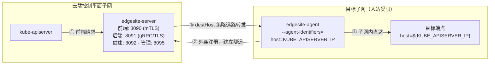
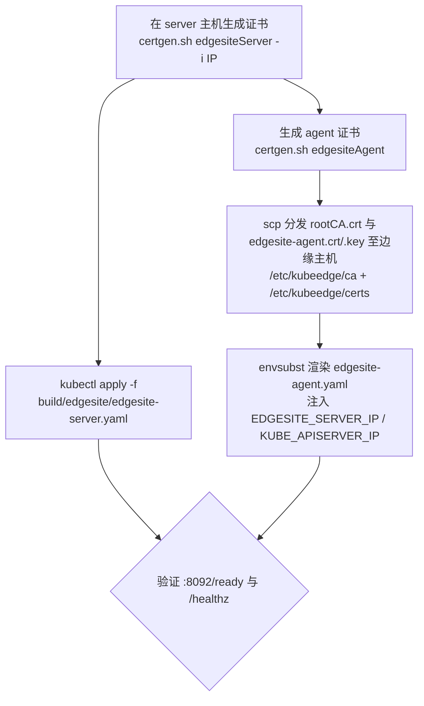

本页剖析 KubeEdge 仓库中的 `edgesite` 子项目：它的定位、两代架构的演变逻辑、当前基于 konnectivity 网络代理的双组件实现（edgesite-server / edgesite-agent）、部署实践与端到端验证方式。阅读前建议先完成 [云边协同总体架构：云端与边缘组件全景](7-yun-bian-xie-tong-zong-ti-jia-gou-yun-duan-yu-bian-yuan-zu-jian-quan-jing)，以区分 EdgeSite 与 CloudCore/EdgeCore 主架构的边界。

## 定位：为什么需要 EdgeSite

EdgeSite 官方自述为 "Cluster at edge"，其仓库内 README 用一句话给出工程目标：安装 edgesite-server 与 edgesite-agent，**使位于另一子网的 kube-apiserver 能够被访问**。它解决的是一类典型的物理网络约束问题——集群控制平面与业务子网分属不同网段，且目标子网通常入站受限、出站开放，云端组件无法直接发起连接抵达其中的服务端点。Sources: [README.md](edgesite/README.md#L1-L2)

理解这一定位的关键在于：当前代码库中的 EdgeSite **不是**一个 Kubernetes 发行版或独立控制平面，而是对上游项目 `sigs.k8s.io/apiserver-network-proxy`（konnectivity 网络代理）的复用与集成。`go.mod` 中显式声明了 `sigs.k8s.io/apiserver-network-proxy v0.0.37` 与 `konnectivity-client v0.31.0` 两个直接依赖；edgesite-agent 与 edgesite-server 的入口代码也直接复用了上游的 `app.Agent` 与 `options.NewProxyRunOptions` 等类型，仅在 KubeEdge 侧补充了 klog 参数适配与本地封装。Sources: [go.mod](go.mod#L66-L67)

从入口代码可以确认二者的职责分工：edgesite-server 构造上游的 `ProxyRunOptions` 并挂接本地 `app.NewProxyCommand`；edgesite-agent 则完全构造自上游 `apiserver-network-proxy/cmd/agent/app`，KubeEdge 侧没有为它编写任何业务逻辑。也就是说，EdgeSite 子项目 today 的本质是"konnectivity 代理的两个可部署二进制 + 对应部署清单 + 证书脚本扩展"。Sources: [main.go](edgesite/cmd/edgesite-server/main.go#L25-L35)

## 架构演变：两代 EdgeSite 的概念漂移

追溯 git 历史（提交 `eddcd25f3`，PR #2858，2021-05-31）可以发现，EdgeSite 在 v1.8 前后经历了彻底的重构。旧版 edgesite 是一个**单二进制轻量集群运行时**：它通过 Beehive 框架注册 `edged`、`edgecontroller`、`metamanager` 三个模块，在边缘本地完整承载"精简版云 + 边"能力，并使用 SQLite 存储元数据——这才是"边缘独立集群"名称的由来。重构提交删除了 `edgesite/cmd/edgesite/` 下的全部旧实现（约 180 行入口与选项代码），代之以 konnectivity 双组件；随后的 `8d0c3ec27`（"refine edgesite"）进一步将 server 逻辑拆入独立 `app` 包并同步 vendor。Sources: [server.go](edgesite/cmd/edgesite-server/app/server.go#L53-L54)

这一演变的架构含义值得每个读者明确：**名称未变，内涵已变**。今日阅读任何 EdgeSite 资料，都必须先分辨其描述的是哪一代。下表总结了两代的核心差异：

| 维度 | 旧版 EdgeSite（≤ v1.7） | 新版 EdgeSite（v1.8+，当前） |
|---|---|---|
| 工程形态 | 单二进制边缘集群运行时 | 网络代理双组件（server + agent） |
| 组成模块 | edged + edgecontroller + metamanager | konnectivity ProxyServer + konnectivity Agent |
| 技术基础 | Beehive 消息框架 + SQLite | sigs.k8s.io/apiserver-network-proxy v0.0.37 |
| 解决的问题 | 在边缘独立运行一套精简控制面 | 跨子网访问另一网段中的 kube-apiserver 端点 |
| 代码位置 | `edgesite/cmd/edgesite/`（已删除） | `edgesite/cmd/edgesite-server/`、`edgesite/cmd/edgesite-agent/` |
| 部署载体 | 单进程部署 | 两个独立 Deployment（hostNetwork） |

Sources: [server.go](edgesite/cmd/edgesite-server/app/server.go#L40-L54)

## 当前架构与工作原理

理解下图需要先建立 konnectivity 的基本模型：代理 server 暴露两类入口——面向 API Server 侧请求的**前端**与面向目标子网的**后端**；agent 运行在目标子网内，**主动外连**到 server 的后端端口建立长连接隧道，从而绕过子网入站限制。server 收到前端请求后，依据路由策略挑选已注册的 agent，将流量经隧道转发至目标。下图中 server 的命令注释直接印证了这一方向："receives requests from the API server and forwards to the agent"。

Sources: [server.go](edgesite/cmd/edgesite-server/app/server.go#L40-L54), [README.md](edgesite/README.md#L1-L2)

**edgesite-server 的四个监听面**。`run()` 方法按固定顺序拉起四个服务：master server（前端，支持 UDS、gRPC、http-connect 三种模式）、agent server（隧道后端）、admin server（调试与指标）、health server（探针），随后阻塞于信号处理直至优雅退出。当配置了 `--agent-namespace` 时，server 还会构建 Kubernetes clientset 以启用基于 ServiceAccount Token 的 agent 认证（`AgentTokenAuthenticationOptions`）；默认部署清单未启用该项，认证完全依赖 mTLS 双向证书。Sources: [server.go](edgesite/cmd/edgesite-server/app/server.go#L54-L124)

**传输安全模型**。`getTLSConfig` 为两条链路统一构造 TLS 配置：加载 X509 密钥对、将 CA 证书装入信任池、强制 `RequireAndVerifyClientCert`（要求并校验对端客户端证书）并限定最低 TLS 1.2。参数命名与链路一一对应：`--server-*` 三件套服务于前端（master server），`--cluster-*` 三件套服务于 agent 后端——`runMTLSMasterServer` 消费后者组、`runAgentServer` 消费前者组的对应关系可在两处启动代码中逐行核对。agent 侧 gRPC 链路还附加了 keepalive 参数以维持长连接。Sources: [server.go](edgesite/cmd/edgesite-server/app/server.go#L211-L238), [server.go](edgesite/cmd/edgesite-server/app/server.go#L240-L337)

**路由策略与目标标识**。部署清单为 server 指定 `--proxy-strategies=destHost`，为 agent 指定 `--agent-identifiers=host=${KUBE_APISERVER_IP}`。二者组合的语义是：agent 向 server 注册时声明"目标子网中 host 为 KUBE_APISERVER_IP 的端点由我可达"；当前端请求的目标 host 与该标识匹配时，destHost 后端管理器将请求路由给这条隧道。这正是 README 中"access kube-apiserver in other subnet"的落地机制——目标 host 即另一子网中 kube-apiserver 的服务地址。另有一个实现细节值得知晓：mTLS 模式下若选择 http-connect 模式，server 会额外监听一个 `:8088` 的无 TLS HTTP 端口（上游行为），部署清单中未显式声明它。Sources: [edgesite-agent.yaml](build/edgesite/edgesite-agent.yaml#L24-L30), [edgesite-server.yaml](build/edgesite/edgesite-server.yaml#L24-L33)

**端口全景**。edgesite-server Deployment 以 `hostNetwork` 方式运行并占用四个主机端口：

| 端口 | 清单名称 | 链路 | 协议/内容 | 绑定范围 |
|---|---|---|---|---|
| 8090 | serverport | 前端 | http-connect/gRPC（mTLS） | 所有网卡 |
| 8091 | agentport | 后端隧道 | gRPC + TLS + keepalive | 所有网卡 |
| 8092 | healthport | 探针 | `/healthz`（存活）、`/ready`（就绪） | 所有网卡 |
| 8095 | adminport | 管理 | Prometheus `/metrics`、pprof | 仅 127.0.0.1 |

就绪探针直接透传 server 内部 `Readiness` 组件的状态，非就绪时返回 500 与原因文本；admin server 固定绑定环回地址，外部无法触达，指标与性能剖析仅限本机访问。Sources: [edgesite-server.yaml](build/edgesite/edgesite-server.yaml#L34-L46), [server.go](edgesite/cmd/edgesite-server/app/server.go#L339-L395)

## 部署实践

官方部署流程分为"证书 → server → 证书分发 → agent"四步，整体依赖关系如下：

**第一步：证书准备**。README 规定的做法是调用 `certgen.sh` 的两个专用子命令——`edgesiteServer`（生成 edgesite-server 与 server 两套证书，并将 server IP 写入 SAN 扩展）与 `edgesiteAgent`（生成 agent 身份证书）。两个函数在当前脚本中依然存在：前者依次执行 `genCsr`/`genCert` 两次，后者复用同一本地 CA 签发 agent 证书。Sources: [README.md](edgesite/README.md#L5-L24), [certgen.sh](build/tools/certgen.sh#L192-L213)

> ⚠️ **脚本与文档脱节提示**：当前 `certgen.sh` 的命令入口已重构为白名单式 `case` 分发器，仅路由 `genCertAndKey`、`genCert`、`genCsr`、`stream`、`help` 五个命令；`edgesiteServer`/`edgesiteAgent` 虽作为函数保留，但已无法从命令行到达——README 中的调用方式在当前代码上会命中 `Unknown command` 分支退出。这是 `e5bc2b9b1`（"limit scope, added help"）收紧入口后遗留的不一致。实践上可改用白名单原语（`genCsr` + `genCert`，注意 server 证书需携带 IP SAN）手工等价执行。Sources: [certgen.sh](build/tools/certgen.sh#L237-L345)

**第二步：部署 edgesite-server**。清单以 hostNetwork Deployment 形态运行，镜像命令行固定了八个启动参数（两套证书三件套 + 模式 + 路由策略），并将宿主机 `/etc/kubeedge/certs` 与 `/etc/kubeedge/ca` 两个目录以 hostPath 卷挂载进容器——这与 certgen.sh 的默认证书输出路径严格对齐。Sources: [edgesite-server.yaml](build/edgesite/edgesite-server.yaml#L17-L33)

**第三步：分发证书并部署 edgesite-agent**。agent 证书必须在 server 主机上用同一 CA 签发后分发至边缘主机（保持 `/etc/kubeedge/ca`、`/etc/kubeedge/certs` 目录结构）。agent 清单中的 `${EDGESITE_SERVER_IP}` 与 `${KUBE_APISERVER_IP}` 两个占位符通过 `envsubst` 渲染后 `kubectl apply`——前者决定隧道外连的目标，后者定义 agent 的路由标识。注意 agent 同样以 Deployment 部署且副本数为 1，单副本意味着该子网隧道当前无内建冗余。Sources: [README.md](edgesite/README.md#L26-L38), [edgesite-agent.yaml](build/edgesite/edgesite-agent.yaml#L17-L30)

**镜像构建**。两个 Dockerfile 均采用两阶段构建：`golang:1.23.12-alpine` 阶段以 `CGO_ENABLED=0` 产出静态链接二进制，运行时阶段基于 `scratch` 空镜像——最终镜像不含 shell 与任何系统库，最小化攻击面与体积。agent 与 server 的差异仅在构建目标包路径。Sources: [server-build.Dockerfile](build/edgesite/server-build.Dockerfile#L9-L18), [agent-build.Dockerfile](build/edgesite/agent-build.Dockerfile#L8-L16)

**关键参数速查**：

| 组件 | 参数 | 清单取值 | 作用 |
|---|---|---|---|
| server | `--cluster-ca-cert/-cert/-key` | rootCA.crt / edgesite-server.crt/.key | 后端（agent 链路）TLS 凭证 |
| server | `--server-ca-cert/-cert/-key` | rootCA.crt / server.crt/.key | 前端（API Server 链路）mTLS 凭证 |
| server | `--mode` | http-connect | 前端协议模式（可选 grpc） |
| server | `--proxy-strategies` | destHost | 按请求目标 host 选择 agent |
| agent | `--ca-cert/-cert/-key` | rootCA.crt / edgesite-agent.crt/.key | agent 身份与证书链校验 |
| agent | `--proxy-server-host` | ${EDGESITE_SERVER_IP} | server 地址（envsubst 注入） |
| agent | `--agent-identifiers` | host=${KUBE_APISERVER_IP} | 声明本 agent 可达的目标 host |

Sources: [edgesite-server.yaml](build/edgesite/edgesite-server.yaml#L24-L33), [edgesite-agent.yaml](build/edgesite/edgesite-agent.yaml#L24-L30)

## 端到端验证：e2e_edgesite 套件

`tests/e2e_edgesite` 提供了基于 Ginkgo v2 的端到端验证，测试直接使用标准 Kubernetes clientset 操作集群，覆盖 Deployment 与裸 Pod 两条用例线。所有用例通过 `testsuite` 公共方法执行，并配合计时器与状态打印输出结果。值得注意的是，用例验证的是**经隧道链路后的完整应用生命周期**——Pod 的创建、副本维持与删除均需穿过 edgesite 代理链路抵达目标子网，因此该套件实质上同时检验了网络代理的数据面可用性。Sources: [edgesite_test.go](tests/e2e_edgesite/edgesite_test.go#L43-L44)

| 用例编号 | 场景 | 核心验证点 |
|---|---|---|
| E2E_ES_APP_DEPLOYMENT_1 | 创建 1 副本 Deployment | Pod 正常启动 |
| E2E_ES_APP_DEPLOYMENT_2 | 创建 3 副本 Deployment | 副本数符合期望 |
| E2E_ES_APP_DEPLOYMENT_3 | 手动删除全部 Pod | Deployment 控制器自动重建至期望副本 |
| E2E_ES_POD_DEPLOYMENT_1 | 直接创建裸 Pod | 正常进入 Running |
| E2E_ES_POD_DEPLOYMENT_2 | 创建后删除 Pod | 删除成功 |
| E2E_ES_POD_DEPLOYMENT_3 | 重复删除已删除的 Pod | 返回 NotFound 错误 |
| E2E_ES_POD_DEPLOYMENT_4 | 循环 10 次创建/删除 | 每轮均成功，检验链路稳定性 |

Sources: [edgesite_test.go](tests/e2e_edgesite/edgesite_test.go#L74-L117), [edgesite_test.go](tests/e2e_edgesite/edgesite_test.go#L123-L200)

## 在文档体系中的位置与延伸阅读

需要划清一条边界：KubeEdge 中存在**两条独立的"隧道"技术线**。EdgeSite 面向的是"控制平面跨子网触达目标网络"的 konnectivity 代理场景；而云边运维隧道（kubectl exec/logs/metrics）由 CloudStream/EdgeStream 体系承担，二者协议、部署位置与目标均不同。EdgeSite 也不在 keadm 的部署能力范围内（代码库中 keadm 无任何 edgesite 引用），其部署路径完全依赖 `build/edgesite/` 下的清单与证书脚本。若你关注的是云边消息总线与边缘自治，请回到主线阅读；若关注运维隧道，请转至 [CloudStream：kubectl exec/logs/metrics 云边隧道](13-cloudstream-kubectl-exec-logs-metrics-yun-bian-sui-dao)。

建议的后续阅读路径：先通过 [项目概述：KubeEdge 的定位与核心价值](1-xiang-mu-gai-shu-kubeedge-de-ding-wei-yu-he-xin-jie-zhi) 巩固全局图景，再以 [测试体系：端到端与集成测试框架](29-ce-shi-ti-xi-duan-dao-duan-yu-ji-cheng-ce-shi-kuang-jia) 了解 e2e_edgesite 套件在整体测试矩阵中的位置；动手部署前，[keadm 一键部署与 Helm Charts 安装配置](4-keadm-jian-bu-shu-yu-helm-charts-an-zhuang-pei-zhi) 可帮助你理解 KubeEdge 主线组件的标准安装方式，从而与 EdgeSite 的手动部署路径形成对照。Sources: [server.go](edgesite/cmd/edgesite-server/app/server.go#L40-L54)