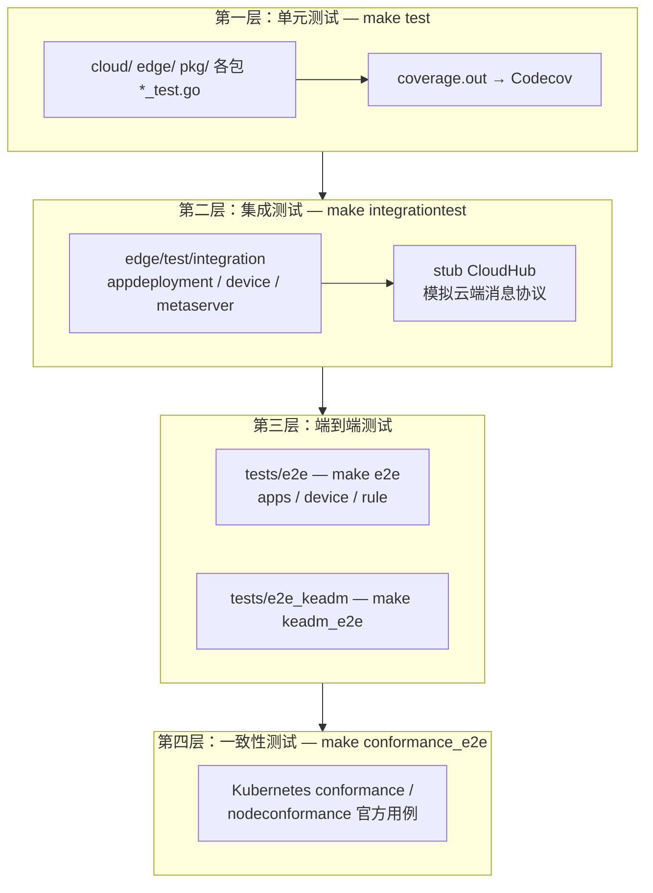
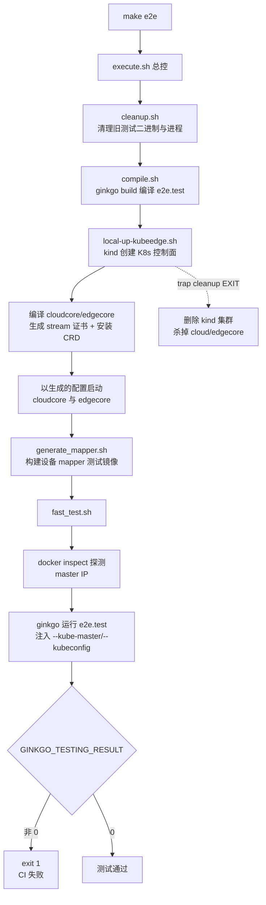
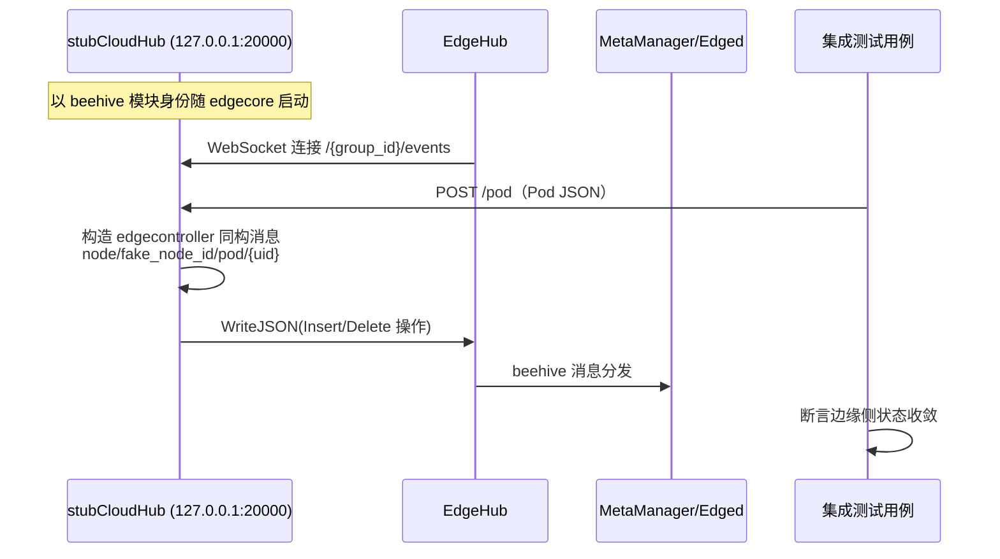

KubeEdge 作为云边协同系统，其测试体系必须同时覆盖"云端 Kubernetes 扩展"与"边缘自治代理"两个维度的正确性。本页剖析仓库 `tests/` 目录下的端到端（E2E）测试与 `edge/test/`、`tests/integration/` 下的集成测试框架，解释其分层策略、环境编排机制、Ginkgo v2 测试底座以及 CI 矩阵化执行方式，帮助进阶开发者理解"一次 PR 如何被完整验证"，以及如何在本复现这些测试环境。

## 测试分层策略与全景

KubeEdge 的自动化测试呈四层金字塔结构：最底层是随包分布的单元测试（`make test`，产物上传 Codecov），其上是针对 edgecore 进程的模块级集成测试（`make integrationtest`，以 stub CloudHub 模拟云端，无需真实集群），再往上是驱动完整云边系统的 E2E 套件（`make e2e`、`make keadm_e2e`），最顶层是验证 Kubernetes API 兼容性的一致性测试（`make conformance_e2e`）。每层通过 Makefile 目标暴露，CI 中按依赖关系并行调度。

各层在被测对象、环境需求与框架选型上差异显著：单元测试零外部依赖、秒级反馈；集成测试需要本机启动 edgecore 进程但用 stub 替代云端；E2E 测试需要 kind 集群加上本地编译的 cloudcore/edgecore 二进制；一致性测试则直接复用 Kubernetes 官方 e2e 镜像，对"KubeEdge 边缘节点是否表现如标准节点"做出裁决。

| 维度 | 单元测试 | 边缘集成测试 | E2E 主套件 | keadm E2E | 一致性测试 |
|---|---|---|---|---|---|
| 代码位置 | `cloud/` `edge/` `pkg/` | `edge/test/integration` | `tests/e2e` | `tests/e2e_keadm` | `build/conformance` |
| 测试框架 | go test | Ginkgo v2 | Ginkgo v2 + K8s e2e framework | Ginkgo v2 | K8s 官方 e2e 镜像 |
| 被测对象 | 单个函数/模块 | edgecore 进程（stub 云端） | 完整云边系统 | keadm 安装产物 | K8s API 兼容性 |
| 环境需求 | 无 | 本机 edgecore + MQTT broker | kind 集群 + 源码编译二进制 | kind 集群 + 镜像构建 | kind 集群 + conformance 镜像 |
| CI 入口 | `make test` | `make integrationtest` | `make e2e` | `make keadm_e2e` | `make conformance_e2e` |

Sources: [Makefile](Makefile#L117-L146), [.github/workflows/main.yaml](.github/workflows/main.yaml#L100-L155)

## 统一技术底座：Ginkgo v2 与 Kubernetes e2e 框架

E2E 套件的技术选型直接继承自 Kubernetes 上游：测试主体使用 Ginkgo v2 + Gomega 编写断言，入口文件 `tests/e2e/e2e_test.go` 通过两个标准入口函数组织执行。`TestMain` 负责在测试运行前汇聚三套 flag 集——KubeEdge 自有 flag（`utils.RegisterFlags`）、Kubernetes e2e framework 的公共 flag（`RegisterCommonFlags`）与集群连接 flag（`RegisterClusterFlags`）——并经 `framework.AfterReadingAllFlags` 完成默认值校验，这使得 KubeEdge E2E 可以直接复用上游的 JUnit 报告、并行调度等基础设施。

`TestE2E` 则是标准的 Ginkgo 套件装配：注册 FailHandler、执行 BeforeSuite（若启用了设备测试则建立 MQTT 连接）、按 `framework.TestContext.ReportDir` 创建报告目录，最后以 `framework.CreateGinkgoConfig()` 生成的配置调用 `ginkgo.RunSpecs` 启动名为 "KubeEdge e2e suite" 的完整套件。通过匿名导入 `tests/e2e/apps`、`tests/e2e/device`、`tests/e2e/rule` 三个包，各业务域的 `Describe` 定义在编译期自动注册进套件。

Sources: [e2e_test.go](tests/e2e/e2e_test.go#L36-L73)

KubeEdge 自有的测试配置面刻意保持精简：`Config` 结构体只暴露应用镜像列表、K8s master 地址、云/边镜像 URL、节点数量、协议类型等运行期参数，通过 `--image-url` 与 `--test-with-device` 等 flag 注入。`TestContext` 将该配置装载后供所有用例包共享，`SendHTTPRequest` 则提供了带跳过证书校验的 HTTP 探测工具，服务于设备与规则类用例的端点验证。

Sources: [config.go](tests/e2e/utils/config.go#L27-L47), [context.go](tests/e2e/utils/context.go#L16-L66)

## E2E 主套件：用例组织与生命周期治理

E2E 用例按业务域分为三个包——`apps`（部署/副本/删除恢复）、`device`（设备 CRUD 与状态同步）、`rule`（云边消息路由规则），每个包由 `framework.go`（`GroupDescribe` 包装函数）与用例文件构成，公共编排逻辑沉淀在 `testsuite` 包中复用。以部署用例为例，其结构展示了三个值得注意的工程模式。

**模式一：计时器度量**。每个用例在 BeforeEach 中从 `TestTimerGroup` 领取计时器并绑定用例名，AfterEach 中结束计时并打印结果，为性能回归提供用例级耗时数据。

**模式二：随机资源命名**。用例名以 `edgecore-depl-app-` 加 `GetRandomString(5)` 生成的随机后缀构成，避免并行运行或残留资源导致的命名冲突。

**模式三：AfterEach 全量清理与状态断言**。用例结束后统一执行"取 deployment → 列 pod → 删 deployment → 轮询等待 pod 消失"的清理链，且每一步都是 Gomega 断言——清理失败同样会导致用例失败，防止脏环境向后传导。

Sources: [deployment.go](tests/e2e/apps/deployment.go#L47-L120), [config.go](tests/e2e/utils/config.go#L56-L58)

底层断言工具集中在 `tests/e2e/utils` 包：`pod.go` 封装了 client-go 的增删查与轮询等待（`wait.PollImmediate` 驱动的 `WaitForPodsToDisappear`），`node.go`、`rule.go`、`device.go` 提供对应资源类型的同构封装；`edgeclientset`（kubeedge API 客户端）与标准 clientset 并列引入，说明部分用例直接断言 KubeEdge 自定义资源。这一层让用例代码只描述"做什么"，资源状态收敛逻辑全部下沉。

Sources: [pod.go](tests/e2e/utils/pod.go#L34-L80)

## 环境编排：从 kind 集群到测试执行的全流水线

`make e2e` 触发的 `tests/scripts/execute.sh` 是 E2E 测试的总指挥，其流程可概括为五阶段：清理 → 编译 → 拉起环境 → 构建测试镜像 → 执行。脚本以 `trap cleanup EXIT` 保证任何退出路径都会回收环境，这是长时编排脚本防泄漏的关键设计。

Sources: [execute.sh](tests/scripts/execute.sh#L16-L66), [compile.sh](tests/scripts/compile.sh#L17-L35)

环境构建的核心是 `hack/local-up-kubeedge.sh`，它将"源码即环境"的理念参数化到极致。脚本头部定义的 `PROTOCOL`（默认 WebSocket，可切换 QUIC）、`CONTAINER_RUNTIME`（containerd/docker/cri-o/isulad）、`KIND_IMAGE`（K8s 版本）三个环境变量，分别对应云边传输通道、边缘容器运行时与控制面版本三个测试维度。`start_cloudcore`/`start_edgecore` 函数通过 `--defaultconfig` 导出默认配置后用 `sed` 逐项改写——开启 CloudStream/EdgeStream/MetaServer、按协议启用 WebSocket 或 QUIC、按运行时改写 CRI endpoint、注入从 `tokensecret` 提取的注册令牌——最终以 nohup 后台进程方式拉起两个组件，并轮询等待 token 生成。这种"默认配置 + sed 改写"的方式使环境配置完全由脚本声明，无需维护独立的配置文件模板。

Sources: [hack/local-up-kubeedge.sh](hack/local-up-kubeedge.sh#L21-L33), [hack/local-up-kubeedge.sh](hack/local-up-kubeedge.sh#L208-L297), [hack/local-up-kubeedge.sh](hack/local-up-kubeedge.sh#L166-L204)

测试执行阶段的 `fast_test.sh` 完成最后的环境探测与参数注入：从 `docker inspect` 读取 kind 控制面容器 IP 作为 master 地址，设置 `KUBECONFIG` 与 `CHECK_EDGECORE_ENVIRONMENT="false"`（跳过边缘环境预检，因为 CI 容器不满足标准边缘硬件假设），然后以编译产物 `e2e.test` 二进制为参数调用 ginkgo，并依据退出码决定整体成败。

| 参数/环境变量 | 注入位置 | 作用 |
|---|---|---|
| `--image-url` | `utils.RegisterFlags` | 测试用应用镜像（如 nginx） |
| `--test-with-device` | `utils.RegisterFlags` | 是否执行设备用例（需 MQTT 连接） |
| `--kube-master` / `--kubeconfig` | K8s e2e framework flag | 集群 API 地址与凭证 |
| `PROTOCOL` | `local-up-kubeedge.sh` | 云边通道：WebSocket / QUIC |
| `CONTAINER_RUNTIME` | `local-up-kubeedge.sh` | 边缘 CRI：containerd/docker/cri-o/isulad |
| `KIND_IMAGE` | `execute.sh` 首参 | kind 控制面 K8s 版本 |
| `ENABLE_DAEMON=true` | `execute.sh` | 守护模式，脚本退出不销毁环境 |
| `CHECK_EDGECORE_ENVIRONMENT=false` | `fast_test.sh` | 跳过 edgecore 启动环境检查 |

Sources: [fast_test.sh](tests/scripts/fast_test.sh#L25-L58)

## keadm 部署路径验证：E2E 家族

E2E 主套件验证的是"手工拉起的环境"，而 `tests/e2e_keadm` 验证的是用户真实的安装路径——keadm。`make keadm_e2e` 触发的 `keadm_e2e.sh` 走的是当前推荐的 Helm 安装路径：先以 `make image` 构建 cloudcore 与 installation-package 镜像，通过 `docker save`/`ctr import` 将 Docker 镜像转为 CRI 可识别格式并 `kind load` 注入测试集群；随后执行 `keadm init --set cloudCore.service.enable=false` 安装云端（Helm Chart 方式），轮询等待 `tokensecret` 生成，取 token 后执行 `keadm join` 注册名为 `edge-node` 的边缘节点，最后轮询节点 Ready 才开始跑测试。这套"轮询 token → 轮询 Ready"的同步原语，是部署类 E2E 保证时序正确性的核心手段。

Sources: [keadm_e2e.sh](tests/scripts/keadm_e2e.sh#L31-L102)

keadm 系 E2E 存在三个变体，共享 `keadm_common_e2e.sh` 中的基础函数：`build_ginkgo` 编译 `e2e_keadm.test`，`prepare_cluster` 创建 kind 集群并做了两个关键 workaround——绑定 `system:anonymous` 到 cluster-admin（边缘侧匿名访问需要）以及删除 kindnet CNI DaemonSet（边缘侧暂不兼容 kind 的 CNI）；`run_test` 以与主套件一致的 flag 注入方式运行测试。三个变体的差异仅在云端安装方式：`keadm_deprecated_e2e` 使用旧版二进制部署路径（配合 `make release` 产物），`keadm_e2e` 使用 Helm 路径，`keadm_compatibility_e2e` 则通过 `CLOUD_EDGE_VERSION` 变量验证跨版本兼容性。

Sources: [keadm_common_e2e.sh](tests/scripts/keadm_common_e2e.sh#L15-L56), [Makefile](Makefile#L299-L341), [Makefile](Makefile#L445-L465)

keadm E2E 的用例本身刻意保持最小化——只验证"Pod 经 keadm 安装的完整链路后在边缘正常运行"这一核心承诺（`E2E_POD_DEPLOYMENT`），因为该套件的价值在安装路径而非业务广度。用例复用了主套件的 `testsuite.CreatePodTest` 与 utils 断言工具，体现两套件共享同一验证词汇表。

Sources: [keadm_test.go](tests/e2e_keadm/keadm_test.go#L29-L81)

## 边缘侧集成测试：stub CloudHub 与模块级验证

集成测试位于两处：`edge/test/integration`（已成熟的边缘侧套件，覆盖 appdeployment、device、metaserver 三个域）与 `tests/integration`（新框架骨架）。`make integrationtest` 依次执行两边的 `execute.sh`，先构建 edgecore 再运行各模块测试。

边缘集成测试的关键设计是 **stub CloudHub**：`edge/test/cloudhub/stub.go` 将一个假云端注册为 beehive 模块，在 `127.0.0.1:20000` 上同时暴露两个 HTTP 端点——`/{group_id}/events` 供 EdgeHub 建立 WebSocket 长连接，`/pod` 供测试用例提交 Pod JSON。收到 Pod 后，stub 将其封装为与真实 EdgeController 完全同构的 beehive 消息（路由为 `node/fake_node_id/pod/{uid}`，操作为 Insert/Delete）并推送给 EdgeHub。这使 MetaManager、Edged 等下游模块在**无云端依赖**的情况下接受真实消息流的驱动。

Sources: [edge/test/cloudhub/stub.go](edge/test/cloudhub/stub.go#L26-L31), [edge/test/cloudhub/stub.go](edge/test/cloudhub/stub.go#L76-L144)

测试对 edgecore 进程的生命周期管理由 `test_setup.go` 承担：`CreateEdgeCoreConfigFile` 基于默认配置裁剪（内嵌 MQTT 模式、启用 EventBus、指定证书路径与 DMI socket），`StartEdgeCore` 以 nohup 拉起进程后用 `pgrep` 验证存活，失败则打印配置与日志后退出——快速失败并保留现场。各测试域的 suite 文件在 BeforeSuite 中完成"生成配置 → 启动进程 → 运行用例"的编排，例如 metaserver 套件只开启 MetaManager/MetaServer 模块并关闭 `RequireAuthorization` 特性门控，直接以标准 client-go 连接 MetaServer 地址执行 Pod 级 CRUD 断言。

Sources: [edge/test/integration/utils/test_setup.go](edge/test/integration/utils/test_setup.go#L19-L75), [metaserver_suite_test.go](edge/test/integration/metaserver/metaserver_suite_test.go#L19-L44)

`tests/integration/framework` 提供了一个更声明式的新框架原语：`DisableAllModules` 接受 CloudCoreConfig 或 EdgeCoreConfig，一键关闭全部模块，由用例按需重新点亮——`main_test.go` 展示了典型配方（仅保留 CloudHub+SyncController 与 EdgeHub+MetaServer）。边缘进程编排入口 `RunCloud`/`RunEdge` 目前在 main_test.go 中处于注释状态，说明该框架仍在演进中；其意义在于将"模块组合矩阵"作为一等公民，为未来细粒度的组件间集成测试铺路。

Sources: [util.go](tests/integration/framework/util.go#L11-L33), [main_test.go](tests/integration/metaserver/main_test.go#L14-L29), [access_test.go](tests/integration/metaserver/access_test.go#L20-L71)

## Kubernetes 一致性测试

E2E 套件验证 KubeEdge 特有功能，一致性测试则回答另一个问题：边缘节点上的工作负载是否严格遵循 Kubernetes 语义。`conformance_e2e.sh` 复用与主 E2E 完全相同的 `local-up-kubeedge.sh` 拉起环境，然后将 K8s 官方一致性测试封装为 Docker 镜像运行——`build/conformance/Dockerfile` 与 `nodeconformance.Dockerfile` 分别对应完整一致性与节点级一致性两种类型。运行时通过环境变量定制行为：`E2E_SKIP="\[Serial\]"` 跳过串行用例、`E2E_PARALLEL="-p"` 开启并行、`--network host` 直接访问集群、结果统一落盘 `/tmp/results` 供 CI 归档。镜像化运行隔离了官方测试工具链与宿主机环境的依赖冲突。

Sources: [tests/scripts/conformance_e2e.sh](tests/scripts/conformance_e2e.sh#L78-L112)

## CI 全景：矩阵化质量门禁

`.github/workflows/main.yaml` 将上述所有能力组织为一张多维测试矩阵。`e2e_test` job 以 **协议 × K8s 版本** 为矩阵轴（WebSocket/QUIC × v1.30/v1.31/v1.32），并刻意让两种协议绑定不同边缘运行时——QUIC 配 docker（cri-dockerd）、WebSocket 配 containerd——用同一矩阵维度同时覆盖传输层与运行层两个正交面。`container_runtime_test` 单独以 isulad/cri-o/docker 三种 CRI 运行时再跑一轮 `make e2e`，`conformance_e2e_test` 以 conformance/nodeconformance 两类型展开。

| CI Job | 矩阵轴 | 变体组合 | 测试目标 |
|---|---|---|---|
| `basic_test` | 无 | 单测 + `make integrationtest` | 单元正确性、覆盖率、边缘集成 |
| `e2e_test` | 协议 × K8s 版本 | WebSocket/QUIC × v1.30–v1.32 | 云边通道与多版本兼容 |
| `container_runtime_test` | CRI 运行时 | isulad / cri-o / docker | 边缘容器运行时适配 |
| `keadm_e2e_test` | 无 | Helm 安装路径 | 推荐部署路径 |
| `keadm_deprecated_e2e_test` | 无 | 二进制部署路径 | 旧版部署路径 |
| `conformance_e2e_test` | 一致性类型 | conformance / nodeconformance | K8s 语义兼容性 |

Sources: [.github/workflows/main.yaml](.github/workflows/main.yaml#L155-L251), [.github/workflows/main.yaml](.github/workflows/main.yaml#L382-L511)

CI 的可观测性设计同样值得注意：每个 E2E job 无论成败都会上传 `/tmp/cloudcore.log` 与 `/tmp/edgecore.log` 为 artifact——这正是 `local-up-kubeedge.sh` 将组件日志固定写到 LOG_DIR（默认 /tmp）的约定带来的便利；一致性测试则归档 `/tmp/results`。另外，job 间通过 `image-prepare` 阶段将 `kubeedge/build-tools` 构建镜像以 artifact 形式传递，避免了各测试 job 重复拉取；运行前统一执行释放磁盘空间与启用 containerd CRI 配置的预处理步骤，是对 GitHub Actions Runner 资源约束的工程化应对。

Sources: [.github/workflows/main.yaml](.github/workflows/main.yaml#L253-L261), [.github/workflows/main.yaml](.github/workflows/main.yaml#L30-L38)

## 本地复现的最小路径

对希望本地复现的开发者，推荐路径为：安装 ginkgo/kind/kubectl 三个依赖后，直接执行 `ENABLE_DAEMON=true bash hack/local-up-kubeedge.sh`（环境保留便于反复调试，用 `tests/scripts/cleanup.sh` 回收），环境就绪后进入 `tests/` 目录运行 `bash scripts/fast_test.sh` 即可跑完整 E2E 套件；若只需验证边缘侧模块，`bash edge/test/integration/scripts/execute.sh metaserver` 可在数分钟内完成单域集成验证。调试 E2E 失败时优先查看 `/tmp/testcase.log`（用例执行日志）与 `/tmp/cloudcore.log`、`/tmp/edgecore.log`（组件日志），三者构成了完整的故障定位链。

Sources: [execute.sh](tests/scripts/execute.sh#L41-L60), [edge/test/integration/scripts/execute.sh](edge/test/integration/scripts/execute.sh#L43-L61)

## 下一步阅读

理解了测试如何验证系统行为后，建议沿两条路径深化：若想理解 E2E 用例所断言的消息流转细节，请阅读 [EdgeHub：云边消息收发枢纽与证书认证](17-edgehub-yun-bian-xiao-xi-shou-fa-shu-niu-yu-zheng-shu-ren-zheng) 与 [MetaManager 与 MetaServer：离线元数据存储与本地 API Server](18-metamanager-yu-metaserver-chi-xian-yuan-shu-ju-cun-chu-yu-ben-di-api-server)；若想掌握测试环境的部署原语，请参考 [本地开发与调试环境（local-up 与代码生成）](5-ben-di-kai-fa-yu-diao-shi-huan-jing-local-up-yu-dai-ma-sheng-cheng) 与 [keadm 一键部署与 Helm Charts 安装配置](4-keadm-jian-bu-shu-yu-helm-charts-an-zhuang-pei-zhi)。架构演进的动机可在 [设计提案导读：理解架构演进决策](30-she-ji-ti-an-dao-du-li-jie-jia-gou-yan-jin-jue-ce) 中找到对应的设计提案（sig-testing 目录）。