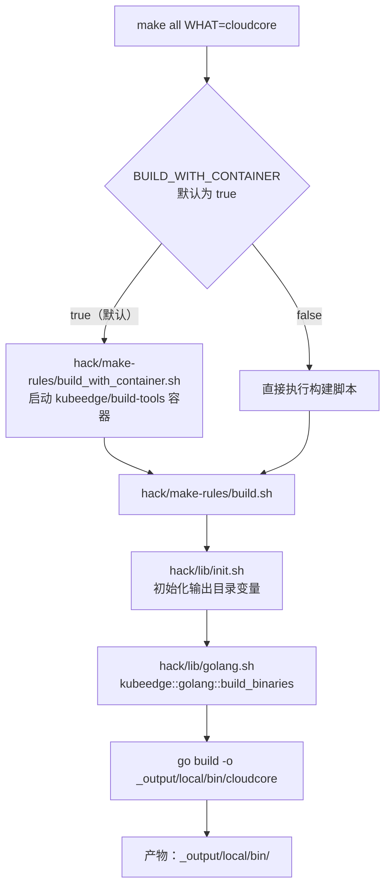
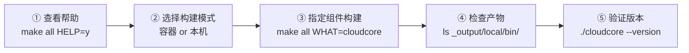

本页面向首次接触 KubeEdge 源码的开发者，讲解如何使用仓库根目录的 `Makefile` 及其背后的构建脚本，将源码编译为可执行的二进制文件与容器镜像。你将了解构建体系的三层结构、两种构建模式的取舍、交叉编译与小型化构建的方法，以及镜像构建规则——掌握这些内容后，你就能按需产出任何 KubeEdge 组件。

## 构建体系总览：一条命令背后的三层结构

KubeEdge 的构建体系采用经典的"入口—规则—函数库"分层设计。顶层 `Makefile` 只负责定义目标并解析参数（如 `WHAT`、`ARM_VERSION`），实际的构建动作委托给 `hack/make-rules/` 下的规则脚本，而规则脚本再调用 `hack/lib/` 中的 Shell 函数库完成环境初始化与 `go build` 调用。这种分层意味着：新手只需记忆 `Makefile` 中的目标名，进阶时再深入脚本内部。

理解这个结构的最直观方式是跟踪 `make all` 的调用链，其完整流程如下（前提说明：图中 `build_with_container.sh` 是否介入取决于 `BUILD_WITH_CONTAINER` 变量的值，后文会展开）：



这一分层在代码中清晰可辨：`Makefile` 的 `all` 目标根据容器模式选择执行路径，最终都指向 `hack/make-rules/build.sh`；`build.sh` 本身只有寥寥数行，它定位仓库根目录后加载 `hack/lib/init.sh`，再调用 `kubeedge::golang::build_binaries` 函数完成实际编译。

Sources: [Makefile](Makefile#L54-L64), [hack/make-rules/build.sh](hack/make-rules/build.sh#L23-L28), [hack/lib/init.sh](hack/lib/init.sh#L23-L32)

## 环境准备：两种构建模式的选择

KubeEdge 默认**在容器内构建**（`BUILD_WITH_CONTAINER?=true`）。此模式下，`build_with_container.sh` 会将整个仓库目录挂载进官方构建镜像 `kubeedge/build-tools:1.23.12-ke1`，在容器内执行你传入的构建命令。这种设计的最大好处是对新手极其友好：**宿主机只需安装 Docker 和 Make**，无需自行配置 Go 工具链与交叉编译器。

如果你想脱离容器直接在本机构建（例如 IDE 调试、或 Docker 不可用的环境），设置 `BUILD_WITH_CONTAINER=false` 即可，此时需要本机满足：Go 版本 ≥ 1.21（构建脚本会强制校验）、`GOPATH` 环境变量已设置。仓库的 `go.mod` 声明当前代码基线为 Go 1.23.12，与构建容器镜像的版本一致，建议本机也安装相同版本以避免意外。

两种模式的对比如下：

| 维度 | 容器模式（默认） | 本机模式 |
|---|---|---|
| 启用方式 | 默认，无需设置 | `make all WHAT=cloudcore BUILD_WITH_CONTAINER=false` |
| 宿主机依赖 | 仅 Docker + Make | Go ≥ 1.21、GOPATH、交叉编译器（如需交叉编译） |
| 构建镜像 | `kubeedge/build-tools:1.23.12-ke1` | 不使用 |
| 仓库挂载路径 | 容器内 `/kubeedge`（可通过 `MOUNTPATH` 覆盖） | 直接在宿主机执行 |
| 典型场景 | 快速上手、CI 环境 | IDE 联调、无 Docker 环境 |

Sources: [Makefile](Makefile#L23-L53), [hack/make-rules/build_with_container.sh](hack/make-rules/build_with_container.sh#L23-L35), [hack/lib/golang.sh](hack/lib/golang.sh#L29-L48), [go.mod](go.mod#L1-L3)

## 第一次构建：make all 全流程

现在动手构建你的第一个二进制。以下流程图展示了从执行命令到拿到产物的完整步骤，每一步对应的命令紧随其后：



**第一步：查看内建帮助。** `Makefile` 中每个主要目标都支持 `HELP=y` 参数，会打印该目标的用途、支持的参数和示例命令，这是最权威的"文档"，建议作为你的第一参考。

Sources: [Makefile](Makefile#L29-L53)

**第二步：执行构建。** 构建 `cloudcore`（云端核心组件）只需一条命令。若不指定 `WHAT`，则会构建全部组件：

```bash
# 只构建 cloudcore（容器模式，默认）
make all WHAT=cloudcore

# 本机模式构建
make all WHAT=cloudcore BUILD_WITH_CONTAINER=false

# 构建全部 11 个组件
make all
```

**第三步：确认产物。** 所有二进制统一输出到 `_output/local/bin/` 目录（该目录默认不存在，首次构建后生成）。输出路径由 `hack/lib/init.sh` 中的变量链决定：`KUBEEDGE_OUTPUT_SUBPATH`（默认 `_output/local`）→ `KUBEEDGE_OUTPUT`（仓库根 + 子路径）→ `KUBEEDGE_OUTPUT_BINPATH`（其下的 `bin`）。你可以通过 `OUT_DIR` / `KUBEEDGE_OUTPUT_SUBPATH` 环境变量自定义输出位置。

Sources: [Makefile](Makefile#L24), [hack/lib/init.sh](hack/lib/init.sh#L25-L28)

## 全部可用二进制组件清单

`WHAT` 参数接受哪些值？答案在两处：`Makefile` 顶部的 `BINARIES` 列表定义了全部 11 个目标，而 `hack/lib/golang.sh` 中的 `ALL_BINARIES_AND_TARGETS` 数组则给出了**二进制名到 Go 源码包路径的精确映射**——构建脚本正是靠这个映射把组件名翻译成 `go build` 的编译目标。下表同时列出两者（注意 `conformance` 仅出现在 Makefile 列表中，属于测试辅助二进制）：

| 二进制名 | 源码包路径 | 所属层级 |
|---|---|---|
| cloudcore | cloud/cmd/cloudcore | 云端 |
| admission | cloud/cmd/admission | 云端 |
| controllermanager | cloud/cmd/controllermanager | 云端 |
| csidriver | cloud/cmd/csidriver | 云端 |
| iptablesmanager | cloud/cmd/iptablesmanager | 云端 |
| edgecore | edge/cmd/edgecore | 边缘 |
| edgemark | edge/cmd/edgemark | 边缘（压测工具） |
| edgesite-agent | edgesite/cmd/edgesite-agent | 边缘独立集群 |
| edgesite-server | edgesite/cmd/edgesite-server | 边缘独立集群 |
| keadm | keadm/cmd/keadm | 部署工具 |
| conformance | —（Makefile 列表内） | 测试辅助 |

Sources: [Makefile](Makefile#L8-L18), [hack/lib/golang.sh](hack/lib/golang.sh#L178-L189)

## 调试友好构建：GOLDFLAGS 与 GOGCFLAGS

默认情况下，构建产物是"精简"的：`GOLDFLAGS` 未指定时默认为 `-s -w -buildid=`，会剥离调试符号与 DWARF 信息以减小体积。**如果你需要用 delve 等调试器断点调试，必须覆盖这两个参数**：将 `GOLDFLAGS` 设为空字符串以保留符号，`GOGCFLAGS` 设为 `-N -l` 以关闭编译器优化和内联（否则断点位置会漂移）。

```bash
# 生成可调试的未精简二进制
make all WHAT=cloudcore GOLDFLAGS="" GOGCFLAGS="-N -l"
```

Sources: [Makefile](Makefile#L42-L46), [hack/lib/golang.sh](hack/lib/golang.sh#L238-L252)

## 交叉编译：面向 ARM 与 Windows 的构建

KubeEdge 的主战场是资源受限的边缘设备，因此交叉编译是一等公民。`make crossbuild` 支持三个关键参数：`WHAT`（组件名）、`ARM_VERSION`（`GOARM7` 或 `GOARM8`）、`OS`（如 `GOOSwindows`）。未指定 `ARM_VERSION` 时默认构建 ARMv8（64 位 ARM）。

不同目标平台背后的编译配置差异显著，尤其是 **CGO 交叉编译器**的选择——这正是容器模式的价值所在：这些交叉编译器在构建容器中已预装，本机模式则需自行安装（如 Windows 目标需 `mingw-w64`）：

| 参数组合 | 实际 GOOS/GOARCH | 交叉编译器（CC） | 典型硬件 |
|---|---|---|---|
| 默认 / `ARM_VERSION=GOARM8` | linux/arm64 | `aarch64-linux-gnu-gcc` | 树莓派 4、ARM 服务器 |
| `ARM_VERSION=GOARM7` | linux/arm（GOARM=7） | `arm-linux-gnueabihf-gcc` | 树莓派 3 等旧款 32 位设备 |
| `OS=GOOSwindows` | windows/amd64 | `x86_64-w64-mingw32-gcc` | Windows 工控机 |

三个典型命令示例：

```bash
# 为 ARMv7 设备构建 edgecore
make crossbuild WHAT=edgecore ARM_VERSION=GOARM7

# 为 Windows 构建（本机模式）
make crossbuild OS=GOOSwindows BUILD_WITH_CONTAINER=false

# 交叉构建所有组件
make crossbuild
```

需要留意一个实现细节：构建 ARMv8 时脚本会显式清空 `GOARM` 环境变量，因为 Go 编译器不允许在构建 arm64 目标时携带该变量——如果你在自定义脚本中遇到这个报错，原因就在这里。

Sources: [Makefile](Makefile#L165-L198), [hack/lib/golang.sh](hack/lib/golang.sh#L270-L329), [hack/make-rules/crossbuild.sh](hack/make-rules/crossbuild.sh#L26-L28)

## 小型化构建：为资源受限设备瘦身 edgecore

边缘网关的存储往往只有几十 MB，`make smallbuild` 专为这种场景设计。它目前**仅支持 edgecore** 一个组件，采用两步压缩策略：先用 `-extldflags -static` 进行静态链接（消除对目标设备动态库的依赖），再用 `upx-ucl -9` 进行极限压缩。产物同样输出到 `_output/local/bin/`。

```bash
make smallbuild WHAT=edgecore
```

注意：静态链接 + UPX 压缩会牺牲启动速度（运行时需解压），且若选择本机模式，需自行安装 `upx-ucl` 工具。对于常规开发调试，使用普通 `make all` 即可。

Sources: [Makefile](Makefile#L251-L277), [hack/lib/golang.sh](hack/lib/golang.sh#L331-L379)

## 容器镜像构建：make image 与多架构 crossbuildimage

二进制只是起点，云端组件通常以容器镜像形态部署。`make image` 支持与 `make all` 相同的 `WHAT` 参数，其内部维护着一张**目标 → 镜像名 → Dockerfile 路径**的映射表，最终执行 `docker build -t kubeedge/<镜像名>:<git标签>`。镜像标签自动取自 `git describe --tags`，因此**克隆仓库后请先 `git fetch --tags`，否则标签可能为空或不准确**。

常用映射关系如下（完整清单共 13 项，节选组件类镜像）：

| WHAT 目标 | 镜像名 | Dockerfile |
|---|---|---|
| cloudcore | kubeedge/cloudcore | build/cloud/Dockerfile |
| edgecore | kubeedge/edgecore | build/edge/Dockerfile |
| admission | kubeedge/admission | build/admission/Dockerfile |
| edgesite-agent | kubeedge/edgesite-agent | build/edgesite/agent-build.Dockerfile |
| controllermanager | kubeedge/controller-manager | build/controllermanager/Dockerfile |
| iptablesmanager | kubeedge/iptables-manager | build/iptablesmanager/Dockerfile |

```bash
make image WHAT=cloudcore          # 构建单个镜像
make image                         # 构建全部镜像
make crossbuildimage WHAT=cloudcore  # 用 buildx 构建多架构镜像
```

这些 Dockerfile 均采用**多阶段构建**模式：第一阶段基于 `golang:1.23.12-alpine` 完成静态编译（`CGO_ENABLED=0`），第二阶段仅从构建阶段拷贝二进制到干净的 `alpine:3.21` 运行时镜像，按需补充 `iptables` 等运行依赖。这一模式使最终镜像体积最小化，且不含完整 Go 工具链。

Sources: [Makefile](Makefile#L351-L391), [hack/make-rules/image.sh](hack/make-rules/image.sh#L25-L44), [hack/make-rules/image.sh](hack/make-rules/image.sh#L74-L102), [build/cloud/Dockerfile](build/cloud/Dockerfile#L1-L19)

## 版本信息注入机制（ldflags）

你可能好奇 `./cloudcore --version` 显示的版本号从何而来。构建脚本在编译时通过 `-ldflags -X` 将一组 Git 元信息注入到 `pkg/version` 包的变量中，包括 `gitVersion`（语义化版本）、`gitCommit`、`gitTreeState`（工作区是否干净）、`buildDate`、`gitMajor/gitMinor`。版本号由 `git describe --tags` 推导并转换为 semver 兼容格式（如 `v1.1.0-alpha.0.6+84c76d1142ea4d`），未打标签的克隆会回退到 `v0.0.0` 并附加 `-dirty` 标记。

这个机制的实践意义在于：**二进制的版本号取决于构建时的 Git 状态**。若 `go.mod` 版本校验失败并提示 "GIT_VERSION should be a valid Semantic Version"，请检查仓库标签与工作区状态，而非 Go 代码本身。

Sources: [hack/lib/golang.sh](hack/lib/golang.sh#L50-L115), [hack/lib/golang.sh](hack/lib/golang.sh#L118-L148)

## 日常辅助目标：test / lint / verify / clean / install / release

除编译外，`Makefile` 还定义了一组覆盖开发全流程的辅助目标。它们遵循相同的参数约定（`HELP=y` 查看帮助、`WHAT` 指定组件），摘要如下：

| 目标 | 用途 | 关键参数 | 背后脚本 |
|---|---|---|---|
| `make test` | 运行单元测试 | `WHAT=cloud`（支持 cloud/edge）、`PROFILE=y` 生成覆盖率 | hack/make-rules/test.sh |
| `make lint` | golangci-lint 静态检查 | 无 | hack/make-rules/lint.sh |
| `make verify` | 校验 Go 版本/vendor/代码生成/CRD 一致性 | 无（组合 5 个子目标） | hack/verify-*.sh |
| `make generate` | 生成 CRD YAML | `CRD_VERSIONS`、`CRD_OUTPUTS`（默认 build/crds） | hack/generate-crds.sh |
| `make clean` | 清理构建产物与 Go 缓存 | 无 | hack/make-rules/clean.sh |
| `make install` | 安装二进制到系统 | `WHAT`（默认装全部） | Makefile 内联 |
| `make release` | 构建发布产物 | `WHAT=kubeedge/edgesite/keadm` | hack/make-rules/release.sh |

两点新手提示：其一，`make test` 和 `make clean` 都会先触发清理动作（`clean.sh` 会同时清空 Go 构建缓存和 `_output/local/bin`），切换分支后遇到诡异编译错误时，`make clean` 是首选的"重置"手段；其二，`make install` 的安装目标目录由 `INSTALL_DIR`（默认 `/usr/local`）+ `/bin` 组成，支持 `DESTDIR` 前缀，便于打包到非标准根文件系统。

Sources: [Makefile](Makefile#L67-L138), [Makefile](Makefile#L200-L227), [Makefile](Makefile#L334-L349), [Makefile](Makefile#L393-L452), [hack/make-rules/clean.sh](hack/make-rules/clean.sh#L26-L39)

## 新手常见问题排查

下表汇总了首次构建时最常见的报错场景及其解决方案，均对应上文已验证的构建机制：

| 现象 | 根因 | 解决方案 |
|---|---|---|
| `go minor version must >= 1.21` | 本机 Go 版本过低 | 升级到 1.23.x，或改用默认容器模式 |
| `GOPATH environment value not set` | 本机模式缺少 GOPATH | `go env -w GOPATH=...` 或改用容器模式 |
| 找不到二进制：`can not find binary: xxx` | `WHAT` 拼写不在映射表中 | 核对上方组件清单表 |
| `GOARM6 does not support cross build` | 交叉编译仅支持 ARM7/8 | 使用 `GOARM7` 或 `GOARM8` |
| 版本号显示 `v0.0.0` | 克隆仓库未拉取标签 | `git fetch --tags` 后重新构建 |
| 构建 Windows 目标失败 | 缺少 mingw-w64 交叉编译器 | `sudo apt-get install mingw-w64` 或使用容器模式 |
| 调试器断点位置漂移 | 默认 `-s -w` 剥离了调试信息 | `GOLDFLAGS="" GOGCFLAGS="-N -l"` 重新构建 |

Sources: [hack/lib/golang.sh](hack/lib/golang.sh#L39-L48), [hack/lib/golang.sh](hack/lib/golang.sh#L295-L298), [hack/lib/golang.sh](hack/lib/golang.sh#L321-L327), [Makefile](Makefile#L42-L46)

## 下一步

成功构建出二进制与镜像后，建议按以下路径继续深入学习：

- 使用 [keadm 一键部署与 Helm Charts 安装配置](4-keadm-jian-bu-shu-yu-helm-charts-an-zhuang-pei-zhi) 将刚构建的组件部署成真实的云边协同环境；
- 进入 [本地开发与调试环境](5-ben-di-kai-fa-yu-diao-shi-huan-jing-local-up-yu-dai-ma-sheng-cheng)，了解 `hack/local-up-kubeedge.sh` 如何把构建与联调串成一条龙；
- 若准备向社区提交代码，请先阅读 [贡献流程与社区规范](6-gong-xian-liu-cheng-yu-she-qu-gui-fan)，其中 `make verify` 与 `make lint` 是 PR 门禁的本地预演。