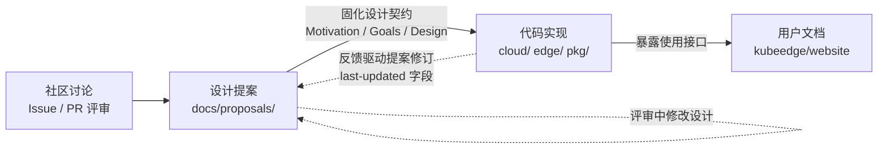
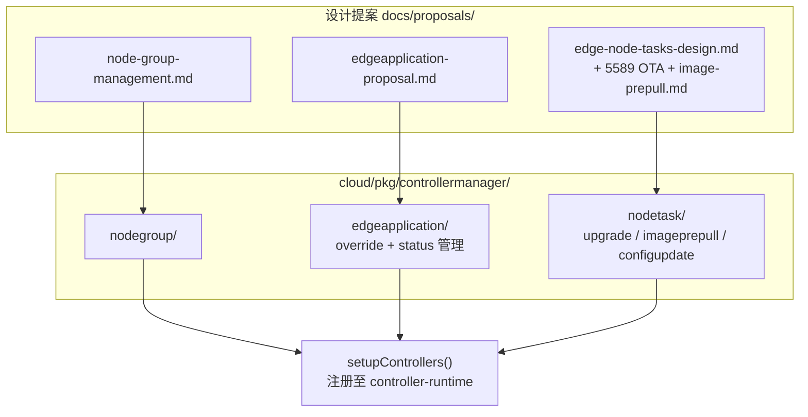
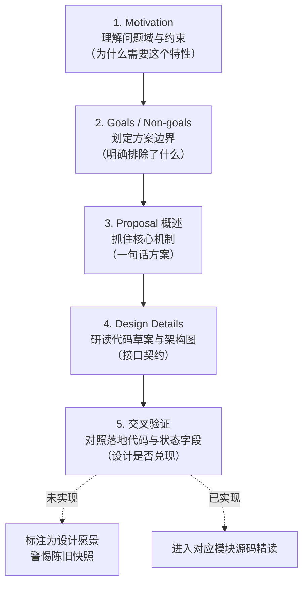

本页面向希望深入理解 KubeEdge 架构演进逻辑的高级开发者。仓库中的 `docs/proposals/` 目录收录了 40 余份设计提案（Proposal），横跨 8 个活跃 SIG 分组与 9 个编号提案目录——它们是 KubeEdge 重大架构决策的"第一手文献"。与面向使用者的操作文档不同，提案记录的是**问题域、权衡取舍与设计约束**：读懂提案，才能理解代码"为什么长成这样"，而不仅是"如何运行"。本页将系统介绍提案体系的组织逻辑、标准格式、状态语义，并提供一条可操作的精读路径与"提案 → 代码"追溯映射。

## 提案为何是理解 KubeEdge 的第一手文献

KubeEdge 仓库内的 `docs/` 目录并不承载用户文档——`docs/README.md` 仅有一行说明，指出所有正式文档托管于独立的 website 仓库。这意味着仓库内唯一成规模的设计文献就是 `docs/proposals/`：它们与源码同仓演进，是架构决策离代码最近的记录载体。当你阅读诸如 CloudHub、SyncController、MetaServer 等模块时，对应的提案文档解释了模块存在的原因、当初否决的替代方案，以及被明确划出范围的 Non-goals——这些信息在代码注释中通常不存在。

理解三者的分工可以用如下知识流模型表达：社区讨论形成共识，提案将共识固化为设计契约，实现将其翻译为代码，而最终面向用户的文档只暴露"如何使用"。对于架构研究者而言，**提案是唯一能观察到"决策时刻"的文档层**。

值得注意的是，这种"提案与代码同仓"的模式使得提案中引用的路径、API 名称可以直接与源码交叉验证——本页后续的映射表正是基于这种可验证性构建的。

Sources: [README.md](docs/README.md#L1-L2)

## 目录组织：以 SIG 为主线的治理结构

`docs/proposals/` 的一级目录完全按 SIG（Special Interest Group，特别兴趣小组）划分：`sig-architecture`、`sig-cluster-lifecycle`、`sig-device-iot`、`sig-mec`、`sig-networking`、`sig-node`、`sig-release`、`sig-scalability`、`sig-security`、`sig-testing` 共 10 个分组。其中 `sig-mec` 与 `sig-release` 目前仅有 `TBD` 占位文件，表明该治理框架为未来议题预留了扩展位。这种组织方式意味着：**寻找某个特性的设计依据时，先判断它属于哪个领域，再进入对应 SIG 目录**，比全局搜索更高效。

各 SIG 的主题侧重如下表所示，同时给出与当前知识库目录的对应关系，便于双向跳转：

| SIG 分组 | 设计主题域 | 代表提案 |
|---|---|---|
| `sig-architecture` | 基础框架（Beehive、通信协议、Webhook） | quic-design.md、module-restarting.md、6442 Beehive 错误处理 |
| `sig-cluster-lifecycle` | 部署工具 keadm、批量节点管理 | 5563-keadm-tool-enhancement、batch-node-access.md、keadm-debug.md |
| `sig-device-iot` | 设备 CRD、Mapper 框架、协议接入 | device-crd.md、mapper-design-v2.md、6319 C 语言 Mapper |
| `sig-networking` | 边缘网络与流量控制 | edgemesh-design.md、closed-loop-flow-control.md |
| `sig-node` | 节点任务、升级、存储、CI、流式接口 | edge-node-tasks-design.md、csi.md、reliable-message-delivery.md、exec-logs.md |
| `sig-scalability` | 高可用与规模扩展 | cloudcore-ha-design.md、ha_router.md |
| `sig-security` | 云边认证与边缘鉴权 | edge-authentication.md、cloudhub-enhancement.md |
| `sig-testing` | 性能测试基线 | perf.md |

Sources: [keadm-tool-enhancement README.md](docs/proposals/sig-cluster-lifecycle/5563-keadm-tool-enhancement/README.md#L1-L14)

除 SIG 主题表外，部分 SIG 目录下还存在**编号提案目录**这一特殊形态：目录名形如 `NNNN-短标题`（如 `5589-ota-upgrades-for-edge-node`、`6442-enhance-error-handling-of-beehive-modules`），编号习惯与 Kubernetes KEP（Kubernetes Enhancement Proposal）一致，内部以 `README.md` 为入口并随附架构图等资源。目前仓库中共有 9 个此类目录（5563、5589、5999、6312、6314、6315、6316、6319、6442），多集中于 2024 年后的新特性。两种提案形态的对比：

| 维度 | 编号目录型（NNNN-xxx/README.md） | 单文件型（xxx.md） |
|---|---|---|
| 典型样本 | 5589-ota-upgrades-for-edge-node | cloudcore-ha-design.md |
| 配套资源 | 图片与提案同目录存放 | 图片统一存放在 `docs/images/proposals/` |
| 格式严谨度 | 变动不一：5589 缺少 status 字段 | 同样变动不一，需逐份检查 |
| 视觉素材形态 | 相对路径引用同目录 PNG | 部分新提案直接嵌入 Mermaid 源文件 |

Sources: [README.md](docs/proposals/sig-node/5589-ota-upgrades-for-edge-node/README.md#L1-L9)

## 提案文档的标准骨架

绝大多数提案遵循 Kubernetes 社区传承下来的文档骨架：YAML frontmatter 元数据块 + 固定的正文章节序列。以两份经典提案为例可以完整还原这一结构。`reliable-message-delivery.md` 的 frontmatter 包含 title、authors、approvers、creation-date、last-updated、status 六个字段；正文则依次展开 Motivation（动机）、Goals（目标）、Non-goals（明确不做的事）、Proposal（方案概述）与 Design Details（设计细节）。`csi.md` 则展示了最完整的形态：frontmatter 之后带有锚点目录，正文末尾还包含 Alpha/Beta/GA 三阶段的 Graduation Criteria（毕业标准）。

各 frontmatter 字段的语义与阅读价值如下：

| 字段 | 语义 | 阅读价值 |
|---|---|---|
| `title` | 提案正式名称 | 注意 title 与文件名可能不一致（如 edge-node-tasks-design.md 的 title 是 "Edge Node Upgrade"） |
| `authors` | 提案作者（GitHub handle） | 追踪同一作者的系列提案可发现演进脉络 |
| `approvers` | 评审批准人（多为 Maintainer） | approvers 为 TBD 说明尚未完成评审 |
| `creation-date` | 提案创建日期 | 定位该设计所处的历史技术背景 |
| `last-updated` | 最后修订日期 | 与 creation-date 的间隔反映设计的迭代强度 |
| `status` | 生命周期状态 | 判断提案是否已落地（详见下一节） |

Sources: [reliable-message-delivery.md](docs/proposals/sig-node/reliable-message-delivery.md#L1-L13)

格式规范并非严格统一，这本身就是重要的阅读信号。早期的经典提案（csi.md、reliable-message-delivery.md）格式最完整；而 `6442-enhance-error-handling-of-beehive-modules/README.md` 完全省略了 frontmatter，直接以标题开头；`5589-ota-upgrades-for-edge-node` 有 frontmatter 但缺少 status 字段；`edgeapplication-proposal.md` 则采用了带编号的章节风格（1. Introduction / 2. Problem Statement / 3. Proposed Solution）。因此**不应依赖格式假设来定位信息，而应按语义章节检索**——但无论格式如何变体，Motivation 与设计细节这两个核心区块在所有提案中都存在。

提案正文并非纯文字：设计细节中大量嵌入代码草案，直接以 Go 结构体或常量定义的形式固化接口契约。例如 5589 OTA 提案中给出了云端下发到边缘的 `NodeUpgradeJobRequest` 结构体（含 `ImageDigest`、`RequireConfirmation` 等字段）；6442 提案中定义了 `ModuleRestartPolicy` 及其 `RestartTypeAlways`/`RestartTypeOnFailure` 两种策略常量。这些代码草案是提案中最"硬"的部分——它们几乎总是与后续实现严格对应。

Sources: [README.md](docs/proposals/sig-node/5589-ota-upgrades-for-edge-node/README.md#L39-L47)

此外，新一代提案开始采用 Mermaid 作为图表载体：6312 设备异常检测提案将架构图存为独立的 `workflow.mermaid` 源文件（描述 Mapper 与外部异常检测系统之间的推拉数据流），这比位图更易维护与评审。

Sources: [workflow.mermaid](docs/proposals/sig-device-iot/6312-device-anomaly-detection-framework/workflow.mermaid#L1-L22)

## status 字段：提案的生命周期坐标

通过扫描全部提案文档的 status 字段，可以观察到 KubeEdge 提案状态语义的全貌。**主流取值是 `implementable`（可实施，占绝大多数），其次是 `Implemented`（已实现）**；此外还存在 `implemented`（全小写）、`Complete`、`Pending`、`WIP`、`deprecated` 等变体。下表汇总了观察到的所有取值及其实例：

| 状态取值 | 语义推断 | 观察到的实例 |
|---|---|---|
| `implementable` | 设计已定稿、等待或正在实现 | csi.md、edge-node-tasks-design.md、quic-design.md（大多数提案） |
| `Implemented` / `implemented` | 设计已落地到代码 | reliable-message-delivery.md、cloudcore-ha-design.md、configuration.md、edge-authentication.md |
| `Complete` | 特性已完成 | 6314-use-keadm-to-manage-windows-node |
| `Pending` | 尚未启动或搁置 | keadm-debug.md |
| `WIP` | 提案本身仍在编写 | 6316-make-the-device-model-more-meaningful |
| `deprecated` | 方案已废弃 | batch-node-access.md |

Sources: [cloudcore-ha-design.md](docs/proposals/sig-scalability/cloudcore-ha-design.md#L1-L15)

高级读者需要警惕两点。**其一**，状态取值的大小写与词汇不统一（Implemented/implemented/Complete 并存），且部分提案（如 5589、5563、6442）根本没有 status 字段——因此 status 只能作为**线索而非结论**，最终应以代码中的实际实现为准。**其二**，`implementable` 是一个"冻结"较多的状态：许多标注 implementable 的提案（如 csi.md，其 last-updated 停留在 2019 年）对应的特性早已实现，但状态未被回写。这提示我们：提案文档是"写入时快照"，不具有代码的实时性。

Status 之外，部分提案用**阶段化目标**表达演进承诺。cloudcore-ha-design.md 将高可用拆分为 Alpha（支持 CloudCore 崩溃恢复与热备）与 Beta（多实例无状态同时服务）两个阶段；csi.md 则给出完整的 Alpha/Beta/GA 毕业标准。这种渐进交付结构与 Kubernetes 的特性生命周期一致，阅读时应注意区分"当前提案承诺的范围"与"最终愿景"。

Sources: [csi.md](docs/proposals/sig-node/csi.md#L1-L14)

## 从提案到代码：可追溯的演进映射

提案体系的最大价值在于**可追溯性**：设计文档中的抽象概念可以逐一定位到具体代码模块。以下映射表均经过仓库实际验证，可作为精读提案时的"落地检查清单"：

| 提案（来源） | 状态 | 落地代码 | 验证依据 |
|---|---|---|---|
| reliable-message-delivery.md | Implemented | `cloud/pkg/synccontroller/` | SyncController 模块即提案中"云端补偿同步"的实现 |
| quic-design.md | implementable | `pkg/viaduct/pkg/server/quic.go` 等 | viaduct 中 server/client/conn/lane 四层均有 quic.go，cloudhub servers 亦引用 |
| edge-node-tasks-design.md | implementable | `cloud/pkg/taskmanager/` + `cloud/pkg/controllermanager/nodetask/` + `pkg/nodetask/` | nodetask 控制器含 nodeupgradejob/imageprepulljob/configupdatejob 三类任务 |
| edgeapplication-proposal.md | implementable | `cloud/pkg/controllermanager/edgeapplication/` | 含 overridemanager、statusmanager 子包 |
| node-group-management.md | implementable | `cloud/pkg/controllermanager/nodegroup/` | nodegroupcontroller.go |
| 5589-ota-upgrades-for-edge-node | （无 status） | `nodetask/nodeupgradejob.go` + `pkg/upgrade/edge/` | 提案中的 NodeUpgradeJobRequest 对应 message 包定义 |

Sources: [message.go](pkg/nodetask/message/message.go#L29-L45)

映射的最直接证据来自控制器的装配点。`cloud/pkg/controllermanager/controllermanager.go` 的 `setupControllers` 函数将 nodegroup、edgeapplication 与三个 nodetask 控制器（ImagePrePullJob、ConfigUpdateJob、NodeUpgradeJob）统一注册到 controller-runtime 管理器中，且这些控制器依赖的 `operationsv1alpha2` API 组正是 edge-node-tasks 系列提案所定义的任务 CRD。换言之，**controllermanager 的代码结构几乎就是一份"已实现提案清单"**。

Sources: [controllermanager.go](cloud/pkg/controllermanager/controllermanager.go#L61-L80)

这条"提案 → 实现"的追溯链也解释了本知识库多个章节的内容来源：SyncController 章节可回溯至 reliable-message-delivery 提案，ControllerManager 章节对应 edgeapplication 与 nodegroup 提案，Viaduct 章节对应 quic-design 提案。**当你需要判断某个模块的设计是否仍处于演进状态时，回到提案的 last-updated 日期与 status 字段，比阅读代码更能快速定位"决策冻结点"。**

Sources: [edge-node-tasks-design.md](docs/proposals/sig-node/edge-node-tasks-design.md#L29-L50)

## 提案阅读方法论：五步精读路径

面对数十份提案，建议采用固定的五步精读路径，将有限的阅读时间集中在决策密度最高的区块。这一路径的核心原则是：**先理解问题域，再评估方案边界，最后才进入实现细节**——提案的章节顺序本身就为此而设计。

第一步精读 Motivation 时，重点提取**问题约束**而非解决方案。例如 reliable-message-delivery.md 的动机段落指出："云边网络不稳定导致边缘节点频繁断连，若 cloudcore 或 edgecore 重启离线，发往边缘的消息将丢失，造成云边状态不一致"——这段话同时交代了边缘弱网环境、双向故障场景与一致性目标三个约束，是理解整个可靠同步机制的钥匙。

Sources: [reliable-message-delivery.md](docs/proposals/sig-node/reliable-message-delivery.md#L15-L36)

第二步关注 Goals 与 Non-goals 的**对称性**。提案作者通常会以 Non-goals 明确排除相邻问题域：reliable-message-delivery.md 明确声明"不提供 cloudhub 的 HA/故障转移、不处理安全通信、不处理存储数据加密"——这三条 Non-goals 恰好分别指向了后续独立的 cloudcore-ha-design.md、sig-security 系列提案。由此可见，**Non-goals 列表实际上是整个提案体系的"分工地图"**：被排除的议题往往能在其他提案中找到承接者。

Sources: [reliable-message-delivery.md](docs/proposals/sig-node/reliable-message-delivery.md#L29-L36)

第三、四步进入方案与细节层时，优先阅读**代码草案与设计图**而非散文描述。cloudcore-ha-design.md 中给出的 `LocationCache` 结构体（以 sync.Map 维护 EdgeNodes、configMapNode、secretNode 等六类映射）直接揭示了消息下发需要维护"资源 → 目标节点"路由关系的核心难点；6442 提案中的 `ModuleRestartPolicy` 定义则直接对应后来 Beehive 模块重启机制的实现。提案中的 Go 代码块可信度极高，因为它们在评审阶段就经历了与实现的对齐。

Sources: [cloudcore-ha-design.md](docs/proposals/sig-scalability/cloudcore-ha-design.md#L17-L58)

第五步的交叉验证可以将提案阅读转化为代码阅读的入口。以 edge-node-tasks-design.md 为例，提案提出的"使用 CRD 描述任务元数据/状态 + 控制器云边同步"方案，在 `controllermanager.go` 的控制器注册、`pkg/nodetask/message` 的上下游消息结构中均有严格对应。完成验证后，即可沿本知识库的模块章节深入：例如验证 SyncController 后进入 [SyncController：可靠同步与补偿机制](11-synccontroller-ke-kao-tong-bu-yu-bu-chang-ji-zhi)，验证 nodetask 后进入 [ControllerManager：EdgeApplication、节点组与节点任务管理](12-controllermanager-edgeapplication-jie-dian-zu-yu-jie-dian-ren-wu-guan-li)。

Sources: [edge-node-tasks-design.md](docs/proposals/sig-node/edge-node-tasks-design.md#L1-L21)

## 主题式阅读路线：三条演进主线

提案不仅是个体设计文档，串读同一主题的提案序列可以观察到架构的**代际演进**。以下三条主线均经过文件间引用关系验证，推荐按序阅读。

**主线一：云边可靠性与高可用**。起点是 2019 年的 reliable-message-delivery.md（引入节点级消息队列与 ACK 确认），其后是 2020 年的 cloudcore-ha-design.md（从热备到无状态多实例的 Alpha/Beta 路线图），再到 sig-scalability 下的 ha_router.md。这条主线展示了 KubeEdge 从"消息不丢"到"云端不倒"的可靠性诉求升级。

Sources: [cloudcore-ha-design.md](docs/proposals/sig-scalability/cloudcore-ha-design.md#L17-L28)

**主线二：节点任务体系**。起点是 2023 年的 edge-node-tasks-design.md（定义任务 CRD、云边任务同步与断点续跑框架），随后 2024 年的 5589 OTA 提案在其上叠加了镜像摘要校验与升级确认机制，同期的 image-prepull.md 与 5999 任务状态增强提案则扩展了任务类型。这条主线是理解 NodeUpgradeJob/ImagePrePullJob 等 operations API 的必读材料，相关实现解析见 [Edged：轻量级边缘节点代理与容器管理](16-edged-qing-liang-ji-bian-yuan-jie-dian-dai-li-yu-rong-qi-guan-li)。

Sources: [README.md](docs/proposals/sig-node/5589-ota-upgrades-for-edge-node/README.md#L11-L30)

**主线三：设备接入框架的代际更替**。这条主线的演进关系在文档内部有显式声明：mapper-design-v2.md 开篇即指出"原始描述参见 mapper-design.md"。完整序列为 device-crd.md（设备 CRD 奠基）→ device-crd-v1beta1.md（API 版本演进）→ mapper-design.md（第一代 Mapper）→ mapper-design-v2.md（重新设计 Mapper 与 DeviceTwin 的交互边界）→ 2024 年的 6315 设备用例优化、6316 设备模型增强与 6319 C 语言 Mapper 等编号提案。该主线直接对应本知识库的 [Mapper Framework 与 DMI 设备映射接入](25-mapper-framework-yu-dmi-she-bei-ying-she-jie-ru)、[DeviceTwin：设备数字孪生与状态管理](20-devicetwin-she-bei-shu-zi-luan-sheng-yu-zhuang-tai-guan-li) 两章。

Sources: [mapper-design-v2.md](docs/proposals/sig-device-iot/mapper-design-v2.md#L13-L18)

## 与代码考古互补的决策文献

作为结语，需要强调提案文献在工程实践中的三个用途。**其一**，为新特性设计寻找先例：在向 KubeEdge 提交新提案前，检索对应 SIG 目录的历史提案可以复用已评审过的约束分析（例如 Webhook、QUIC、模块重启等议题都已有成熟的权衡记录）。**其二**，为疑难问题定位设计意图：当边缘自治或消息补偿行为与直觉不符时，reliable-message-delivery 与 cloudcore-ha 提案中的场景推演往往直接给出答案。**其三**，理解社区的技术判断力：对比提案承诺与最终落地（如 cloudcore-ha 的 Beta 阶段至今的状态），可以校准对设计文档承诺度的评估框架。

提案体系的探索不应止步于本页。若你从总体架构视角切入，建议先阅读 [云边协同总体架构：云端与边缘组件全景](7-yun-bian-xie-tong-zong-ti-jia-gou-yun-duan-yu-bian-yuan-zu-jian-quan-jing) 建立组件地图，再按本页的五步路径回溯各组件提案；若关注边缘侧的认证与自治设计，[云边安全与认证体系（证书、令牌与边缘鉴权）](26-yun-bian-an-quan-yu-ren-zheng-ti-xi-zheng-shu-ling-pai-yu-bian-yuan-jian-quan) 与 [可靠消息传递与边缘自治机制](27-ke-kao-xiao-xi-chuan-di-yu-bian-yuan-zi-zhi-ji-zhi) 两章可与 sig-security 及可靠传输主线提案形成互证；若计划向社区贡献设计文档，[贡献流程与社区规范](6-gong-xian-liu-cheng-yu-she-qu-gui-fan) 提供了与提案评审衔接的协作入口。