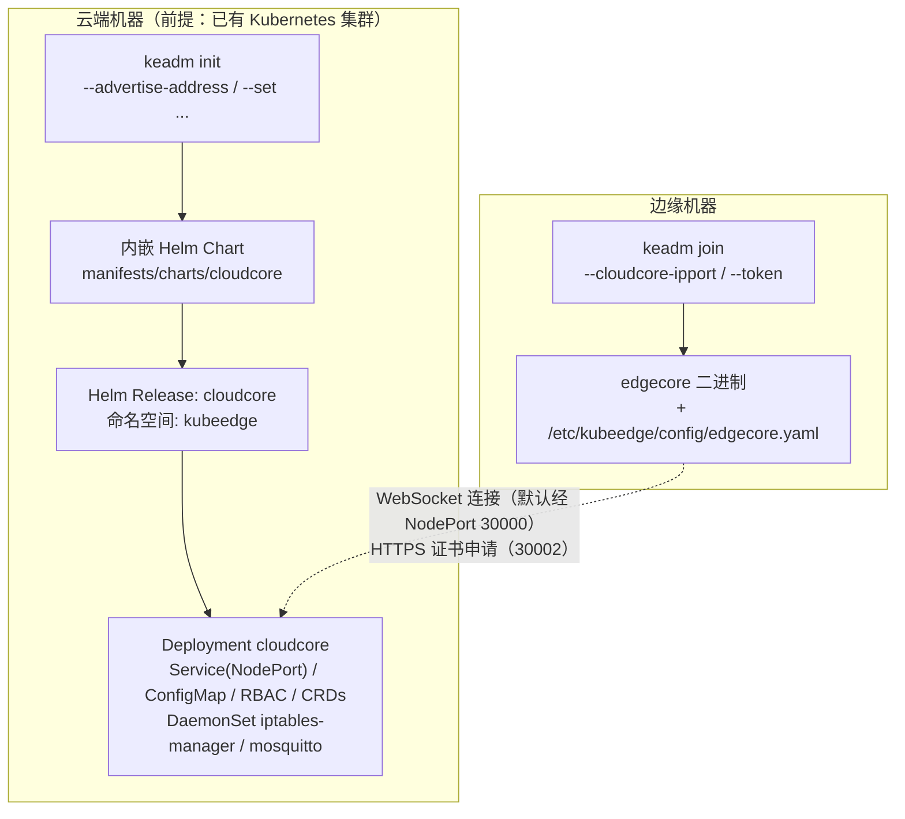
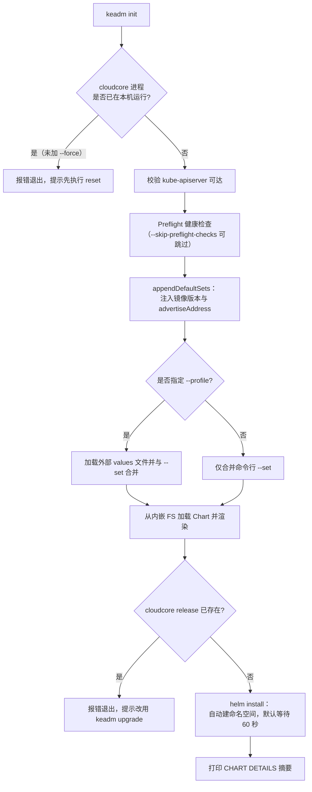
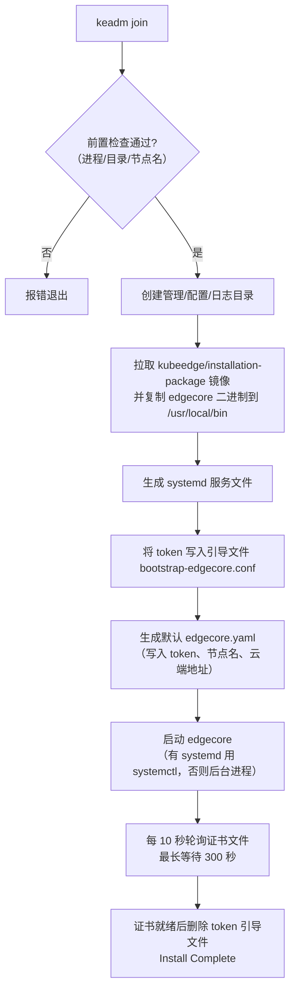

KubeEdge 官方推荐使用 `keadm` 工具完成云边集群的一键引导：在云端执行 `keadm init` 部署 CloudCore，在边缘执行 `keadm join` 接入边缘节点。自 v1.9 起，云端部署不再依赖下载二进制与手写 systemd 服务，而是改为**内嵌 Helm Chart 渲染**——keadm 二进制内部打包了完整的 cloudcore Chart，通过 Helm SDK 直接安装到 Kubernetes 集群。本页面向初学者剖析这套部署体系的设计原理、核心参数与标准工作流。

## 一、keadm 与 Helm Charts 的分工：一张全景图

理解这套体系前，先厘清三个角色：**keadm** 是引导 CLI（类比 Kubernetes 世界的 kubeadm）；**cloudcore Chart** 是描述云端组件全部 Kubernetes 资源的模板集合（位于 `manifests/charts/cloudcore/`）；**Helm** 是渲染模板并落盘资源的包管理引擎。keadm 的巧妙之处在于通过 Go 的 `embed` 机制把整个 Chart 目录编译进二进制，使用者无需单独下载 Chart，也不必在本机安装 Helm 客户端——keadm 直接调用 Helm 的 Go SDK（`helm.sh/helm/v3/pkg/action`）完成安装。



部署目标由此清晰：云端机器只需一个可用的 Kubernetes 集群和 `keadm init` 一条命令；边缘机器只需网络可达云端、能拉取容器镜像，并执行 `keadm join`。这一"云端一命令、边缘一命令"的心智模型直接写在 keadm 的帮助文档中。

Sources: [manifests.go](manifests/manifests.go#L25-L36), [cmd_others.go](keadm/cmd/keadm/app/cmd/cmd_others.go#L48-L62)

## 二、keadm 命令全景

keadm 基于 cobra 框架组织命令，入口在 `NewKubeedgeCommand()` 中统一注册。命令分为四个层次：**推荐命令**（`init`、`join`、`manifest`、`reset` 等）、**beta 命令**、**升级相关命令**（`upgrade`/`backup`/`rollback`）以及**已废弃命令**（`keadm deprecated`）。

| 命令 | 作用位置 | 核心职责 |
| --- | --- | --- |
| `keadm init` | 云端 | 渲染并安装 cloudcore Chart，创建 `kubeedge` 命名空间 |
| `keadm manifest` | 云端 | 仅渲染 Chart 输出 Kubernetes 资源清单，不实际安装，用于审计 |
| `keadm gettoken` | 云端 | 读取供边缘节点接入的令牌 |
| `keadm join` | 边缘 | 安装 edgecore 并连接 CloudCore |
| `keadm reset` | 云/边缘 | 卸载组件并清理目录，是 init/join 的逆操作 |
| `keadm upgrade` | 云/边缘 | 基于 Helm release 或节点任务升级版本 |
| `keadm deprecated init/join/reset` | 云/边缘 | 旧版二进制下载式安装，**不推荐** |

新命令集与旧命令集的关键区别在于实现方式：推荐命令统一走 Helm 路径，而 `keadm deprecated` 子树保留了历史版本的"下载压缩包、写 systemd 服务"流程，官方明确标注其不建议使用。

Sources: [cmd_others.go](keadm/cmd/keadm/app/cmd/cmd_others.go#L75-L101), [deprecated.go](keadm/cmd/keadm/app/cmd/deprecated/deprecated.go#L8-L22)

## 三、云端部署：keadm init 的执行流水线

`keadm init` 的命令描述明确写道：以类似 Helm 的 `--set` 参数列表安装 KubeEdge 云端组件。它内部分五个阶段执行，理解这条流水线能帮你在安装失败时快速定位阶段。



第一阶段是**幂等性防护**：安装前先检测本机是否已有 cloudcore 进程在运行，若存在则要求先执行 `keadm reset`，防止重复部署产生冲突；只有显式传入 `--force` 或指定 `--external-helm-root` 时才跳过该检查。第二阶段确认 Kubernetes 集群可达后，进入 **Preflight 检查**（校验集群健康状态，可用 `--skip-preflight-checks` 关闭）。随后进入本页的主角——**values 组装**，最后以 Helm 原生 `action.Install` 落盘：release 名固定为 `cloudcore`，命名空间固定为 `kubeedge`（`constants.SystemNamespace`），默认自动创建命名空间并等待 60 秒确认部署就绪。

Sources: [init.go](keadm/cmd/keadm/app/cmd/cloud/init.go#L31-L65), [cloudcore.go](keadm/cmd/keadm/app/cmd/helm/cloudcore.go#L92-L172), [installer.go](keadm/cmd/keadm/app/cmd/helm/installer.go#L30-L46)

### 参数到 values 的三步注入

初学者最容易困惑的是：命令行参数如何变成 Chart 的配置？答案是 `appendDefaultSets` 函数执行的三步注入，它把 keadm 专属参数翻译成标准的 Helm `--set` 键值对追加进 values 列表：

| 你传入的参数 | keadm 自动生成的 `--set` | 作用 |
| --- | --- | --- |
| `--kubeedge-version v1.23.0` | `cloudCore.image.tag=v1.23.0`、`iptablesManager.image.tag=...`、`controllerManager.image.tag=...` | 三个组件镜像统一对齐到目标版本 |
| `--image-repository myrepo.com` | `cloudCore.image.repository=myrepo.com/cloudcore` 等 | 为私有镜像仓库批量改写镜像前缀 |
| `--advertise-address 10.0.0.1,10.0.0.2` | `cloudCore.modules.cloudHub.advertiseAddress[0]=10.0.0.1`、`...[1]=10.0.0.2` | 写入 CloudCore 证书的 SubAltNames 与对外地址 |

注意注入是**非覆盖式**的：只有当用户没有通过 `--set` 显式指定同名键时，默认值才会追加（`HasSets` 判断），保证用户配置优先。其中 `--advertise-address` 是整条链路中**最关键的必填参数**——它决定边缘节点从哪个地址连接云端，Chart 的注释甚至警告：留空会导致 CloudCore 启动后异常退出。

Sources: [cloudcore.go](keadm/cmd/keadm/app/cmd/helm/cloudcore.go#L316-L339), [values.yaml](manifests/charts/cloudcore/values.yaml#L41-L44)

## 四、cloudcore Helm Chart 解析：values.yaml 与模板清单

Chart 元数据声明了名称 `cloudcore` 与版本 `1.23.0`（与代码中的默认版本常量 `DefaultKubeEdgeVersion = "1.23.0"` 保持同源）。其目录组织如下：

```
manifests/charts/cloudcore/
├── Chart.yaml                  # Chart 元数据
├── README.md                   # 全部可配置项文档（keadm --set 的官方字典）
├── values.yaml                 # 默认值
├── crds/                       # 14 个 CRD：EdgeApplication、NodeGroup、Device、Rule 等
└── templates/                  # 渲染模板
    ├── deployment_cloudcore.yaml       # CloudCore 主 Deployment
    ├── service_cloudcore.yaml          # NodePort Service
    ├── configmap_cloudcore.yaml        # cloudcore.yaml 配置
    ├── secret_cloudcore.yaml           # token secret（gettoken 的数据源）
    ├── rbac_cloudcore.yaml 等系列      # RBAC
    ├── daemonset_iptablesmanager.yaml  # iptables 管理器
    ├── daemonset_mosquitto.yaml        # 边缘 MQTT broker（可选）
    └── deployment_controllermanager / admission.yaml  # 可选组件
```

`values.yaml` 中与初学者最相关的默认值如下表。掌握这些键名，即可用 `--set` 覆盖任意一项：

| 配置键 | 默认值 | 说明 |
| --- | --- | --- |
| `cloudCore.image.repository/tag` | `kubeedge/cloudcore` / `v1.23.0` | 主组件镜像 |
| `cloudCore.modules.cloudHub.advertiseAddress` | `[""]` | **必须设置**为边缘可达的 IP |
| `cloudCore.modules.cloudHub.websocket.enable` | `true`（端口 10000） | 默认云边通信协议 |
| `cloudCore.modules.cloudHub.quic.enable` | `false`（端口 10001） | QUIC 协议默认关闭 |
| `cloudCore.service.type` | `NodePort` | 对外暴露方式 |
| `cloudCore.service.cloudhubNodePort` | `30000` | WebSocket 对外端口 |
| `cloudCore.service.tunnelNodePort` | `30004` | kubectl exec/logs 隧道端口 |
| `iptablesManager.enable / mode` | `true` / `external` | 自动为 Service 配置 iptables 转发 |
| `controllerManager.enable` | `false` | EdgeApplication/节点组控制器，按需开启 |
| `mosquitto.enable` | `true` | 边缘侧 MQTT broker（DaemonSet） |

Chart 的 README 是参数权威字典，逐条记录了每个键的默认值与语义，`keadm init --set` 与原生 `helm install -f values.yaml` 共用同一套键名。渲染产物中，cloudcore Deployment 以 `hostNetwork: true` 运行并暴露 10000–10004 五个容器端口，分别对应 WebSocket、QUIC、HTTPS 证书服务、CloudStream 与隧道服务。

Sources: [Chart.yaml](manifests/charts/cloudcore/Chart.yaml#L1-L8), [values.yaml](manifests/charts/cloudcore/values.yaml#L4-L110), [values.yaml](manifests/charts/cloudcore/values.yaml#L112-L202), [README.md](manifests/charts/cloudcore/README.md#L15-L57), [deployment_cloudcore.yaml](manifests/charts/cloudcore/templates/deployment_cloudcore.yaml#L44-L60)

## 五、边缘接入：keadm join 的引导流程

与云端不同，边缘节点不使用 Helm——`keadm join` 直接拉取安装包镜像、释放 edgecore 二进制、生成配置并以 systemd 服务启动。它先执行三重前置检查：edgecore 进程未运行、管理目录 `/var/lib/kubeedge` 为空、目标节点名未被集群注册（通过向云端的 `https://<ip>:10002/node/<name>` 发起探测实现）。



两个设计细节值得初学者注意。其一，**token 一次性使用**：令牌仅写入临时引导文件，edgecore 凭它向云端 HTTPS 端口（默认 10002）申请证书，证书签发完成后引导文件立即删除，凭据不落盘——这正是云边双向信任的起点。其二，**协议自动装配**：默认 WebSocket 模式下，`--cloudcore-ipport` 的地址写入 WebSocket Server 配置、QUIC Server 自动补全为同主机 10001 端口、隧道服务器指向 10004；若指定 `--hub-protocol=quic` 则反之。此外 `keadm join` 也支持 `--set` 风格参数直接修改 edgecore 配置（如 `--set modules.edged.tailoredKubeletConfig.pods=-1`），底层以严格模式反序列化校验，写错键名会直接报错而非静默忽略。

Sources: [join.go](keadm/cmd/keadm/app/cmd/edge/join.go#L66-L99), [join_others.go](keadm/cmd/keadm/app/cmd/edge/join_others.go#L52-L102), [join_others.go](keadm/cmd/keadm/app/cmd/edge/join_others.go#L104-L198), [join_others.go](keadm/cmd/keadm/app/cmd/edge/join_others.go#L200-L256)

`keadm join` 的完整参数如下表（`--cloudcore-ipport` 为唯一必填项）：

| 参数 | 简写 | 默认值 | 说明 |
| --- | --- | --- | --- |
| `--cloudcore-ipport` | `-e` | 无（必填） | CloudCore 地址，格式 `IP:Port`（WebSocket 用 10000） |
| `--token` | `-t` | 空 | `keadm gettoken` 获取的接入令牌 |
| `--edgenode-name` | `-i` | 主机名 | 边缘节点唯一标识 |
| `--kubeedge-version` | 无 | 自动探测最新版，失败回退 `1.23.0` | 指定安装版本 |
| `--cgroupdriver` | 无 | `cgroupfs` | 容器 cgroup 驱动，需与容器运行时一致 |
| `--remote-runtime-endpoint` | `-p` | 系统 socket | 容器运行时端点 |
| `--labels` | `-l` | 空 | 节点标签，如 `key1=val1,key2=val2` |
| `--image-repository` | 无 | 官方源 | 安装包镜像仓库前缀 |
| `--certport` | `-s` | `10002` | 证书申请端口 |
| `--pre-run` / `--post-run` | 无 | 空 | 安装前后执行的钩子脚本 |

Sources: [join_others.go](keadm/cmd/keadm/app/cmd/edge/join_others.go#L52-L102), [join.go](keadm/cmd/keadm/app/cmd/edge/join.go#L45-L53), [constant.go](keadm/cmd/keadm/app/cmd/common/constant.go#L129-L130)

## 六、标准部署工作流：从零到云边互通

将前述机制串联，一次完整的云边环境搭建只需四步。以下命令均来自代码中的官方示例：

```bash
# ① 云端：安装 CloudCore（advertise-address 必须是边缘可达的 IP）
sudo keadm init --advertise-address=10.20.30.40 --kubeedge-version=v1.23.0

# ② 云端：获取边缘接入令牌
sudo keadm gettoken --kube-config /root/.kube/config

# ③ 边缘：携带令牌接入集群
sudo keadm join --cloudcore-ipport=10.20.30.40:10000 \
    --token=<步骤②的输出> --edgenode-name=testing123

# ④ 云端验证：节点就绪后开始下发应用
kubectl get nodes
```

该工作流对应的端到端验收逻辑已被 `tests/e2e_keadm` 测试套件覆盖。若想在实际安装前审计将产生的资源，可在步骤①前执行 `keadm manifest --advertise-address=10.20.30.40 --dry-run`——它走与 init 完全相同的渲染管线，但只把 YAML 打印到标准输出；配合 `--skip-crds` 可省略 14 个 CRD 的输出噪音。

Sources: [init.go](keadm/cmd/keadm/app/cmd/cloud/init.go#L37-L44), [gettoken.go](keadm/cmd/keadm/app/cmd/cloud/gettoken.go#L31-L64), [join.go](keadm/cmd/keadm/app/cmd/edge/join.go#L45-L53), [manifest.go](keadm/cmd/keadm/app/cmd/cloud/manifest.go#L32-L80)

## 七、定制化手段对比：keadm --set、profile 与原生 Helm

keadm 在 Helm 之上提供了三种 values 来源，理解其优先级与适用场景是进阶配置的关键：

| 手段 | 语法示例 | 适用场景 |
| --- | --- | --- |
| `--set`（命令行键值） | `--set cloudCore.modules.cloudHub.nodeLimit=500` | 少量临时调整，优先级最高 |
| `--profile`（values 文件） | `--profile /path/version.yaml` 或 `--profile version=v1.23.0` | 批量预定义配置；传 `version=vX.Y.Z` 时加载**内嵌**的 `profiles/version.yaml` |
| `--external-helm-root`（外部 Chart 目录） | `--external-helm-root /my/charts` | 改造过 Chart 的用户；指定后 keadm 从磁盘读取而非内嵌 FS |

与原生 Helm 安装的对比如下。两者渲染产物完全一致（同一 Chart、同一键名空间），差异仅在使用成本：

| 维度 | `keadm init` | 原生 `helm upgrade --install` |
| --- | --- | --- |
| 前置条件 | 仅需 keadm 二进制（Chart 已内嵌） | 需安装 Helm CLI 并获取 Chart |
| 前置检查 | 自动检测进程/集群/Preflight | 无，需自行保证 |
| 版本管理 | `--kubeedge-version` 自动对齐三个组件镜像 tag | 需手动维护 `-f values.yaml` 中所有 tag |
| 卸载 | `keadm reset cloud` 一条命令 | `helm uninstall` + 手动删命名空间 |

Chart README 中的官方 Helm 原生示例可供对照：`helm upgrade --install cloudcore ./cloudcore --namespace kubeedge --create-namespace --set cloudCore.modules.cloudHub.advertiseAddress[0]=192.168.88.6`。

Sources: [installer.go](keadm/cmd/keadm/app/cmd/helm/installer.go#L30-L46), [init.go](keadm/cmd/keadm/app/cmd/cloud/init.go#L94-L107), [README.md](manifests/charts/cloudcore/README.md#L5-L13), [manifests.go](manifests/manifests.go#L29-L36)

## 八、清理与重置：keadm reset 的对称设计

`keadm reset` 与 init/join 严格对称：云端子命令检测到本机 CloudCore 运行后，先给出交互式确认（`--force` 可跳过），随后执行 `TearDownCloudCore`——其内部同样经由 Helm 封装层，清理整个 `kubeedge` 命名空间（等价于 Helm 卸载加命名空间删除），最后清理本机状态目录。边缘侧 `keadm reset` 对称地停止 edgecore 进程并清空 `/var/lib/kubeedge`。

```bash
sudo keadm reset cloud    # 云端：卸载 Helm release 并删除 kubeedge 命名空间
sudo keadm reset          # 边缘：停止 edgecore 并清理管理目录
```

这套"安装什么就卸载什么"的对称性，使初学者可以放心地反复试验 init → join → reset 循环而不必担心残留污染。

Sources: [reset.go](keadm/cmd/keadm/app/cmd/cloud/reset.go#L43-L97), [cloudcore.go](keadm/cmd/keadm/app/cmd/helm/cloudcore.go#L296-L303)

## 九、常见问题速查

部署失败的报错信息直接映射到上文流水线的具体阶段，按阶段定位即可：

| 报错信息 | 阶段 | 处理方式 |
| --- | --- | --- |
| `CloudCore is already running on this node, please run reset to clean up first` | init 前置检查 | 执行 `keadm reset cloud` 后重试 |
| `the cloudcore release already exists, and you can upgrade the cloudcore using the keadm upgrade` | release 检查 | 已安装过，改用升级命令而非重复 init |
| `failed to verify k8s component installed` | 集群可达性 | 确认 kubeconfig 有效且集群健康 |
| 边缘侧 `EdgeCore is already running...` / `the management directory ... is not clean` | join 前置检查 | 执行边缘 `keadm reset` 清理 |
| `node already exists or internal error occurred, cannot register again` | 节名冲突 | 换 `--edgenode-name` 或先在云端删除旧 Node 对象 |
| CloudCore 起来后边缘始终连不上 | advertiseAddress | 检查 `--advertise-address` 是否为边缘实际可达地址（而非回环/内网不可达 IP） |
| join 卡在等待证书 300 秒后失败 | token/网络 | 核对 token 是否来自目标集群、30002 端口是否放通 |

Sources: [cloudcore.go](keadm/cmd/keadm/app/cmd/helm/cloudcore.go#L99-L113), [cloudcore.go](keadm/cmd/keadm/app/cmd/helm/cloudcore.go#L150-L155), [join.go](keadm/cmd/keadm/app/cmd/edge/join.go#L73-L99), [join_others.go](keadm/cmd/keadm/app/cmd/edge/join_others.go#L242-L253)

## 下一步阅读

掌握了部署工具链后，建议按以下路径深入：若尚未动手，先回到 [快速开始：搭建首个云边协同环境](2-kuai-su-kai-shi-da-jian-shou-ge-yun-bian-xie-tong-huan-jing) 完成实操；部署完成后，沿 [EdgeCore：模块化边缘核心与启动生命周期](15-edgecore-mo-kuai-hua-bian-yuan-he-xin-yu-qi-dong-sheng-ming-zhou-qi) 理解 join 所启动的边缘进程内部结构，通过 [CloudHub：云边长连接网关与消息分发](8-cloudhub-yun-bian-chang-lian-jie-wang-guan-yu-xiao-xi-fen-fa) 理解 30000 端口背后的连接管理，用 [云边安全与认证体系（证书、令牌与边缘鉴权）](26-yun-bian-an-quan-yu-ren-zheng-ti-xi-zheng-shu-ling-pai-yu-bian-yuan-jian-quan) 深入 token 引导与证书签发的安全机制；需要参与开发则进入 [本地开发与调试环境（local-up 与代码生成）](5-ben-di-kai-fa-yu-diao-shi-huan-jing-local-up-yu-dai-ma-sheng-cheng)，或用 [测试体系：端到端与集成测试框架](29-ce-shi-ti-xi-duan-dao-duan-yu-ji-cheng-ce-shi-kuang-jia) 中介绍的 `tests/e2e_keadm` 验证你定制后的部署流程。