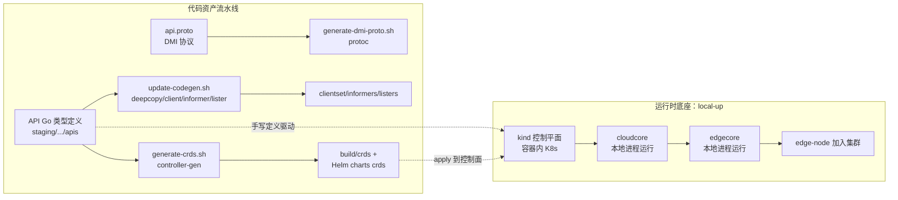
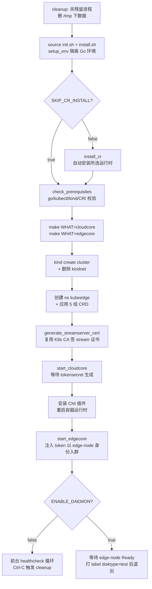
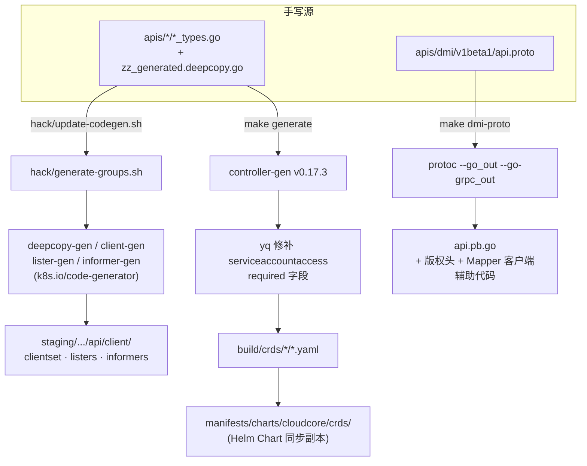

本页面向希望在 KubeEdge 源码上进行二次开发与调试的中级开发者，系统讲解两大开发基础设施：其一是 `hack/local-up-kubeedge.sh`——一条命令在本机拉起"云端控制面 + 边缘节点"的最小可运行环境；其二是 `hack/` 目录下的代码生成体系——当修改 API 定义时，如何自动生成 deepcopy 函数、clientset/informer/lister 以及 CRD YAML。掌握这两套机制后，你可以在不依赖真实多机环境的条件下完成绝大部分云边协同功能的开发验证。

## 环境全景：两条主线构成的开发底座

KubeEdge 的本地开发环境可以抽象为"运行时底座"与"代码资产流水线"两条主线。前者回答"我的代码跑在哪里、怎么跑起来"，后者回答"我改了 API 之后，配套的生成代码和清单如何保持一致"。两者共同衔接源码编译（详见 [源码编译与构建指南（Makefile 与构建规则）](3-yuan-ma-bian-yi-yu-gou-jian-zhi-nan-makefile-yu-gou-jian-gui-ze)）与测试体系（详见 [测试体系：端到端与集成测试框架](29-ce-shi-ti-xi-duan-dao-duan-yu-ji-cheng-ce-shi-kuang-jia)）。

理解这张图的关键在于：local-up 环境中 **cloudcore 与 edgecore 都不是容器化部署**，而是以本地进程方式直接运行（通过 `nohup` 后台拉起），只有 K8s 控制平面运行在 kind 容器中。这种设计让你可以直接在 IDE 中断点调试云端或边缘代码，而无需经历镜像构建与推送环节。

Sources: [local-up-kubeedge.sh](hack/local-up-kubeedge.sh#L208-L238), [local-up-kubeedge.sh](hack/local-up-kubeedge.sh#L240-L304), [update-codegen.sh](hack/update-codegen.sh#L47-L50), [go.work](go.work#L1-L9)

## 一键拉起：local-up-kubeedge.sh 的可配置项

脚本通过环境变量暴露行为开关，默认值针对"最快可用"场景设计。启动前无需手工安装容器运行时以外的任何 KubeEdge 组件，kind 若缺失还会通过 `go install` 自动补装：

| 环境变量 | 默认值 | 作用 |
|---|---|---|
| `KIND_IMAGE`（第 1 参数） | `kindest/node:v1.32.2` | 控制平面 K8s 版本 |
| `CLUSTER_NAME` | `test` | kind 集群名，决定容器名 `<name>-control-plane` |
| `CONTAINER_RUNTIME` | `containerd` | edgecore 使用的 CRI，支持 `docker`/`cri-o`/`isulad` |
| `PROTOCOL` | `WebSocket` | 云边通信协议，设为 `QUIC` 时切换 |
| `ENABLE_DAEMON` | `false` | `true` 时脚本后台等待节点就绪（e2e 使用） |
| `LOG_DIR` / `LOG_LEVEL` | `/tmp` / `2` | 日志目录与 klog 详细度 |
| `SKIP_CR_INSTALL` | `false` | 跳过容器运行时自动安装 |
| `ENABLE_CNI` | `false` | 边缘 Pod 启用 CNI 时注入 clusterDNS |

其中 `install_cr` 函数对 docker/cri-o/isulad 三种非默认运行时提供了自动安装逻辑，内置最多 5 次重试，且在第 4 次尝试时会自动将 apt 源切换为中科大镜像以缓解网络问题——这是针对国内开发环境的实用容错。

Sources: [local-up-kubeedge.sh](hack/local-up-kubeedge.sh#L17-L27), [local-up-kubeedge.sh](hack/local-up-kubeedge.sh#L35-L107), [install.sh](hack/lib/install.sh#L30-L48)

## 执行流程：从裸机到云边就绪的八步流水线

脚本的主体流程是严格顺序化的，每一步失败都会立即终止（`set -eE`）。下图概括了从 cleanup 到边缘节点 Ready 的完整链路：

值得注意的是 CRD 安装清单与代码生成产物严格对应：devices（v1beta1）、reliablesyncs（v1alpha1）、router（v1）、operations（v1alpha2）、policy（serviceaccountaccess）五组 YAML 均取自 `build/crds/` 目录——这正是 `hack/generate-crds.sh` 的输出位置，形成了"生成 → 应用"的闭环。

Sources: [local-up-kubeedge.sh](hack/local-up-kubeedge.sh#L358-L397), [local-up-kubeedge.sh](hack/local-up-kubeedge.sh#L167-L196), [local-up-kubeedge.sh](hack/local-up-kubeedge.sh#L437-L448)

## 配置注入的艺术：sed 驱动的深度定制

local-up 最值得学习的实现技巧是"默认配置 + sed 注入"模式。cloudcore 与 edgecore 均先通过 `--defaultconfig` 导出完整默认配置到 `_output/local/bin/*.yaml`，再用一系列 `sed` 精准修改后启动。这种做法避免了维护两套独立配置文件，也保证了配置始终跟随代码中的默认值演进。

对 cloudcore 的注入包括：开启 `cloudStream`（kubectl 日志/exec 隧道的云端侧）、按需开启 QUIC 监听、开启 `dynamicController` 与 `router`，并将 kubeConfig 与各类证书路径统一重定向到 `/tmp` 下。启动后脚本会轮询 `kubectl get secret -nkubeedge` 直到 `tokensecret` 出现，确保边缘侧接入凭据已就绪。

对 edgecore 的注入更为丰富：开启 `edgeStream` 与 `metaServer`（边缘本地 API Server）；依据所选 `CONTAINER_RUNTIME` 改写 `containerRuntimeEndpoint`（docker 切到 `cri-dockerd.sock`，cri-o 切到 `crio.sock`，isulad 还需降级 runc）；从 tokensecret 提取接入令牌；设置 `hostnameOverride: edge-node`；将 `mqttMode` 强制为 `0`（使用进程内嵌 MQTT broker，免除外部 Mosquitto 依赖）；并通过符号链接将配置挂到 `/etc/kubeedge/config/edgecore.yaml`。此外脚本会设置 `CHECK_EDGECORE_ENVIRONMENT=false`，跳过边缘环境检查以便在开发机上运行。

Sources: [local-up-kubeedge.sh](hack/local-up-kubeedge.sh#L208-L238), [local-up-kubeedge.sh](hack/local-up-kubeedge.sh#L240-L304)

## 证书与数据隔离：为什么一切都搬进 /tmp

`generate_streamserver_cert` 函数直接用 `docker cp` 从 kind 控制平面容器中拷出 Kubernetes CA 证书与私钥，再用 `openssl` 以 `127.0.0.1` 为 SAN 签发 stream 证书——这样 cloudstream/edgestream 建立的云边隧道证书天然被 K8s API Server 信任，省去了手工分发 CA 的步骤。同时，所有 kubeedge 运行时数据（`/tmp/etc/kubeedge`、`/tmp/var/lib/kubeedge`）都重定向到临时目录，配合退出时的 cleanup 逻辑，保证脚本可反复重跑而不污染宿主机。

Sources: [local-up-kubeedge.sh](hack/local-up-kubeedge.sh#L324-L356), [local-up-kubeedge.sh](hack/local-up-kubeedge.sh#L145-L148)

## Makefile 快捷入口与调试构建

local-up 内部复用 Makefile 的构建目标，理解这些入口有助于将调试手段组合起来：

| Make 目标 | 对应脚本 | 用途 |
|---|---|---|
| `make all WHAT=edgecore` | `hack/make-rules/build.sh` | 构建指定二进制到 `_output/local/bin` |
| `make all WHAT=cloudcore GOLDFLAGS="" GOGCFLAGS="-N -l"` | 同上 | 关闭内联与优化，支持 delve 断点调试 |
| `make generate` | `hack/generate-crds.sh` | 重新生成全部 CRD YAML |
| `make dmi-proto` | `hack/generate-dmi-proto.sh` | 从 proto 生成 DMI gRPC 代码 |
| `make verify` | 5 个 verify 脚本 | CI 级一致性校验（golang/vendor/codegen/licenses/crds） |
| `make crossbuild WHAT=edgecore ARM_VERSION=GOARM7` | `hack/make-rules/crossbuild.sh` | 交叉编译 ARMv7/ARMv8/Windows |
| `make smallbuild` | `hack/make-rules/smallbuild.sh` | edgecore 静态链接 + upx 压缩 |

调试构建的要点写在 Makefile 帮助文本中：默认 `GOLDFLAGS` 为 `-s -w`（剥离调试信息），将 `GOGCFLAGS` 设为 `-N -l` 可禁用优化与内联，从而让 delve 能正确映射源码行——这是对 cloudcore/edgecore 做断点调试的标准前置步骤。

Sources: [Makefile](Makefile#L29-L53), [Makefile](Makefile#L220-L249), [Makefile](Makefile#L73-L95), [golang.sh](hack/lib/golang.sh#L223-L252)

## 隔离的 Go 构建环境：setup_env 的沙箱设计

`kubeedge::golang::setup_env` 是所有 hack 脚本共享的环境初始化函数，其设计意图在注释中有明确阐述：将 `GOPATH` 指向仓库内的 `_output/_go` 虚拟路径，`GOCACHE` 与 `GOMODCACHE` 也一并收拢到该沙箱内，随后 `unset GOBIN`、`unset GO111MODULE`、`unset GOWORK`，确保二进制落点可预测、模块模式处于受控状态。这意味着 local-up 环境下安装的 kind 等工具与构建缓存不会污染开发者全局的 Go 环境，多版本切换也互不干扰。

构建时 `build_binaries` 将默认 ldflags 组合为 `-s -w -buildid=` 加上版本信息注入（git commit、semver 等），最终以 `go build -o ${KUBEEDGE_OUTPUT_BINPATH}/<name>` 产出二进制——local-up 脚本启动的正是这些产物。版本号通过 `git describe` 推导，若仓库没有 tag 会降级为 `v0.0.0` 并给出提示（脚本建议执行 `git fetch --tags`）。

Sources: [golang.sh](hack/lib/golang.sh#L488-L523), [golang.sh](hack/lib/golang.sh#L238-L252), [golang.sh](hack/lib/golang.sh#L50-L68), [init.sh](hack/lib/init.sh#L25-L27)

## 代码生成体系：手写 API 到全部派生资产的流水线

当你在 `staging/src/github.com/kubeedge/api/apis` 下新增或修改资源类型时，需要重新生成四类资产。整个流水线的驱动关系如下：

**clientset/informer/lister 生成**：`update-codegen.sh` 维护着 7 组 group:version 清单（devices:v1beta1、reliablesyncs:v1alpha1、rules:v1、apps:v1alpha1、operations:v1alpha1 与 v1alpha2、policy:v1alpha1），调用 `generate-groups.sh` 时以 `GOWORK=off GOFLAGS=-mod=vendor` 安装 k8s.io/code-generator 的四个生成器，产物统一写入 `staging/src/github.com/kubeedge/api/client/` 下的 clientset、listers、informers 子目录。

**CRD 生成**：`generate-crds.sh` 先自动安装缺失的 controller-gen（v0.17.3）与 yq（v4.44.3），在 apis 目录上执行 `crd:crdVersions=v1,generateEmbeddedObjectMeta=true,allowDangerousTypes=true` 生成到临时目录，随后做两项后处理——用 yq 为 serviceaccountaccess 补上 x-kubernetes-list-map-keys 所需的 `required` 字段（这是上游 Kubernetes 的已知问题，脚本中以 TODO 标注），再将产物按 `devices_<version>_<resource>.yaml` 等命名规则**同时复制到 `build/crds/` 与 Helm Chart 目录 `manifests/charts/cloudcore/crds/`**，保证 keadm 部署与本地 local-up 使用同一份清单。router CRD 因非生成产物，只做单向同步。

**DMI 协议生成**：设备管理接口（DMI）走独立的 proto 工具链，`protoc` 生成 `api.pb.go` 后，脚本通过 `sed` 注入 Apache 版权头，并追加 `NewMapperClient`/`NewDeviceManageClient` 两个便捷构造函数，最后 gofmt 格式化。

Sources: [update-codegen.sh](hack/update-codegen.sh#L26-L50), [generate-groups.sh](hack/generate-groups.sh#L47-L92), [generate-crds.sh](hack/generate-crds.sh#L61-L153), [generate-dmi-proto.sh](hack/generate-dmi-proto.sh#L63-L83)

## 一致性守护：copy-regenerate-diff 校验模式

生成的代码与 YAML 属于"必须与源定义保持同步"的资产，KubeEdge 采用统一的校验范式：verify 脚本先把现有产物备份到 `_tmp`，重新执行一次完整生成，然后 `diff -Naupr` 对比新旧产物——不一致则报错退出并提示运行对应的 update 脚本。`make verify` 将其与 Go 版本、vendor、许可证校验串联，构成 PR 提交前的最终防线。

| 校验脚本 | 守护对象 | 提示的修复命令 |
|---|---|---|
| `hack/verify-codegen.sh` | `staging/.../api` 全部生成代码 | `hack/update-codegen.sh` |
| `hack/verify-crds.sh` | `build/crds/` 下的 CRD YAML | `hack/generate-crds.sh` |

这一机制解释了为什么修改 `_types.go` 后必须跑一次 update 脚本：若只改了结构体而未重新生成 deepcopy 与 clientset，CI 的 diff 校验会立即失败。API 生成体系的完整设计背景可进一步阅读 [API 定义、CRD 规范与代码生成体系](24-api-ding-yi-crd-gui-fan-yu-dai-ma-sheng-cheng-ti-xi)。

Sources: [verify-codegen.sh](hack/verify-codegen.sh#L23-L48), [verify-crds.sh](hack/verify-crds.sh#L23-L48), [Makefile](Makefile#L67-L95)

## 多模块工作区：go.work 如何缝合主仓与 staging

仓库根目录的 `go.work` 声明了四个模块：主模块（`.`）、`staging/src/github.com/kubeedge/api`（API 与生成客户端所在）、`staging/src/github.com/kubeedge/beehive`（消息框架）与 `staging/src/github.com/kubeedge/mapper-framework`。在 IDE 中打开仓库根目录即可获得跨模块的代码跳转与补全。需要注意一个反直觉的细节：`build.sh` 与 `generate-groups.sh` 在执行时显式 `GOWORK=off`——构建产物和生成器安装走各自的模块依赖，而日常开发与 `setup_env` 环境下工作区是激活状态（`unset GOWORK` 恢复默认开启）。

Sources: [go.work](go.work#L1-L9), [golang.sh](hack/lib/golang.sh#L516-L518), [generate-groups.sh](hack/generate-groups.sh#L52), [build.sh](hack/make-rules/build.sh#L26-L28)

## 与 e2e 测试体系的联动

local-up 脚本不仅是手工调试工具，更是 CI 中 e2e 测试的环境供给层。`tests/scripts/execute.sh` 在编译测试二进制后以 `ENABLE_DAEMON=true` 调用同一脚本拉起环境，随后启动 ginkgo 套件。`ENABLE_DAEMON=true` 模式下脚本的收尾逻辑从"前台 healthcheck 死循环"切换为"轮询 `kubectl get nodes` 直到 `edge-node` 变为 Ready、打上 `disktype=test` 标签后让脚本自身退出但环境保持运行"——这正是 e2e 需要的"就绪即返回"语义。环境复用意味着你在本地手工调试 e2e 失败案例时，可以用完全相同的方式拉起环境重放。

Sources: [execute.sh](tests/scripts/execute.sh#L40-L66), [local-up-kubeedge.sh](hack/local-up-kubeedge.sh#L420-L448)

## 故障排查速查表

| 症状 | 根因定位 | 处置方式 |
|---|---|---|
| 脚本报 Go 版本过低 | `verify_golang_version` 要求 minor ≥ 21 | 升级 Go 或使用容器内构建 |
| cloudcore 启动后 e2e 卡在等节点 | 边缘接入 token 未生成 | 查看 `/tmp/cloudcore.log`，确认 tokensecret 已创建 |
| edgecore 起不来且日志报 CRI 连接失败 | `CONTAINER_RUNTIME` 与实际运行时不符 | 核对 endpoint：docker→`cri-dockerd.sock`，cri-o→`crio.sock` |
| 边缘 Pod 无网络 | kindnet 被删除后 CNI 未装好 | 检查 `/opt/cni/bin/loopback` 与 `/etc/cni/net.d/10-containerd-net.conflist` |
| `make verify` 报 codegen out of date | 手改了 API 未重新生成 | 执行 `hack/update-codegen.sh` / `make generate` |
| 想用 delve 调试但断点不命中 | 默认 ldflags 剥离了调试信息 | `make all WHAT=<组件> GOLDFLAGS="" GOGCFLAGS="-N -l"` |
| 二进制版本号显示 v0.0.0 | 仓库缺少 git tag | `git fetch --tags` 后重新构建 |

Sources: [golang.sh](hack/lib/golang.sh#L29-L48), [local-up-kubeedge.sh](hack/local-up-kubeedge.sh#L234-L237), [local-up-kubeedge.sh](hack/local-up-kubeedge.sh#L253-L274), [install.sh](hack/lib/install.sh#L122-L192), [verify-codegen.sh](hack/verify-codegen.sh#L44-L47), [Makefile](Makefile#L42-L51), [golang.sh](hack/lib/golang.sh#L60-L68)

## 推荐阅读路径

- 动手前的构建基础：[源码编译与构建指南（Makefile 与构建规则）](3-yuan-ma-bian-yi-yu-gou-jian-zhi-nan-makefile-yu-gou-jian-gui-ze)——理解 `make WHAT=` 与容器内外构建的分工。
- 修改 API 后的完整工作流：[API 定义、CRD 规范与代码生成体系](24-api-ding-yi-crd-gui-fan-yu-dai-ma-sheng-cheng-ti-xi)——深入 CRD 设计规范与生成器原理。
- 环境就绪后的验证：[测试体系：端到端与集成测试框架](29-ce-shi-ti-xi-duan-duan-yu-ji-cheng-ce-shi-kuang-jia) 与 [测试体系：端到端与集成测试框架](29-ce-shi-ti-xi-duan-dao-duan-yu-ji-cheng-ce-shi-kuang-jia)——在 local-up 环境上运行 e2e/integration 套件。
- 提交代码前的规范：[贡献流程与社区规范](6-gong-xian-liu-cheng-yu-she-qu-gui-fan)——`make verify` 是 PR 的必过门槛。