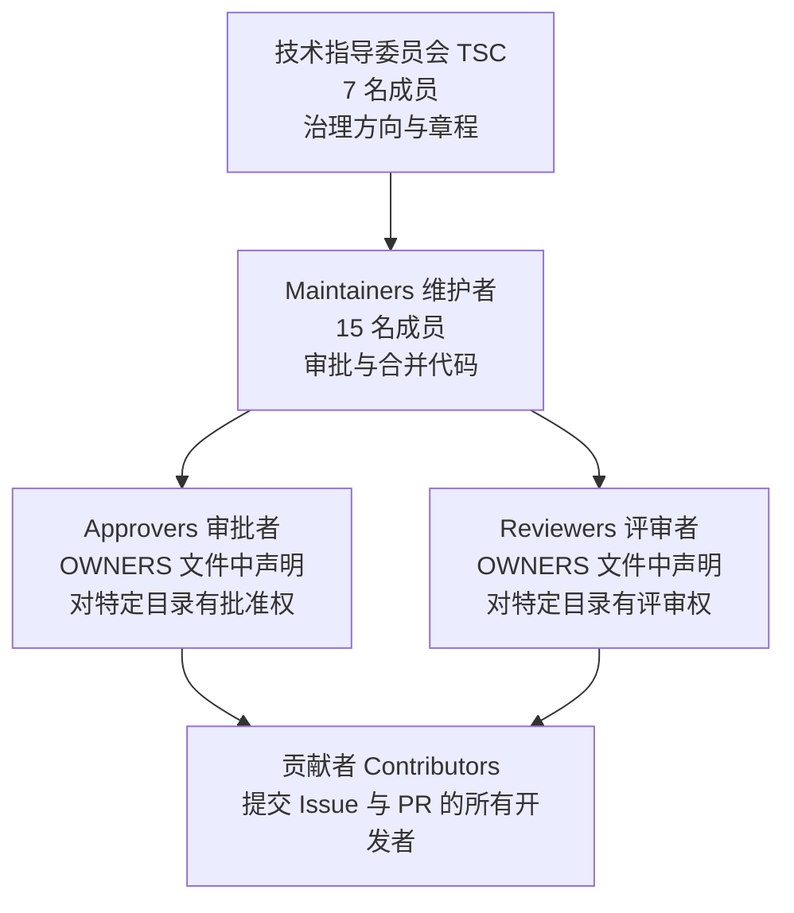
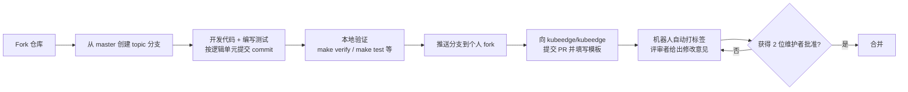
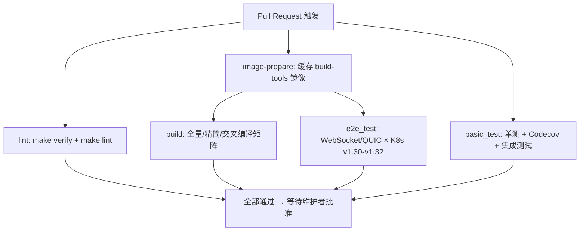

本页面向首次接触 KubeEdge 仓库的开发者，系统梳理从"寻找任务"到"PR 被合并"的完整贡献路径，以及支撑这一过程的社区治理结构与自动化质量门禁。所有内容均直接来自仓库内的贡献指南、模板文件与 CI 配置，帮助你在提交第一行代码之前就理解社区的"游戏规则"。掌握本页内容后，配合 [源码编译与构建指南（Makefile 与构建规则）](3-yuan-ma-bian-yi-yu-gou-jian-zhi-nan-makefile-yu-gou-jian-gui-ze) 中的构建命令，即可独立完成一次规范化的代码贡献。

Sources: [CONTRIBUTING.md](CONTRIBUTING.md#L1-L153)

## 社区治理与角色体系

KubeEdge 的技术决策由明确的层级结构治理，理解这一结构能帮你判断"谁有权限审核和合并我的 PR"。最高层是**技术指导委员会（TSC，Technical Steering Committee）**，由 7 名来自 QingCloud、DaoCloud、Huawei、VMware 等公司的成员组成，负责确定项目的使命、范围与目标；其下是**维护者**，是代码合并的实际守门人；不再活跃的维护者则进入**荣誉维护者**名单以保留其历史贡献记录。

Sources: [MAINTAINERS.md](MAINTAINERS.md#L5-L40)



在仓库层面，治理权通过 **OWNERS 文件**落实到具体目录。仓库根目录的 OWNERS 声明了 10 名 `approvers`（审批者）与 15 名 `reviewers`（评审者）的 GitHub ID；同样的机制也存在于 `docs/`、`hack/`、`keadm/`、`tests/` 等子目录中，形成目录级的责任制。这意味着 PR 评审请求会自动路由给对应目录的评审者，而合并则需要目录审批者的批准。

Sources: [OWNERS](OWNERS#L1-L34)

社区角色还有明确的晋升路径：随着持续贡献，普通开发者可以从贡献者逐步晋升到社区成员、评审者乃至维护者，完整的角色定义见 KubeEdge 官网的 Community Membership 页面。

Sources: [CONTRIBUTING.md](CONTRIBUTING.md#L23-L25)

## 行为规范与社区期望

参与贡献的第一条要求是阅读并遵守**社区行为准则**。仓库内的 `CODE_OF_CONDUCT.md` 是一个指针文件，正式准则维护在 kubeedge/community 仓库中；提交任何评论或代码前都应确认自己的行为符合该准则。

Sources: [CODE_OF_CONDUCT.md](CODE_OF_CONDUCT.md#L1-L3)

社区期望层面，CONTRIBUTING.md 明确了项目的协作基调：KubeEdge 是一个由社区驱动的项目，致力于构建健康、友好、高效的环境，目标是打造一个基于 Kubernetes 的云原生边缘计算平台，以规模化方式管理边缘节点与设备，并在离线场景下展现韧性与可靠性。这种大规模平台的建设需要志同道合的社区共同支撑，因此协作过程中的互相尊重是硬性前提。

Sources: [CONTRIBUTING.md](CONTRIBUTING.md#L20-L22)

对于安全问题，有一条特殊通道：不要通过公开 Issue 报告漏洞。仓库的 `SECURITY.md` 指向社区仓库中的安全政策文档，其中描述了漏洞的报告流程与处理机制。

Sources: [.github/SECURITY.md](.github/SECURITY.md#L1)

## 寻找你的第一个贡献任务

对新手而言，最友好的切入点是带有 **`good first issue`** 和 **`help wanted`** 标签的 Issue——这些是社区专门标记给新贡献者的入门任务，遍布 KubeEdge 组织的多个仓库。文档类贡献同样是绝佳起点，例如修复缺失或失效的链接。开发过程中遇到疑问，可以通过 Slack 频道或邮件列表（mailing list）向社区求助。

Sources: [CONTRIBUTING.md](CONTRIBUTING.md#L37-L46)

看中某个 Issue 后，在 Issue 下评论 **`/assign`** 或 **`/assign @你自己`**，机器人会自动将其分配给你，你的名字会出现在 Assignees 列表中——这是社区领取任务的正式方式，避免多人重复劳动。

Sources: [CONTRIBUTING.md](CONTRIBUTING.md#L44-L46)

如果不打算写代码，提交一份高质量的 Issue 同样是受社区欢迎的贡献。KubeEdge 提供了 5 种 Issue 模板，各自绑定了不同的分类标签，填写时应严格按模板提供环境信息：

| 模板 | 自动标签 | 核心字段 | 适用场景 |
|------|---------|---------|---------|
| Bug Report | `kind/bug` | 现象、期望、最小复现步骤、云端/边缘节点完整环境（K8s 版本、KubeEdge 版本、硬件、OS、内核、Go 版本） | 运行 KubeEdge 时遇到的缺陷 |
| Enhancement Request | `kind/feature` | 希望新增/修改什么、为什么需要 | 功能建议 |
| Failing Test | `kind/failing-test` | 失败的 CI 任务、失败的测试、开始失败的时间、失败原因 | 报告 CI 不稳定或失败 |
| Question | `kind/question` | 现象与预期、复现方式、K8s 与 KubeEdge 版本 | 使用疑问 |
| Release Onboarding | — | （发布协调专用） | 版本发布流程对接 |

Sources: [.github/ISSUE_TEMPLATE/bug-report.md](.github/ISSUE_TEMPLATE/bug-report.md#L1-L39)，[.github/ISSUE_TEMPLATE/enhancement.md](.github/ISSUE_TEMPLATE/enhancement.md#L1-L12)，[.github/ISSUE_TEMPLATE/failing-test.md](.github/ISSUE_TEMPLATE/failing-test.md#L1-L19)，[.github/ISSUE_TEMPLATE/question.md](.github/ISSUE_TEMPLATE/question.md#L1-L18)

Issue 应提交到对应子仓库——例如 KubeEdge 核心项目的问题开到 `kubeedge/kubeedge` 仓库，并遵循模板中提示的填写指引。

Sources: [CONTRIBUTING.md](CONTRIBUTING.md#L48-L51)

## 提交 Pull Request 的完整流程

KubeEdge 遵循标准的 GitHub PR 流程，但有几条社区强约定需要特别注意。下图描述了从 fork 到合并的完整生命周期，其中两个关键节点是：**本地验证必须先行**（预测 CI 能否通过），以及 **PR 必须获得两位维护者的批准才能合并**。



Sources: [CONTRIBUTING.md](CONTRIBUTING.md#L61-L70)

### PR 模板逐项解析

打开 PR 时，`.github/PULL_REQUEST_TEMPLATE.md` 会引导你完成五项声明，每一项都有明确用途：

| 模板字段 | 填写要求 | 作用 |
|---------|---------|------|
| What type of PR is this? | 添加 `/kind bug`、`/kind cleanup`、`/kind documentation`、`/kind feature`、`/kind test`、`/kind design` 之一；可选附加 `/kind api-change`、`/kind failing-test` | 机器人据此自动分类并路由评审 |
| What this PR does / why we need it | 说明改动内容与必要性 | 帮助评审者快速理解意图 |
| Which issue(s) this PR fixes | 使用 `Fixes #<issue 编号>` 语法 | PR 合并时自动关闭关联 Issue |
| Special notes for your reviewer | 给评审者的特别说明 | 标注需要重点关注的区域 |
| Does this PR introduce a user-facing change? | 有用户可见变更时必须填写 release-note，涉及用户迁移动作需加 `action required` 字样 | 自动汇入版本发布说明 |

Sources: [.github/PULL_REQUEST_TEMPLATE.md](.github/PULL_REQUEST_TEMPLATE.md#L14-L46)

### Commit Message 格式规范

社区对 commit message 有统一约定，核心是回答两个问题：**改了什么，为什么改**。subject 行承载"什么"，body 描述"为什么"。一个符合规范的示例：

```text
scripts: add test codes for metamanager

this add some unit test codes to improve code coverage for metamanager

Fixes #12
```

形式化定义为 `<subsystem>: <what changed>` + 空行 + 变更原因 + 空行 + footer，其中 subject 行不超过 70 字符，其余行在 80 字符处换行。若你的 PR 长时间无人评审，可以到 Slack 上寻求帮助寻找评审者。

Sources: [CONTRIBUTING.md](CONTRIBUTING.md#L102-L134)

## 质量门禁：本地验证与 CI 检查全解

PR 提交前后有两道质量关卡：开发者自行运行的**本地验证**，以及 GitHub Actions 自动执行的 **CI 流水线**。在提交 PR 前，社区要求至少跑通三项本地检查以预判 CI 结果。

Sources: [CONTRIBUTING.md](CONTRIBUTING.md#L78-L81)

### 本地验证命令速查

| 命令 | 验证内容 | 实际执行脚本 |
|------|---------|-------------|
| `make verify` | Go 版本、vendor 目录、代码生成产物、依赖许可证、CRD 规范五项一致性 | 串联 `verify-golang.sh`、`verify-vendor.sh`、`verify-codegen.sh`、`verify-vendor-licenses.sh`、`verify-crds.sh` |
| `make test` | 单元测试（`PROFILE=y` 额外生成 `coverage.out` 覆盖率文件） | `hack/make-rules/test.sh`，可用 `WHAT=cloud` 限定组件 |
| `make lint` | golangci-lint 静态检查 | `hack/make-rules/lint.sh` |
| `make integrationtest` | 边缘侧集成测试 | 验证组件间与 K8s 控制面的交互 |

Sources: [Makefile](Makefile#L67-L95)，[CONTRIBUTING.md](CONTRIBUTING.md#L80-L81)

`make verify` 是最容易被新手忽视的一道关卡：它不仅检查 Go 版本，还会校验 vendor 与代码生成产物是否与源码声明一致。若你修改了 API 定义，必须先通过 `hack/update-codegen.sh` 等生成命令同步产物再提交，相关机制详见 [API 定义、CRD 规范与代码生成体系](24-api-ding-yi-crd-gui-fan-yu-dai-ma-sheng-cheng-ti-xi)。

Sources: [Makefile](Makefile#L73-L95)

### golangci-lint 启用的检查器

`make lint` 背后的 `.golangci.yml` 采取"默认全关、按需启用"策略，当前启用了 9 个 linter，提交前建议本地安装 golangci-lint 预跑一遍，避免 CI 因风格问题打回：

| Linter | 检查内容 |
|--------|---------|
| `errcheck` | 未检查的错误返回值 |
| `goconst` | 可提取为常量的重复字符串 |
| `gofmt` / `goimports` | 格式化与 import 分组（本地前缀 `github.com/kubeedge`） |
| `gosimple` / `govet` | 可简化的代码与常见错误模式 |
| `misspell` | 拼写错误（白名单含 `mosquitto` 等项目名词） |
| `revive` | Go 代码规范（如禁止 dot-import，但允许 ginkgo/gomega 测试包） |
| `whitespace` | 多余空白行 |

Sources: [.golangci.yml](.golangci.yml#L64-L81)，[.golangci.yml](.golangci.yml#L50-L62)

### CI 流水线的四个阶段

PR 提交后，`main.yaml` 定义的 Main CI WorkFlow 会自动运行。注意它通过 `paths-ignore` 跳过纯文档改动（`**.md`、`docs/**`、`**/OWNERS`、`**/MAINTAINERS`），所以只改文档的 PR 不会触发完整构建。流水线包含四个串行/并行的 job 组：

| CI 阶段 | 内容 | 关键细节 |
|--------|------|---------|
| lint | `make verify` + `make lint` | Go 1.23.x，30 分钟超时 |
| build | `make`、`make smallbuild`、`make crossbuild`（含 GOARM7/GOARM8、Windows 交叉编译矩阵） | 默认在 `kubeedge/build-tools` 容器内构建，先由 image-prepare job 拉取镜像 |
| basic_test | `make test PROFILE=y` 单测 + Codecov 覆盖率上传 + `make integrationtest` | 覆盖率上传仅在官方仓库生效，fork 仓库跳过 |
| e2e_test | 6 组端到端测试矩阵：WebSocket 与 QUIC 协议 × Kubernetes v1.30/v1.31/v1.32 | 依赖 ginkgo v2.21.0，60 分钟超时 |

Sources: [.github/workflows/main.yaml](.github/workflows/main.yaml#L1-L200)



Sources: [.github/workflows/main.yaml](.github/workflows/main.yaml#L40-L200)

除主流水线外，仓库还配置了 `codespell.yml`（拼写检查）、`cifuzz.yml`（模糊测试）与 `fossa.yml`（许可证合规扫描）等专项工作流，共同构成多层质量防护网。

Sources: [.github/workflows](.github/workflows/main.yaml)

## 代码评审与合并标准

要通过评审，社区对 PR 质量有四条明确期望：遵循 Go 官方 [CodeReviewComments](https://github.com/golang/go/wiki/CodeReviewComments) 编码指南；撰写高质量的 commit message；将大改动拆分为一系列逻辑独立的小补丁，每个补丁单独可理解、合并后解决完整问题；用机器人提示的 `/command` 为 PR 标注合适的评审者。

Sources: [CONTRIBUTING.md](CONTRIBUTING.md#L93-L99)

**两位维护者批准**是合并的硬性门槛。PR 提交后，机器人会自动为 PR 应用结构化标签，并在评论中给出可用的 `/command` 指令建议（如 `/assign` 认领任务），指令集与 Kubernetes 社区的 Prow 机器人一致。配合 [本地开发与调试环境（local-up 与代码生成）](5-ben-di-kai-fa-yu-diao-shi-huan-jing-local-up-yu-dai-ma-sheng-cheng) 提前复现 CI 环境，能显著减少评审往返次数。

Sources: [CONTRIBUTING.md](CONTRIBUTING.md#L68-L85)

## Issue 与 PR 的生命周期管理

为防止任务无限期搁置，仓库配置了 stale 机器人（probot-stale）自动管理不活跃的 Issue 与 PR。理解其规则可以避免你的任务被意外关闭：

| 配置项 | 值 | 含义 |
|--------|-----|------|
| `daysUntilStale` | 365 天 | 无活动满一年后被标记为 `lifecycle/stale` |
| `daysUntilClose` | 90 天 | 标记 stale 后再无活动将被关闭 |
| `staleLabel` | `lifecycle/stale` | stale 标记名称 |
| `exemptLabels` | `lifecycle/frozen` | 评论 `/lifecycle frozen` 可冻结任务，永不判为 stale |
| `limitPerRun` | 5 次/小时 | 机器人限流，避免刷屏 |
| `exemptAssignees` | false | 已分配的 Issue 同样参与 stale 判定 |

Sources: [.github/stale.yml](.github/stale.yml#L14-L53)

机器人的提示语是友好的：收到 stale 通知后，只要在 PR/Issue 下评论或推送新 commit 就能解除 stale 状态；即使被关闭，社区也明确表示随时可以重新打开。

Sources: [.github/stale.yml](.github/stale.yml#L23-L42)

## 小结与下一步行动

至此你已掌握完整的贡献闭环：在 `good first issue` 中认领任务（`/assign`）→ 从 master 拉 topic 分支开发 → 按 `<subsystem>: <what>` 格式提交逻辑单元 → 本地跑通 `make verify`、`make test`、`make lint` → 提交填写完整的 PR → 通过 CI 四阶段与两位维护者批准后合并。建议按以下路径继续深入：

1. 动手前先通读 [源码编译与构建指南（Makefile 与构建规则）](3-yuan-ma-bian-yi-yu-gou-jian-zhi-nan-makefile-yu-gou-jian-gui-ze)，确保本地构建环境就绪；
2. 调试技巧参考 [本地开发与调试环境（local-up 与代码生成）](5-ben-di-kai-fa-yu-diao-shi-huan-jing-local-up-yu-dai-ma-sheng-cheng)，其中包含 `make verify` 各子脚本的工作机制；
3. 若贡献涉及测试代码，[测试体系：端到端与集成测试框架](29-ce-shi-ti-xi-duan-duan-yu-ji-cheng-ce-shi-kuang-jia) 详细拆解了 CI 中 e2e 矩阵的运行原理；
4. 修改 API 时必读 [API 定义、CRD 规范与代码生成体系](24-api-ding-yi-crd-gui-fan-yu-dai-ma-sheng-cheng-ti-xi)，这是 `make verify` 中 codegen 检查的上游知识。