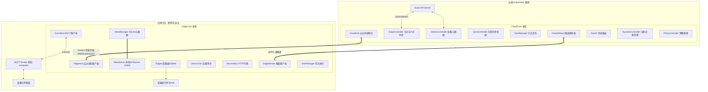
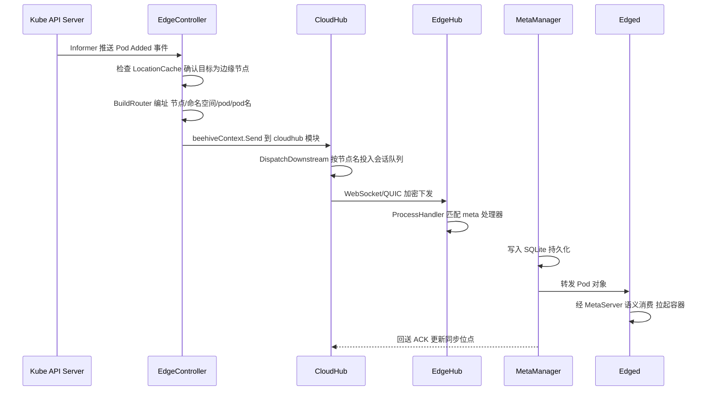
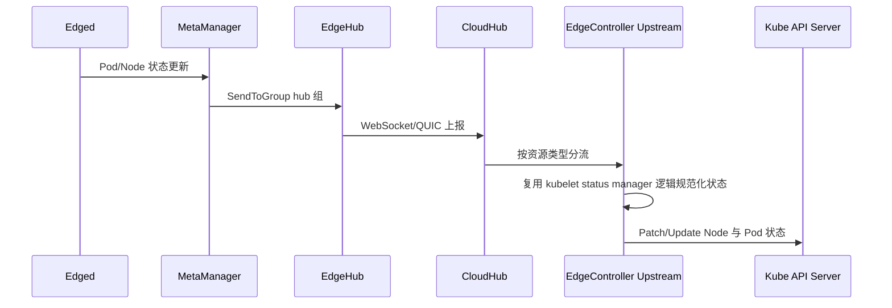

本页是整个"深入解析"章节的总纲，目标是为中级开发者建立一张可落地的 KubeEdge 架构地图：云端 CloudCore 与边缘 EdgeCore 各自由哪些模块组成、模块之间如何通过 Beehive 消息框架协作、一条消息如何跨越不稳定的广域网络完成"云端声明式意图 → 边缘本地执行"的转换。理解本页后，后续各组件深潜页面都可以在这张地图上找到自己的坐标。

## 设计原点：为什么把架构拆成"云"与"边"两个平面

Kubernetes 原生的中心化控制循环（kubelet 直连 API Server）在边缘场景会遇到三重约束：边缘与云之间的网络带宽昂贵且不稳定、边缘节点可能长时间断网、边缘硬件资源有限到无法运行完整的 kubelet + 容器运行时全套依赖。KubeEdge 的解法是把控制面"翻译"成消息：云端将 Kubernetes API Server 中的对象变更转换为按节点定向的消息流，边缘将执行结果以状态消息回流，两个平面之间只存在一种东西——**消息**。

这解释了代码库的顶层布局：`cloud/` 目录承载云端所有组件的源码，其 README 明确指出云端两大核心是 EdgeController（扩展的 Kubernetes 控制器，watch 节点与 Pod）与 CloudHub（负责把变更缓存并推送给 EdgeHub），并且强调"以节点为粒度定向投递"是为了降低云边带宽消耗。

Sources: [README.md](cloud/README.md#L1-L9), [README.md](edge/README.md#L1-L12)

边缘侧则是一个单进程多模块的二进制 EdgeCore，由六个（如今已扩展为九个）模块组成：EdgeHub 负责与云通信、Edged 负责容器管理、EventBus 对接 MQTT、ServiceBus 反向代理边缘 HTTP 服务、DeviceTwin 维护设备状态、MetaManager 在两者之间做消息路由并把元数据持久化到 SQLite——最后这一点正是边缘离线自治能力的物理基础。

Sources: [README.md](edge/README.md#L3-L12)

## 架构总览：一张全景图

下图整合了两个平面与它们之间的四类连接。前提知识：图中 CloudCore/EdgeCore 均为**单一二进制进程**，内部模块以协程方式运行，模块间通信走进程内消息通道；跨进程（云边之间、边缘与 MQTT Broker 之间）才走网络协议。

这张图的两个进程边界（`CC` 与 `EC` 子图）可以直接在代码里验证：CloudCore 的启动命令把九个模块一次性注册进 Beehive 框架，由统一的生命周期管理器拉起；EdgeCore 同理。

Sources: [server.go](cloud/cmd/cloudcore/app/server.go#L173-L188), [server.go](edge/cmd/edgecore/app/server.go#L201-L220)

## 云端组件全景：CloudCore 的模块清单

KubeEdge 的架构有个对阅读者非常友好的特性：**模块注册表就是架构图**。CloudCore 启动时调用 `registerModules`，依次注册九个模块，每个 `Register` 调用对应 `cloud/pkg/` 下的一个同名目录：

| 云端模块 | 消息方向 | 核心职责 | 后续深潜页 |
|---|---|---|---|
| CloudHub | 下行 + 上行 | 维护与每个边缘节点的长连接会话，双向分发消息 | [CloudHub](8-cloudhub-yun-bian-chang-lian-jie-wang-guan-yu-xiao-xi-fen-fa) |
| EdgeController | 下行 + 上行 | watch Pod/Node/ConfigMap/Secret，下发到边缘；把边缘上报的状态写回 API Server | [EdgeController](9-edgecontroller-bian-yuan-zi-yuan-xia-fa-yu-zhuang-tai-shang-bao) |
| DeviceController | 下行 + 上行 | Device/DeviceModel CRD 的云边元数据同步 | [DeviceController](10-devicecontroller-she-bei-yuan-shu-ju-de-yun-bian-tong-bu) |
| TaskManager | 下行 + 上行 | 节点升级、预检等节点任务的编排与状态跟踪 | [ControllerManager](12-controllermanager-edgeapplication-jie-dian-zu-yu-jie-dian-ren-wu-guan-li) |
| SyncController | 双向 | 通过 ObjectSync/ClusterObjectSync CRD 记录每个对象的同步位点，断连恢复后补偿重发 | [SyncController](11-synccontroller-ke-kao-tong-bu-yu-bu-chang-ji-zhi) |
| CloudStream | 隧道 | 接收 kube-apiserver 的 exec/logs/metrics 请求，经隧道转发至边缘 | [CloudStream](13-cloudstream-kubectl-exec-logs-metrics-yun-bian-sui-dao) |
| Router | 双向 | 基于规则（rule/ruleendpoint CRD）在云边 MQTT/HTTP 间路由消息 | [Router](14-router-ji-yu-gui-ze-de-yun-bian-xiao-xi-lu-you) |
| DynamicController | 上行 | 边缘 MetaServer 的动态对象读写代理（配合 metaserver 应用机制） | [MetaManager 与 MetaServer](18-metamanager-yu-metaserver-chi-xian-yuan-shu-ju-cun-chu-yu-ben-di-api-server) |
| PolicyController | 云端内部 | 策略 CRD 的管理 | — |

除这九个注册模块外，CloudCore 进程还按条件启动三类附属 goroutine：当 `RequireAuthorization` 特性门控开启时运行 CSRApprover 辅助边缘证书签发；当 IptablesManager 为内部模式时维护隧道端口的 iptables 规则；以及一个监控指标服务。

Sources: [server.go](cloud/cmd/cloudcore/app/server.go#L173-L188), [server.go](cloud/cmd/cloudcore/app/server.go#L151-L155), [server.go](cloud/cmd/cloudcore/app/server.go#L161-L166)

值得注意的是，CloudCore 的命令行帮助文本至今仍写着"contains three modules: cloudhub, edgecontroller, and devicecontroller"——这是项目早期架构的化石记录，实际模块数量已扩展到九个，这提醒我们读 KubeEdge 代码时应以 `registerModules` 而非注释为准。

Sources: [server.go](cloud/cmd/cloudcore/app/server.go#L67-L72)

## 边缘组件全景：EdgeCore 的模块清单

EdgeCore 的 `registerModules` 与云端同构：先初始化 SQLite 数据访问层（`dao.Init`），再注册九个模块。注意注册顺序暗含依赖关系——数据库先行，EdgeHub 的消息处理器随后注册，确保消息到达时分发表已就绪：

| 边缘模块 | Beehive 模块名 | 所属组 | 核心职责 |
|---|---|---|---|
| EdgeHub | `websocket` | `hub` | 与 CloudHub 建立长连接，收发全部云边消息，管理证书与断线重连 |
| MetaManager | `metamanager` | `meta` | 元数据持久化到 SQLite，离线后本地查询兜底；托管 MetaServer |
| MetaServer | — | — | 边缘本地的仿 API Server（默认 127.0.0.1:10550），供 Edged 与 CRI 等调用方使用标准 K8s 接口访问元数据 |
| Edged | `edged` | `edged` | 轻量级 kubelet，管理 Pod 生命周期 |
| DeviceTwin | `twin` | `twin` | 设备数字孪生：设备状态缓存、同步与查询 |
| EventBus | `eventbus` | `bus` | MQTT 客户端，连接 Broker 实现设备数据上行与下行控制 |
| ServiceBus | `servicebus` | `user` | 边缘内嵌 HTTP 服务端，让云端应用能访问边缘上的 REST 服务 |
| EdgeStream | `edgestream` | `edgestream` | 到 CloudStream 的隧道客户端，承载 exec/logs/metrics 流量 |
| TaskManager | `taskmanager` | `taskmanager` | 执行云端下发的节点任务（如升级） |

Sources: [server.go](edge/cmd/edgecore/app/server.go#L201-L220), [names.go](edge/pkg/common/modules/names.go#L3-L21), [group.go](edge/pkg/common/modules/group.go#L3-L21)

其中 Edged 值得特别说明，因为它代表了 KubeEdge 近年的一个重大架构转向：`edged.go` 文件头部的变更日志明确写道"为边缘部署场景创建 mini-kubelet，从 K8S kubelet 代码派生并裁剪"，而实现方式不再是手工维护一份裁剪过的副本，而是**直接复用上游 kubelet 的 `kubeletserver.Run` 入口**（`DefaultRunLiteKubelet = kubeletserver.Run`），仅通过 `MakeKubeClientBridge` 把 kubelet 内部的 API client 桥接到本地 MetaServer——kubelet 以为自己在访问云端 API Server，实际访问的是边缘本地的仿制品。这一设计让 Edged 与上游 Kubernetes 版本保持同步的成本大幅降低（当前适配版本为 v1.32.10）。

Sources: [edged.go](edge/pkg/edged/edged.go#L16-L22), [edged.go](edge/pkg/edged/edged.go#L81-L84), [edged.go](edge/pkg/edged/edged.go#L369-L373), [default.go](common/constants/default.go#L35-L37)

## 消息的骨架：Beehive 模型与路由五元组

两个平面、十八个模块能协作，靠的是统一的**消息路由模型**。Beehive 框架定义的 `Message` 结构由三部分组成：`Header`（消息 ID、ParentID、时间戳、ResourceVersion、Sync 标志）、`Router`（Source/Destination/Group/Operation/Resource 五元组）和 `Content`（载荷）。其中 Resource 字段采用 `<节点名>/<命名空间>/<资源类型>/<资源ID>` 的路径式编址，这正是消息能被"定向到某个节点"的机制基础。

Sources: [message.go](staging/src/github.com/kubeedge/beehive/pkg/core/model/message.go#L46-L66), [message.go](staging/src/github.com/kubeedge/beehive/pkg/core/model/message.go#L68-L86), [process.go](edge/pkg/metamanager/process.go#L74-L76)

跨平面的消息寻址依赖两侧共享的模块名约定。这里有一个容易踩坑的命名错位：边缘模块的 Beehive 注册名与目录名并不一致——EdgeHub 目录下的模块注册名是 `websocket`，DeviceTwin 的注册名是 `twin`。排查消息流向时必须以下表为准：

| 逻辑组件 | 云端注册名 | 边缘注册名 | 语义 |
|---|---|---|---|
| 连接网关 | `cloudhub` | `websocket` | EdgeHub 历史上基于 WebSocket，注册名保留至今 |
| 资源同步 | `edgecontroller` | `edged` | 下行资源的生产者与消费者 |
| 设备同步 | `devicecontroller` | `twin` | 设备元数据 ↔ 设备孪生 |
| 任务管理 | `taskmanager` | `taskmanager` | 同名模块跨平面配对 |

Sources: [modules.go](cloud/pkg/common/modules/modules.go#L7-L43), [names.go](edge/pkg/common/modules/names.go#L3-L21)

## 一条 Pod 的诞生：下行链路逐跳追踪

理解架构最有效的方式是跟一条消息走完全程。当用户创建一个调度到边缘节点的 Pod 后，下行链路如下：

链路上每一跳都有明确的代码锚点。EdgeController 的 `DownstreamController.syncPod` 消费 Pod 事件，先经 `LocationCache.IsEdgeNode` 过滤非边缘节点的 Pod，再用 `BuildRouter` 把 Pod 的节点名、命名空间写进消息编址，最后由 `messageLayer.Send` 发出——而 `Send` 的实现只是简单地 `beehiveContext.Send(module, message)`，目标模块固定为 `cloudhub`。

Sources: [downstream.go](cloud/pkg/edgecontroller/controller/downstream.go#L53-L96), [context.go](cloud/pkg/common/messagelayer/context.go#L47-L56), [context.go](cloud/pkg/common/messagelayer/context.go#L74-L81)

消息进入 CloudHub 后由 `DispatchDownstream` 循环消费，按消息编址中的节点名投入对应边缘节点的会话队列。这里体现了 KubeEdge 对不可靠网络的显式建模：`message_dispatcher.go` 的注释定义了两种投递语义——**ACK 模式**要求边缘在元数据成功落库后回执，未收到回执前 CloudHub 会假定失败并重发；**NO-ACK 模式**则用于请求-响应式交互，丢包靠边缘重新发起请求兜底。

Sources: [message_dispatcher.go](cloud/pkg/cloudhub/dispatcher/message_dispatcher.go#L69-L80), [message_dispatcher.go](cloud/pkg/cloudhub/dispatcher/message_dispatcher.go#L49-L67)

消息抵达边缘后，EdgeHub 不做业务处理，只做**分发**：`ProcessHandler` 依次尝试四类处理器，按消息 Group 匹配 `meta`/`twin`/`bus`/`task`，命中后转交处理。这种"网关只路由不解析"的分层，是 EdgeHub 能保持轻量的关键。

Sources: [handler.go](edge/pkg/edgehub/messagehandler/handler.go#L50-L74)

## 状态的回流：上行链路

上行链路是对称的逆过程，两个设计点值得注意。第一，MetaManager 发往云端的消息统一走 `sendToCloud`，投递到其配置的 `ContextSendGroup`——默认值是 `hub` 组，即 EdgeHub 所在组，这是编排在配置默认值里的隐式依赖。

Sources: [process.go](edge/pkg/metamanager/process.go#L50-L64), [default.go](staging/src/github.com/kubeedge/api/apis/componentconfig/edgecore/v1alpha2/default.go#L123)

第二，CloudHub 上行分发按资源类型分流：`nodestatus`/`podstatus` 等发往 `edgecontroller` 组，设备相关消息发往 `devicecontroller` 组，任务状态上报发往 `taskmanager` 组。UpstreamController 中的状态规范化逻辑直接取自 kubelet 的 status manager（文件头注释声明了 `updatePodStatus`、`updateNodeStatus` 等函数的来源），保证了边缘节点在云端眼中的"状态语义"与原生 kubelet 节点完全一致。

Sources: [message_dispatcher.go](cloud/pkg/cloudhub/dispatcher/message_dispatcher.go#L544-L546), [upstream.go](cloud/pkg/edgecontroller/controller/upstream.go#L17-L24)

## 云边之间的四类连接平面

消息平面（Viaduct）之外，云边之间还有三条独立通道，各自解决一类问题。把它们混为一谈是初学者最常见的误区：

| 连接平面 | 云端端点 | 边缘端点 | 协议 | 承载内容 |
|---|---|---|---|---|
| 消息平面 | CloudHub (WS/QUIC 服务端) | EdgeHub | Viaduct 封装的 WebSocket/QUIC + protobuf | 全部资源/设备/任务消息与状态 |
| 流隧道平面 | CloudStream (Tunnel + Stream Server) | EdgeStream | gRPC 双向流 | kubectl exec/logs/metrics 的原始字节流 |
| 设备平面 | — | EventBus | MQTT | 遥测数据与设备控制指令 |
| 边缘服务平面 | Router / 云端应用 | ServiceBus | HTTP | 云端主动访问边缘 REST 服务 |

Sources: [server.go](cloud/pkg/cloudhub/servers/server.go#L18-L28), [README.md](pkg/viaduct/README.md#L1-L13), [cloudstream.go](cloud/pkg/cloudstream/cloudstream.go#L54-L66), [README.md](edge/README.md#L3-L12)

流隧道平面之所以独立于消息平面存在，是因为 exec 的字节流需要低延迟、高吞吐且不能被消息队列的 ACK 语义拖累。CloudStream 在启动时先等待 CloudHub 生成 TLS 隧道证书（`DoneTLSTunnelCerts` 信号量），然后拉起 TunnelServer（与 EdgeStream 维持长连接）和 StreamServer（接受 kube-apiserver 连接），两个服务之间通过连接对凑完成"apiserver 请求 ↔ 边缘会话"的桥接。多 CloudCore 实例部署时，各实例还会通过 ConfigMap 协商独占的隧道端口（`NegotiateTunnelPort`），配合 IptablesManager 实现入口流量的实例间分发。

Sources: [cloudstream.go](cloud/pkg/cloudstream/cloudstream.go#L54-L66), [server.go](cloud/cmd/cloudcore/app/server.go#L138-L146)

传输层本身由 Viaduct 库抽象：它用 protobuf 序列化 Beehive 消息，向上提供统一的连接与消息 API，向下当前支持 gorilla WebSocket 与 quic-go 两种承载。CloudHub 侧按配置可同时开启两种协议的服务端，握手均强制双向 TLS（`RequireAndVerifyClientCert`）。

Sources: [README.md](pkg/viaduct/README.md#L3-L7), [server.go](cloud/pkg/cloudhub/servers/server.go#L19-L28), [server.go](cloud/pkg/cloudhub/servers/server.go#L45-L56)

## 边缘自治的物理基础：为什么 MetaManager 是枢纽

下行链路中 MetaManager 只是消息的中转站，但它真正的价值在断网时刻：所有下行对象先落 SQLite，Edged 的所有 API 请求走本地 MetaServer 而非云端——这意味着**边缘节点的"事实来源"是本地数据库而非云端**。恢复连接后，SyncController 依据 ObjectSync CRD 中记录的每个对象的 ResourceVersion 位点，只补发断连期间遗漏的变更，避免全量重传。EdgeHub 的重连策略同样针对边缘网络特性做了工程化：指数退避（2 秒起步、上限 30 秒、带抖动）确保短暂闪断的节点能在秒级回到 Ready 状态，而避免对过载的 CloudHub 形成连接风暴。

Sources: [edgehub.go](edge/pkg/edgehub/edgehub.go#L14-L28), [process.go](edge/pkg/metamanager/process.go#L50-L64), [server.go](edge/pkg/metamanager/metaserver/server.go)

自治、可靠同步、证书轮换这三个主题的展开超出了本页边界，请移步 [可靠消息传递与边缘自治机制](27-ke-kao-xiao-xi-chuan-di-yu-bian-yuan-zi-zhi-ji-zhi) 与 [云边安全与认证体系](26-yun-bian-an-quan-yu-ren-zheng-ti-xi-zheng-shu-ling-pai-yu-bian-yuan-jian-quan)。

## 仓库目录与组件映射速查

最后给出"目录 → 架构角色"的映射表，作为在代码库中导航时的备忘单：

| 仓库路径 | 架构角色 |
|---|---|
| `cloud/cmd/cloudcore/` | CloudCore 二进制入口与模块注册 |
| `cloud/pkg/cloudhub/` | 云边连接网关（会话、分发、WS/QUIC 服务端、HTTP 认证服务） |
| `cloud/pkg/edgecontroller/` | 节点/Pod/ConfigMap/Secret 云边同步控制器 |
| `cloud/pkg/devicecontroller/`、`cloud/pkg/synccontroller/`、`cloud/pkg/taskmanager/` | 设备同步、可靠补偿、节点任务 |
| `cloud/pkg/cloudstream/`、`cloud/pkg/router/`、`cloud/pkg/dynamiccontroller/` | 流隧道服务端、规则路由、动态对象代理 |
| `edge/cmd/edgecore/` | EdgeCore 二进制入口与模块注册 |
| `edge/pkg/edgehub/`、`edge/pkg/metamanager/` | 云边客户端与本地元数据枢纽（含 MetaServer） |
| `edge/pkg/edged/` | 轻量级 kubelet |
| `edge/pkg/eventbus/`、`edge/pkg/devicetwin/`、`edge/pkg/servicebus/`、`edge/pkg/edgestream/` | 设备接入三件套与隧道客户端 |
| `staging/src/github.com/kubeedge/beehive/`、`pkg/viaduct/` | 消息框架与传输通道（共享基础库） |
| `staging/src/github.com/kubeedge/api/` | 全部 CRD 与组件配置的 API 定义 |

Sources: [server.go](cloud/cmd/cloudcore/app/server.go#L173-L188), [server.go](edge/cmd/edgecore/app/server.go#L201-L220)

## 下一步阅读路径

本页建立了全景地图，建议按"先云端主干、再边缘主干、最后基础框架"的顺序深入：

1. 云端消息入口：[CloudHub：云边长连接网关与消息分发](8-cloudhub-yun-bian-chang-lian-jie-wang-guan-yu-xiao-xi-fen-fa)，随后是同平面资源同步主力 [EdgeController：边缘资源下发与状态上报](9-edgecontroller-bian-yuan-zi-yuan-xia-fa-yu-zhuang-tai-shang-bao)
2. 边缘启动内幕：[EdgeCore：模块化边缘核心与启动生命周期](15-edgecore-mo-kuai-hua-bian-yuan-he-xin-yu-qi-dong-sheng-ming-zhou-qi)，以及容器管理实体 [Edged：轻量级边缘节点代理与容器管理](16-edged-qing-liang-ji-bian-yuan-jie-dian-dai-li-yu-rong-qi-guan-li)
3. 支撑上述一切的两大基础库：[Beehive：模块化消息通信框架](22-beehive-mo-kuai-hua-xiao-xi-tong-xin-kuang-jia) 与 [Viaduct：云边消息传输通道](23-viaduct-yun-bian-xiao-xi-chuan-shu-tong-dao-websocket-quic)

若尚未阅读，建议先回看 [项目概述：KubeEdge 的定位与核心价值](1-xiang-mu-gai-shu-kubeedge-de-ding-wei-yu-he-xin-jie-zhi) 补齐背景动机。