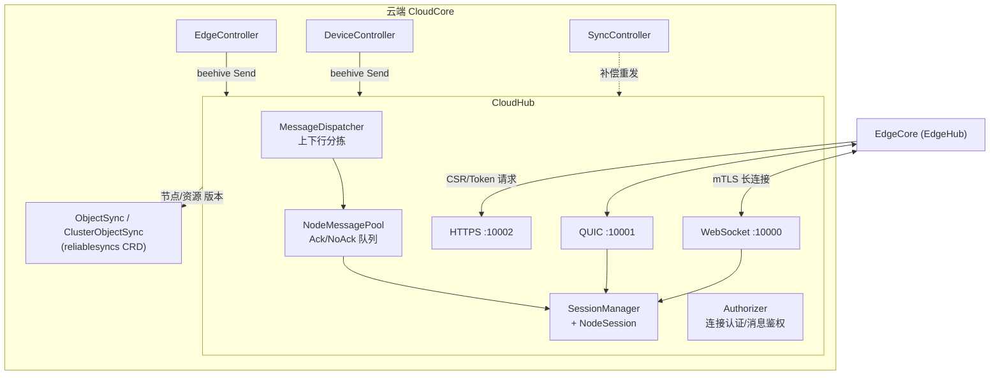
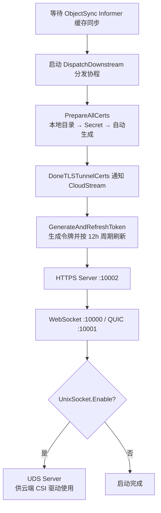
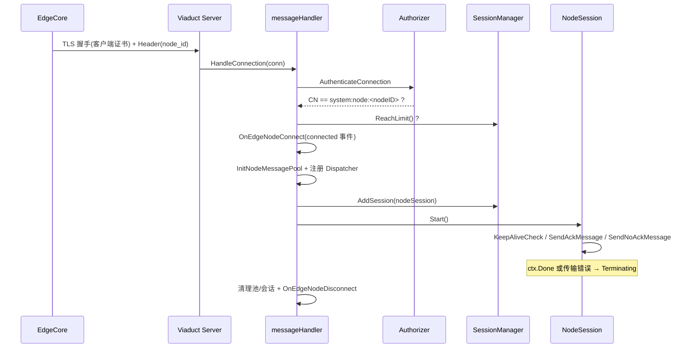

CloudHub 是 CloudCore 中面向边缘节点的**长连接网关**，也是所有下行消息的唯一出口。它维护与每个边缘节点（EdgeCore）之间的 WebSocket / QUIC 双向连接，一方面把云端控制器（EdgeController、DeviceController 等）产生的资源变更推送到边缘，另一方面把边缘上报的状态、心跳与响应回送至云端对应模块。本文基于源码剖析 CloudHub 的启动流程、连接生命周期、消息分发模型、可靠投递机制与配套的证书服务，帮助中级开发者建立完整的代码阅读地图。

## 定位与总体架构

官方配置定义对 CloudHub 的描述非常精炼：它是一个 WebSocket 或 QUIC 服务器，负责监听云端变化、缓存消息并发送给 EdgeHub（见 `CloudHub` 结构体的注释）。从 Beehive 模块化框架的视角看，CloudHub 注册为 `core.Module`，归属 `hub` 模块组，是云边消息在 Beehive 消息总线上的汇聚点——云端其他模块通过 `beehiveContext.Send` 把消息发往 CloudHub 模块，CloudHub 再按目标节点分拣下发。

Sources: [types.go](staging/src/github.com/kubeedge/api/apis/componentconfig/cloudcore/v1alpha1/types.go#L105-L108)
Sources: [cloudhub.go](cloud/pkg/cloudhub/cloudhub.go#L73-L83)
Sources: [context.go](cloud/pkg/common/messagelayer/context.go#L46-L53)

其内部由五个子包协作构成，职责划分清晰：

| 子包 | 核心类型 | 职责 |
| --- | --- | --- |
| `servers` | `Server`（viaduct） | WebSocket/QUIC 长连接监听与 TLS 配置 |
| `servers/httpserver` | restful 路由 | 证书签发、CA 分发、节点检查、节点任务上报 |
| `handler` | `messageHandler` | 连接准入、消息鉴权、会话装配 |
| `session` | `Manager`、`NodeSession` | 节点会话生命周期、心跳、按节点发送 |
| `dispatcher` | `MessageDispatcher` | 上下行消息分拣、ACK/NO-ACK 入队、ObjectSync 比对 |

Sources: [OWNERS](cloud/pkg/cloudhub/OWNERS#L1-L4)

Sources: [cloudhub.go](cloud/pkg/cloudhub/cloudhub.go#L41-L66)

## 模块启动流程：从注册到五路服务并行就绪

CloudHub 遵循 Beehive 的模块注册模型：`Register()` 先将配置写入全局 `hubconfig.Config`，再构造模块实例。`newCloudHub()` 是理解其依赖关系的入口——它依次创建 `SessionManager`（携带 `NodeLimit` 上限）、`MessageDispatcher`（注入 ObjectSync/ClusterObjectSync 的 Lister 与 CRD 客户端）、`Authorizer`（依据配置的鉴权模式）以及 `MessageHandler`，并把两个 reliablesyncs Informer 的同步完成条件挂到模块上。

Sources: [cloudhub.go](cloud/pkg/cloudhub/cloudhub.go#L41-L71)

`Start()` 的执行顺序体现了严谨的启动时序约束：**先等缓存同步、再启动分发循环、再备好证书与令牌、最后监听端口**。具体而言，模块首先阻塞等待 ObjectSync 缓存同步完成（失败直接退出进程），随后启动下行分发协程 `DispatchDownstream()`；接着 `PrepareAllCerts` 按"本地文件 → Secret → 现场生成"的顺序备齐 CA 与 CloudCore 证书，通过 `DoneTLSTunnelCerts` 通道通知 CloudStream 可以启动隧道；之后生成并周期刷新注册令牌，再以独立协程拉起 HTTPS 服务器；最后 `StartCloudHub()` 启动 WebSocket 与 QUIC 长连接服务，若启用 UnixSocket 则额外启动仅供云端 CSI 驱动使用的 UDS 服务。

Sources: [cloudhub.go](cloud/pkg/cloudhub/cloudhub.go#L90-L126)
Sources: [cloudhub.go](cloud/pkg/cloudhub/cloudhub.go#L127-L141)
Sources: [cloudhub.go](cloud/pkg/cloudhub/cloudhub.go#L142-L173)

一个值得注意的设计细节：`DoneTLSTunnelCerts` 是一个容量为 1 的通道，写入后立即关闭。这使得 CloudStream 侧的等待方无论先后启动都能立即收到信号（读取已关闭通道不会阻塞），是典型的"一次性事件广播"手法。

Sources: [cloudhub.go](cloud/pkg/cloudhub/cloudhub.go#L28-L30)

## 四类接入服务器：WebSocket、QUIC、HTTPS 与 Unix Socket

`StartCloudHub()` 根据配置并行启动 WebSocket 与 QUIC 两个长连接服务器，两者共用同一套 TLS 配置与消息处理器回调：`ConnNotify` 指向 `HandleConnection`（连接建立回调），`OnReadTransportErr` 指向读传输错误处理（连接断开回调）。传输层由 Viaduct 框架封装，CloudHub 只关心协议类型与监听地址。

Sources: [server.go](cloud/pkg/cloudhub/servers/server.go#L24-L35)

TLS 层采用**强制双向认证**：`ClientAuth` 设为 `RequireAndVerifyClientCert`，即边缘节点必须出示由 CloudHub CA 签发的客户端证书；最低版本 TLS 1.2，密码套件限定为三种 ECDSA 方案（与 CA 私钥生成算法匹配）。QUIC 服务器还透传 `MaxIncomingStreams`（默认 10000），控制单连接多路复用的流上限。

Sources: [server.go](cloud/pkg/cloudhub/servers/server.go#L37-L88)

| 服务器 | 协议 | 默认端口 | 默认启用 | 用途 |
| --- | --- | --- | --- | --- |
| WebSocket | WS over TLS | 10000 | 是 | 边缘节点长连接主通道 |
| QUIC | QUIC (UDP) | 10001 | 否 | 弱网/高丢包场景的备选通道 |
| HTTPS | HTTPS | 10002 | 是 | 证书签发、CA 分发、节点任务 |
| UDS | Unix Domain Socket | `kubeedge.sock` | 是 | 云端 CSI 驱动与 CloudHub 的本地通信 |

Sources: [default.go](staging/src/github.com/kubeedge/api/apis/componentconfig/cloudcore/v1alpha1/default.go#L46-L88)

UDS 服务器的定位容易误解：注释明确指出它**不用于云边通信**，仅服务于云端 CSI 驱动。它把收到的 JSON 消息经 `beehiveContext.SendSync` 同步投递到 CloudHub 模块，等待超时后返回响应，最终由下行链路转发至边缘节点处理卷操作。

Sources: [server.go](cloud/pkg/cloudhub/servers/udsserver/server.go#L25-L45)

## 连接建立：认证、限流与会话装配

当边缘节点发起连接时，viaduct 层回调 `HandleConnection`，完整流程如下：

1. **身份认证**：`AuthenticateConnection` 用 CloudHub CA 验证客户端证书链，并要求证书 CommonName 必须等于 `system:node:<nodeID>`（即 Kubernetes 的 NodesUser 前缀），同时拒绝中间证书。认证失败直接拒绝连接。
2. **容量限流**：`SessionManager.ReachLimit()` 检查当前节点数是否达到 `NodeLimit`（默认 1000），超出则拒绝服务。
3. **发布上线事件**：`OnEdgeNodeConnect` 构造 `connected` 事件消息，通知控制器侧节点状态。
4. **装配会话**：初始化该节点专属的 `NodeMessagePool` 并注册到 Dispatcher；创建 `NodeSession` 并加入 `SessionManager`；同时异步重试更新 Node 的 Annotation。
5. **启动会话主循环**：`nodeSession.Start()` 阻塞直至会话结束，结束时清理消息池、删除会话并发布 `disconnected` 事件。

Sources: [message_handler.go](cloud/pkg/cloudhub/handler/message_handler.go#L126-L190)
Sources: [authorizer.go](cloud/pkg/cloudhub/authorization/authorizer.go#L75-L137)

消息级别的鉴权由 `AdmitMessage` 承担：它把 Beehive 消息路由映射为 Kubernetes 的授权属性——用户固定为 `system:node:<nodeID>`、组为 `system:nodes`，KubeEdge 自定义资源类消息（keepalive、response、task 等）映射为 NonResourceAttributes 并打上 `kubeedgeResource` 标记直通放行，而 node/pod/configmap/secret 等内建资源则映射为标准 ResourceAttributes 交给 Node 鉴权器裁决。该特性默认关闭，开启后若处于 Debug 模式则只记录拒绝日志不实际拦截。

Sources: [resource_attributes.go](cloud/pkg/cloudhub/authorization/resource_attributes.go#L24-L98)
Sources: [kubeedge_resource_authorizer.go](cloud/pkg/cloudhub/authorization/kubeedge_resource_authorizer.go#L24-L46)
Sources: [types.go](staging/src/github.com/kubeedge/api/apis/componentconfig/cloudcore/v1alpha1/types.go#L210-L222)

## 会话管理：SessionManager 与 NodeSession 生命周期

`SessionManager` 以 `sync.Map` 维护 nodeID 到 `NodeSession` 的映射，并用原子计数器跟踪在线节点数（同时暴露为 `ConnectedNodes` 监控指标）。`AddSession` 中隐藏了一个关键的**重连去重逻辑**：若同一 nodeID 的旧会话仍存在（典型场景是节点断线后快速重连，旧会话的清理协程尚未执行完），管理器会先调用旧会话的 `Terminating()` 释放资源，再存入新会话。`DeleteSession` 则通过指针比对防止误删新会话——只有当缓存中的会话与待删除的是同一实例时才真正移除。

Sources: [session_manager.go](cloud/pkg/cloudhub/session/session_manager.go#L31-L119)

`NodeSession` 是单节点连接生命周期的抽象，`Start()` 拉起三个常驻协程：

| 协程 | 职责 | 超时/终止行为 |
| --- | --- | --- |
| `KeepAliveCheck` | 定时器等待心跳，每次收到 keepalive 重置定时器 | 超时未收到 → 标记 `TransportErr` 并 Terminating |
| `SendAckMessage` | 从 AckMessageQueue 取消息，带 ACK 确认地发送 | 队列关闭/传输错误/节点删除 → Terminating |
| `SendNoAckMessage` | 从 NoAckMessageQueue 取消息，直接发送 | 队列关闭/传输错误 → Terminating |

Sources: [node_session.go](cloud/pkg/cloudhub/session/node_session.go#L133-L247)

心跳机制完全由边缘驱动：边缘节点定期发送 keepalive 消息，`DispatchUpstream` 识别后调用 `SessionManager.KeepAliveMessage` 向会话的 `keepaliveChan` 投递信号（通道容量为 1，塞满时仅告警不阻塞，避免心跳风暴反压消息处理）。若在 `KeepaliveInterval`（默认 30 秒）内收不到任何心跳，则判定连接已死，主动终止会话并释放连接。

Sources: [message_dispatcher.go](cloud/pkg/cloudhub/dispatcher/message_dispatcher.go#L148-L158)
Sources: [node_session.go](cloud/pkg/cloudhub/session/node_session.go#L145-L180)

会话终止由 `stopOnce` 保证幂等：取消上下文、关闭两个消息队列、关闭底层连接。终止原因分为四类——`TransportErr`（传输层错误或心跳超时）、`NodeStopErr`（下发了节点删除消息，`IsNodeStopped` 检测到 node 资源的 delete 操作）、`QueueShutdownErr`（队列被主动关闭）与正常退出 `NoErr`。

Sources: [node_session.go](cloud/pkg/cloudhub/session/node_session.go#L237-L247)
Sources: [node_session.go](cloud/pkg/cloudhub/session/node_session.go#L288-L295)
Sources: [types.go](cloud/pkg/cloudhub/common/model/types.go#L90-L100)

## 消息分发器：上行与下行双通道

`MessageDispatcher` 接口定义了 CloudHub 的消息中枢角色。**下行方向**，`DispatchDownstream()` 持续从 Beehive 总线的 CloudHub 模块队列中取消息（这些消息由 EdgeController、DeviceController 等经 `ContextMessageLayer.Send` 投递而来），从 `Router.Resource` 中解析出目标节点 ID（格式为 `node/<nodeID>/...`），经 `IsToEdge` 过滤后按 `noAckRequired` 的判定结果进入 ACK 或 NO-ACK 队列。

Sources: [message_dispatcher.go](cloud/pkg/cloudhub/dispatcher/message_dispatcher.go#L111-L146)
Sources: [helper.go](cloud/pkg/cloudhub/common/helper.go#L68-L80)
Sources: [types.go](cloud/pkg/cloudhub/common/model/types.go#L110-L133)

**上行方向**的 `DispatchUpstream()` 是一个按操作类型分流的状态机，路由决策全部依据消息的 Operation 与 Group 字段：

| 上行消息类型 | 处理方式 | 去向 |
| --- | --- | --- |
| `keepalive` | 刷新会话心跳 | SessionManager |
| 卷资源（CSI） | `SendResp` 同步应答 | 请求方（UDS/CSI） |
| `response` | 触发 ACK，关闭 ackChannel | NodeSession |
| `response_error` | 记录错误日志 | 仅日志 |
| `upload` + UserGroup | 改写资源路径 | Router 模块 |
| 任务类操作 | 转发至任务管理组 | TaskManager |
| K8sCA 请求 | 回送集群 CA 内容 | 原路返回边缘 |
| 其余（状态上报等） | `PubToController` | EdgeController / DeviceController 组 |

Sources: [message_dispatcher.go](cloud/pkg/cloudhub/dispatcher/message_dispatcher.go#L148-L210)

`Publish()` 完成最后一跳的路由：源为 MetaServer 的消息发往 DynamicController，资源为 twin 的发往 DeviceController 模块组，其余全部发往 EdgeController 模块组。同时 `PubToController` 会把资源路径规范化为 `node/<nodeID>/...` 前缀，保证云端控制器收到消息时能还原来源节点。

Sources: [message_dispatcher.go](cloud/pkg/cloudhub/dispatcher/message_dispatcher.go#L538-L550)

## 消息池与两种投递模式：ACK 与 NO-ACK

CloudHub 对下行消息实行**两种可靠性等级**，源码顶部的注释对此有权威阐述：ACK 模式要求边缘节点在 MetaManager 成功落库后回送确认，超时未确认则重发；NO-ACK 模式发出即认为成功，容忍丢失——通常用于"请求-响应"场景，边缘收不到响应会重新发起请求。每个节点的消息池 `NodeMessagePool` 为两种模式各维护一套 `cache.Store`（存消息本体）与 `workqueue.RateLimitingQueue`（存消息键、控制发送顺序与重试限速）。

Sources: [message_dispatcher.go](cloud/pkg/cloudhub/dispatcher/message_dispatcher.go#L29-L49)
Sources: [message_pool.go](cloud/pkg/cloudhub/common/message_pool.go#L28-L54)

是否需要 ACK 由 `noAckRequired()` 基于白名单判定，以下类型直接走 NO-ACK：PodList、membership、twin/cloud_updated、ServiceAccountToken、K8sCA、所有 CSI 卷操作、MetaServer 应用响应、用户消息、任务管理器消息，以及 EdgeController 下发的 Node 状态、Lease、Patch、CSR、Pod 状态等高频短生命周期消息。这类消息的共同特征是**时效性强、可重取或丢失代价低**。

Sources: [message_dispatcher.go](cloud/pkg/cloudhub/dispatcher/message_dispatcher.go#L438-L504)

| 维度 | ACK 模式 | NO-ACK 模式 |
| --- | --- | --- |
| 典型消息 | ConfigMap/Secret 等资源下发 | 节点状态、心跳响应、Token |
| 确认机制 | 边缘回 `response`，ParentID 关联 | 无确认 |
| 重试策略 | 5 秒间隔最多 5 次，超时后限速重入队 | 不重试 |
| 断点记录 | ACK 后更新 ObjectSync 资源版本 | 不记录 |
| 乱序保护 | 按资源版本比对，丢弃旧版本 | 按到达顺序直发 |

Sources: [node_session.go](cloud/pkg/cloudhub/session/node_session.go#L417-L449)

ACK 模式的发送实现 `sendMessageWithRetry` 颇具并发设计参考价值：发送前在 `ackMessageCache` 注册以消息 ID 为键的确认通道，随后异步写出消息并阻塞等待。边缘的确认消息经上行链路触发 `ReceiveMessageAck`，用 `LoadAndDelete` **原子地**取走并关闭通道——注释特意解释了为何必须用 `LoadAndDelete` 而非分离的 Load+Delete：消息重发会导致同一确认被并发投递多次，分离操作会让两个协程关闭同一通道而 panic。超时重发最多 4 次后返回 `ErrWaitTimeout`，消息以限速方式重新入队。

Sources: [node_session.go](cloud/pkg/cloudhub/session/node_session.go#L417-L449)
Sources: [node_session.go](cloud/pkg/cloudhub/session/node_session.go#L122-L131)

## 断点续传：ObjectSync 资源版本与可靠同步

ACK 队列入队前有一道**版本仲裁**，这是 KubeEdge 可靠消息体系的-cloudHub 侧核心。`enqueueAckMessage` 要求 ACK 消息必须携带资源版本（删除消息除外），然后逐级比对：

1. 与节点消息池 Store 中暂存的同 UID 消息比对——若池内已是删除消息或更高版本，直接丢弃；
2. 与 CRD `ObjectSync`（命名空间资源）/ `ClusterObjectSync`（集群级资源）的 `Status.ObjectResourceVersion` 比对——仅当消息版本更新才入队；
3. 若对应 ObjectSync 不存在（首次下发），就地创建并初始化版本为 "0"。

Sources: [message_dispatcher.go](cloud/pkg/cloudhub/dispatcher/message_dispatcher.go#L229-L293)

当边缘确认收到消息后，`saveSuccessPoint` 把该消息的资源版本写回 ObjectSync/ClusterObjectSync 的 Status 字段，相当于为每个"节点 × 资源"对保存了一个**同步断点**；若操作是删除，则直接删除对应的 ObjectSync 并清理暂存消息。这样即使连接反复断开，云端总能知道边缘已同步到哪个版本，重连后只需补发断点之后的消息。该机制的另一端（SyncController 的补偿重发）在 [SyncController：可靠同步与补偿机制](11-synccontroller-ke-kao-tong-bu-yu-bu-chang-ji-zhi) 中详述。

Sources: [node_session.go](cloud/pkg/cloudhub/session/node_session.go#L451-L532)
Sources: [node_session.go](cloud/pkg/cloudhub/session/node_session.go#L551-L573)

## HTTPS 服务：证书签发、令牌与节点任务入口

除长连接外，CloudHub 还通过 HTTPS 服务器承担"注册面"职能，共暴露五条路由：

| 路由 | 处理器 | 用途 |
| --- | --- | --- |
| `GET /ca.crt` | `GetCA` | 向边缘下发集群 CA 证书 |
| `GET /edge.crt` | `EdgeCoreClientCert` | 校验令牌或旧证书后为 EdgeCore 签署 CSR |
| `GET /node/{nodename}` | `CheckNode` | 查询节点是否已存在于 Kubernetes |
| `POST /nodeupgrade` | `UpgradeEdge` | 接收边缘节点升级请求 |
| `POST /task/{taskType}/name/{taskID}/node/{nodeID}/status` | `ReportStatus` | 接收节点任务状态上报 |

Sources: [server.go](cloud/pkg/cloudhub/servers/httpserver/server.go#L50-L69)
Sources: [default.go](common/constants/default.go#L26-L30)

证书签发是边缘节点接入的第一步。`EdgeCoreClientCert` 支持两种身份凭据：若请求携带证书（证书轮换场景），则用 CA 验证旧证书且校验 Subject 匹配（兼容旧版 `KubeEdge/kubeedge.io` 与新版 `system:nodes/system:node:<name>` 两种主体）；若是首次注册，则校验 `Authorization` 头中的 Bearer Token（用 CA 私钥验签）。验证通过后读取请求体中的 CSR，按 `EdgeCertSigningDuration`（默认 365 天）签署客户端证书返回。

Sources: [certs.go](cloud/pkg/cloudhub/servers/httpserver/certificate/certs.go#L36-L85)
Sources: [certs.go](cloud/pkg/cloudhub/servers/httpserver/certificate/certs.go#L100-L163)

`PrepareAllCerts` 实现了三级证书来源回退：优先读本地配置的 PEM 文件，其次从 `casecret`/`cloudcoresecret` Secret 恢复（支持 CloudCore Pod 重建后证书不丢），都缺失时现场自签 CA 并为 CloudCore 签发含 AdvertiseAddress/DNSNames 的服务端证书，最后回写 Secret。令牌方面，`GenerateAndRefreshToken` 用 CA 证书哈希加签名生成注册令牌存入 `tokensecret`，并按 `TokenRefreshDuration`（默认 12 小时）周期轮换，keadm 获取的正是这个令牌。

Sources: [pre_server.go](cloud/pkg/cloudhub/servers/httpserver/pre_server.go#L47-L92)
Sources: [pre_server.go](cloud/pkg/cloudhub/servers/httpserver/pre_server.go#L94-L189)

## 配置项速查

CloudHub 的全部行为开关集中在 `CloudHub` 配置结构中，加载入口 `InitConfigure` 强制要求 `AdvertiseAddress` 非空，并负责把 TLS 文件加载为内存字节（CA 与 CAKey、Cert 与 Key 必须成对出现）：

| 配置项 | 默认值 | 说明 |
| --- | --- | --- |
| `enable` | true | 模块开关 |
| `keepaliveInterval` | 30（秒） | 心跳超时间隔 |
| `nodeLimit` | 1000 | 单 CloudCore 实例最大接入节点数 |
| `websocket.address/port` | 0.0.0.0 / 10000 | WebSocket 监听 |
| `quic.enable/port/maxIncomingStreams` | false / 10001 / 10000 | QUIC 监听 |
| `https.address/port` | 0.0.0.0 / 10002 | HTTPS 注册面 |
| `unixsocket.address` | `unix:///var/lib/kubeedge/kubeedge.sock` | CSI 本地通道 |
| `advertiseAddress` | 自动探测 | 对外宣告地址，签发证书 SAN 使用 |
| `edgeCertSigningDuration` | 365（天） | 边缘证书有效期 |
| `tokenRefreshDuration` | 12（小时） | 注册令牌轮换周期 |
| `authorization.enable/modes` | false / node | 消息与连接鉴权 |

Sources: [types.go](staging/src/github.com/kubeedge/api/apis/componentconfig/cloudcore/v1alpha1/types.go#L105-L156)
Sources: [default.go](staging/src/github.com/kubeedge/api/apis/componentconfig/cloudcore/v1alpha1/default.go#L46-L88)
Sources: [config.go](cloud/pkg/cloudhub/config/config.go#L21-L87)

## 小结与延伸阅读

CloudHub 的设计呈现三个鲜明特征：其一是**传输与业务解耦**——viaduct 屏蔽了 WebSocket/QUIC 差异，CloudHub 只面向 `conn.Connection` 与 Beehive 消息抽象编程；其二是**每节点独立消息管道**——NodeMessagePool + NodeSession 把消息投递的顺序、重试、确认隔离到节点粒度，单节点故障不影响其他节点；其三是**投递与状态分离**——消息池只负责"暂存与发送"，同步断点统一记录在 ObjectSync CRD 中，由 SyncController 闭环补偿，这让 CloudHub 保持无状态重启友好的同时具备了断点续传能力。

若要继续深入这条云边链路，建议按以下顺序阅读：先看 [EdgeController：边缘资源下发与状态上报](9-edgecontroller-bian-yuan-zi-yuan-xia-fa-yu-zhuang-tai-shang-bao) 理解消息的产生端；再读 [SyncController：可靠同步与补偿机制](11-synccontroller-ke-kao-tong-bu-yu-bu-chang-ji-zhi) 补全 ObjectSync 的另一端；传输细节可查阅 [Viaduct：云边消息传输通道（WebSocket/QUIC）](23-viaduct-yun-bian-xiao-xi-tong-dao-websocket-quic) 与 [Beehive：模块化消息通信框架](22-beehive-mo-kuai-hua-xiao-xi-tong-xin-kuang-jia)；边缘侧的对端实现见 [EdgeHub：云边消息收发枢纽与证书认证](17-edgehub-yun-bian-xiao-xi-shou-fa-shu-niu-yu-zheng-shu-ren-zheng)；安全体系的整体梳理则见 [云边安全与认证体系（证书、令牌与边缘鉴权）](26-yun-bian-an-quan-yu-ren-zheng-ti-xi-zheng-shu-ling-pai-yu-bian-yuan-jian-quan)。