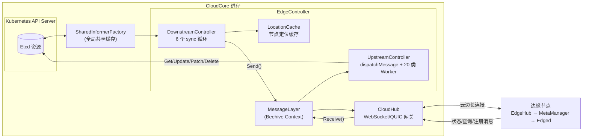

EdgeController 是 CloudCore 中最核心的控制器模块，承担云边之间的**双向数据总线**角色：下行方向，它监听 Kubernetes API Server 的资源变化（Pod、ConfigMap、Secret、Node 等），将其转换为 Beehive 消息推送给边缘节点；上行方向，它接收边缘节点上报的节点状态、Pod 状态及各类资源请求，回写到 Kubernetes API Server。本文基于源码剖析其架构设计、消息寻址模型、并发机制与关键代码路径。

## 模块定位与生命周期

EdgeController 以 Beehive 模块的形式注册进 CloudCore 进程，其结构体由 `UpstreamController` 与 `DownstreamController` 两个子控制器组成，分别负责上行与下行流量。这种"一个模块、两个子控制器"的结构是理解该组件的第一把钥匙——下行与上行是完全独立的两条流水线，仅在消息层交汇。[edgecontroller.go](cloud/pkg/edgecontroller/edgecontroller.go#L13-L18)

模块通过 `Register` 函数在 CloudCore 启动时注册，`Name()` 返回 `"edgecontroller"`、`Group()` 返回同名分组，`Enable()` 读取配置中的开关决定是否启用。构造阶段从全局共享的 `InformersManager` 获取 Kubernetes 与 KubeEdge CRD 两套 Informer 工厂，分别注入上游与下游控制器，这保证了所有云端控制器共享同一份 Informer 缓存，避免重复 LIST/WATCH 对 API Server 的压力。[edgecontroller.go](cloud/pkg/edgecontroller/edgecontroller.go#L22-L38)

`Start()` 依次启动上游与下游控制器，任一失败即进程退出。值得注意的是，两个子控制器的启动顺序是先 Upstream 后 Downstream，确保节点注册与状态回传通道先于资源下发就绪。[edgecontroller.go](cloud/pkg/edgecontroller/edgecontroller.go#L64-L72)

模块名常量定义在共享的 modules 包中，CloudHub、EdgeController、SyncController 等模块通过这些字符串常量在 Beehive 消息总线上互相寻址，这是后文消息路由的基础。[modules.go](cloud/pkg/common/modules/modules.go#L4-L8)

## 双向同步架构总览

以下概念图概括了 EdgeController 的完整数据流。前置知识：图中 Beehive 是 KubeEdge 自研的模块化消息框架，模块间通信通过带 `Router`（source/group/resource/operation）的 Message 完成；CloudHub 是维护边缘长连接的网关模块。

整个链路中，EdgeController **不直接持有与边缘的连接**——所有消息经由 MessageLayer 投递到 CloudHub 模块，由后者通过 WebSocket/QUIC 长连接下发；同样，边缘上行消息也由 CloudHub 转入 Beehive 总线，EdgeController 从自己的接收通道消费。这种解耦使控制器逻辑完全不必关心连接管理。关于 CloudHub 的连接模型，参见 [CloudHub：云边长连接网关与消息分发](8-cloudhub-yun-bian-chang-lian-jie-wang-guan-yu-xiao-xi-fen-fa)。

Sources: [edgecontroller.go](cloud/pkg/edgecontroller/edgecontroller.go#L13-L38), [context.go](cloud/pkg/common/messagelayer/context.go#L48-L67)

## 下行链路：DownstreamController 资源下发

### 资源监听与事件合并

DownstreamController 持有六个资源管理器，每个管理器内部封装一个 SharedInformer 与事件通道，分别监听 Pod、ConfigMap、Secret、Node、Rule、RuleEndpoint 的变化。[downstream.go](cloud/pkg/edgecontroller/controller/downstream.go#L31-L51)

Pod 的事件处理存在一个精巧的**合并过滤层**：Informer 产生的真实事件先进入 `realEvents`，由 `merge()` 协程转换后写入 `mergedEvents`。关键规则是——带 `DeletionTimestamp` 的 Pod Added 事件会被改写为 Modified 事件（因为 Pod 进入优雅删除期时资源仍在，需要通知边缘更新而非插入）。同时 `isPodUpdated` 只比较 ObjectMeta 与 Spec（显式忽略 ResourceVersion/Generation 后做 DeepEqual），**仅 Status 变化的 Pod 不会触发下行消息**，避免状态上报引发的下发回环。[pod.go](cloud/pkg/edgecontroller/manager/pod.go#L23-L51)

### LocationCache：ConfigMap/Secret 的节点定位

Pod 可以直接按 `spec.nodeName` 定向投递，但 ConfigMap 和 Secret 没有"归属节点"概念——一个 ConfigMap 可能被分布在 100 个节点上的 Pod 同时挂载。为此，DownstreamController 维护 LocationCache：三张 `sync.Map` 分别记录边缘节点集合、"namespace/configMapName → 节点列表"和"namespace/secretName → 节点列表"的映射。[location.go](cloud/pkg/edgecontroller/manager/location.go#L10-L18)

缓存构建的核心是 `PodConfigMapsAndSecrets`：它从 Pod Spec 的四个维度提取依赖——Volume 挂载（含 Projected Volume）、容器 EnvFrom、环境变量 ValueFrom 引用、以及 ImagePullSecrets。每当 Pod 添加或更新时，`AddOrUpdatePod` 将其引用的每个 ConfigMap/Secret 与所在节点建立关联；之后 ConfigMap 变化时，`ConfigMapNodes` 即可 O(1) 取出所有需要同步的节点，逐节点发送消息。[location.go](cloud/pkg/edgecontroller/manager/location.go#L20-L67), [location.go](cloud/pkg/edgecontroller/manager/location.go#L78-L120)

### 六个同步循环

控制器启动时为每类资源拉起一个独立的 sync 协程，形成"每资源一循环"的事件驱动模型。各循环的目标定位策略存在本质差异，汇总如下表：[downstream.go](cloud/pkg/edgecontroller/controller/downstream.go#L341-L363)

| 同步循环 | 监听资源 | 投递目标策略 | 映射的操作 |
| --- | --- | --- | --- |
| `syncPod` | Pod | `spec.nodeName` 单节点定向 | Added→insert / Modified→update / Deleted→delete |
| `syncConfigMap` | ConfigMap | LocationCache 反查挂载节点集 | Added/Modified→update, Deleted→delete |
| `syncSecret` | Secret | LocationCache 反查引用节点集 | Added **合并为** update, Deleted→delete |
| `syncEdgeNodes` | Node | 广播至该节点自身 | Added/Modified 合并为 update |
| `syncRule` | Rule CRD | 经 Router 模块处理 | 仅 insert/delete，不支持 Modified |
| `syncRuleEndpoint` | RuleEndpoint CRD | 经 Router 模块处理 | 仅 insert/delete，不支持 Modified |

以 `syncPod` 为例，事件处理的第一道闸门是 `dc.lc.IsEdgeNode(pod.Spec.NodeName)`——只有调度到边缘节点上的 Pod 才会被下发，云端 Pod 被直接忽略。随后构造资源路径并按事件类型设置 insert/update/delete 操作，最后经 MessageLayer 发送。[downstream.go](cloud/pkg/edgecontroller/controller/downstream.go#L53-L96)

控制器冷启动时还有一个 `initLocating` 预热步骤：通过 `node-role.kubernetes.io/edge` 标签筛选所有边缘节点，再全量 LIST Pod 并为边缘节点上的 Pod 重建 LocationCache 关系，确保 Informer 历史事件不丢失时定位数据依然完整。[downstream.go](cloud/pkg/edgecontroller/controller/downstream.go#L365-L388)

## 消息寻址与传输通道

### 资源路径模型

云边消息的寻址完全依赖 Message.Router.Resource 字符串。`BuildResource` 按固定格式拼装：`node/{nodeID}/{namespace}/{resourceType}[/{resourceID}]`，四个索引位置（1~4）分别对应节点 ID、命名空间、资源类型、资源名。上行解析函数 `GetNodeID`/`GetNamespace`/`GetResourceType`/`GetResourceName` 与之严格对称，按分隔符 `/` 切分取索引值。[util.go](cloud/pkg/common/messagelayer/util.go#L31-L60), [util.go](cloud/pkg/common/messagelayer/util.go#L71-L109)

这套扁平化路径是**边缘端 MetaManager 进行本地元数据存取的键空间约定**——边缘收到 `group: resource` 的消息后，按同样规则解析出存储位置写入本地 SQLite（详见 [MetaManager 与 MetaServer：离线元数据存储与本地 API Server](18-metamanager-yu-metaserver-chi-xian-yuan-shu-ju-cun-chu-yu-ben-di-api-server)）。

### MessageLayer 与模块间交接

MessageLayer 是一个仅含 `Send`/`Receive`/`Response` 三个方法的薄接口，其唯一实现 `ContextMessageLayer` 将调用直接桥接到 Beehive 上下文。EdgeController 使用的实例由 `EdgeControllerMessageLayer()` 工厂构造，方向映射如下：[context.go](cloud/pkg/common/messagelayer/context.go#L28-L45)

| 接口方法 | 投递目标模块 | 语义 |
| --- | --- | --- |
| `Send` | `cloudhub`（Rule 类消息改投 `router`） | 下行资源下发 |
| `Receive` | `edgecontroller`（自身收件箱） | 消费边缘上行消息 |
| `Response` | `cloudhub` | 对边缘查询/上报的应答 |

`Send` 中存在一个特殊分支：当消息资源路径为两段式且前缀是 `rule` 或 `ruleendpoint` 时，消息改发给 Router 模块而非 CloudHub，这体现了消息层对路由类 CRD 的分流设计。[context.go](cloud/pkg/common/messagelayer/context.go#L48-L81)

## 上行链路：UpstreamController 状态回传

### dispatchMessage：单入口多通道路由

UpstreamController 的入口是 `dispatchMessage` 协程：它阻塞式地从 MessageLayer 接收消息，解析资源类型后写入对应的类型化 channel。该 channel 共 20 余个，构成"单入口、多通道、按资源分流"的扇出架构。节点类资源还会**按操作二次分流**——例如 `ResourceTypeNode` 依据 insert/query/update 操作分别投递到注册、查询、更新三个通道。[upstream.go](cloud/pkg/edgecontroller/controller/upstream.go#L206-L289)

主要资源类型与处理函数的映射关系如下：

| 资源类型 | 处理函数 | 对 K8s API Server 的动作 |
| --- | --- | --- |
| `nodestatus` | `updateNodeStatus` / `registerNode` / `patchNode` | Node 创建、UpdateStatus、StrategicMergePatch |
| `podstatus` | `updatePodStatus` | Pod UpdateStatus（含孤儿清理） |
| `event` | `processEvent` | Event Create/Update/Patch |
| `configmap` / `secret` | `queryConfigMap` / `querySecret` | LISTER 读缓存并应答（边缘查询） |
| `node` (query) | `queryNode` | 读缓存应答 |
| `lease` | `createOrUpdateLease` / `queryLease` | Lease Create/Update/Get |
| `serviceaccounttoken` | `processServiceAccountToken` | TokenRequest 创建 |
| `csr` | `processCSR` | 证书签名请求批准 |

Sources: [upstream.go](cloud/pkg/edgecontroller/controller/upstream.go#L137-L204)

### 节点注册与状态上报的三代演进

节点上行处理经历了三代机制，当前代码中三代并存，这是阅读源码时最需要注意的时间线线索：

**第一代 `updateNodeStatus`**（已标记 Deprecated）处理两类操作。Insert 操作即节点注册：先 Get 检查节点是否已存在，不存在则调用 `createNode` 创建——其中有一个对抗 `NodeRestriction` 准入插件的细节：Kubernetes 保留标签（`kubernetes.io/*`）不允许 kubelet 类身份写入，因此先剥离、创建后再用 Patch 补回，同时将 CloudCore 本地 IP 写入 `kubeedge.io/cloudcore-ipport` 类注解实现节点与云端的映射。[upstream.go](cloud/pkg/edgecontroller/controller/upstream.go#L602-L694), [upstream.go](cloud/pkg/edgecontroller/controller/upstream.go#L529-L582)

Update 操作即心跳状态回写。边缘上报的 `NodeStatusRequest` 经反序列化后直接覆盖节点 Status；关键防御逻辑有三处——其一，若上报心跳的 `LastHeartbeatTime` 距今超过 `NodeUpdateFrequency`（默认 10 秒），则强制刷新为当前时间，防止边缘时钟漂移导致 kube-controller-manager 误判 NotReady；其二，NVIDIA GPU 的扩展资源被编解码为 `huawei.com/gpu-status` 注解；其三，`VolumesAttached` 与 KubeletEndpoint.Port 以云端现存值为准回填，避免覆盖 kube-controller-manager 维护的字段。写回成功后构造 Response 消息应答边缘。[upstream.go](cloud/pkg/edgecontroller/controller/upstream.go#L688-L753)

**第二代 `patchNode`** 是官方推荐的替代路径：不再做 Get-Modify-Update 全量读改写，而是将边缘发来的 patch 字节流直接以 `StrategicMergePatchType` 打到节点 `status` 子资源上，冲突概率与流量开销都显著降低，处理完同样以 `ObjectResp` 结构应答。[upstream.go](cloud/pkg/edgecontroller/controller/upstream.go#L1014-L1057)

**第三代 `registerNode` + `createOrUpdateLease`** 对应边缘 EdgeCore 的新版注册与心跳模型：节点注册结果封装为 `ObjectResp{Object, Err}` 应答；心跳改为维护 Kubernetes 原生的 Lease 资源（`InsertOperation` 创建、`UpdateOperation` 更新），与标准 kubelet 的 NodeLease 机制对齐。[upstream.go](cloud/pkg/edgecontroller/controller/upstream.go#L956-L1012), [upstream.go](cloud/pkg/edgecontroller/controller/upstream.go#L1326-L1399)

### Pod 状态上报与孤儿 Pod 清理

`updatePodStatus` 是从 kubelet status_manager 移植改造而来的函数，包含多项状态规范化：为 Ready/Initialized 条件维护 `LastTransitionTime`（状态未变则保留原时间戳）、锁定 `StartTime` 不随上报变化。写回后还有一个 Kubernetes 原生 kubelet 不具备的**边缘特有分支**：若 Pod 带有 DeletionTimestamp 且已进入 Succeeded/Failed 终态、且所有容器均已停止，云端会主动向边缘下发 Pod 删除消息——因为在离线自治场景下边缘可能无法感知云端已确认的删除意图，需要云端反向兜底清理。对于 K8s 中已不存在的"孤儿 Pod"上报，同样下发删除消息要求边缘清理本地副本。[upstream.go](cloud/pkg/edgecontroller/controller/upstream.go#L414-L527)

## 并发模型与规模调优

UpstreamController 的并发度完全由配置驱动：`Start()` 按 `config.Load` 中每类 Worker 的数量批量拉起协程，如 `UpdateNodeStatusWorkers`、`QueryConfigMapWorkers`、`CreateLeaseWorkers` 等，配套的 channel 容量则由 `config.Buffer` 决定。这套 Buffer/Load 二元组是 KubeEdge 大规模节点（官方基准 10 万级）下削峰的关键旋钮。[upstream.go](cloud/pkg/edgecontroller/controller/upstream.go#L137-L204)

默认值按 `NodeLimit`（CloudHub 最大节点数，默认 500）线性伸缩，核心参数如下表：[default.go](staging/src/github.com/kubeedge/api/apis/componentconfig/cloudcore/v1alpha1/default.go#L95-L100), [default.go](staging/src/github.com/kubeedge/api/apis/componentconfig/cloudcore/v1alpha1/default.go#L200-L211)

| 配置项 | 默认值 | 说明 |
| --- | --- | --- |
| `NodeUpdateFrequency` | 10 秒 | 心跳时间戳刷新阈值 |
| `Buffer.PatchNode` | 1024 + nodeLimit/2 | patch 状态通道容量 |
| `Buffer.QueryNode` | 1024 + nodeLimit | 节点查询通道容量 |
| `Buffer.CreateLease` | 1024 + nodeLimit | Lease 心跳通道容量 |
| `Load.QueryNodeWorkers` | ≥ nodeLimit | 节点查询 Worker 数 |
| `Load.PatchNodeWorkers` | ≥ 100 + nodeLimit/50 | patch Worker 数 |
| `Load.CreateLeaseWorkers` | ≥ nodeLimit | Lease Worker 数 |

除显式默认外，CloudCore 还在配置加载阶段执行 `AdjustCloudCoreConfig` 强制下限校验：无论用户配置多少，上述 Worker 与 Buffer 都会被抬升到与 `NodeLimit` 挂钩的底线值，同时 KubeAPIConfig 的 QPS/Burst（`5×nodeLimit` / `10×nodeLimit`）同步调整，防止节点规模扩容后心跳洪峰拖垮云边同步。KubeAPIConfig 的基础默认（QPS 100 / Burst 200 量级的通用常量）见 [default.go](common/constants/default.go#L42-L47)。

Sources: [default.go](staging/src/github.com/kubeedge/api/apis/componentconfig/cloudcore/v1alpha1/default.go#L214-L259)

## 与相邻云端控制器的职责边界

EdgeController 与其他云端控制器容易混淆，明确边界有助于定位代码：

| 控制器 | 关注对象 | 与 EdgeController 的关系 |
| --- | --- | --- |
| EdgeController | K8s 原生资源 ↔ 边缘 | 本文对象 |
| DeviceController | Device/DeviceModel CRD ↔ 设备孪生 | 复用同样的 MessageLayer 模式但独立监听，见 [DeviceController：设备元数据的云边同步](10-devicecontroller-she-bei-yuan-shu-de-yun-bian-tong-bu) |
| SyncController | 可靠同步队列补偿 | 只补偿 EdgeController 下发后 ACK 超时/失败的消息，见 [SyncController：可靠同步与补偿机制](11-synccontroller-ke-kao-tong-bu-yu-bu-chang-ji-zhi) |
| DynamicController | 边缘元数据热更新/查询 | 处理 MetaServer 转发的动态请求，不经 EdgeController |

值得强调的是，LocationCache 中只缓存 Pod 与 ConfigMap/Secret 的关系，Service、Endpoints、Volume 等资源虽也属于 K8s 原生范畴，但并不在 EdgeController 的下发清单中——Service/Endpoints 下发由 MetaServer 按需拉取模式承接，这体现了 KubeEdge 从"全量推送"向"按需拉取"的架构演进方向。

Sources: [location.go](cloud/pkg/edgecontroller/manager/location.go#L11-L18)

## 小结与延伸阅读

EdgeController 的设计精髓可以浓缩为三句话：**下行靠 Informer 事件驱动加缓存反查定位，上行靠类型化 channel 扇出到 Worker 池，云边之间靠扁平资源路径与 MessageLayer 解耦**。理解了 `BuildResource` 的路径约定与 Buffer/Load 的伸缩模型，就掌握了阅读云边协同代码的主线。

建议的后续阅读路径：先阅读 [SyncController：可靠同步与补偿机制](11-synccontroller-ke-kao-tong-bu-yu-bu-chang-ji-zhi) 理解消息丢失后的补偿闭环，再深入边缘侧 [EdgeHub：云边消息收发枢纽与证书认证](17-edgehub-yun-bian-xiao-xi-shou-fa-shu-niu-yu-zheng-shu-ren-zheng) 与 [Edged：轻量级边缘节点代理与容器管理](16-edged-qing-liang-ji-bian-yuan-jie-dian-dai-li-yu-rong-qi-guan-li) 对照下行消息的消费端处理，最后通过 [可靠消息传递与边缘自治机制](27-ke-kao-xi-xi-chuan-di-yu-bian-yuan-zi-zhi-ji-zhi) 俯瞰整个可靠性设计全景。